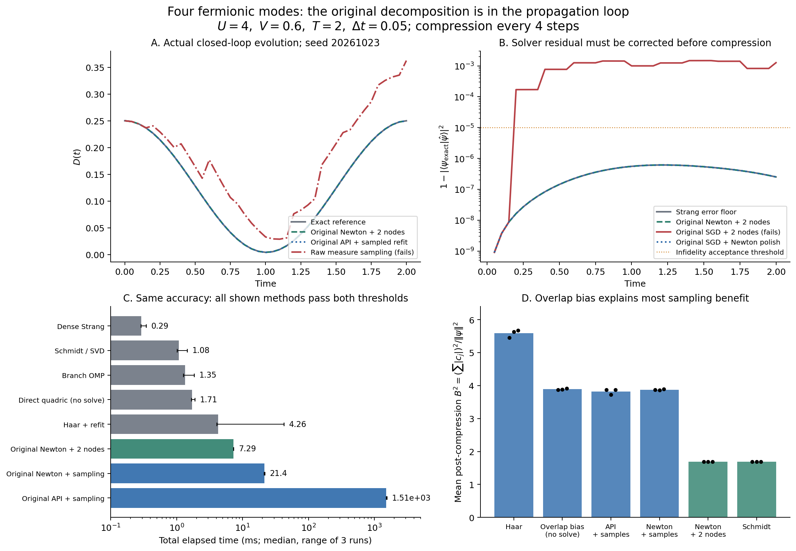

# 四模 Anderson：原 Gaussian decomposition 的含时演化闭环

本目录是独立的小规模实验，原仓库实现只读导入。**已经真正调用原算法，完成连续测度的离散化，并把离散分解反馈到下一段演化。四模测试没有显示对最强基线的总耗时优势。**

先读 [实验报告](REPORT.md)，数学推导见 [METHOD.md](METHOD.md)。正式结果在 `results/comparison_final/`；`pilot/` 和 `comparison/` 是开发阶段输出，保留供追溯，不用于替换正式计时。主实验为 18 种配置 × 3 个种子；另有 20 个小规模控制实验。全部只有 4 个 fermionic modes。

## 运行

数值部分仅依赖 Python 3.10+ 和 NumPy。此次使用 Python 3.12.14 / NumPy 2.3.5，所有数值库线程数设为 1，没有并行任务。原运行机器的系统 Python 3.9 无法导入原仓库的联合类型注解，数值实验使用了 Python 3.12。以下是跨机器复现命令（固定本次数值 NumPy 版本需要 Python 3.11+）：

```bash
# 从仓库根目录开始；可以复用已有 Python 3.10+ 环境。
cd gaussian_synthesis
python3.12 -m venv .venv
.venv/bin/python -m pip install -e . numpy==2.3.5
cd experiments/anderson_four_mode_dynamics
PY='../../.venv/bin/python'
"$PY" -W error::RuntimeWarning -m unittest -v test_closed_loop.py
"$PY" -W error::RuntimeWarning benchmark.py --output results/reproduction_main
"$PY" -W error::RuntimeWarning controls.py --output results/reproduction_controls
"$PY" verify_results.py
```

输出目录必须尚不存在，以免覆盖历史结果。主实验和控制实验各设 180 秒上限；原始未压缩分支实验最多 12 步 / 4096 分支。本次主实验进程的峰值 RSS 为 48.66 MiB。复现目录的数值应与正式结果一致，耗时会受机器状态影响；`verify_results.py` 默认审计已保存的正式结果，输出到 `results/publication_verification.json`，不会覆盖原始 `verification.json`。

画图只读取保存结果，不导入原数值包；需要 Matplotlib。在具有 Matplotlib 的 Python 环境中运行：

```bash
python plot_results.py
```

## 文件

| 文件 | 用途 |
|---|---|
| `model.py` | 四模 SIAM、费米符号、Strang Gaussian branching、Schmidt 基线 |
| `bridge.py` | 原 `synthesize` / `projected_sgd` / 既有 Newton 求解器的实际调用；连续测度采样及两节点矩压缩 |
| `experiment.py` | 真正的闭环演化；精确参考只在演化和计时结束后生成 |
| `benchmark.py` | 18 配置 × 3 种子，同误差筛选，完整计算计时 |
| `controls.py` | 非粒子空穴对称、U、步长、压缩间隔和短时间原始分支对照 |
| `test_closed_loop.py` | 10 项结构性测试，覆盖原 API 调用、相位、Gaussianity 和误差传播 |
| `verify_results.py` | 从保存轨迹反推每步输入，检查求解 witness 和压缩结果确实进入后续演化 |
| `plot_results.py` | 生成 PNG / PDF 科学图 |
| `results/comparison_final/comparison.json` | 正式汇总、三次耗时范围、各项样本成本 |
| `results/comparison_final/case_*.json` | 每次压缩的原算法来源、完整 API 返回摘要、witness 和局部误差 |
| `results/comparison_final/case_*.csv` | 每一时刻的误差、观测量、分支数、系数成本 |
| `results/comparison_final/case_*_states.npz` | 实际闭环轨迹、最终 Gaussian 原子和系数 |
| `results/verification.json` | 74 条轨迹的审计结果、环境版本、原实现和实验代码 SHA-256 |

原 API、SGD、测度与采样直接来自 `../../src/gaussian_synthesis/`。同一 k=2 凸问题的既有 Newton 求解器保存在 `vendor/four_mode_landscape/`，数值源码原样复制；它不是 Anderson 精确演化器。来源、哈希和导入适配说明见 [PROVENANCE.md](vendor/four_mode_landscape/PROVENANCE.md)。



## 发布说明

本实验从原来的日期目录整理到仓库的 `gaussian_synthesis/experiments/anderson_four_mode_dynamics/`。
只调整了导入路径、可移植运行说明和审计输出位置；数值算法、随机种子、历史结果、失败标记和计时数据未改写。
原始实现快照在 `results/source_snapshot/`，历史环境路径保留在原始审计 JSON 中用于溯源。
`results/publication_manifest.json` 记录了此次目录整理前后所有原始结果和图表的 SHA-256。
分支基于远程 `main`，不依赖尚未合并的其他实验分支。
