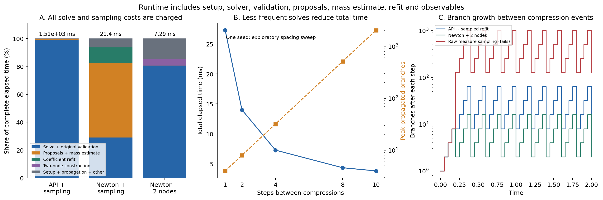

# 四模 Anderson 闭环实验结果

本轮已经把原 Gaussian decomposition 真正接进含时演化：**原求解器 → 原连续测度 → 有限 Gaussian 分解 → 下一段传播**。求解、原 API 的验证、拒绝采样、质量估计和系数重拟合都计入总计算耗时。

结论有两层：将原公开接口的采样流程改成“同一凸问题的既有 Newton 求解器 + 两节点矩压缩”，本机总耗时从 **1513 ms 降到 7.29 ms**，压缩后分支从 **8 降到 2**，精度不变；但四模 Schmidt 基线约 **1.08 ms**，直接稠密传播约 **0.29 ms**。**这轮证明了接入可行及内部改进有效，没有证明我们的分解能胜过该模型的最佳基线。**

## 实验口径

一个 impurity 轨道加一个 bath 轨道，每个轨道含两种自旋，共 4 modes。模式数未增加。U=4、杂化 v=0.6、中心化 impurity 能级 ε′d=0；U=0 Gaussian ground state 在 t=0 开启中心化相互作用。T=2、Δt=0.05，每 4 步压缩一次，共 10 次。Hamiltonian、费米符号和两节点推导见 [METHOD.md](METHOD.md)。

正式比较包含 18 个配置，各用种子 20261023、20261024、20261025 串行运行一次。耗时取三次中位数，不取最快或最佳种子。所有确定性配置也重复三次。控制实验另有 20 条单种子轨迹。主实验峰值 RSS 48.66 MiB；原始无压缩分支仅跑到 T=0.6 / 4096 分支。

“同等误差”的操作定义是整条轨迹同时满足：

- 最大 infidelity ≤ 10⁻⁵；
- 最大 double occupancy 绝对误差 ≤ 2×10⁻⁴；
- 三个种子全部通过。

这些阈值在 pilot 后、正式比较前固定，属于探索实验。通过的压缩方案基本都达到同一个 Strang 误差底：最大 infidelity **6.1490×10⁻⁷**，最大 |ΔD| **1.74245×10⁻⁴**。精确基线精度更高。密度 nd(t) 也记录；主模型因粒子空穴对称接近恒定，因此额外做 ε′d=0.4 控制。

总耗时从构造模型开始，包含传播、原求解和验证、采样、压缩、观测量、内存中的轨迹记录与循环开销。排除 Python 冷启动/导入、磁盘保存、画图，以及计时结束后生成的外部精确审计轨迹。精确传播基线自身的对角化与传播当然计入。各项计时之和已逐条核对等于总耗时。

## 主比较

下表的 B² 是**实际离散分解的系数成本**，取每条轨迹 10 个压缩时刻的均值，再对三种子平均。它不是已证明最优的 Gaussian extent。K 是压缩后保留原子数，Kpeak 是压缩之前真正经历的最大传播分支数；采样字典大小另外记录。

| 方案 | 总耗时中位数 ms | K / Kpeak | 平均压缩后 B² | 同误差通过 |
|---|---:|---:|---:|:---:|
| 4 维物理子空间精确传播 | 0.347 | — | — | 是 |
| 稠密 Strang | 0.290 | — | — | 是 |
| Schmidt / SVD 压缩 | 1.076 | 2 / 32 | 1.6913 | 是 |
| 已有传播分支上的 OMP 重拟合 | 1.352 | 2 / 32 | 1.6913 | 是 |
| 直接按系数绝对值截断 | 1.039 | 4 / 64 | 1.2954 | **否** |
| 均匀 Haar 字典 + 重拟合 | 4.256 | 8 / 128 | 5.5871 | 是 |
| **原 synthesize + 连续测度采样 + 重拟合** | **1513.159** | **8 / 128** | **3.8226** | **是** |
| 原 projected_sgd + 采样 + 重拟合 | 332.412 | 8 / 128 | 3.9188 | 是 |
| 原 Newton + 连续测度采样 + 重拟合 | 21.440 | 8 / 128 | 3.8763 | 是 |
| 原 Newton + 直接 Monte Carlo 和式 | 19.763 | 128 / 2048 | 4.2073 | **否** |
| 原 SGD + 两节点矩压缩 | 319.594 | 2 / 32 | 1.6945 | **否** |
| **原 Newton + 两节点矩压缩** | **7.289** | **2 / 32** | **1.6913** | **是** |
| 原 Newton + 采样 + 对称性处理 + 重拟合 | 26.945 | 4 / 64 | 2.1924 | 是 |
| Haar + 对称性处理 + 重拟合 | 12.752 | 4 / 64 | 2.3163 | 是 |
| 未优化 u=target 的重叠加权采样 + 重拟合 | 15.043 | 8 / 128 | 3.8874 | 是 |
| 不解凸问题的直接四模几何分解 | 1.708 | 2 / 32 | 1.6913 | 是 |
| 原 SGD + Newton 校正 + 两节点 | 326.894 | 2 / 32 | 1.6913 | 是 |
| **原完整 synthesize + Newton 校正 + 两节点** | **1504.736** | **2 / 32** | **1.6913** | **是** |

精度不达标的方案不计为性能胜出，较小的错误态系数成本也不算优势。所有单次耗时范围都在 [comparison.json](results/comparison_final/comparison.json)。例如原完整接口为 1511–1543 ms，Newton 两节点为 7.241–7.302 ms，Schmidt 为 1.017–1.445 ms。Haar 方案有一次 42.258 ms 的慢样本，另外两次约 4 ms；保留该样本，未据此宣称稳定的细微性能差异。三次运行不构成统计性能研究。

两节点方案最终 B²=**1.0233982220**，压缩时刻最大 B²=**1.9838474915**；传播期间因再次分支，记录时刻最大 B²=**2.6393015652**。仅看终点会因系统接近复现初态而低估整条轨迹的系数成本，因此表中优先报告时间平均，原数据同时保留最大值和终值。

## 调用与开销证据

`bridge.solve_measure` 直接导入并调用原文件，未另写一个替代算法冒充原算法。每次事件保存 `source_function`、witness、求解残差；完整 API 版本还保存原 `SynthesisResult.summary()`，包括随机流、训练历史和独立验证信息。

原公开接口每条 T=2 轨迹实际执行 **10 次 synthesize**：2,048,000 个训练样本、10,240 个诊断样本、约 1,033,000–1,037,000 个独立验证样本；外加 25,088–25,600 次离散化提议和 10,240 个质量估计样本，最终接受 128×10 个采样点。计数均为实际使用量，拒绝样本也算。虽然模式数很小，原接口的严格独立验证相对昂贵，这正是要计入的瓶颈。

以中位总耗时对应的**实际那一次运行**拆分：

| 组件 | 原 API + 采样重拟合 ms | 原 Newton + 两节点 ms |
|---|---:|---:|
| 原求解与原验证 / Newton 求解 | 1496.450 | 5.860 |
| 连续测度提议和质量估计 | 11.947 | 0 |
| 两节点构造 | 0 | 0.330 |
| target 合成及系数重拟合 | 2.914 | 0.010 |
| 初始化、传播、观测和其余循环开销 | 1.848 | 1.089 |
| **总计** | **1513.159** | **7.289** |

Newton 两节点没有随机采样，离散化的全部计算成本在“两节点构造”内。约 **208 倍**的内部流程提速同时包含两个改变：使用四模可用的确定性凸求解，以及用精确一阶矩压缩取代采样。它不是对原 SGD 本身加速了 208 倍；只保留原完整 API 并加两节点，仍需约 1505 ms。Newton 两节点相对 Schmidt 还慢约 **6.8 倍**。

## 哪些问题已经解决，哪些收益不能归于凸优化

**纯采样不可直接作为这一精度的演化器。** 每次 128 个样本的连续测度和式，三个种子最大 infidelity 可到 **0.249**。误差反馈到后续压缩目标而累积，不能把对精确态逐时刻分解的误差当作闭环误差。

**采样字典重拟合解决了四模重构误差。** 它使用当前近似 target 的 8 个振幅重新确定复系数，通常选满 8 个原子后精确张成目标。原 API 版本相对稠密 Strang 的最大态距离小于 **8.5×10⁻¹⁵**。这一准确性主要由有限维重拟合保证，不能说明原凸 witness 本身已经达到同样精度。

**两节点压缩必须搭配足够准确的 witness。** 直接低预算原 SGD 的两节点方案最大 infidelity 达 **0.00537**。两节点忠实地表示 C₂(u)，因此不会替求解器消除残差。原 SGD 输出后用原 Hessian 做 Newton 校正即可恢复 Strang 精度；原完整 API 的同样校正版也通过，且它实际使用原 API witness。原 Newton 两节点相对 Strang 的最大态距离约 **1.00×10⁻¹⁰**，主要是停止容限留下的幅值残差，远低于当前 Trotter 误差。

**采样系数成本改善主要来自重叠加权。** 原 Newton 测度加权相对 Haar，把平均压缩后 B² 从 5.5871 降到 3.8763，约下降 30.6%；但不解凸问题、直接 u=target 的加权已达到 3.8874。两者差仅约 0.3%，三个种子不足以认定这是稳健的优化增益。完整 API 的采样结果略有不同，同样没有据此宣称优越性。

**两节点的收益主要依赖四模几何。** 它保持原连续测度的一阶向量矩，不保持总质量；不是“抽两个样本就能重建所有态”。直接四模几何对照不解凸问题也能得到相同分支数和系数成本，而且更快。四模实验能验证接口、相位和闭环设计，却过于特殊，不能证明更大 impurity 系统的优势。

## 小控制实验

1. **ε′d=0.4：**通过方案最大 infidelity 约 5.56×10⁻⁷。原 Newton 两节点和 Schmidt 最终 B² 同为 1.16610；已有分支 OMP 用 3 个原子、B²=1.47824。两节点表示更紧凑，但总耗时约 7.73 ms，仍慢于 Schmidt 的 1.46 ms。未优化重叠采样终点成本甚至略低于优化采样，进一步说明不能轻率归因。
2. **U=0：**保持 1 个 Gaussian 原子、B²=1，主动跳过不必要的分解调用；最大 infidelity 6.7×10⁻¹⁶。U=1 也通过主精度阈值。
3. **U=8、Δt=0.05：**最大 infidelity 5.98×10⁻⁶，但最大 |ΔD|=6.61×10⁻⁴，**没有通过双阈值**；压缩误差很小，主要问题是 Trotter 步长。
4. **步长：**U=4 时 Δt=0.1、0.05、0.025 的最大 |ΔD| 约 6.970×10⁻⁴、1.742×10⁻⁴、4.356×10⁻⁵，符合二阶误差缩放；infidelity 每减半步长约缩小 16 倍。Δt=0.1 的 D 误差不达标。
5. **压缩间隔：**每 1、2、4、8、10 步压缩的耗时约 27.3、14.0、7.3、4.36、3.83 ms；对应峰值传播分支 4、8、32、512、2048。延迟求解能省时间，但增加内存和中间系数成本。这只是单种子小扫描，未把间隔调优后的结果与固定间隔基线混称为公平胜出。
6. **原始分支只跑 T=0.6：**4096 分支、B²=3.13273、耗时 0.566 ms；Newton 两节点为 2 个最终分支、B²=1.88431、耗时 2.579 ms，同精度。原始分支在这段短时间仍更快；本轮只观察到分支与系数成本节省，没有观测到总耗时交叉点。

## 对后续算法开发的判断

本轮值得保留的成果是可审计的闭环接口、求解残差和离散化误差的分开记录、实际系数重拟合、以及“按需压缩而非每步全量求解”的方向。直接照搬离线 synthesize 到每个时间片，验证和全局优化的成本会压倒传播；仅降低原子数也不等于降低总时间。

下一步若继续以改善演化为目标，应优先让 decomposition 处理**当前分支张成空间之外的残差**，复用传播后的原子与 witness，并由累计误差预算触发原子增补或重压缩。候选分解应先与已有分支 OMP 比较，只有在相同误差下实际减少总成本才接受；既不把更小 B² 自动视为更快，也不要求每段都重新求解整个态。

另一个必要工程改动，是用 Gaussian overlap 的 Gram 矩阵计算重拟合和压缩残差，避免把 target 展开成完整 Fock 向量。当前四模实现有意使用稠密向量作验证，尚未实现这条可扩展路线。本轮没有扩大系统，也没有用四模的特殊两节点公式宣称高模式算法优势。

## 验证与可追溯性

10 项测试全部通过。保存结果的额外审计逐一检查了 **74 条正式/控制轨迹**：每个 target 来自前一个实际近似态，非压缩步符合 Strang，witness 的 C₂(u) 残差与记录一致，两节点输出就是该一阶矩，最后的原子和系数重构保存终态，累计局部误差控制了全程压缩误差。

最终原子的最大 Gaussian quadric 缺陷为 **2.23×10⁻¹⁴** 以下，两节点一阶矩误差最大 **8.05×10⁻¹⁶**。这属于浮点数值验证，不是区间算术证明。原接口单次 `certified` 状态也没有被升级为整个演化过程的联合概率保证。

正式原始数据：[主比较](results/comparison_final/comparison.json)、[控制实验](results/controls/summary.json)、[测试日志](results/tests.log)、[保存轨迹审计及源码哈希](results/verification.json)。运行方法与文件分工见 [README.md](README.md)。所有新增代码和结果都在本目录，原有实现没有改动。
