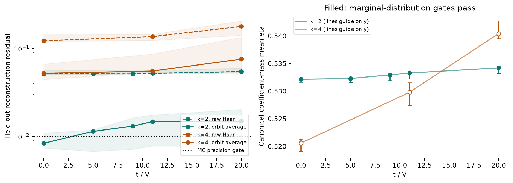
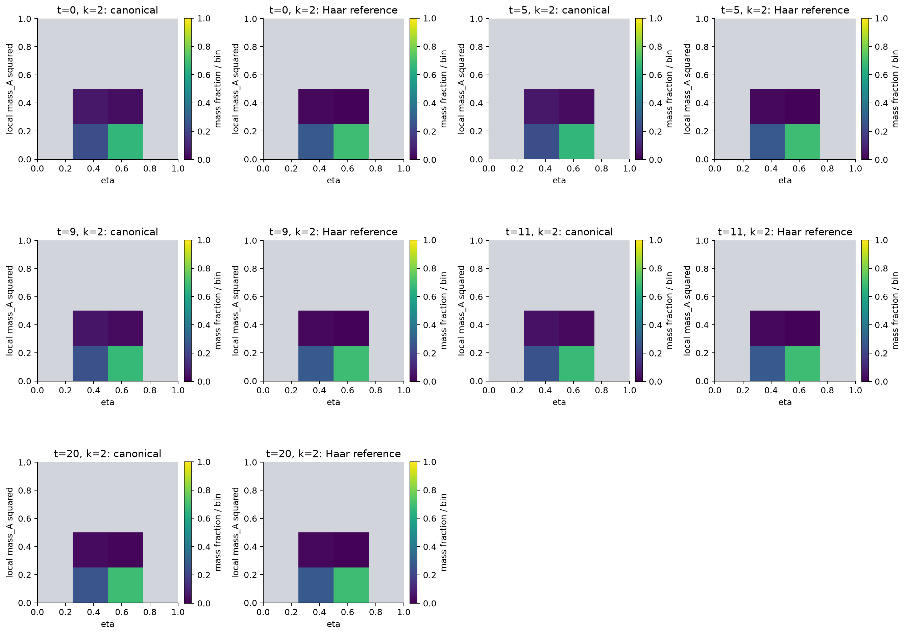
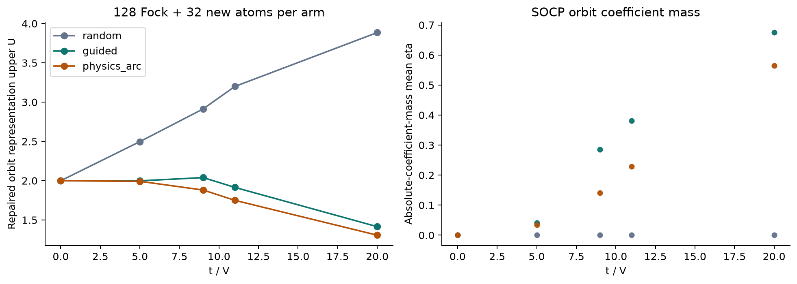

# FK canonical 分解：构型发现与相干检验

**正式固定配置实验。**

运行状态：`complete_with_limits`。配置含5个k=2物理点及3个k=4对照点。

跨配置的全部3个种子的验收：重构 5/8；分布解释 5/8；相干解释 0/8。

**证据分开计量：** 确定性整数矩支持 canonical 重构；半整数质量与分布仍需积分；witness引导的SOCP成本属于另一种轨道表示，不能替换canonical的B。所有成本上界均非全字典最优性或区间认证。

## A. 确定性 canonical 重构

代数与完整张量审计通过：`True`。实际k=2数值解完整128维重构：

| t/V | 完整残差 | 梯度 | 通过 |
|---:|---:|---:|---|
| 0 | 4.44275e-16 | 1.12642e-16 | True |
| 5 | 2.31259e-16 | 1.59444e-16 | True |
| 9 | 4.27307e-12 | 4.27332e-12 | True |
| 11 | 9.00544e-11 | 9.00543e-11 | True |
| 20 | 1.87404e-11 | 1.87403e-11 | True |

确定性k=2的误差与下图的随机积分残差是不同量。raw和orbit-average使用同一witness及同一批样本，配对比较没有更换目标。

图中区间为配置中3个种子的实际范围，不是置信区间；连线仅连接实际计算点。空心点未通过分布解释门槛。

## B1. Canonical 分布与有限阶成本

| t/V | k | B中位数 | raw残差范围 | RB残差范围 | 最小ESS | eta均值范围 | 分布解释 | 相干解释 |
|---:|---:|---:|---|---|---:|---|---|---|
| 0 | 2 | 7.58056 | 0.05067–0.05609 | 0.007382–0.01091 | 19819.4 | 0.5316–0.5324 | True | False |
| 5 | 2 | 7.54229 | 0.05036–0.05626 | 0.006726–0.01188 | 19779.4 | 0.5315–0.5325 | True | False |
| 9 | 2 | 7.35281 | 0.05126–0.05563 | 0.007136–0.01623 | 18392.7 | 0.5319–0.5329 | True | False |
| 11 | 2 | 7.1496 | 0.05138–0.05609 | 0.007767–0.01751 | 16863.9 | 0.5322–0.5334 | True | False |
| 20 | 2 | 6.59231 | 0.05322–0.05971 | 0.0077–0.02024 | 13175.9 | 0.5332–0.5345 | True | False |
| 0 | 4 | 5.41896 | 0.1208–0.1432 | 0.0444–0.06645 | 1983 | 0.519–0.5213 | False | False |
| 11 | 4 | 4.88523 | 0.1228–0.1449 | 0.05361–0.08645 | 1236.06 | 0.5274–0.5315 | False | False |
| 20 | 4 | 4.02008 | 0.1413–0.2052 | 0.05094–0.1341 | 357.816 | 0.5395–0.5427 | False | False |

Gaussian探针校准全部通过：`True`。校准检验已知均值与采样波动是否一致，不保证0.01精度。有限k的Gaussian目标本来就有B>1，故B不是true extent的直接读数。

最终独立流固定N=65536，总失败概率预算0.05分配给120个预定事件。保守统计半径和超预算状态保存在各validation JSON；经验稳定性、ESS和误差门槛均不自动成为统计认证。

最终非探针重构C通过保守统计误差包络的数量：0/24。此计数仅针对重构C，不代表边缘分布、各组向量或相干核同时得到认证。

每一对图使用相同色尺，分别显示canonical系数质量和同批样本的Haar参考概率。灰色格子的局部ESS在至少一个种子中低于100；canonical使用加权ESS，Haar参考使用该格子的实际样本数。两图各自遮罩，灰色不表示零概率。这些是有限阶canonical分布，不能据此声称最优分解的支持转变。Haar参考直方图与TV距离保存在原始数组/JSON。

## B2. 不输入弧族的构型发现

引导组从与随机组相同的32个Haar原子出发，用固定k=2 witness和全部120个Majorana双线性平面做局部重叠优化。人工弧族只在独立的物理先验组使用。每组128个公共Fock原子加32个新原子；候选数相同，计算时间不同。

| t/V | 随机U中位数 | 引导U中位数 | 弧族U中位数 | 引导≤1.05×弧族的种子数 | 引导严格优于随机的种子数 |
|---:|---:|---:|---:|---:|---:|
| 0 | 2 | 2 | 2 | 3 / 3 | 0 / 3 |
| 5 | 2.49748 | 1.99846 | 1.99229 | 3 / 3 | 3 / 3 |
| 9 | 2.91386 | 2.03963 | 1.88139 | 0 / 3 | 3 / 3 |
| 11 | 3.19935 | 1.9152 | 1.75042 | 0 / 3 | 3 / 3 |
| 20 | 3.8853 | 1.41507 | 1.30673 | 0 / 3 | 3 / 3 |

U包含完整Fock残差修补及目标态误差估计。局部最大重叠不提供全字典对偶上界；SOCP最优仅限候选轨道。轨道代表不是有限Gaussian分支。图右侧属于SOCP轨道表示，不能与canonical分布混称同一结果。

| 方法 | 候选生成时间合计(s) | SOCP时间合计(s) |
|---|---:|---:|
| random | 0.04813 | 2.726 |
| guided | 1.814 | 0.04875 |
| physics_arc | 0.07969 | 0.04851 |

弧族生成在各t之间复用，上表只计一次；guided时间含Haar初始化，未包含共用的canonical witness准备成本。完整端到端耗时见summary.json，不能从等候选数推断等时间优势。

## C. 相干贡献

没有结果通过全部相干解释门槛。不能由总重构或边缘分布稳定推断各分组相干贡献准确；本轮不解释Wick峰的来源。

| t/V | k | 最大闭合残差 | 最大CQ误差 | 最大W误差 | 最大组RMSE | 最大半样本差异 |
|---:|---:|---:|---:|---:|---:|---:|
| 0 | 2 | 0.0109149 | 0.101718 | 0.102806 | 0.010719 | 0.0363403 |
| 5 | 2 | 0.0118758 | 0.0793028 | 0.0747261 | 0.0107421 | 0.0389246 |
| 9 | 2 | 0.0162335 | 0.208162 | 0.0437087 | 0.0113238 | 0.0439879 |
| 11 | 2 | 0.0175084 | 0.263172 | 0.0412372 | 0.0119584 | 0.0451192 |
| 20 | 2 | 0.0202351 | 0.316896 | 0.044555 | 0.0134536 | 0.0390351 |
| 0 | 4 | 0.0664522 | 0.512154 | 0.556254 | 0.033076 | 0.0866647 |
| 11 | 4 | 0.0864542 | 1.2943 | 0.117494 | 0.0450901 | 0.0971152 |
| 20 | 4 | 0.13411 | 2.13049 | 0.198252 | 0.0827792 | 0.139157 |

## D. 算法引导成本的必要性检验

| t/V | eta上限 | 受限字典下界 | 引导上界最大值 | 配置的全部3个种子均分离 |
|---:|---:|---:|---:|---|
| 0 | 0 | 1 | 2 | False |
| 0 | 0.25 | 0.444444 | 2 | False |
| 0 | 0.5 | 0.343146 | 2 | False |
| 0 | 0.75 | 0.287187 | 2 | False |
| 5 | 0 | 1.70972 | 1.99846 | False |
| 5 | 0.25 | 0.759877 | 1.99846 | False |
| 5 | 0.5 | 0.586685 | 1.99846 | False |
| 5 | 0.75 | 0.491011 | 1.99846 | False |
| 9 | 0 | 2.7196 | 2.03966 | True |
| 9 | 0.25 | 1.20871 | 2.03966 | False |
| 9 | 0.5 | 0.933219 | 2.03966 | False |
| 9 | 0.75 | 0.781034 | 2.03966 | False |
| 11 | 0 | 3.19935 | 1.9152 | True |
| 11 | 0.25 | 1.42194 | 1.9152 | False |
| 11 | 0.5 | 1.09784 | 1.9152 | False |
| 11 | 0.75 | 0.918813 | 1.9152 | False |
| 20 | 0 | 3.8853 | 1.41507 | True |
| 20 | 0.25 | 1.7268 | 1.41507 | True |
| 20 | 0.5 | 1.33322 | 1.41507 | False |
| 20 | 0.75 | 1.11581 | 1.41507 | False |

这些比较使用引导组自己的修补上界，未借用人工弧族成本。正分离说明同等低成本的精确表示无法满足该关联限制；它不证明canonical分布已近最优，也不是区间算术认证。必要平均eta及高eta系数质量比例详见discovery JSON。

## 可复现文件

- `config.json`、`manifest.json`、`requirements-lock.txt`：冻结参数、来源与依赖。
- `canonical_k2.*`、`training_*.*`、`frozen_*.npz`：矩证明、完整重构、经验训练及冻结witness。
- `development_*.*`、`validation_*.*`：独立流统计、完整累加器、分布和相干核。
- `discovery_*.*`：原始Gaussian原子、局部旋转路径、相位、SOCP系数和必要性界。
- `acceptance.json`、`comparisons.json`、`summary.json`：所有门槛、配对比较和实际资源。
- `verification.json`：独立保存数组复核；不重做Monte Carlo或系数优化。

本轮未增加系统规模或扫描密度，未修改主库或先前实验源文件。
