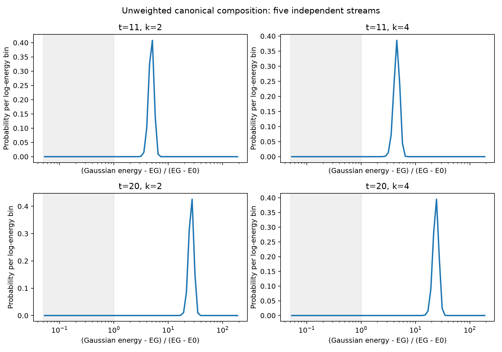

# 本轮进展：能量分辨连续 Gaussian 组成

## 最新快照：按用户要求暂停（2026-10-25）

本轮后台实验已停止，完整方案仍未完成。新增代码、已有结果及中断记录一并保存，
本次上传未启动额外测试或验证。以下是暂停前已经完成的工作：

- 80 个自动发现方向通过独立 130 位核验，覆盖 10,240 个全局支持区间。
  四分之一关联能窗的高能系数质量下界：t=11 为 0.192324–0.192381，
  t=20 为 0.173114–0.173115。证据见
  [自动方向认证](results/m3_blind_certificates_02/verification.json)。
- 第二批 160 个物理先验／已知态残差／直接对偶对照方向也已通过认证。
  移去 HFB 分量后的直接 Krylov 搜索得到接近的结果，自动方向的保真度界
  仍弱于联合解析参考；尚未证明分布新增信息或独立优势。
  证据见 [对照认证](results/m3_control_certificates_02/verification.json)。
- 修正后的百万样本加权验证：t=11 五次重构均低于 1e-3；t=20 仍有超标重复。
  完整参数扫描只完成部分单元，现标记为 interrupted_by_user。
- 新增真实 Gaussian 项的 R/B 比较程序及试跑记录，但完整比较、
  Hamiltonian-only 模式、反事实实验和跨模型检验均未完成。

冻结对照数组打包为
[结果压缩包](results/m3_discovery_controls_frozen_20261025.tar.xz)，
在本实验目录执行 `tar -xJf results/m3_discovery_controls_frozen_20261025.tar.xz`
即可还原 JSON 记录所引用的相对路径。大体积原始采样数组仍保留本地。

下文为此前阶段的详细记录；其运行状态以本节和 EXECUTION_STATE.json 为准。

推送快照更新（2026-10-25）：修正后的百万样本加权运行已生成 complete 摘要；
自动方向发现已生成冻结结果，状态为 frozen_before_global_certification。
三组参数扫描的摘要仍标为 running。本次按要求直接发布现有结果，未重跑验证；
这些执行状态不代表新增科学关卡通过。下文保留此前详细分析，其“正在进行”描述
以 PUBLICATION.json 中记录的本次摘要状态为准。

本轮尚未完成。M1 的数值积分关卡已通过；M2 已得到非零组成能量的全局证书，
但加权分布重构仍在提高精度。完整参数扫描、自动方向发现、强基线比较、
反事实构造和跨模型检验尚未完成。G1、G2、G3 均未标记为通过。

## M1：完整相干积分与稀有低能区域

在 t=11,20、k=2,4 上完成 20 个独立流，每流 1,048,576 个实际 Gaussian。
总计保存 20,971,520 个原始 ket，以及相位、能量、纯度与条件向量。
Spin(7) 和时间反演用于对称不变积分的 Rao–Blackwell 平均；投影向量没有被
计作 Gaussian 项，也没有使用 Fock 修补。

| t | k | 普通系数成本估计 | 最大单次对称平均重构残差 |
|---|---|---|---|
| 11 | 2 | 7.21843 | 0.0005510 |
| 11 | 4 | 5.15383 | 0.0003371 |
| 20 | 2 | 6.65834 | 0.0003425 |
| 20 | 4 | 4.40906 | 0.0006755 |

成本是分布积分估计，不是严格上界，也不接近最优成本的证明。
独立核验重新组合全部保存的 ket，并复算了 155,200 个二点／四点核矩阵。
核分项是未归一化双线性形式；真实态、区域退相干密度及 Wick 非线性量分别处理。

四个自然能窗中，普通 SMC 均没有命中低能样本，因此没有直接把零计数解释成零贡献。
另完成 40 个独立的 Haar 数目区域提议实验，每个 32,768 次；仍保留真实 Hamiltonian
能窗指示函数。这些提议的归一化体积由精确多项式积分确定。
全局被积函数上界与独立二项概率界给出：所有低能向量的范数上界最大为
**0.00016623**，同时失败概率至多 **4e-7**，条件是理想 IID 提议分布。
浮点采样误差未作区间封闭，因此这是带明确假设的概率保证，不是确定性区间证书。
低能条件形状没有测出；通过的是其绝对贡献可忽略的误差控制。

证据：[独立核验](results/m1_verification_01/verification.json)、
[稀有区域推导](RARE_ENERGY_INTEGRATION.md)、
[初始失败记录](results/m1_unweighted_n131072_s5_01/summary.json)。

## 已核验的解析参考，不计作分布发现

采用方案指定的成本预算，四分之一关联能窗口得到：

| t | Delta | 精确表示的高能质量下界 | 容许误差 0.01 的下界 |
|---|---|---|---|
| 11 | 2.0917200116 | 18.91817% | 18.21633% |
| 20 | 0.6852761739 | 17.26521% | 16.48349% |

这里的质量是绝对系数质量，不能解释为物理能量比例。
方案中的距离型 fidelity 预测约 0.92866、0.95181 与现有原子界一致；
进一步同时利用归一化和两个激发幅度约束，可严格得到 0.90563、0.95077 的上界。
这些仍然来自已有解析信息，不是 G1 或 G3 的证据。
已覆盖 24 个窗口／成本组合，并用另一套 120 位本征解和有理 Sylvester 检查核验。

证据：[参考证书](results/analytic_reference_02/summary.json)、
[核验](results/analytic_reference_02/verification.json)。

## M2：加权采样与独立全局支持证书

已推导加权凸泛函、重构恒等式、普通／加权成本关系与响应的超梯度解释。
零惩罚采样与原实现逐位一致；两组加权 CP1 分布通过独立数值积分和五流对照。
加权 SMC 使用可逆 Gaussian 旋转和 Metropolis 接受率，没有假定加权 Cartan 支持界。

小规模 k=2、lambda=0.25 的试跑重构误差尚未达标，而且全局 L_lambda 没有超过 U。
k=8、lambda=1 的冻结方向已得到下列严格证书：

| t | 加权成本下界 L | 普通预算 U | 必需组成能量 A 的下界 |
|---|---|---|---|
| 11 | 2.0486534970 | 1.7514585793 | 0.2971949177 |
| 20 | 1.3438484750 | 1.2955704207 | 0.0482780543 |

A 使用 (E(g)-EG)/(EG-E0) 的无量纲能量，适用于任何普通成本不超过 U 的精确分解。
表中数字经过显示舍入，认证上下界以链接的 JSON 数值为准。
这些证书由独立全局支持包络得到；8,192 个覆盖区间全部经另一个 120 位实现核验。
有效性不要求数值 witness 已经是精确最优方向，因此 pilot 重构尚未通过不使证书失效。
但它也不使加权分布通过重构关卡，更不能替代与强解析／自适应基线的比较。

补充的强解析对照已经给出更高的 A 下界：t=11 为 1.06303，t=20 为 3.53848。
它利用既有全局原子矩约束和成本预算，不读取连续分布。因此当前 pilot 的加权
证书明显弱于这一对照，不能作为独立增益。该对照在 pilot 之后加入，时间关系
明确记录，没有将它伪称为预注册结果。
证据：[强解析组成能量对照](results/composition_analytic_control_01/summary.json)。

百万样本的独立加权验证正在进行。完整 k/lambda 网格、weighted 条件尾积分和
固定目标的高精度成本曲线仍未完成。

第一次百万样本加权运行出现大规模 GPU 稀疏乘法异常：当前 CuPy/CUDA 路径在
1,048,576 列 RHS 时返回零，而较小尺寸及 CPU 结果正常。该批次已停止，
在目录内写入 INVALIDATED.json；不能把其结果当作有效分布。
改为最多 131,072 列分块，并添加 CPU 终点评分检查后，百万列回归误差为
2.7e-15。修正后的运行位于 m2_k8_lambda1_validation_n1048576_02。
这不影响使用较小尺寸产生的冻结方向及其独立全局支持证书。

证据：[加权理论](WEIGHTED_SYNTHESIS.md)、
[采样器回归](results/weighted_sampler_validation_01/verification.json)、
[全局加权证书](results/m2_k8_support_01/summary.json)、
[逐区间核验](results/m2_k8_support_01/verification.json)。

## 尚未完成的核心工作

- 不输入 e4/e8 的方向发现，以及对发现结果的独立全局认证。
- 与 Husimi、物理先验、普通对偶及两种自适应列生成的公平比较；完整 R、B 网格和五重复。
- 删除高能区域后重新优化、相位扰动、区域退相干及无能窗字典的反事实比较。
- Known-state 与 Hamiltonian-only 两种权限下的构造与完整成本记录。
- 配对模型与预先保留的 g=0.37 上的盲方向发现和验证。
- G3 的认证优势或至少两个参数区间的实际 Pareto 优势；目前没有证据证明通过。

逐项范围见 [需求账本](REQUIREMENTS.json)，实际进度见 [执行状态](EXECUTION_STATE.json)。
所有失败实验保留，原实验目录未修改。
