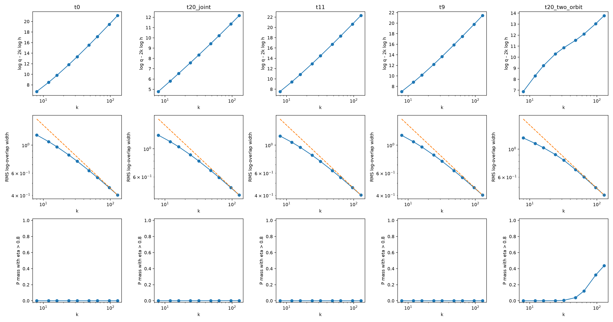

# 固定 witness 的接触几何与 replica 扫描

5 个冻结方向，每个方向 5 个独立种子、65536 个 SMC 粒子、9 个阶数，共 225 个检查点。误差条以独立运行作为统计单位，不把重采样粒子当作独立样本。

| witness | 有效维数拟合（均值 ± 重复 95% 半宽） | 零模 | 最小正曲率 |
|---|---:|---:|---:|
| t0 | 12.0168 ± 0.0534 | 12 | 2 |
| t20_joint | 5.8714 ± 0.0674 | 6 | 0.38405602 |
| t11 | 11.9458 ± 0.0489 | 6 | 6.668687e-06 |
| t9 | 11.9499 ± 0.0343 | 6 | 7.1195252e-06 |
| t20_two_orbit | 6.9510 ± 0.0235 | 6 | 0.54423626 |

50/90 位计算在至少 40 位上吻合；独立的全生成元双精度 Hessian 也与之相符。t9、t11 的解析驻点有 6 个对称零模和 6 个约 10⁻⁶ 的真实软方向。估算 k×曲率达到 1 需要约 1.4–1.5×10⁵ 阶，因此 k≤128 的有效维数约 12 并不矛盾；没有据此启动更大 k。

t20 联合 witness 的全局接触集合由解析饱和条件确定为 S6。有限阶拟合有修正项和窗口依赖，误差条仅反映重复运行波动。两个轨道候选的拟合尚未稳定到局部几何维数 6，不能用这个拟合证明新的接触分量或维数。

t20 两轨道候选的两个解析驻点具有相同的 50 个正曲率和相同的轨道诱导度量。条件于它们穷尽全局接触集，Laplace 极限权重相同。eta>0.8 仅为有限阶启发式分区，不能视为严格接触分量概率。

t9、t11 使用解析驻点的重叠值修正此前局部搜索参考值；仍没有全局支持证书。t20 两轨道候选同样未获全局认证。所有高阶积分为点估计。
