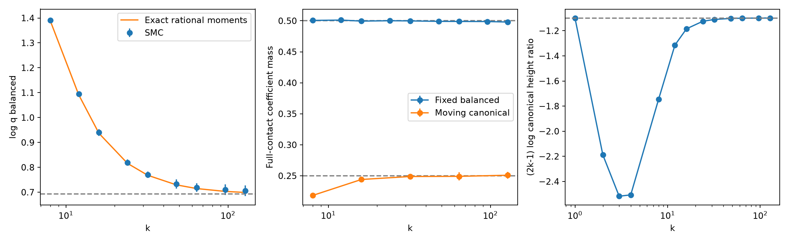

# 已知最优解的两接触轨道测试

目标为 (3|vac⟩+|full⟩)/√10，严格 Gaussian 成本为 4/√10。完整接触集合只有 vacuum 和 full 两条射线，两者维数均为 0。证明及精确矩公式见 TWO_CONTACT_TOY.md。

| k | 固定 witness 的 full 系数质量 | canonical witness 的 full 系数质量 |
|---:|---:|---:|
| 8 | 0.500613 | 0.218236 |
| 16 | 0.499484 | 0.244020 |
| 32 | 0.499811 | 0.248856 |
| 64 | 0.498922 | 0.249093 |
| 128 | 0.497980 | 0.250896 |

固定 witness 权重趋向 1/2；随 k 移动的 canonical witness 权重趋向目标要求的 1/4。解析矩方程给出 (2k−1)log(r_k)→log(1/3)，即 1/k 高度调整。本例不需要 log(k)/k，因为两个接触分量维数相同。

k2 用完整 128×128 张量上的独立 Cartan projector 精确核对；k2/4/8/16 又用独立四维 Gauss–Legendre 多项式积分核对。所有阶数均用未调用高阶公式的独立 SMC 运行作数值交叉验证。统计置信区间不是严格概率包围；canonical 方向的 90 位根求解也没有伪装成区间认证。
