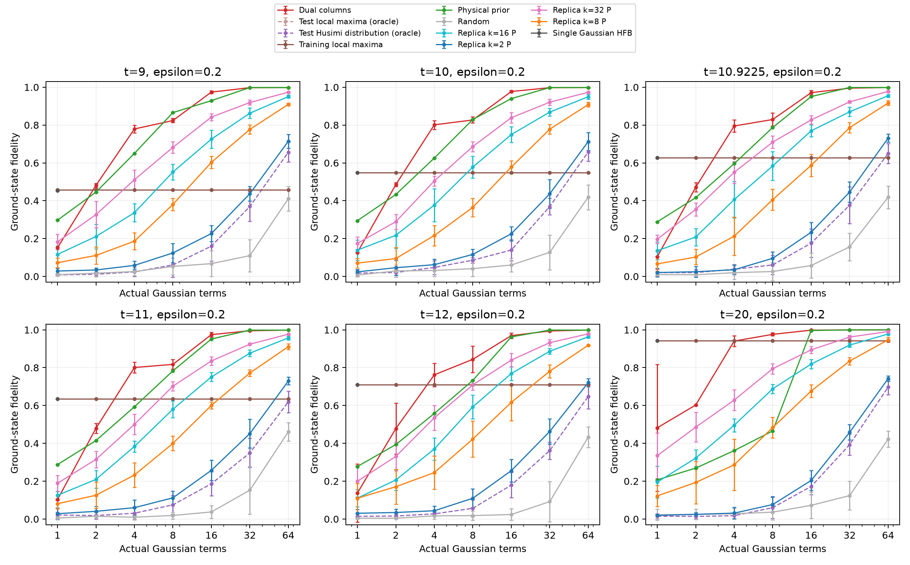
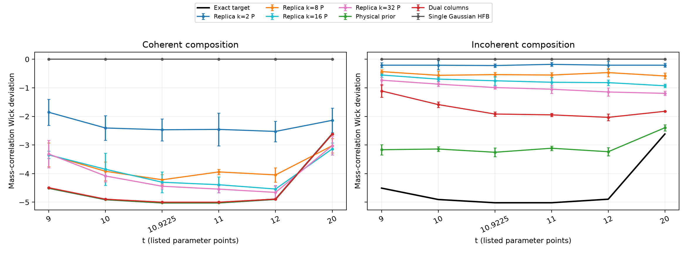

# FK replica hierarchy：E0–E5实验报告

方案规定的分级扫描、独立Gaussian构造、几何/能窗实验、完整相干核和冻结字典扰动对照均已执行并复核。完成的是实验与有证据范围的结论；非零t的全局最优接触分类、高阶canonical积分的严格认证仍未解决。本报告主要展示系数l1成本tau_G；Gaussian extent为xi_G=tau_G²。

本轮共55个(t,k)扫描点、48项GPU解析回归、10650个最终公平对照预测。所有正式扫描点均通过完整表示重构残差<10⁻³与B五种子相对重复半宽<1%的经验门槛；这些门槛不等于严格统计覆盖。

## 最主要的结果

1. **高阶收敛真实但有限阶仍慢。** t=0到k=128时，canonical B=2.1691634±8.85e-05，比精确最优成本2高8.458%。其canonical L点估计为1.8416839，不称为认证下界。独立全局支持证书仍给L=U=2。
2. **几何解释了端点的收敛系数。** t=0完整Gaussian切空间Hessian在Thouless坐标下精确为0×12、1×32、2×12；44个正法向方向给出B_k=2+22/k+O(k⁻²)。k(B_k−2)的独立采样向22靠近。t=0的所有最优分解必须支撑于S⁶×S⁶；低成本分解还有定量eta约束。
3. **物理必要性可以严格证明，但解析参考更强。** 高阶方向改善了同类q4归一化证书；已知端点w0=2M_AM_B还能跨参数使用，与能量不等式结合后给出更强的能窗排除能力。不能把只优于弱归一化基线的结果说成高阶独有优势。
4. **高阶改善了有限字典，但未超过强基线。** 在epsilon=.2、32个实际Gaussian项下，六个t的平均保真度均随k2→8→16→32上升；k32仍全部低于物理先验与列生成。包括上游采样成本后，本轮不支持优于这些方法的算法优势。

## E1：成本与分级覆盖

| t | 已测k | 最高k的B ± 经验95%半宽 | 该点canonical L（高阶未认证） | 独立严格U |
|---:|---|---:|---:|---:|
| 0 | 1, 2, 4, 8, 16, 32, 64, 128 | 2.1691634 ± 8.85e-05 | 1.8416839 | 2 |
| 5 | 1, 2, 4, 8, 16 | 3.2029818 ± 0.000651 | 1.4669327 | 1.9937386 |
| 9 | 1, 2, 4, 8, 16, 32 | 2.49032 ± 0.00015 | 1.5411211 | 1.88253229 |
| 9.1 | 1, 2, 4, 8, 16 | 3.0294998 ± 0.000491 | 1.4034789 | 1.87700238 |
| 10 | 1, 2, 4, 8, 16, 32 | 2.4118772 ± 0.000322 | 1.4988531 | 1.8215481 |
| 10.9225 | 1, 2, 4, 8, 16, 32 | 2.3294752 ± 0.000289 | 1.4541549 | 1.75706907 |
| 11 | 1, 2, 4, 8, 16, 32 | 2.3221053 ± 8.01e-05 | 1.4502528 | 1.75145858 |
| 12 | 1, 2, 4, 8, 16, 32 | 2.2296333 ± 0.000276 | 1.3999794 | 1.67865584 |
| 20 | 1, 2, 4, 8, 16, 32, 64 | 1.5368196 ± 8.75e-05 | 1.1971298 | 1.29741869 |

把解析端点witness用于所有目标，并与精确k4及tau≥1取最强下界，另得到以下完整Gaussian字典的严格区间；它们不是高阶canonical L的认证。

| t | 已认证tau下界 | 已认证tau上界 | G=(U−L)/U | 任意B≤U分解的平均eta上界 |
|---:|---:|---:|---:|---:|
| 0 | 2 | 2 | 0 | 0 |
| 5 | 1.95794739 | 1.9937386 | 0.0179518 | 0.0359036 |
| 9 | 1.74831455 | 1.88253229 | 0.0712964 | 0.142593 |
| 9.1 | 1.7394717 | 1.87700238 | 0.0732714 | 0.146543 |
| 10 | 1.65359457 | 1.8215481 | 0.0922037 | 0.184407 |
| 10.9225 | 1.55814595 | 1.75706907 | 0.113213 | 0.226426 |
| 11 | 1.55000035 | 1.75145858 | 0.115023 | 0.230046 |
| 12 | 1.44608118 | 1.67865584 | 0.138548 | 0.277096 |
| 20 | 1.02565162 | 1.29741869 | 0.209468 | 0.55468 |

图中空心L是canonical积分点估计；绿色三角是另行精确q4归一化后的保守高阶可行witness。二者不是同一个归一化，不能混用来声称小的严格缺口。黑线采用精确t0上界2或有IEEE舍入包围的相邻精确Gaussian修补构造成本。

数值半径通过符号恒等式u_eff=(Re<u|psi>/q_k(u))^(1/(2k−1))u消元；完整角向重构仍独立核验。Spin(7)群平均对应真实Gaussian酉轨道，不把平均投影态计为Gaussian原子。

## E2/E3：必要性与几何

t=0尖锐支持界为|<2M_AM_B|g>|≤1−eta/2。因此U≤2.02的所有精确分解中，eta≥0.2的系数质量最多约9.901%；精确最优U=2迫使eta=0和两个局部magic接触条件。

以下取Delta=.01，U为已认证的独立构造上界；数字是能窗内系数质量比例的严格上界。1表示此方向没有排除信息，filled是另行给出的参考witness。

| t | U | k2 | k4 | k8 | k16 | k32 | k64 | filled | 解析端点w0 |
|---:|---:|---:|---:|---:|---:|---:|---:|---:|---:|
| 9 | 1.88253229 | 1 | 1 | 1 | 1 | 0.929203 | — | 0.948537 | 0.14956 |
| 9.1 | 1.87700238 | 1 | 1 | 1 | 0.98111 | — | — | 0.949096 | 0.151024 |
| 11 | 1.75145858 | 1 | 1 | 1 | 1 | 0.943654 | — | 0.960351 | 0.230621 |
| 20 | 1.29741869 | 1 | 1 | 1 | 1 | 1 | 1 | 0.98739 | 0.554932 |

表格最后一列来自解析端点支持和eta≥(1−X_Delta)²，明显强于本轮高阶q4参考；其受限支持由显式质量/hopping弧达到。以下图仅展示相同q4归一化方向之间的比较。证明与完整参考表见[跨参数必要性](PRODUCT_WITNESS_TRANSFER.md)及[数值证书](results/product_witness_transfer_01/REPORT.md)。

固定witness几何在t=0、9、11、20测到k128。t0拟合有效维数约11.91与严格维数12相符；t9/11存在约10⁻⁶软曲率，尚不足以分类真实极限接触流形；t20有限阶有效维数约6.82，未替代全局最大值认证。能窗构造的336组数据独立检验了t9的Delta⁻¹、t>9的Delta⁻²障碍及误差依赖。

## E4/E5：冻结字典、相干核与扰动预测

使用t=9、10、10.9225、11、12、20；epsilon=0、.02、.05、.1、.2；实际Gaussian项数1、2、4、8、16、32、64；每格五个重复。k2/8/16/32字典及普通基线全部在扰动ED前冻结，系数只由新Hamiltonian的H/S广义本征问题求得。直接目标Husimi分布与局部极大值测试oracle明确使用ED目标。

以下为epsilon=.2、32个实际Gaussian项的平均保真度（HFB仅1项）：

| t | k2 | k8 | k16 | k32 | 物理先验 | 列生成 | 随机 | Husimi oracle | HFB(1项) |
|---:|---:|---:|---:|---:|---:|---:|---:|---:|---:|
| 9 | 0.437129 | 0.776959 | 0.862564 | 0.919082 | 0.998202 | 0.997468 | 0.1097 | 0.369643 | 0.454014 |
| 10 | 0.436373 | 0.778071 | 0.868324 | 0.920804 | 0.998276 | 0.997392 | 0.127114 | 0.369323 | 0.54873 |
| 10.9225 | 0.445835 | 0.786172 | 0.869897 | 0.922569 | 0.998427 | 0.995026 | 0.156323 | 0.376532 | 0.628226 |
| 11 | 0.451785 | 0.771999 | 0.876633 | 0.924108 | 0.998442 | 0.995189 | 0.152608 | 0.349703 | 0.634531 |
| 12 | 0.462904 | 0.781224 | 0.886722 | 0.932236 | 0.998653 | 0.993989 | 0.091831 | 0.361764 | 0.709026 |
| 20 | 0.458087 | 0.834902 | 0.91935 | 0.961893 | 0.999661 | 0.999534 | 0.123744 | 0.393091 | 0.942147 |

例如t11的k32平均保真度为0.924108，五重复经验95%半宽为0.00552。这表明候选组成随阶数改进；表中的物理先验和列生成仍更准确，不能据此宣称高阶采样是更有效的预测算法。

在Wick峰附近t=10.9225、epsilon=0、32项时，目标偏离为-5.02015，k32相干态给-4.44298，同原子非相干混合仅给-0.990833。这量化了该有限字典中相干干涉的贡献。高阶观测量误差不随k普遍单调：例如t20的k16 Wick误差高于k8；更高保真度本身不保证每个观测量都更准。

Hamiltonian、质量关联和三个四点算符均保存完整Fock核，并独立用256维算符、SVD子空间能量和显式Wick收缩复核。非相干对照采用同一原子的|c|²归一化权重，未优化混合权重，不能宣称是所有Gaussian混合的最优限制。HFB是32起点局部优化；保留秩与真实项数分别报告。

全部预算和扰动的能量、关联误差及重复区间见[frozen_predictions_k2_k8_k16_k32_01/REPORT.md](results/frozen_predictions_k2_k8_k16_k32_01/REPORT.md)。成本采用[cost_audited_aggregates.csv](results/frozen_predictions_k2_k8_k16_k32_01/cost_audited_aggregates.csv)：递归计入精确矩、前阶初始化、训练和验证采样；共享来源一次计入，物理先验按相同候选的独立构造计时。此为记录到的源运行墙钟总和，不是等时硬件竞赛，也未计入未记录的启动开销。

## 验证、失败记录与复现

完成审计及依赖哈希：[audit.json](results/complete_plan_audit_01/audit.json)。测试日志：[all_tests_final_01.log](results/all_tests_final_01.log)。每个实验目录均保存运行配置、源码快照、SHA256、原始数组与独立verification.json。

旧k4随机积分重构失败由精确Cartan后端修复；旧k8数值半径失败由另行记录的径向消元与新验证处理，没有重标旧结果。Gaussian8 GPU高阶重复误差曾超过1%，增加到524288粒子后通过。t20k64原串行01在两个训练种子后为四卡并行02中止，partial文件和interruption.json保留；134个小规模训练/验证数组与串行逐位一致。

使用8×H20 96GB及允许的174个逻辑CPU；用户授权的旧占卡任务已通过STOP正常退出。未提交或推送Git变更。第二物理模型和额外非零t的k128是条件扩展，本轮未执行。

严格证明与实现口径：[Cartan精确矩](CARTAN_THEORY.md)、[高阶分块界](CARTAN_BLOCK_BOUNDS.md)、[径向消元](RADIAL_ELIMINATION.md)、[t0必要性](PRODUCT_MAGIC_NECESSITY.md)、[跨参数必要性](PRODUCT_WITNESS_TRANSFER.md)、[t0渐近系数](PRODUCT_MAGIC_ASYMPTOTICS.md)、[Gaussian舍入修补](GAUSSIAN_ROUNDING_CERTIFICATES.md)、[能窗定理](ENERGY_WINDOW_THEORY.md)。

## 记录到的成本分解

完整最终对照的唯一上游依赖、冻结和预测运行计时之和为35108.547秒（9.752小时）。并行源运行的时间在这里相加，不是用户实际等待时间；不包含开发失败、独立复核和未记录初始化。

以下取t11、epsilon=.2、32项（HFB1项）的五重复平均。冷启动上游采用完整可复用来源任务计时，未将其他点或预算均摊掉；其范围与每次预测耗时不同。

| 方法 | 上游来源秒 | 候选生成秒 | 选择秒 | 单次预测秒 | 冷启动记录合计秒 |
|---|---:|---:|---:|---:|---:|
| replica_k2_P | 524.454 | 0 | 0.0237468 | 0.000751004 | 524.479 |
| replica_k8_P | 12061.4 | 0 | 0.0237224 | 0.000759399 | 12061.4 |
| replica_k16_P | 20662.9 | 0 | 0.0237291 | 0.0007673 | 20662.9 |
| replica_k32_P | 31926.2 | 0 | 0.0237547 | 0.000731172 | 31926.2 |
| physics_prior | 0.330774 | 0 | 0.0231647 | 0.000634382 | 0.354573 |
| dual_columns | 1335.69 | 0 | 0.0210772 | 0.00074233 | 1335.71 |
| random | 0 | 0.0189279 | 0.0242477 | 0.000768162 | 0.0439438 |
| husimi_test_oracle | 0.0278244 | 3.46647 | 0.00174607 | 0.000771963 | 3.49681 |
| single_gaussian_HFB | 0 | 0.945146 | 0 | 0.000239317 | 0.945385 |
