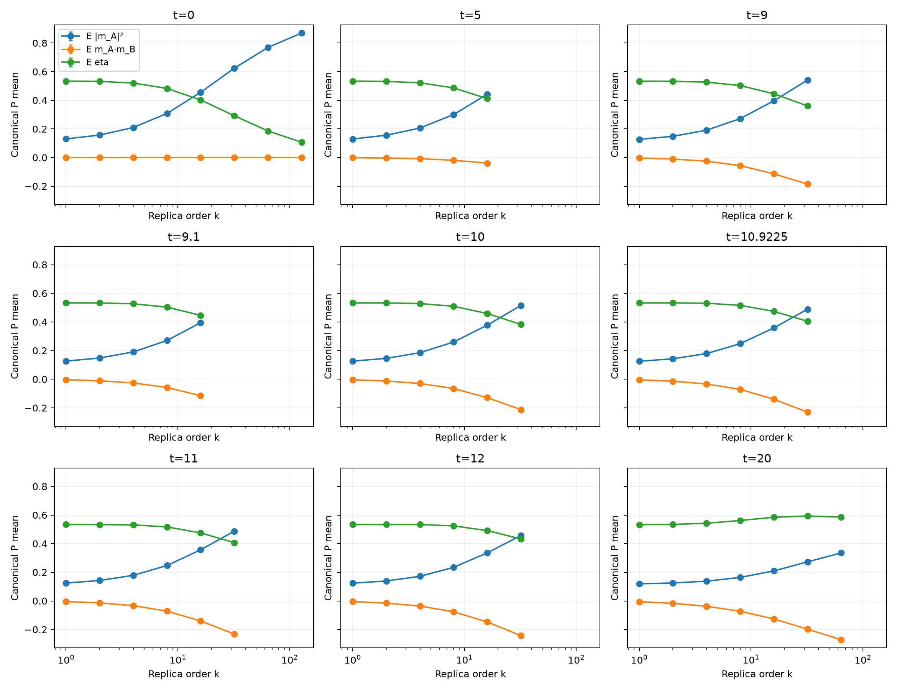
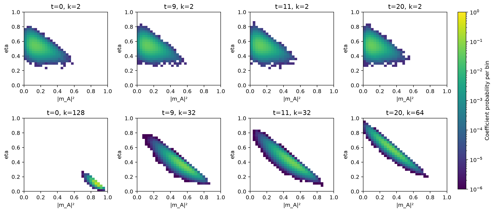

# Canonical Gaussian组成

所有点均从独立核验过的完整P粒子数组重新计算；保留每个种子的统计量和特征数组哈希。误差条来自至少五条独立随机流的经验Student-t半宽，未把同一SMC内的粒子当作独立样本。

这些是有限阶canonical系数分布的组成，不能直接解释为唯一最优构型或所有最优表示的必要原子。t=0的全字典必要性另外有解析证明；非零t的全局接触集合仍未完成尖锐认证。

| t | 最低/最高k | E eta（低阶→高阶） | E massA²（低阶→高阶） |
|---:|---|---|---|
| 0 | 1 / 128 | 0.533836 → 0.106779 | 0.13031 → 0.87 |
| 5 | 1 / 16 | 0.53379 → 0.411562 | 0.129544 → 0.442498 |
| 9 | 1 / 32 | 0.533474 → 0.360802 | 0.127003 → 0.541238 |
| 9.1 | 1 / 16 | 0.533387 → 0.446438 | 0.126875 → 0.394773 |
| 10 | 1 / 32 | 0.53319 → 0.382664 | 0.126337 → 0.515436 |
| 10.9225 | 1 / 32 | 0.533164 → 0.40504 | 0.125279 → 0.489321 |
| 11 | 1 / 32 | 0.533233 → 0.406971 | 0.124815 → 0.487101 |
| 12 | 1 / 32 | 0.533244 → 0.432644 | 0.123836 → 0.457252 |
| 20 | 1 / 64 | 0.533053 → 0.58552 | 0.119237 → 0.335357 |
