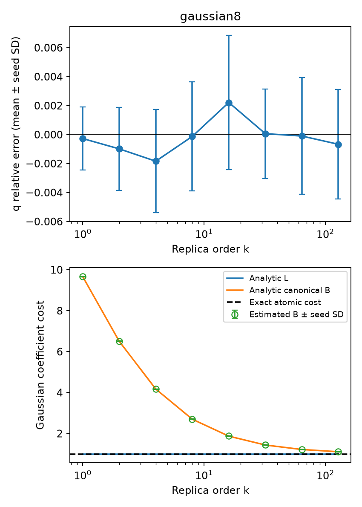

# E0 高阶解析基准

运行状态：`complete`。

使用通用 Gaussian 流形采样后端，未向积分器提供目标态的高阶解析积分。独立种子间 Student-t 区间是经验误差诊断，不是严格覆盖证明。

| 对象 | β | Z 相对误差均值 | 95% 重复半宽 | 1%经验门槛 | Gaussian纯度 |
|---|---:|---:|---:|---|---|
| gaussian8 | 0.5 | -8.379e-05 | 0.001311 | True | True |
| gaussian8 | 1 | -0.0002756 | 0.0027 | True | True |
| gaussian8 | 1.5 | -0.0005062 | 0.003931 | True | True |
| gaussian8 | 2 | -0.0009881 | 0.003551 | True | True |
| gaussian8 | 3.5 | -0.001329 | 0.00375 | True | True |
| gaussian8 | 4 | -0.00184 | 0.004416 | True | True |
| gaussian8 | 7.5 | -0.0004303 | 0.004909 | True | True |
| gaussian8 | 8 | -0.0001274 | 0.004676 | True | True |
| gaussian8 | 15.5 | 0.002282 | 0.005634 | True | True |
| gaussian8 | 16 | 0.002215 | 0.005768 | True | True |
| gaussian8 | 31.5 | 3.653e-05 | 0.003801 | True | True |
| gaussian8 | 32 | 6.169e-05 | 0.003828 | True | True |
| gaussian8 | 63.5 | -0.0001312 | 0.005038 | True | True |
| gaussian8 | 64 | -0.0001011 | 0.004998 | True | True |
| gaussian8 | 127.5 | -0.0006638 | 0.004648 | True | True |
| gaussian8 | 128 | -0.0006706 | 0.004706 | True | True |

图中空心点为数值积分估计。纯 Gaussian 的真实最小成本及解析 L 均为 1；canonical B 在有限阶大于 1 是分解本身的成本，不能解释为非 Gaussian 资源。

本报告只覆盖 E0 的解析对象。FK 的 k=4 独立重构、E1–E5 和相应认证仍须逐项完成；此基准运行完成不等于整个方案完成。
