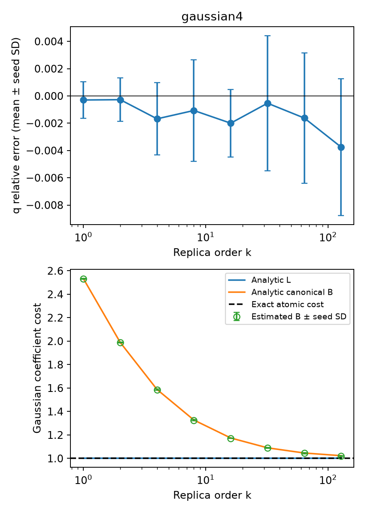

# E0 高阶解析基准

运行状态：`complete`。

使用通用 Gaussian 流形采样后端，未向积分器提供目标态的高阶解析积分。独立种子间 Student-t 区间是经验误差诊断，不是严格覆盖证明。

| 对象 | β | Z 相对误差均值 | 95% 重复半宽 | 1%经验门槛 | Gaussian纯度 |
|---|---:|---:|---:|---|---|
| gaussian4 | 0.5 | -0.0006017 | 0.002294 | True | True |
| gaussian4 | 1 | -0.0002954 | 0.001655 | True | True |
| gaussian4 | 1.5 | -0.0004133 | 0.001614 | True | True |
| gaussian4 | 2 | -0.0002727 | 0.001974 | True | True |
| gaussian4 | 3.5 | -0.001142 | 0.003778 | True | True |
| gaussian4 | 4 | -0.001677 | 0.00329 | True | True |
| gaussian4 | 7.5 | -0.0009177 | 0.004483 | True | True |
| gaussian4 | 8 | -0.001066 | 0.004614 | True | True |
| gaussian4 | 15.5 | -0.001854 | 0.002961 | True | True |
| gaussian4 | 16 | -0.001997 | 0.003082 | True | True |
| gaussian4 | 31.5 | -0.0005029 | 0.006153 | True | True |
| gaussian4 | 32 | -0.000532 | 0.006158 | True | True |
| gaussian4 | 63.5 | -0.001584 | 0.005987 | True | True |
| gaussian4 | 64 | -0.001622 | 0.005925 | True | True |
| gaussian4 | 127.5 | -0.003758 | 0.00623 | True | True |
| gaussian4 | 128 | -0.003752 | 0.006245 | True | True |

图中空心点为数值积分估计。纯 Gaussian 的真实最小成本及解析 L 均为 1；canonical B 在有限阶大于 1 是分解本身的成本，不能解释为非 Gaussian 资源。

本报告只覆盖 E0 的解析对象。FK 的 k=4 独立重构、E1–E5 和相应认证仍须逐项完成；此基准运行完成不等于整个方案完成。
