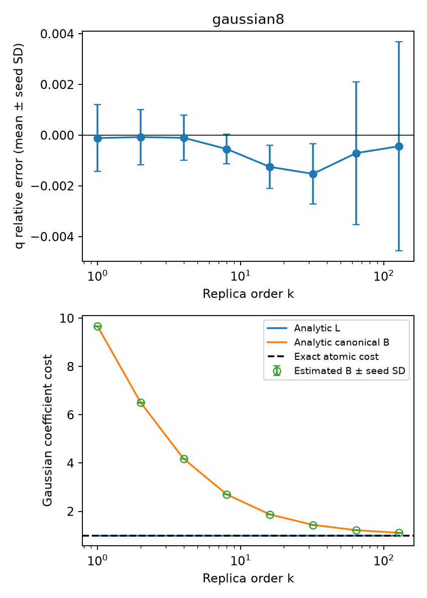

# E0 高阶解析基准

运行状态：`complete`。

使用通用 Gaussian 流形采样后端，未向积分器提供目标态的高阶解析积分。独立种子间 Student-t 区间是经验误差诊断，不是严格覆盖证明。

| 对象 | β | Z 相对误差均值 | 95% 重复半宽 | 1%经验门槛 | Gaussian纯度 |
|---|---:|---:|---:|---|---|
| gaussian8 | 0.5 | 1.742e-05 | 0.001162 | True | True |
| gaussian8 | 1 | -0.0001142 | 0.001638 | True | True |
| gaussian8 | 1.5 | 0.0001323 | 0.001938 | True | True |
| gaussian8 | 2 | -7.406e-05 | 0.001357 | True | True |
| gaussian8 | 3.5 | 7.694e-05 | 0.0009548 | True | True |
| gaussian8 | 4 | -0.0001044 | 0.001106 | True | True |
| gaussian8 | 7.5 | -0.0004507 | 0.0009259 | True | True |
| gaussian8 | 8 | -0.0005462 | 0.0007361 | True | True |
| gaussian8 | 15.5 | -0.001372 | 0.001005 | True | True |
| gaussian8 | 16 | -0.001252 | 0.001059 | True | True |
| gaussian8 | 31.5 | -0.001553 | 0.001375 | True | True |
| gaussian8 | 32 | -0.001525 | 0.001469 | True | True |
| gaussian8 | 63.5 | -0.0006917 | 0.003481 | True | True |
| gaussian8 | 64 | -0.0007093 | 0.003489 | True | True |
| gaussian8 | 127.5 | -0.0004459 | 0.005123 | True | True |
| gaussian8 | 128 | -0.0004356 | 0.005126 | True | True |

图中空心点为数值积分估计。纯 Gaussian 的真实最小成本及解析 L 均为 1；canonical B 在有限阶大于 1 是分解本身的成本，不能解释为非 Gaussian 资源。

本报告只覆盖 E0 的解析对象。FK 的 k=4 独立重构、E1–E5 和相应认证仍须逐项完成；此基准运行完成不等于整个方案完成。
