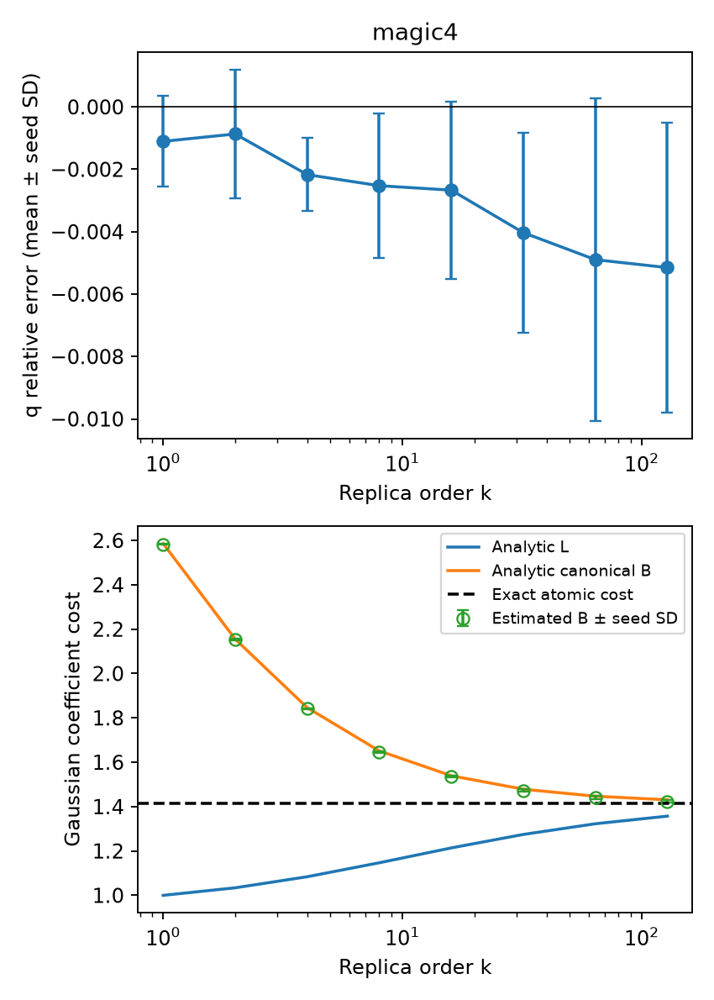

# E0 高阶解析基准

运行状态：`complete`。

使用通用 Gaussian 流形采样后端，未向积分器提供目标态的高阶解析积分。独立种子间 Student-t 区间是经验误差诊断，不是严格覆盖证明。

| 对象 | β | Z 相对误差均值 | 95% 重复半宽 | 1%经验门槛 | Gaussian纯度 |
|---|---:|---:|---:|---|---|
| magic4 | 0.5 | -0.001306 | 0.001344 | True | True |
| magic4 | 1 | -0.001103 | 0.001813 | True | True |
| magic4 | 1.5 | -0.001105 | 0.002469 | True | True |
| magic4 | 2 | -0.0008673 | 0.002566 | True | True |
| magic4 | 3.5 | -0.002294 | 0.001424 | True | True |
| magic4 | 4 | -0.00217 | 0.001451 | True | True |
| magic4 | 7.5 | -0.002423 | 0.002799 | True | True |
| magic4 | 8 | -0.002525 | 0.002885 | True | True |
| magic4 | 15.5 | -0.002628 | 0.003588 | True | True |
| magic4 | 16 | -0.002667 | 0.003534 | True | True |
| magic4 | 31.5 | -0.004033 | 0.004012 | True | True |
| magic4 | 32 | -0.004029 | 0.003974 | True | True |
| magic4 | 63.5 | -0.004927 | 0.006473 | True | True |
| magic4 | 64 | -0.004895 | 0.006432 | True | True |
| magic4 | 127.5 | -0.005161 | 0.005751 | True | True |
| magic4 | 128 | -0.00515 | 0.005757 | True | True |

图中空心点为数值积分估计。纯 Gaussian 的真实最小成本及解析 L 均为 1；canonical B 在有限阶大于 1 是分解本身的成本，不能解释为非 Gaussian 资源。

本报告只覆盖 E0 的解析对象。FK 的 k=4 独立重构、E1–E5 和相应认证仍须逐项完成；此基准运行完成不等于整个方案完成。
