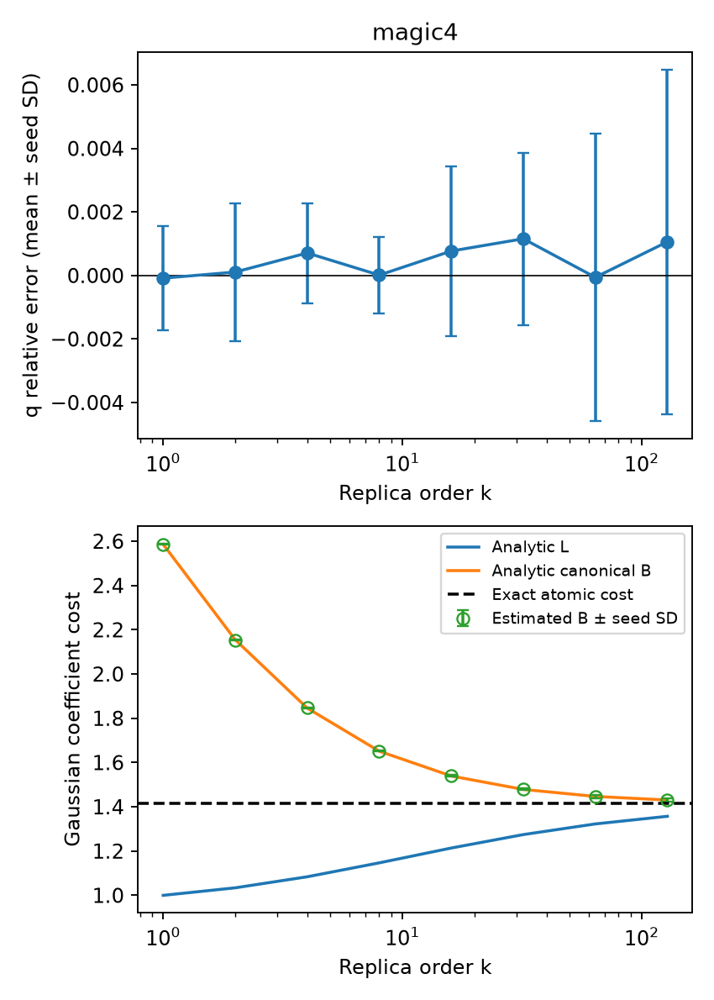

# E0 高阶解析基准

运行状态：`complete`。

使用通用 Gaussian 流形采样后端，未向积分器提供目标态的高阶解析积分。独立种子间 Student-t 区间是经验误差诊断，不是严格覆盖证明。

| 对象 | β | Z 相对误差均值 | 95% 重复半宽 | 1%经验门槛 | Gaussian纯度 |
|---|---:|---:|---:|---|---|
| magic4 | 0.5 | 0.0003039 | 0.001343 | True | True |
| magic4 | 1 | -8.394e-05 | 0.002049 | True | True |
| magic4 | 1.5 | -0.0004153 | 0.002047 | True | True |
| magic4 | 2 | 0.0001078 | 0.002688 | True | True |
| magic4 | 3.5 | 0.0005191 | 0.001973 | True | True |
| magic4 | 4 | 0.0007088 | 0.001954 | True | True |
| magic4 | 7.5 | -0.0001012 | 0.001364 | True | True |
| magic4 | 8 | 1.162e-05 | 0.001502 | True | True |
| magic4 | 15.5 | 0.0007843 | 0.003308 | True | True |
| magic4 | 16 | 0.0007698 | 0.003321 | True | True |
| magic4 | 31.5 | 0.001175 | 0.003359 | True | True |
| magic4 | 32 | 0.001156 | 0.003366 | True | True |
| magic4 | 63.5 | -5.448e-05 | 0.005629 | True | True |
| magic4 | 64 | -5.724e-05 | 0.005629 | True | True |
| magic4 | 127.5 | 0.001048 | 0.006753 | True | True |
| magic4 | 128 | 0.00106 | 0.006736 | True | True |

图中空心点为数值积分估计。纯 Gaussian 的真实最小成本及解析 L 均为 1；canonical B 在有限阶大于 1 是分解本身的成本，不能解释为非 Gaussian 资源。

本报告只覆盖 E0 的解析对象。FK 的 k=4 独立重构、E1–E5 和相应认证仍须逐项完成；此基准运行完成不等于整个方案完成。
