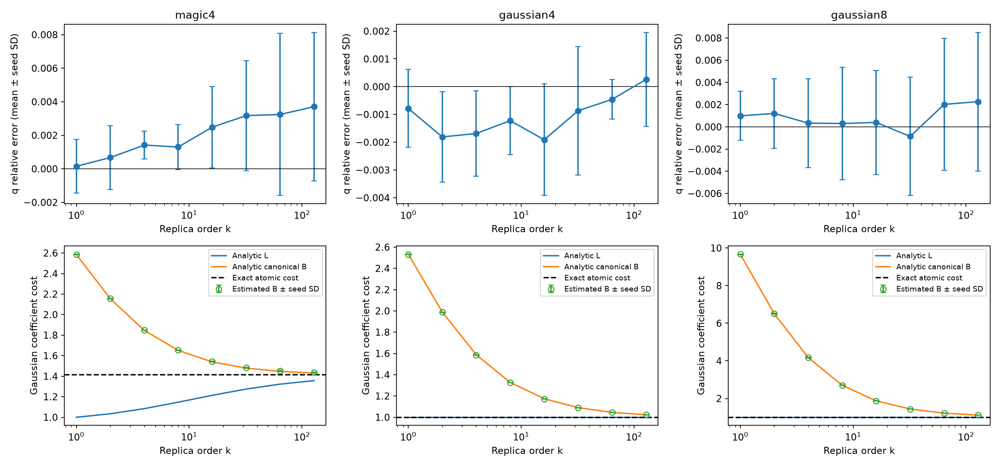

# E0 高阶解析基准

运行状态：`complete`。

使用通用 Gaussian 流形采样后端，未向积分器提供目标态的高阶解析积分。独立种子间 Student-t 区间是经验误差诊断，不是严格覆盖证明。

| 对象 | β | Z 相对误差均值 | 95% 重复半宽 | 1%经验门槛 | Gaussian纯度 |
|---|---:|---:|---:|---|---|
| magic4 | 0.5 | 0.0003039 | 0.001343 | True | True |
| magic4 | 1 | 0.0001521 | 0.001981 | True | True |
| magic4 | 1.5 | 0.0004331 | 0.001906 | True | True |
| magic4 | 2 | 0.0006712 | 0.002375 | True | True |
| magic4 | 3.5 | 0.001358 | 0.0008934 | True | True |
| magic4 | 4 | 0.001417 | 0.001037 | True | True |
| magic4 | 7.5 | 0.001259 | 0.001571 | True | True |
| magic4 | 8 | 0.0013 | 0.001672 | True | True |
| magic4 | 15.5 | 0.002503 | 0.002878 | True | True |
| magic4 | 16 | 0.002486 | 0.003015 | True | True |
| magic4 | 31.5 | 0.003207 | 0.004087 | True | True |
| magic4 | 32 | 0.003171 | 0.004081 | True | True |
| magic4 | 63.5 | 0.003247 | 0.006035 | True | True |
| magic4 | 64 | 0.003242 | 0.006003 | True | True |
| magic4 | 127.5 | 0.003707 | 0.005503 | True | True |
| magic4 | 128 | 0.003708 | 0.005503 | True | True |
| gaussian4 | 0.5 | -0.0006603 | 0.001454 | True | True |
| gaussian4 | 1 | -0.000782 | 0.001742 | True | True |
| gaussian4 | 1.5 | -0.001096 | 0.001738 | True | True |
| gaussian4 | 2 | -0.00181 | 0.002021 | True | True |
| gaussian4 | 3.5 | -0.001565 | 0.001784 | True | True |
| gaussian4 | 4 | -0.001686 | 0.001913 | True | True |
| gaussian4 | 7.5 | -0.001203 | 0.001402 | True | True |
| gaussian4 | 8 | -0.001224 | 0.001524 | True | True |
| gaussian4 | 15.5 | -0.001884 | 0.002637 | True | True |
| gaussian4 | 16 | -0.001912 | 0.002495 | True | True |
| gaussian4 | 31.5 | -0.0008955 | 0.002882 | True | True |
| gaussian4 | 32 | -0.0008651 | 0.002874 | True | True |
| gaussian4 | 63.5 | -0.0004293 | 0.0008729 | True | True |
| gaussian4 | 64 | -0.0004555 | 0.0008838 | True | True |
| gaussian4 | 127.5 | 0.0002521 | 0.002113 | True | True |
| gaussian4 | 128 | 0.0002618 | 0.002106 | True | True |
| gaussian8 | 0.5 | 0.0002798 | 0.0012 | True | True |
| gaussian8 | 1 | 0.0009925 | 0.00273 | True | True |
| gaussian8 | 1.5 | 0.0006981 | 0.003661 | True | True |
| gaussian8 | 2 | 0.001205 | 0.003903 | True | True |
| gaussian8 | 3.5 | 0.0004598 | 0.004913 | True | True |
| gaussian8 | 4 | 0.0003366 | 0.004963 | True | True |
| gaussian8 | 7.5 | 0.0004374 | 0.005423 | True | True |
| gaussian8 | 8 | 0.0003019 | 0.006269 | True | True |
| gaussian8 | 15.5 | 0.0005633 | 0.006088 | True | True |
| gaussian8 | 16 | 0.0003958 | 0.005814 | True | True |
| gaussian8 | 31.5 | -0.0008553 | 0.006753 | True | True |
| gaussian8 | 32 | -0.000861 | 0.006609 | True | True |
| gaussian8 | 63.5 | 0.002026 | 0.007362 | True | True |
| gaussian8 | 64 | 0.002023 | 0.007393 | True | True |
| gaussian8 | 127.5 | 0.002287 | 0.007745 | True | True |
| gaussian8 | 128 | 0.002266 | 0.00775 | True | True |

图中空心点为数值积分估计。纯 Gaussian 的真实最小成本及解析 L 均为 1；canonical B 在有限阶大于 1 是分解本身的成本，不能解释为非 Gaussian 资源。

本报告只覆盖 E0 的解析对象。FK 的 k=4 独立重构、E1–E5 和相应认证仍须逐项完成；此基准运行完成不等于整个方案完成。
