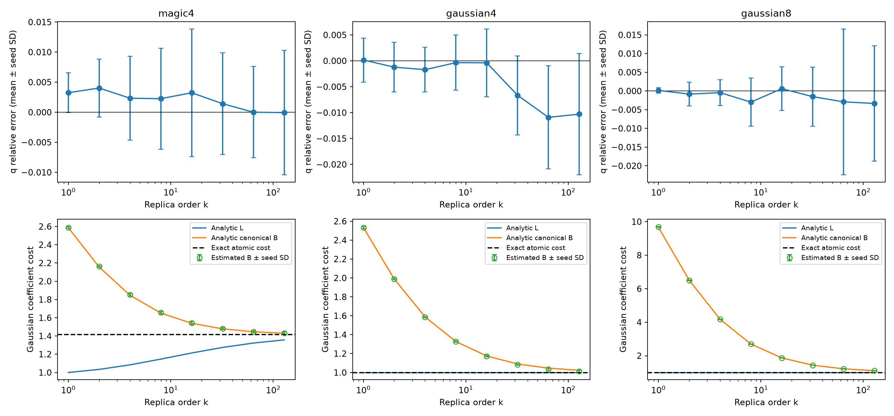

# E0 高阶解析基准

运行状态：`complete`。

使用通用 Gaussian 流形采样后端，未向积分器提供目标态的高阶解析积分。独立种子间 Student-t 区间是经验误差诊断，不是严格覆盖证明。

| 对象 | β | Z 相对误差均值 | 95% 重复半宽 | 1%经验门槛 | Gaussian纯度 |
|---|---:|---:|---:|---|---|
| magic4 | 0.5 | 0.001441 | 0.004587 | True | True |
| magic4 | 1 | 0.003249 | 0.004106 | True | True |
| magic4 | 1.5 | 0.004186 | 0.004318 | True | True |
| magic4 | 2 | 0.004026 | 0.005981 | True | True |
| magic4 | 3.5 | 0.002749 | 0.008864 | True | True |
| magic4 | 4 | 0.002329 | 0.008646 | True | True |
| magic4 | 7.5 | 0.002596 | 0.01057 | False | True |
| magic4 | 8 | 0.002257 | 0.01045 | False | True |
| magic4 | 15.5 | 0.003137 | 0.01292 | False | True |
| magic4 | 16 | 0.003238 | 0.0132 | False | True |
| magic4 | 31.5 | 0.001551 | 0.01047 | False | True |
| magic4 | 32 | 0.00142 | 0.01053 | False | True |
| magic4 | 63.5 | 7.35e-05 | 0.009442 | True | True |
| magic4 | 64 | 7.412e-06 | 0.00943 | True | True |
| magic4 | 127.5 | -5.827e-05 | 0.01286 | False | True |
| magic4 | 128 | -5.897e-05 | 0.01285 | False | True |
| gaussian4 | 0.5 | 5.145e-05 | 0.00494 | True | True |
| gaussian4 | 1 | 0.0001666 | 0.005281 | True | True |
| gaussian4 | 1.5 | -0.000576 | 0.004693 | True | True |
| gaussian4 | 2 | -0.001221 | 0.005942 | True | True |
| gaussian4 | 3.5 | -0.002113 | 0.005141 | True | True |
| gaussian4 | 4 | -0.001709 | 0.005368 | True | True |
| gaussian4 | 7.5 | -0.0006237 | 0.005923 | True | True |
| gaussian4 | 8 | -0.000348 | 0.006627 | True | True |
| gaussian4 | 15.5 | -0.0006002 | 0.008152 | True | True |
| gaussian4 | 16 | -0.0003785 | 0.008129 | True | True |
| gaussian4 | 31.5 | -0.006653 | 0.009572 | True | True |
| gaussian4 | 32 | -0.006654 | 0.009474 | True | True |
| gaussian4 | 63.5 | -0.01086 | 0.01236 | False | True |
| gaussian4 | 64 | -0.01091 | 0.01234 | False | True |
| gaussian4 | 127.5 | -0.01027 | 0.01452 | False | True |
| gaussian4 | 128 | -0.01029 | 0.01455 | False | True |
| gaussian8 | 0.5 | 0.002185 | 0.002965 | True | True |
| gaussian8 | 1 | 0.0001532 | 0.0008796 | True | True |
| gaussian8 | 1.5 | -0.001086 | 0.00568 | True | True |
| gaussian8 | 2 | -0.0008427 | 0.003934 | True | True |
| gaussian8 | 3.5 | -0.0001134 | 0.004287 | True | True |
| gaussian8 | 4 | -0.0004395 | 0.004288 | True | True |
| gaussian8 | 7.5 | -0.002655 | 0.007994 | True | True |
| gaussian8 | 8 | -0.002978 | 0.00805 | True | True |
| gaussian8 | 15.5 | 0.0005608 | 0.007599 | True | True |
| gaussian8 | 16 | 0.0006168 | 0.007218 | True | True |
| gaussian8 | 31.5 | -0.001734 | 0.009568 | True | True |
| gaussian8 | 32 | -0.00151 | 0.009809 | True | True |
| gaussian8 | 63.5 | -0.003138 | 0.02436 | False | True |
| gaussian8 | 64 | -0.002909 | 0.02421 | False | True |
| gaussian8 | 127.5 | -0.003361 | 0.01917 | False | True |
| gaussian8 | 128 | -0.003339 | 0.01919 | False | True |

图中空心点为数值积分估计。纯 Gaussian 的真实最小成本及解析 L 均为 1；canonical B 在有限阶大于 1 是分解本身的成本，不能解释为非 Gaussian 资源。

本报告只覆盖 E0 的解析对象。FK 的 k=4 独立重构、E1–E5 和相应认证仍须逐项完成；此基准运行完成不等于整个方案完成。
