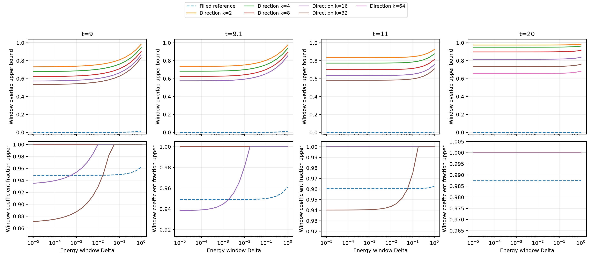

# Replica方向与能窗组成必要性

对不同阶数得到的方向，统一使用精确k=4矩的区间上界归一化；因此这些是完整Gaussian字典上的有效witness，但不是高阶N_k认证。精确物理基态由完整256维谱间隙与残差包围。

能窗内振幅满足 |g0|≤1、|g4|≤sqrt(3/2)X、|g8|≤X²/4，因此重叠上界为 |beta0|+sqrt(3/2)|beta4|X+|beta8|X²/4。若此上界小于1，凸对偶不等式给出任何成本≤U的精确分解在该能窗内的系数质量比例上界。

默认U是明确给定的条件阈值；若另传入cost-certificates，同时使用该证书包围的实际Gaussian修补构造上界，此时存在成本≤U的精确表示。每行cost_threshold_kind区分两者。超过1的比例界按1截断并明确标为无信息。filled参考单列为source k=0，它不是replica优化结果。

| t | 方向来源k | 归一化k | Delta | U | L严格下界 | 能窗h严格上界 | 窗内质量占比上界 | 非平凡 |
|---:|---:|---:|---:|---:|---:|---:|---:|---|
| 9 | 2 | 4 | 0.01 | 2 | 1.140087 | 0.7561062 | 1 | False |
| 9 | 2 | 4 | 0.01 | 1.88253 | 1.140087 | 0.7561062 | 1 | False |
| 9 | 4 | 4 | 0.01 | 2 | 1.143744 | 0.7046988 | 1 | False |
| 9 | 4 | 4 | 0.01 | 1.88253 | 1.143744 | 0.7046988 | 1 | False |
| 9 | 8 | 4 | 0.01 | 2 | 1.140191 | 0.649432 | 1 | False |
| 9 | 8 | 4 | 0.01 | 1.88253 | 1.140191 | 0.649432 | 1 | False |
| 9 | 16 | 4 | 0.01 | 2 | 1.131439 | 0.6016275 | 1 | False |
| 9 | 16 | 4 | 0.01 | 1.88253 | 1.131439 | 0.6016275 | 1 | False |
| 9 | 32 | 4 | 0.01 | 2 | 1.11843 | 0.5631844 | 1 | False |
| 9 | 32 | 4 | 0.01 | 1.88253 | 1.11843 | 0.5631844 | 0.9292032 | True |
| 9 | 0 | 4 | 0.01 | 2 | 0.09712859 | 0.0001388889 | 0.9515679 | True |
| 9 | 0 | 4 | 0.01 | 1.88253 | 0.09712859 | 0.0001388889 | 0.9485371 | True |
| 9.1 | 2 | 4 | 0.01 | 2 | 1.138647 | 0.7527562 | 1 | False |
| 9.1 | 2 | 4 | 0.01 | 1.877 | 1.138647 | 0.7527562 | 1 | False |
| 9.1 | 4 | 4 | 0.01 | 2 | 1.142484 | 0.7000564 | 1 | False |
| 9.1 | 4 | 4 | 0.01 | 1.877 | 1.142484 | 0.7000564 | 1 | False |
| 9.1 | 8 | 4 | 0.01 | 2 | 1.138753 | 0.6432947 | 1 | False |
| 9.1 | 8 | 4 | 0.01 | 1.877 | 1.138753 | 0.6432947 | 1 | False |
| 9.1 | 16 | 4 | 0.01 | 2 | 1.129595 | 0.5941413 | 1 | False |
| 9.1 | 16 | 4 | 0.01 | 1.877 | 1.129595 | 0.5941413 | 0.9811102 | True |
| 9.1 | 0 | 4 | 0.01 | 2 | 0.09564704 | 5.585137e-05 | 0.9522297 | True |
| 9.1 | 0 | 4 | 0.01 | 1.877 | 0.09564704 | 5.585137e-05 | 0.9490957 | True |
| 11 | 2 | 4 | 0.01 | 2 | 1.106594 | 0.8354763 | 1 | False |
| 11 | 2 | 4 | 0.01 | 1.75146 | 1.106594 | 0.8354763 | 1 | False |
| 11 | 4 | 4 | 0.01 | 2 | 1.113766 | 0.7746778 | 1 | False |
| 11 | 4 | 4 | 0.01 | 1.75146 | 1.113766 | 0.7746778 | 1 | False |
| 11 | 8 | 4 | 0.01 | 2 | 1.106116 | 0.701952 | 1 | False |
| 11 | 8 | 4 | 0.01 | 1.75146 | 1.106116 | 0.701952 | 1 | False |
| 11 | 16 | 4 | 0.01 | 2 | 1.088165 | 0.6364809 | 1 | False |
| 11 | 16 | 4 | 0.01 | 1.75146 | 1.088165 | 0.6364809 | 1 | False |
| 11 | 32 | 4 | 0.01 | 2 | 1.063484 | 0.5837445 | 1 | False |
| 11 | 32 | 4 | 0.01 | 1.75146 | 1.063484 | 0.5837445 | 0.943654 | True |
| 11 | 0 | 4 | 0.01 | 2 | 0.06944453 | 3.884431e-07 | 0.9652781 | True |
| 11 | 0 | 4 | 0.01 | 1.75146 | 0.06944453 | 3.884431e-07 | 0.9603508 | True |
| 20 | 2 | 4 | 0.01 | 2 | 1.020925 | 0.9753021 | 1 | False |
| 20 | 2 | 4 | 0.01 | 1.29742 | 1.020925 | 0.9753021 | 1 | False |
| 20 | 4 | 4 | 0.01 | 2 | 1.025652 | 0.951081 | 1 | False |
| 20 | 4 | 4 | 0.01 | 1.29742 | 1.025652 | 0.951081 | 1 | False |
| 20 | 8 | 4 | 0.01 | 2 | 1.014312 | 0.898272 | 1 | False |
| 20 | 8 | 4 | 0.01 | 1.29742 | 1.014312 | 0.898272 | 1 | False |
| 20 | 16 | 4 | 0.01 | 2 | 0.974194 | 0.8166326 | 1 | False |
| 20 | 16 | 4 | 0.01 | 1.29742 | 0.974194 | 0.8166326 | 1 | False |
| 20 | 32 | 4 | 0.01 | 2 | 0.9197841 | 0.7349711 | 1 | False |
| 20 | 32 | 4 | 0.01 | 1.29742 | 0.9197841 | 0.7349711 | 1 | False |
| 20 | 64 | 4 | 0.01 | 2 | 0.850505 | 0.6569421 | 1 | False |
| 20 | 64 | 4 | 0.01 | 1.29742 | 0.850505 | 0.6569421 | 1 | False |
| 20 | 0 | 4 | 0.01 | 2 | 0.01636035 | 1.291082e-08 | 0.9918198 | True |
| 20 | 0 | 4 | 0.01 | 1.29742 | 0.01636035 | 1.291082e-08 | 0.9873901 | True |

完整21个窗口、归一化证书、物理基态误差与原始向量均在summary.json和NPZ。方向变化是否改进此保守证书由实际表值判断，不能从高阶标签预设。

图中全部witness采用同一精确q4归一化；U为独立Gaussian修补构造的已认证成本上界。比例上界1表示无排除信息。每个下方面板的纵轴范围已标出，不能把小幅改善解释成强接触恢复。
