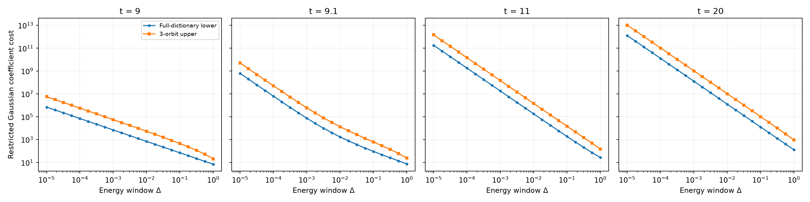

# 完整 Gaussian 字典的能窗成本障碍

用解析不等式给出完整 Gaussian 字典的下界；三个窗内 Gaussian 轨道给出构造上界。系数由显式根式公式以 90 位精度计算，未用窗外 Fock 修补。浮点表格不标记为有向区间认证。

| t | 预期指数 | 下界拟合斜率 | 上界拟合斜率 |
|---:|---:|---:|---:|
| 9 | -1 | -1.000000 | -1.003268 |
| 9.1 | -2 | -1.974786 | -1.975597 |
| 11 | -2 | -1.999932 | -1.999980 |
| 20 | -2 | -1.999998 | -2.000011 |

该指数来自解析上下界，图中拟合作为独立数值检查，不是只对一个构造拟合后便声称完整字典定理。误差容许 0、1e−6、1e−3、1e−2 的全部结果保存在 summary.json。若允许误差消除目标在相反 hopping Gaussian 上的分量，所给 Δ⁻² 下界自然失效；程序保留这一情况。

当前 witness 检查使用 order-2 区间归一化及能窗重叠包络。它不能替代方案要求的高阶 witness 比较；未得到非平凡质量限制时明确保存 vacuous 结果。

推导见实验根目录 ENERGY_WINDOW_THEORY.md。完整 E3 还包括固定 witness 接触几何及高阶 witness 的能窗排除实验。
