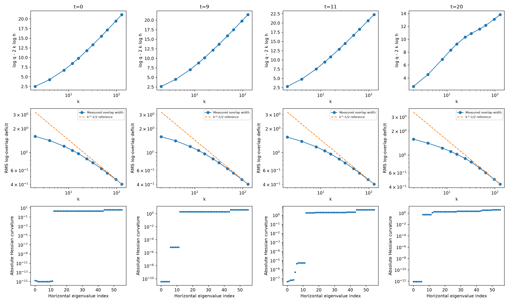

# 固定 witness 的几何标度

所有 replica 阶数使用同一个预先冻结的 witness。t=0 的完整 Gaussian 支持值为解析结果；其余点使用局部支持值作探索性拟合，不能据此认证全局接触维数。

| t | 2×log k 拟合斜率（均值±重复95%半宽） | 原始宽度幂 | 最佳接触梯度范数 | Hessian 6–12 方向 |
|---:|---:|---:|---:|---|
| 0 | 11.91 ± 0.097 | -0.4544 | 4.6e-11 | 1.17e-17 … 1.3e-15 |
| 9 | 11.99 ± 0.093 | -0.4545 | 3.88e-09 | 7.12e-06 … 7.12e-06 |
| 11 | 11.89 ± 0.12 | -0.4538 | 3e-06 | 4.62e-06 … 5.49e-06 |
| 20 | 6.817 ± 0.19 | -0.4734 | 5.01e-11 | 0.537 … 0.537 |

t=0 的解析接触流形为 S⁶×S⁶，维数 12。拟合与之相符；原始有限阶宽度幂尚未达到 −1/2，加入 1/k 修正的敏感性结果保存在 fits.json。

t=9、11 的另外六个 Hessian 曲率约为 10⁻⁶ 量级。在 k≤128 的窗口中，这些方向仍表现为很软的方向，因此 moment 拟合的有效维数约为 12，不能直接等同于按固定 10⁻⁶ 阈值数出的零特征值个数。t=11 的局部站稳精度也不足以作精确维数分类。

t=20 的有限阶拟合趋近较低维数，但仍有拟合窗口和逆阶修正依赖。非零 t 的全局支持认证尚未完成；不宣称在 t=10 或其他参数处证明了接触流形突变。
