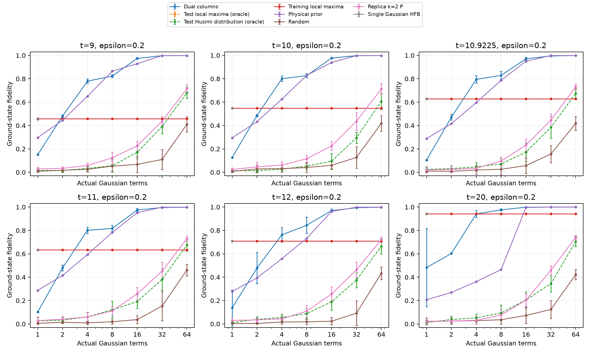
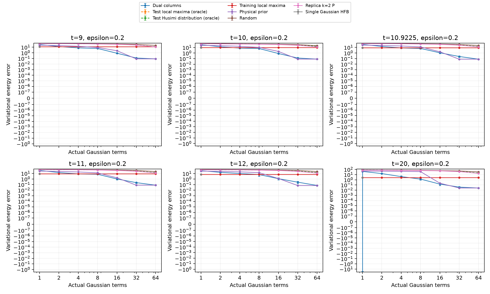

# 冻结 Gaussian 字典：相干核与非均匀扰动对照

已完成并独立核验 7500 个预测，覆盖 6 个 t、5 个扰动强度、5 个随机重复。当前 replica 字典为 replica_k2_P；高阶对照未齐，不将本轮视为完整 E4/E5 结论。

所有普通字典在新 Hamiltonian 的 ED 之前冻结；系数由 H/S 广义本征问题得到。ED 随后计算验证指标。两类 test oracle 明确使用测试目标：局部最大化与精确 Haar 拒绝采样的 Husimi 分布，不能称为预测方法。

计数是实际完整 Gaussian ket 数目；没有把 Spin(7) 轨道代表当作一个 Gaussian 项。HFB 只报告1项。局部最大化字典可能退化，表中同时报告保留秩。误差线是五个随机重复的经验 Student-t 95% 半宽。

## 扰动迁移

以下为 epsilon=0.2、32项（HFB为1项）的均值。完整所有预算/扰动/误差线在 aggregates.csv。

| t | 方法 | 实际项数 | 保留秩 | 保真度 | 能量误差 | 质量关联误差 | Wick偏离误差 |
|---:|---|---:|---:|---:|---:|---:|---:|
| 9 | Dual columns | 32 | 32 | 0.9974684 | 0.11707 | 0.032627 | 0.015988 |
| 9 | Test local maxima (oracle) | 32 | 1 | 0.4580262 | 12.083 | 1.1148 | 4.4773 |
| 9 | Test Husimi distribution (oracle) | 32 | 32 | 0.3915734 | 24.681 | 3.1281 | 2.5318 |
| 9 | Training local maxima | 32 | 1 | 0.4580262 | 12.083 | 1.1148 | 4.4773 |
| 9 | Physical prior | 32 | 24 | 0.9982019 | 0.083048 | 0.058206 | 0.030757 |
| 9 | Random | 32 | 32 | 0.1096997 | 31.792 | 4.9492 | 4.2061 |
| 9 | Replica k=2 P | 32 | 32 | 0.4371291 | 23.872 | 3.4515 | 2.6142 |
| 9 | Single Gaussian HFB | 1 | 1 | 0.4540145 | 12.068 | 0.93617 | 4.4773 |
| 10 | Dual columns | 32 | 32 | 0.9973918 | 0.12737 | 0.033145 | 0.0097217 |
| 10 | Test local maxima (oracle) | 32 | 1 | 0.5487299 | 10.082 | 0.059673 | 4.8855 |
| 10 | Test Husimi distribution (oracle) | 32 | 32 | 0.2949589 | 28.606 | 4.6929 | 3.497 |
| 10 | Training local maxima | 32 | 1 | 0.5487299 | 10.082 | 0.059673 | 4.8855 |
| 10 | Physical prior | 32 | 24 | 0.9982756 | 0.082195 | 0.059673 | 0.020982 |
| 10 | Random | 32 | 32 | 0.1271135 | 32.949 | 5.6897 | 4.3765 |
| 10 | Replica k=2 P | 32 | 32 | 0.4363728 | 24.617 | 3.5349 | 2.5099 |
| 10 | Single Gaussian HFB | 1 | 1 | 0.5487299 | 10.082 | 0.059673 | 4.8855 |
| 10.9225 | Dual columns | 32 | 32 | 0.9950264 | 0.23277 | 0.037737 | 0.013067 |
| 10.9225 | Test local maxima (oracle) | 32 | 1 | 0.6282261 | 8.5586 | 0.73093 | 5.0124 |
| 10.9225 | Test Husimi distribution (oracle) | 32 | 32 | 0.384043 | 27.146 | 4.3471 | 2.7936 |
| 10.9225 | Training local maxima | 32 | 1 | 0.6282261 | 8.5586 | 0.73093 | 5.0124 |
| 10.9225 | Physical prior | 32 | 24 | 0.9984273 | 0.077594 | 0.054127 | 0.007764 |
| 10.9225 | Random | 32 | 32 | 0.1563225 | 32.952 | 6.1887 | 4.301 |
| 10.9225 | Replica k=2 P | 32 | 32 | 0.445835 | 24.484 | 3.925 | 2.554 |
| 10.9225 | Single Gaussian HFB | 1 | 1 | 0.6282261 | 8.5586 | 0.73093 | 5.0124 |
| 11 | Dual columns | 32 | 32 | 0.9951887 | 0.21859 | 0.042613 | 0.0145 |
| 11 | Test local maxima (oracle) | 32 | 1 | 0.6345308 | 8.444 | 0.78785 | 5.0128 |
| 11 | Test Husimi distribution (oracle) | 32 | 32 | 0.3803474 | 26.857 | 4.4891 | 2.9258 |
| 11 | Training local maxima | 32 | 1 | 0.6345308 | 8.444 | 0.78785 | 5.0128 |
| 11 | Physical prior | 32 | 24 | 0.9984424 | 0.077088 | 0.053423 | 0.0066057 |
| 11 | Random | 32 | 32 | 0.1526083 | 33.49 | 6.4182 | 4.4928 |
| 11 | Replica k=2 P | 32 | 32 | 0.4517847 | 24.158 | 4.2093 | 2.5779 |
| 11 | Single Gaussian HFB | 1 | 1 | 0.6345308 | 8.444 | 0.78785 | 5.0128 |
| 12 | Dual columns | 32 | 32 | 0.9939886 | 0.28001 | 0.061175 | 0.012363 |
| 12 | Test local maxima (oracle) | 32 | 1 | 0.7090261 | 7.1323 | 1.3886 | 4.9033 |
| 12 | Test Husimi distribution (oracle) | 32 | 32 | 0.3745878 | 28.405 | 5.1909 | 3.0401 |
| 12 | Training local maxima | 32 | 1 | 0.7090261 | 7.1323 | 1.3886 | 4.9033 |
| 12 | Physical prior | 32 | 24 | 0.9986527 | 0.069605 | 0.042463 | 0.007324 |
| 12 | Random | 32 | 32 | 0.09183098 | 35.905 | 7.5206 | 4.67 |
| 12 | Replica k=2 P | 32 | 32 | 0.4629044 | 24.601 | 4.3598 | 2.3974 |
| 12 | Single Gaussian HFB | 1 | 1 | 0.7090261 | 7.1323 | 1.3886 | 4.9033 |
| 20 | Dual columns | 32 | 32 | 0.9995339 | 0.03801 | 0.0040628 | 0.020868 |
| 20 | Test local maxima (oracle) | 32 | 1 | 0.9421469 | 2.767 | 1.8471 | 2.6372 |
| 20 | Test Husimi distribution (oracle) | 32 | 32 | 0.3440615 | 43.225 | 5.6128 | 1.0138 |
| 20 | Training local maxima | 32 | 1 | 0.9421469 | 2.767 | 1.8471 | 2.6372 |
| 20 | Physical prior | 32 | 24 | 0.9996615 | 0.025853 | 0.0050213 | 0.022567 |
| 20 | Random | 32 | 32 | 0.1237436 | 50.645 | 7.5209 | 2.2081 |
| 20 | Replica k=2 P | 32 | 32 | 0.4580866 | 37.603 | 4.7391 | 0.53492 |
| 20 | Single Gaussian HFB | 1 | 1 | 0.9421469 | 2.767 | 1.8471 | 2.6372 |

## 相干与非相干组成

以下为 epsilon=0、32项（HFB为1项）。非相干混合使用同一组原子和 |c_i|² 归一化权重；其 Wick 预测从混合协方差重新计算。相干矩阵的对角部分和该归一化混合不是同一量。所有 H、质量关联和三个四点算符的完整核保存在逐预测 NPZ。

| t | 方法 | 相干Wick偏离 | 非相干Wick偏离 | 质量关联非对角贡献 |
|---:|---|---:|---:|---:|
| 9 | Dual columns | -4.49324 | -1.10979 | -5.6822 |
| 9 | Test local maxima (oracle) | -1.04805e-14 | -1.1724e-14 | -6.78125 |
| 9 | Test Husimi distribution (oracle) | -1.72707 | -0.142326 | -2.31872 |
| 9 | Training local maxima | -1.08358e-14 | -1.10134e-14 | -6.78125 |
| 9 | Physical prior | -4.50801 | -3.16483 | 1.85567 |
| 9 | Random | -0.384351 | -0.0103484 | -0.956392 |
| 9 | Replica k=2 P | -1.85632 | -0.208384 | -2.19886 |
| 9 | Single Gaussian HFB | 1.95399e-15 | 3.01981e-15 | 0 |
| 10 | Dual columns | -4.89523 | -1.58642 | -6.64441 |
| 10 | Test local maxima (oracle) | -6.03961e-15 | -7.63833e-15 | -6.78125 |
| 10 | Test Husimi distribution (oracle) | -1.93243 | -0.203052 | -2.6636 |
| 10 | Training local maxima | -6.92779e-15 | -7.63833e-15 | -6.78125 |
| 10 | Physical prior | -4.90649 | -3.14088 | -0.747459 |
| 10 | Random | -0.491413 | -0.047472 | -1.15165 |
| 10 | Replica k=2 P | -2.40548 | -0.209907 | -3.17743 |
| 10 | Single Gaussian HFB | -1.63425e-14 | -1.52767e-14 | 0 |
| 10.9225 | Dual columns | -4.99944 | -1.9169 | -7.33535 |
| 10.9225 | Test local maxima (oracle) | -4.26326e-15 | -4.9738e-15 | -6.78125 |
| 10.9225 | Test Husimi distribution (oracle) | -2.03602 | -0.107471 | -2.99132 |
| 10.9225 | Training local maxima | -5.68434e-15 | -5.50671e-15 | -6.78125 |
| 10.9225 | Physical prior | -5.02015 | -3.25441 | -2.86815 |
| 10.9225 | Random | -0.7025 | -0.0234392 | -1.48075 |
| 10.9225 | Replica k=2 P | -2.46721 | -0.221307 | -3.53008 |
| 10.9225 | Single Gaussian HFB | -1.03029e-14 | -9.23706e-15 | 0 |
| 11 | Dual columns | -5.00001 | -1.94615 | -7.39707 |
| 11 | Test local maxima (oracle) | -4.26326e-15 | -4.79616e-15 | -6.78125 |
| 11 | Test Husimi distribution (oracle) | -1.99245 | -0.134839 | -2.94866 |
| 11 | Training local maxima | -5.15143e-15 | -5.68434e-15 | -6.78125 |
| 11 | Physical prior | -5.01942 | -3.11293 | -3.21829 |
| 11 | Random | -0.523899 | -0.0961787 | -1.21173 |
| 11 | Replica k=2 P | -2.45383 | -0.17988 | -3.36778 |
| 11 | Single Gaussian HFB | -8.70415e-15 | -6.39488e-15 | 0 |
| 12 | Dual columns | -4.89131 | -2.03302 | -7.92202 |
| 12 | Test local maxima (oracle) | -1.95399e-15 | -3.73035e-15 | -6.78125 |
| 12 | Test Husimi distribution (oracle) | -1.95599 | -0.141589 | -2.94883 |
| 12 | Training local maxima | -3.90799e-15 | -4.08562e-15 | -6.78125 |
| 12 | Physical prior | -4.89602 | -3.23527 | -5.13392 |
| 12 | Random | -0.239679 | -0.0294894 | -0.745946 |
| 12 | Replica k=2 P | -2.52539 | -0.20846 | -3.80259 |
| 12 | Single Gaussian HFB | -8.34888e-15 | -7.4607e-15 | 0 |
| 20 | Dual columns | -2.61632 | -1.82163 | -8.40528 |
| 20 | Test local maxima (oracle) | -2.13163e-15 | -1.42109e-15 | -6.78125 |
| 20 | Test Husimi distribution (oracle) | -1.66822 | -0.162395 | -3.16572 |
| 20 | Training local maxima | -1.42109e-15 | -2.13163e-15 | -6.78125 |
| 20 | Physical prior | -2.61463 | -2.39621 | -8.11878 |
| 20 | Random | -0.455349 | -0.0754814 | -1.23258 |
| 20 | Replica k=2 P | -2.13727 | -0.209478 | -3.84188 |
| 20 | Single Gaussian HFB | -3.19744e-15 | -2.4869e-15 | 0 |

## 成本与证据范围

aggregates.csv 分别给出来源计算、候选生成、选择、预测和总冷启动秒数。上游 witness/采样/列生成整轮可复用成本均计入，未按字典数量均摊；因此总冷启动列是保守共享成本口径，不是相同时限竞赛。GPU批次与CPU批次的时间也不能直接当作硬件无关复杂度。

独立核验重新构造完整256维 Hamiltonian、所有相干核、完整 Majorana 协方差和三项 Wick 收缩；用SVD子空间本征值交叉检查广义本征求解，并核验冻结原子哈希、真实项数、Gaussian纯度与成本求和。

这些观测量比较刻画给定有限字典和预算的限制；不会仅凭Wick峰附近的数值变化声称已证明高阶接触集合突变或唯一必需构型。

## 依赖计时审计

请使用 `cost_audited_aggregates.csv` 的成本列。审计递归计入前阶witness、冻结验证来源及精确矩构造，并在一次冷启动依赖图中去重；原始预测数组和旧计时列保留。`cost_audit.json` 列出每一项来源。总和是记录到的计算时间，包含共享上游工作；不等于多卡并行墙钟时间，不包含未计时的进程启动/初始化，也不声称是等时预算比较。
