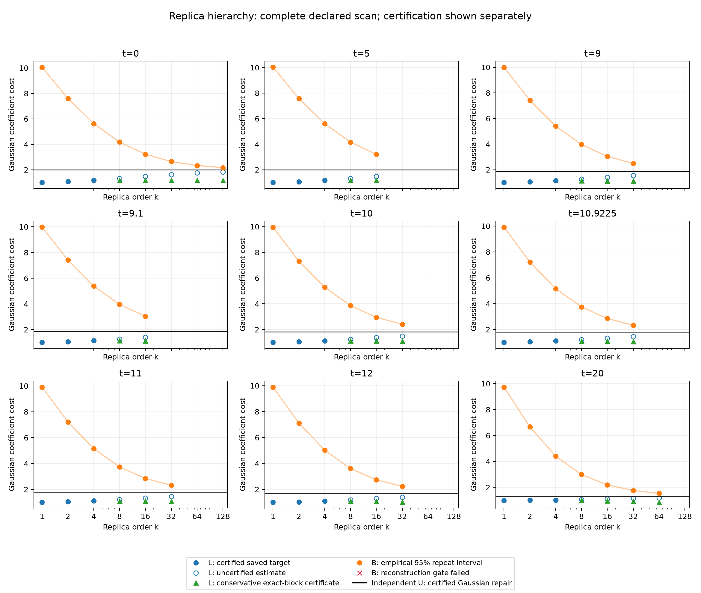

# Figure 1：Replica hierarchy 扫描

仅绘制已测量的数据；分级扫描没有要求所有参数与阶数的笛卡尔积。红叉表示重构门槛未通过。k=1、2、4 的 L 和完整态残差已用解析/精确矩验证；k≥8 的 canonical L 仍是未认证的积分点估计。绿色三角单独表示有精确Nk上界的保守witness，不能与canonical归一化混同。B 保留五次独立重复的经验不确定度。

| t | k | L | B ± 95%半宽 | U_best | rho | 验收 |
|---:|---:|---:|---:|---:|---:|---|
| 0 | 1 | 1 | 10.04878 ± 0.033 | 2 | 2.93e-16 | True |
| 0 | 2 | 1.066335 | 7.602844 ± 0.0078 | 2 | 3.69e-16 | True |
| 0 | 4 | 1.170733 | 5.626412 ± 0.0057 | 2 | 4.5e-16 | True |
| 0 | 8 | 1.312222（未认证） | 4.177135 ± 0.0013 | 2 | 0.00018 | True |
| 0 | 16 | 1.47208（未认证） | 3.21671 ± 0.00078 | 2 | 4.45e-15 | True |
| 0 | 32 | 1.624109（未认证） | 2.64553 ± 0.00048 | 2 | 3.8e-15 | True |
| 0 | 64 | 1.749416（未认证） | 2.332925 ± 0.00043 | 2 | 1.84e-15 | True |
| 0 | 128 | 1.841684（未认证） | 2.169163 ± 8.8e-05 | 2 | 4.88e-15 | True |
| 5 | 1 | 1 | 10.0353 ± 0.02 | 1.993739 | 2.75e-16 | True |
| 5 | 2 | 1.065403 | 7.566412 ± 0.035 | 1.993739 | 3.13e-16 | True |
| 5 | 4 | 1.168448 | 5.605715 ± 0.0056 | 1.993739 | 4.4e-16 | True |
| 5 | 8 | 1.308349（未认证） | 4.159992 ± 0.0011 | 1.993739 | 0.000128 | True |
| 5 | 16 | 1.466933（未认证） | 3.202982 ± 0.00065 | 1.993739 | 7.81e-05 | True |
| 9 | 1 | 1 | 9.990946 ± 0.041 | 1.882532 | 2.23e-16 | True |
| 9 | 2 | 1.055329 | 7.419471 ± 0.026 | 1.882532 | 4.27e-12 | True |
| 9 | 4 | 1.143744 | 5.400913 ± 0.0058 | 1.882532 | 5.82e-13 | True |
| 9 | 8 | 1.265992（未认证） | 3.967651 ± 0.00062 | 1.882532 | 0.000195 | True |
| 9 | 16 | 1.40652（未认证） | 3.037938 ± 0.00064 | 1.882532 | 0.000257 | True |
| 9 | 32 | 1.541121（未认证） | 2.49032 ± 0.00015 | 1.882532 | 0.000124 | True |
| 9.1 | 1 | 1 | 9.982596 ± 0.02 | 1.877002 | 1.7e-16 | True |
| 9.1 | 2 | 1.054811 | 7.408267 ± 0.016 | 1.877002 | 5.16e-12 | True |
| 9.1 | 4 | 1.142484 | 5.389885 ± 0.006 | 1.877002 | 8.81e-13 | True |
| 9.1 | 8 | 1.263792（未认证） | 3.957579 ± 0.00078 | 1.877002 | 0.000203 | True |
| 9.1 | 16 | 1.403479（未认证） | 3.0295 ± 0.00049 | 1.877002 | 0.000399 | True |
| 10 | 1 | 1 | 9.955894 ± 0.03 | 1.821548 | 2.49e-16 | True |
| 10 | 2 | 1.049592 | 7.312812 ± 0.012 | 1.821548 | 3.01e-16 | True |
| 10 | 4 | 1.129793 | 5.289006 ± 0.0057 | 1.821548 | 5.33e-16 | True |
| 10 | 8 | 1.242148（未认证） | 3.86014 ± 0.00036 | 1.821548 | 0.000135 | True |
| 10 | 16 | 1.372943（未认证） | 2.946888 ± 0.00048 | 1.821548 | 0.00052 | True |
| 10 | 32 | 1.498853（未认证） | 2.411877 ± 0.00032 | 1.821548 | 0.00013 | True |
| 10.9225 | 1 | 1 | 9.912398 ± 0.034 | 1.757069 | 1.99e-16 | True |
| 10.9225 | 2 | 1.04355 | 7.225812 ± 0.021 | 1.757069 | 3.31e-16 | True |
| 10.9225 | 4 | 1.115043 | 5.162716 ± 0.009 | 1.757069 | 9.96e-16 | True |
| 10.9225 | 8 | 1.216909（未认证） | 3.74707 ± 0.00036 | 1.757069 | 0.000145 | True |
| 10.9225 | 16 | 1.337291（未认证） | 2.8509 ± 0.00047 | 1.757069 | 1.9e-05 | True |
| 10.9225 | 32 | 1.454155（未认证） | 2.329475 ± 0.00029 | 1.757069 | 0.000105 | True |
| 11 | 1 | 1 | 9.906648 ± 0.032 | 1.751459 | 1.64e-16 | True |
| 11 | 2 | 1.043029 | 7.211088 ± 0.018 | 1.751459 | 2.78e-16 | True |
| 11 | 4 | 1.113766 | 5.151558 ± 0.01 | 1.751459 | 2.37e-16 | True |
| 11 | 8 | 1.214714（未认证） | 3.737376 ± 0.00072 | 1.751459 | 0.000442 | True |
| 11 | 16 | 1.334097（未认证） | 2.842332 ± 0.00037 | 1.751459 | 0.000272 | True |
| 11 | 32 | 1.450253（未认证） | 2.322105 ± 8e-05 | 1.751459 | 0.000381 | True |
| 12 | 1 | 1 | 9.888276 ± 0.035 | 1.678656 | 2.19e-16 | True |
| 12 | 2 | 1.036388 | 7.119217 ± 0.011 | 1.678656 | 1.97e-16 | True |
| 12 | 4 | 1.097379 | 5.019695 ± 0.011 | 1.678656 | 2.18e-16 | True |
| 12 | 8 | 1.186435（未认证） | 3.609862 ± 0.0015 | 1.678656 | 0.000157 | True |
| 12 | 16 | 1.294011（未认证） | 2.734752 ± 0.00032 | 1.678656 | 0.000199 | True |
| 12 | 32 | 1.399979（未认证） | 2.229633 ± 0.00028 | 1.678656 | 9.65e-05 | True |
| 20 | 1 | 1 | 9.727499 ± 0.031 | 1.297419 | 1.71e-16 | True |
| 20 | 2 | 1.008886 | 6.662438 ± 0.0071 | 1.297419 | 5.06e-16 | True |
| 20 | 4 | 1.025652 | 4.406263 ± 0.0035 | 1.297419 | 6.54e-16 | True |
| 20 | 8 | 1.054872（未认证） | 2.990561 ± 0.0008 | 1.297419 | 0.00017 | True |
| 20 | 16 | 1.098354（未认证） | 2.191447 ± 0.00046 | 1.297419 | 9.48e-05 | True |
| 20 | 32 | 1.149576（未认证） | 1.762985 ± 0.00025 | 1.297419 | 0.000151 | True |
| 20 | 64 | 1.19713（未认证） | 1.53682 ± 8.7e-05 | 1.297419 | 7.81e-07 | True |

U_best 在 t=0 采用精确解析值2。若传入cost-certificates，其他点采用相邻精确Gaussian分支与完整Fock修补的保守成本证书（IEEE舍入假设明确列出），原浮点成本另列保留；否则仍是浮点构造成本。canonical L的高阶点估计尚未认证，因此G_point依然不是严格缺口。

保存目标态到精确 Hamiltonian 基态的距离已有独立上界（<1.4e-14），可用于转移低阶 L；对应独立证书保存在 cartan_k2_physical_certificates_01 和 cartan_k4_physical_certificates_02。
