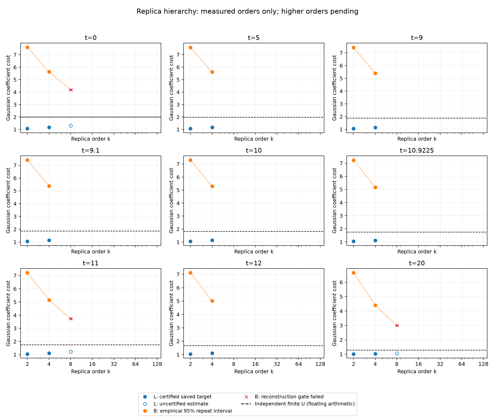

# Figure 1：Replica hierarchy 进度图

仅绘制已完成的数据。空白阶数尚未完成；红叉表示重构门槛未通过。k=2、4 的 L 和完整态残差已用精确矩验证，k=8 当前仍是未认证的积分点估计。B 均保留五次独立重复的经验不确定度。

| t | k | L | B ± 95%半宽 | U_best | rho | 验收 |
|---:|---:|---:|---:|---:|---:|---|
| 0 | 2 | 1.066335 | 7.602844 ± 0.0078 | 2 | 3.69e-16 | True |
| 0 | 4 | 1.170733 | 5.626412 ± 0.0057 | 2 | 4.5e-16 | True |
| 0 | 8 | 1.312089（未认证） | 4.194676 ± 0.013 | 2 | 0.00433 | False |
| 5 | 2 | 1.065403 | 7.566412 ± 0.035 | 1.990899 | 3.13e-16 | True |
| 5 | 4 | 1.168448 | 5.605715 ± 0.0056 | 1.990899 | 4.4e-16 | True |
| 9 | 2 | 1.055329 | 7.419471 ± 0.026 | 1.879852 | 4.27e-12 | True |
| 9 | 4 | 1.143744 | 5.400913 ± 0.0058 | 1.879852 | 5.82e-13 | True |
| 9.1 | 2 | 1.054811 | 7.408267 ± 0.016 | 1.87433 | 5.16e-12 | True |
| 9.1 | 4 | 1.142484 | 5.389885 ± 0.006 | 1.87433 | 8.81e-13 | True |
| 10 | 2 | 1.049592 | 7.312812 ± 0.012 | 1.818954 | 3.01e-16 | True |
| 10 | 4 | 1.129793 | 5.289006 ± 0.0057 | 1.818954 | 5.33e-16 | True |
| 10.9225 | 2 | 1.04355 | 7.225812 ± 0.021 | 1.754567 | 3.31e-16 | True |
| 10.9225 | 4 | 1.115043 | 5.162716 ± 0.009 | 1.754567 | 9.96e-16 | True |
| 11 | 2 | 1.043029 | 7.211088 ± 0.018 | 1.748965 | 2.78e-16 | True |
| 11 | 4 | 1.113766 | 5.151558 ± 0.01 | 1.748965 | 2.37e-16 | True |
| 11 | 8 | 1.214947（未认证） | 3.735277 ± 0.02 | 1.748965 | 0.000926 | False |
| 12 | 2 | 1.036388 | 7.119217 ± 0.011 | 1.676265 | 1.97e-16 | True |
| 12 | 4 | 1.097379 | 5.019695 ± 0.011 | 1.676265 | 2.18e-16 | True |
| 20 | 2 | 1.008886 | 6.662438 ± 0.0071 | 1.295572 | 5.06e-16 | True |
| 20 | 4 | 1.025652 | 4.406263 ± 0.0035 | 1.295572 | 6.54e-16 | True |
| 20 | 8 | 1.054617（未认证） | 3.003304 ± 0.0083 | 1.295572 | 0.00444 | False |

U_best 在 t=0 采用精确解析值 2；其他点为已独立复核的有限 Gaussian 构造，但尚无区间舍入证书。因此 observations.json 中的相对缺口保留为数值缺口，未称为严格认证缺口。

保存目标态到精确 Hamiltonian 基态的距离已有独立上界（<1.4e-14），可用于转移低阶 L；对应独立证书保存在 cartan_k2_physical_certificates_01 和 cartan_k4_physical_certificates_02。
