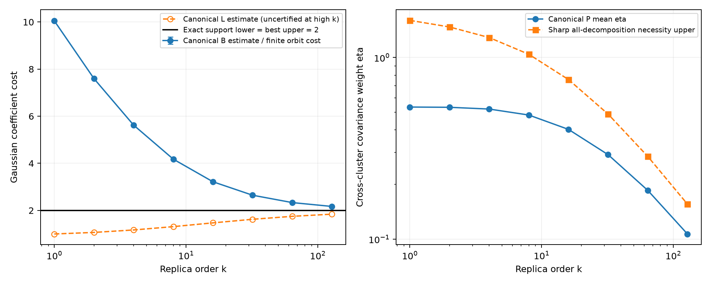
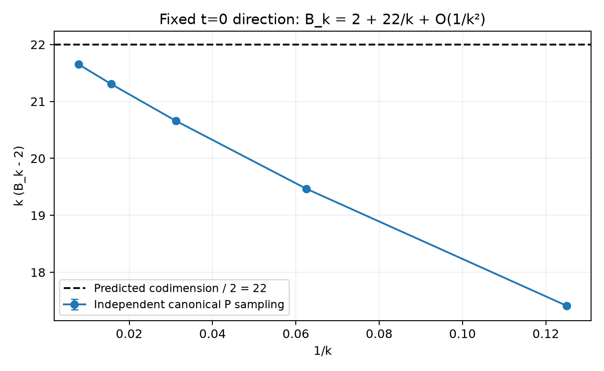

# t=0：精确方向的 canonical hierarchy

有限 Gaussian stabilizer 投影给出严格恒等式 C_k(s0)/q_k(s0)=s0，因此无需用噪声优化估计端点方向。P_k 使用 s0 的确定方向，B_k=1/E_P|<g|s0>|。五个独立采样重复提供成本与分布的经验误差。

每个有限粒子集还给出一个实际256N分支的完整 Gaussian 表示，成本就是表中每次重复的B估计。该构造的重构独立于积分归一化误差。逐粒子Gaussian纯度、全部256N项之和、系数成本和物理必要性包络均已重新核验。

| k | canonical L点估计 | B均值 | B重复95%半宽 | 最差完整分支残差 | 实际Gaussian项数/重复 |
|---:|---:|---:|---:|---:|---:|
| 1 | 1 | 10.04875 | 0.0214 | 5.5e-15 | 33554432 |
| 2 | 1.0663351 | 7.5958019 | 0.009083 | 4.79e-15 | 33554432 |
| 4 | 1.1707328 | 5.6208696 | 0.003256 | 5.34e-15 | 33554432 |
| 8 | 1.3122246 | 4.1765603 | 0.003578 | 4.07e-15 | 33554432 |
| 16 | 1.4720801 | 3.2167104 | 0.0007839 | 4.45e-15 | 33554432 |
| 32 | 1.624109 | 2.6455297 | 0.0004789 | 3.8e-15 | 33554432 |
| 64 | 1.7494161 | 2.3329248 | 0.0004324 | 1.84e-15 | 33554432 |
| 128 | 1.8416839 | 2.1691634 | 8.848e-05 | 4.88e-15 | 33554432 |

固定端点方向的完整Gaussian切空间Hessian有12个零方向、44个正法向方向，Morse–Bott展开给出 B_k=2+22/k+O(k^−2)。22由几何推导，未从图中拟合；证明见PRODUCT_MAGIC_ASYMPTOTICS.md。尚无有限k余项包围，因此此式不代替积分认证。

精确支持归一化给出的L=2与独立最优U=2是另一条认证路线，图中和canonical L点估计分开显示。k>4的q积分、估计的canonical径向尺度和B积分误差仍未做区间认证。有限表示的代数重构恒等式不等于宣称保存的近似数值u具有精确C_k(u)=s0。

256N项按“父Gaussian ket + 有限酉变换 + 系数”因式化保存。没有把一个投影向量计成一个Gaussian项，也没有用这项数代替E5预算。旧的未通过k8随机重构运行保持原样。
