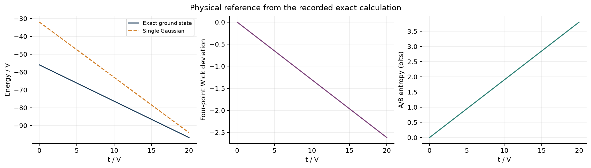
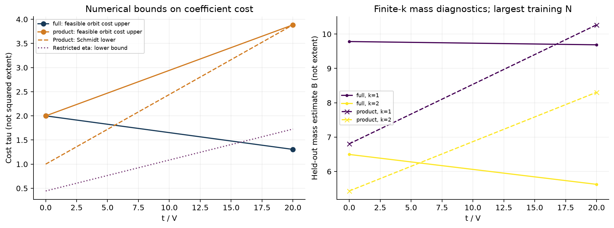
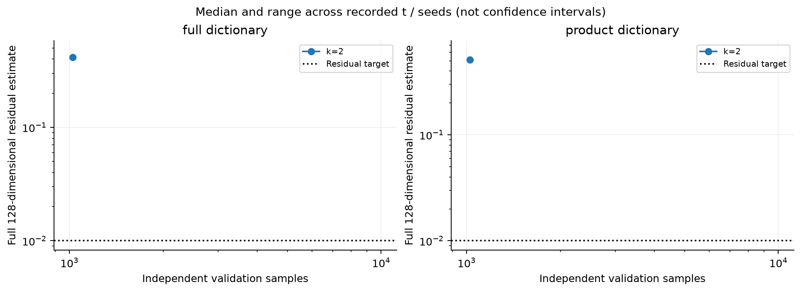

# 双 FK 团簇：首轮实验报告

本报告由同目录的原始 JSON 自动生成。精确参考、有限字典可行表示与有限 k 连续合成分别报告；所有计算采用 V=1。

运行状态：`complete_with_limits`。精确模型结构核验：`True`。
已记录 16 条合成结果，其中 k≥2 为 8 条；通过重构门槛 0 条，允许分布解释 0 条。

**尚无通过分布解释门槛的 k≥2 结果，因此不生成或解释高阶 Gaussian 分布。** 下面的有限 k 系数质量仅作诊断，不证明 canonical 分布收敛，也不证明其解释了四点关联峰。

## 配置与执行状态

- 字典：`['full', 'product']`；随机种子：`[20261023]`。
- t/V：`[0, 20]`；k：`[1, 2]`；训练样本阶梯：`[256, 1024]`。
- 重构容差：0.01；阶段预算：180 秒；总预算：1800 秒；内存预算：512 MiB。
- 合成阶段状态计数：`{'complete': 2}`。
- k≥2 统计状态计数：`{'validation_budget_exceeded': 8}`。

## 精确物理与单 Gaussian 基线

完整 Fock 空间基态能量与三维约化的最大差为 2.84217e-14。
已计算网格上的最小能隙为 21。Wick 偏差峰搜索返回 t/V=10.9225，|W|=5.02015，优化成功标志为 `True`。
这些量来自精确对角化和单 Gaussian 解析基线；不属于连续 Gaussian 合成的产出。

## 可行表示成本与受限字典比较

SOCP 只优化有限的 Spin(7) 轨道字典。轨道平均后的原子保持投影范数，不能重新归一化；系数质量加上 Fock 残差修复给出数值可行上界。求解器的 optimal 状态不证明完整 Gaussian 字典的最优性。

| 字典 | t/V | 可行成本上界 | 重构残差 | product Schmidt 下界 | 受限 eta 下界 | 数值分离 |
|---|---:|---:|---:|---:|---:|---|
| full | 0 | 2 | 1.25065e-13 | 1 | 0.444444 | 否 |
| full | 20 | 1.30549 | 4.24856e-14 | 3.8853 | 1.7268 | 是 |
| product | 0 | 2 | 1.09923e-14 | 1 | 0.444444 | 否 |
| product | 20 | 3.8853 | 1.62078e-14 | 3.8853 | 1.7268 | 否 |

full 字典出现数值成本分离的 t/V：`[20.0]`。
**成本分离为浮点数值证据，不是区间算术证明。** 未对特征向量、轨道平均和舍入误差作严格包络；该结论也不意味着 full 成本已达到最优。

右图展示各组最大训练样本量处的独立验证质量估计，曲线为种子中位数，阴影为种子范围；它们不是置信区间。B_k 是有限 k 表示质量，B_k² 不能直接标记为精确 Gaussian extent。未通过重构的 B_k 不能单独作为目标态的可行成本。

## 连续合成与独立重构

优化坐标只有三维；验证仍在完整128维偶宇称空间计算。训练梯度小或投影内残差小均不能代替完整重构检查。独立验证样本估计值与统计证书状态同时保留。

图中范围跨越 t 点和随机种子，不能解释为采样置信区间。若部分组提前停止，较大 N 的曲线可能仅包含尚在运行的组，不能据此断言整体收敛。

下表每个 t/k/种子仅保留最大训练样本量记录；质量与残差的范围跨种子汇总。

| 字典 | t/V | k | 种子数 | B 中位数 | 全残差范围 | 最小质量 ESS | 重构通过数 |
|---|---:|---:|---:|---:|---|---:|---:|
| full | 0 | 1 | 1 | 9.78286 | 0 – 0 | 807.699 | 1 |
| full | 0 | 2 | 1 | 6.49567 | 0.403758 – 0.403758 | 322.834 | 0 |
| full | 20 | 1 | 1 | 9.68785 | 0 – 0 | 740.344 | 1 |
| full | 20 | 2 | 1 | 5.62551 | 0.42001 – 0.42001 | 162.401 | 0 |
| product | 0 | 1 | 1 | 6.80557 | 0 – 0 | 367.551 | 1 |
| product | 0 | 2 | 1 | 5.43233 | 0.530888 – 0.530888 | 117.625 | 0 |
| product | 20 | 1 | 1 | 10.2686 | 0 – 0 | 817.493 | 1 |
| product | 20 | 2 | 1 | 8.30514 | 0.485053 – 0.485053 | 353.971 | 0 |

k=1 的 frame 恒等式可给出解析重构；其通过状态不代表高阶权重集中问题已解决。高 k 的低有效样本数、验证残差或统计预算不足均须在增加物理解释前解决。

## 数据与可复现范围

- `config.json`：实际配置；`manifest.json`：环境、源码与随机数来源记录。
- `exact.json`、`baselines.json`：物理参考和可行表示；`baseline_vectors.npz`：原子、系数、目标与残差。
- `calibration_*.json`、`pilot_*.json`：采样校准、全部阶段状态与逐条结果。
- `witnesses_*.npz`、`distributions_*.npz`：原始 witness 和分布数据；是否可解释由对应 JSON 的验收标志决定。
- `figures/`：本报告的 PNG 和 PDF。图表直接读取同目录 JSON，没有手工填入实验数值。

所有物理关联都需要相干 ket 重构或成分间矩阵元；Gaussian 成分的经典平均不能替代目标态四点关联。
