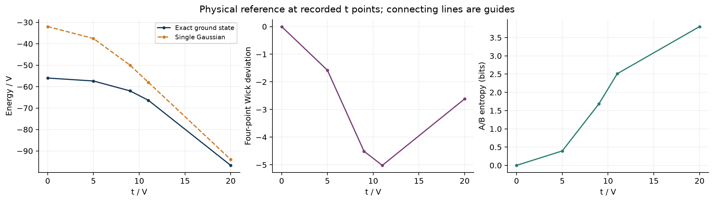
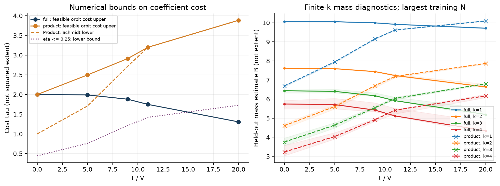
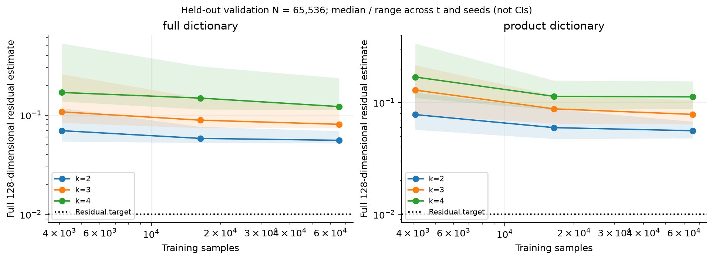

# 双 FK 团簇：首轮实验报告

本报告由同目录的原始 JSON 自动生成。精确参考、有限字典可行表示与有限 k 连续合成分别报告；所有计算采用 V=1。

运行状态：`complete_with_limits`。精确模型结构核验：`True`。
已记录 360 条合成结果，其中 k≥2 为 270 条；通过重构门槛 0 条，允许分布解释 0 条。

**尚无通过分布解释门槛的 k≥2 结果，因此不生成或解释高阶 Gaussian 分布。** 下面的有限 k 系数质量仅作诊断，不证明 canonical 分布收敛，也不证明其解释了四点关联峰。

## 配置与执行状态

- 字典：`['full', 'product']`；随机种子：`[20261023, 20261024, 20261025]`。
- t/V：`[0, 5, 9, 11, 20]`；k：`[1, 2, 3, 4]`；训练样本阶梯：`[4096, 16384, 65536]`。
- 重构容差：0.01；阶段预算：180 秒；总预算：1800 秒；内存预算：512 MiB。
- 合成阶段状态计数：`{'complete': 6}`。
- k≥2 统计状态计数：`{'validation_budget_exceeded': 270}`。

## 精确物理与单 Gaussian 基线

完整 Fock 空间基态能量与三维约化的最大差为 4.26326e-14。
已计算网格上的最小能隙为 17.1353。Wick 偏差峰搜索返回 t/V=10.9225，|W|=5.02015，优化成功标志为 `True`。
这些量来自精确对角化和单 Gaussian 解析基线；不属于连续 Gaussian 合成的产出。

## 可行表示成本与受限字典比较

SOCP 只优化有限的 Spin(7) 轨道字典。轨道平均后的原子保持投影范数，不能重新归一化；系数质量加上 Fock 残差修复给出数值可行上界。求解器的 optimal 状态不证明完整 Gaussian 字典的最优性。

| 字典 | t/V | 可行成本上界 | 重构残差 | product Schmidt 下界 | 受限 eta 下界 | 数值分离 |
|---|---:|---:|---:|---:|---:|---|
| full | 0 | 2 | 1.25065e-13 | 1 | 0.444444 | 否 |
| full | 5 | 1.99093 | 3.48057e-15 | 1.70972 | 0.759877 | 否 |
| full | 9 | 1.88024 | 1.95804e-13 | 2.7196 | 1.20871 | 否 |
| full | 11 | 1.74927 | 9.10536e-14 | 3.19935 | 1.42194 | 否 |
| full | 20 | 1.30549 | 4.24856e-14 | 3.8853 | 1.7268 | 是 |
| product | 0 | 2 | 1.09923e-14 | 1 | 0.444444 | 否 |
| product | 5 | 2.49748 | 3.98148e-15 | 1.70972 | 0.759877 | 否 |
| product | 9 | 2.91386 | 4.45096e-14 | 2.7196 | 1.20871 | 否 |
| product | 11 | 3.19935 | 1.50994e-13 | 3.19935 | 1.42194 | 否 |
| product | 20 | 3.8853 | 1.62078e-14 | 3.8853 | 1.7268 | 否 |

full 字典出现数值成本分离的 t/V：`[20.0]`。
**成本分离为浮点数值证据，不是区间算术证明。** 未对特征向量、轨道平均和舍入误差作严格包络；该结论也不意味着 full 成本已达到最优。

右图展示各组最大训练样本量处的独立验证质量估计，曲线为种子中位数，阴影为种子范围；它们不是置信区间。B_k 是有限 k 表示质量，B_k² 不能直接标记为精确 Gaussian extent。未通过重构的 B_k 不能单独作为目标态的可行成本。

## 连续合成与独立重构

优化坐标只有三维；验证仍在完整128维偶宇称空间计算。训练梯度小或投影内残差小均不能代替完整重构检查。独立验证样本估计值与统计证书状态同时保留。

横轴为训练样本量，独立验证样本量记录为 `[65536]`。验证样本量固定时，增加横轴 N 并不降低独立重构积分的 Monte Carlo 噪声。
图中范围跨越 t 点和随机种子，不能解释为采样置信区间。若部分组提前停止，较大训练 N 的曲线可能仅包含尚在运行的组，不能据此断言整体收敛。

下表每个 t/k/种子仅保留最大训练样本量记录；质量与残差的范围跨种子汇总。

| 字典 | t/V | k | 种子数 | B 中位数 | 全残差范围 | 最小质量 ESS | 重构通过数 |
|---|---:|---:|---:|---:|---|---:|---:|
| full | 0 | 1 | 3 | 10.0609 | 2.22416e-16 – 2.22416e-16 | 51695.5 | 3 |
| full | 0 | 2 | 3 | 7.61628 | 0.0518278 – 0.0546525 | 20025.9 | 0 |
| full | 0 | 3 | 3 | 6.43727 | 0.0751729 – 0.0792271 | 6539.17 | 0 |
| full | 0 | 4 | 3 | 5.7424 | 0.11775 – 0.141222 | 1916.75 | 0 |
| full | 5 | 1 | 3 | 10.052 | 1.93046e-16 – 1.93046e-16 | 51609.2 | 3 |
| full | 5 | 2 | 3 | 7.59118 | 0.0529607 – 0.0555487 | 19838.3 | 0 |
| full | 5 | 3 | 3 | 6.40281 | 0.0738008 – 0.0852662 | 6342.39 | 0 |
| full | 5 | 4 | 3 | 5.71127 | 0.114417 – 0.162476 | 1794.54 | 0 |
| full | 9 | 1 | 3 | 9.99223 | 1.30185e-16 – 1.30185e-16 | 50965.3 | 3 |
| full | 9 | 2 | 3 | 7.43893 | 0.054138 – 0.0578873 | 18377.2 | 0 |
| full | 9 | 3 | 3 | 6.17303 | 0.0752874 – 0.0911283 | 5608.51 | 0 |
| full | 9 | 4 | 3 | 5.42093 | 0.112311 – 0.166207 | 1632.89 | 0 |
| full | 11 | 1 | 3 | 9.91578 | 7.85046e-17 – 7.85046e-17 | 50210.5 | 3 |
| full | 11 | 2 | 3 | 7.23252 | 0.0556583 – 0.060843 | 16749.2 | 0 |
| full | 11 | 3 | 3 | 5.9153 | 0.0805939 – 0.0971136 | 4737.3 | 0 |
| full | 11 | 4 | 3 | 5.11498 | 0.121517 – 0.16896 | 1357.27 | 0 |
| full | 20 | 1 | 3 | 9.71112 | 2.25487e-16 – 2.25487e-16 | 48141.5 | 3 |
| full | 20 | 2 | 3 | 6.6335 | 0.0586346 – 0.068703 | 12810.5 | 0 |
| full | 20 | 3 | 3 | 5.19281 | 0.095642 – 0.122755 | 2642.98 | 0 |
| full | 20 | 4 | 3 | 4.33776 | 0.152335 – 0.234829 | 457.849 | 0 |
| product | 0 | 1 | 3 | 6.68857 | 2.22416e-16 – 2.22416e-16 | 22834.3 | 3 |
| product | 0 | 2 | 3 | 4.60627 | 0.0559717 – 0.0672688 | 7090.61 | 0 |
| product | 0 | 3 | 3 | 3.7511 | 0.0783699 – 0.10525 | 2422.48 | 0 |
| product | 0 | 4 | 3 | 3.22889 | 0.112456 – 0.154762 | 955.98 | 0 |
| product | 5 | 1 | 3 | 7.94784 | 1.93046e-16 – 1.93046e-16 | 32291.6 | 3 |
| product | 5 | 2 | 3 | 5.60797 | 0.0555405 – 0.0670804 | 10632.3 | 0 |
| product | 5 | 3 | 3 | 4.63437 | 0.0781781 – 0.1023 | 3758.54 | 0 |
| product | 5 | 4 | 3 | 4.03793 | 0.108233 – 0.146091 | 1487.13 | 0 |
| product | 9 | 1 | 3 | 9.15426 | 1.30185e-16 – 1.30185e-16 | 42974.7 | 3 |
| product | 9 | 2 | 3 | 6.70481 | 0.0528373 – 0.0650969 | 15520.4 | 0 |
| product | 9 | 3 | 3 | 5.54918 | 0.0761285 – 0.0928481 | 5519.39 | 0 |
| product | 9 | 4 | 3 | 4.91715 | 0.108348 – 0.123777 | 2120.19 | 0 |
| product | 11 | 1 | 3 | 9.61655 | 7.85046e-17 – 7.85046e-17 | 47419.8 | 3 |
| product | 11 | 2 | 3 | 7.18685 | 0.0515757 – 0.0629972 | 18266.6 | 0 |
| product | 11 | 3 | 3 | 6.03386 | 0.0730493 – 0.0878144 | 6816.38 | 0 |
| product | 11 | 4 | 3 | 5.41996 | 0.103364 – 0.1187 | 2756.93 | 0 |
| product | 20 | 1 | 3 | 10.0893 | 2.25487e-16 – 2.25487e-16 | 52167.6 | 3 |
| product | 20 | 2 | 3 | 7.8666 | 0.0477099 – 0.0576459 | 22996.4 | 0 |
| product | 20 | 3 | 3 | 6.80522 | 0.063997 – 0.0776607 | 9907.45 | 0 |
| product | 20 | 4 | 3 | 6.16924 | 0.0877427 – 0.0995273 | 4508.67 | 0 |

k=1 的 frame 恒等式可给出解析重构；其通过状态不代表高阶权重集中问题已解决。高 k 的低有效样本数、验证残差或统计预算不足均须在增加物理解释前解决。

## 数据与可复现范围

- `config.json`：实际配置；`manifest.json`：环境、源码与随机数来源记录。
- `exact.json`、`baselines.json`：物理参考和可行表示；`baseline_vectors.npz`：原子、系数、目标与残差。
- `calibration_*.json`、`pilot_*.json`：采样校准、全部阶段状态与逐条结果。
- `witnesses_*.npz`、`distributions_*.npz`：原始 witness 和分布数据；是否可解释由对应 JSON 的验收标志决定。
- `figures/`：本报告的 PNG 和 PDF。图表直接读取同目录 JSON，没有手工填入实验数值。

所有物理关联都需要相干 ket 重构或成分间矩阵元；Gaussian 成分的经典平均不能替代目标态四点关联。
