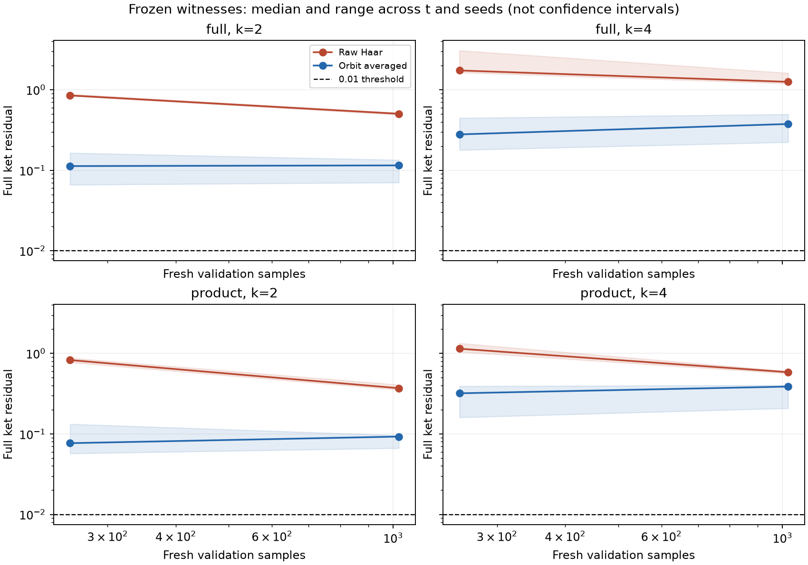
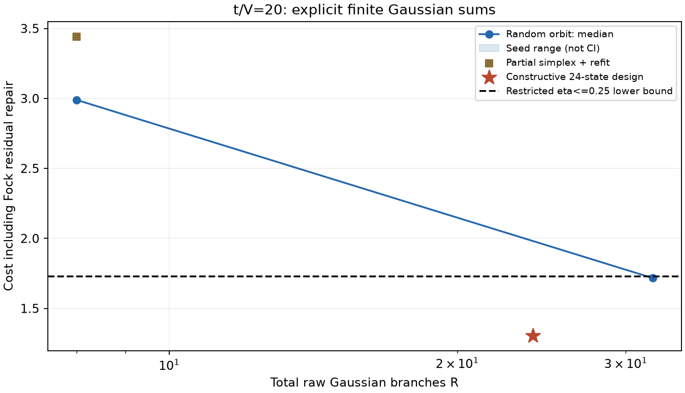

# FK 双团簇：第二轮实验报告

本轮研究对称性平均的积分方差、确定性 k=2 矩参考，以及 t/V=20 的显式有限 Gaussian 展开。首轮源码与数据作为冻结输入，原验收结果保持不变。

运行状态：`complete_with_limits`。所有数值证据仍使用浮点计算，未作区间算术认证。

## 主要结果

- 显式构造 **24 个 normalized Gaussian ket**，原始完整128维残差 **2.16212e-15**。
- 加上全部 Fock 残差与目标误差估计，成本上界 **1.30549195835**，受限 eta≤0.25 字典下界 **1.72679894103**；数值分离：**True**。
- Gaussian 纯性最大误差 1.111e-14；ket 与 covariance lift 最大误差 1.321e-14。
- full 字典 k=2 确定性矩参考通过：**True**。它独立计算目标函数与重构，不需要 Monte Carlo 拟合矩阵。
- 冻结首轮 witness、N=1024 的 12 条记录：普通重构通过 0 条，轨道平均重构通过 0 条。门槛为 0.01。

**确定性重构、有限展开成本、Monte Carlo 精度和统计置信保证分别报告。经验残差通过不等于联合95%统计认证；本轮没有颁发 Monte Carlo 统计证书。**

## 对称性平均与原始重构

两种估计使用同一批新样本，首轮 witness 不再调优。轨道平均 Pi g 有单位成本的 Gaussian 群轨道表示，未将 Pi g 归一化或冒充单个 Gaussian 态。补空间噪声的消除来自该表示的解析积分。

| 字典 | k | 记录数 | 原始残差中位 | 轨道残差中位 | 估计方差比 raw/orbit 中位 | 原始通过 | 轨道通过 |
|---|---:|---:|---:|---:|---:|---:|---:|
| full | 2 | 3 | 0.503969 | 0.115035 | 18.875 | 0 | 0 |
| full | 4 | 3 | 1.2554 | 0.376056 | 11.971 | 0 | 0 |
| product | 2 | 3 | 0.370097 | 0.0927469 | 18.826 | 0 | 0 |
| product | 4 | 3 | 0.584958 | 0.387472 | 15.297 | 0 | 0 |

横轴是本轮新增的独立验证样本量；训练量固定为65536。曲线为跨 t 点与种子的中位数，阴影为范围，均不是置信区间。方差比是单样本向量方差迹的估计比；两种方法共享采样，不能由此直接宣称同等倍数的端到端加速。

## k=2 确定性参考与训练误差

full 字典的对称二次张量空间可用 Gaussian Cartan projector 计算。限制到三维 witness 后得到6×6矩矩阵；本轮另外在完整二次张量空间收缩重构，避免仅通过投影宣告闭合。半整数幂的 B₂ 质量积分仍需独立估计，不能由 q₂ 精确可算推出最小成本已知。

| t/V | 来源 | N=65536记录数 | 目标残差中位(raw) | 目标残差中位(orbit) | 确定性重构偏差中位 |
|---:|---|---:|---:|---:|---:|
| 0 | frozen_pilot | 1 | 0.503969 | 0.134414 | 0.00515045 |
| 0 | deterministic_k2 | 1 | 0.501611 | 0.130991 | 3.64212e-16 |
| 11 | frozen_pilot | 1 | 0.517003 | 0.115035 | 0.00926189 |
| 11 | deterministic_k2 | 1 | 0.518854 | 0.116031 | 9.00538e-11 |
| 20 | frozen_pilot | 1 | 0.48822 | 0.0704723 | 0.0176883 |
| 20 | deterministic_k2 | 1 | 0.496014 | 0.0770621 | 1.87395e-11 |

解析 hopping Gaussian probe 单独标记为 `hopping_gaussian_probe`，不与物理目标通过数混合；product 字典不使用不适用的 full Gaussian probe 公式。所有 probe 标量参考及误差保存在 rb_full_*.json。

## 显式有限 Gaussian 展开

先合并首轮同相位射线的投影轨道，再在三维空间重拟合系数。针对选中的三个轨道，使用七维球面的8顶点正则单纯形；每个轨道都在完整128维空间验证有限平均等于连续投影。所有分支均保存原始 ket 和复系数，保留共同旋转的相对相位。

主结果使用 24 个 Gaussian 分支。完整数值 Fock 修补包含 128 个非零系数，其中超过1e-12的有 0 个；成本包含所有修补系数，不能仅按阈值删去。
每轨道有限平均的最大误差为 1.66702e-15。这是指定轨道的验证，不声称该设计对任意 Gaussian 原子都适用。

| 观测量 | 原始有限展开归一化后的绝对误差 |
|---|---:|
| energy | 2.84217e-14 |
| entropy | 4.44089e-16 |
| schmidt_l1 | 4.44089e-16 |
| mass_correlation | 1.77636e-15 |
| wick_prediction | 8.88178e-16 |
| wick_deviation | 8.88178e-16 |
| eta | 2.22045e-16 |
| mass_a | 1.86511e-30 |
| mass_b | 1.52061e-30 |
| mass_dot | 1.67575e-30 |

随机对照沿已选轨道的质量方向球面抽样，并在显式 Gaussian 列与 Fock 修补上统一做 SOCP；这不是全 Gaussian Haar 候选，也没有全局最优性保证。R始终表示总原始 Gaussian 分支数，修补计数另报。

| 方法 | R | 重复数 | 修补成本范围 | 原始残差范围 | 数值分离数 |
|---|---:|---:|---|---|---:|
| partial_simplex_finite_SOCP | 8 | 1 | 3.442722–3.442722 | 0.3795–0.3795 | 0 |
| random_spherical_orbit_finite_SOCP | 8 | 1 | 2.989524–2.989524 | 0.2376–0.2376 | 0 |
| random_spherical_orbit_finite_SOCP | 32 | 1 | 1.716887–1.716887 | 0.06695–0.06695 | 1 |
| specific_orbit_simplex_2_design | 24 | 1 | 1.305492–1.305492 | 2.162e-15–2.162e-15 | 1 |

## 结构字典消融

以下仅比较首轮保存候选的不同子集，均为轨道投影字典。它们用于判断随机 Haar 候选是否改善当前有限问题，不证明结构弧在全字典中全局最优。

| t/V | Fock | Fock+结构弧 | Fock+Haar | 全部首轮候选 |
|---:|---:|---:|---:|---:|
| 0 | 2 | 2 | 2 | 2 |
| 11 | 3.199354074 | 1.749273297 | 3.199354074 | 1.749273296 |
| 20 | 3.885297617 | 1.305491958 | 3.885297617 | 1.305491959 |

## 数据、资源与限制

- `exact_k2.json/npz`：确定性矩与 witness；`rb_*.json/npz`：配对估计、每个N的完整向量、统计量和源 witness 哈希。
- `finite_orbits.json/npz`：实际 Gaussian ket、复系数、全部 Fock 修补、covariance与相干观测量。`ablation.json/npz`：候选索引与系数。
- `manifest.json`：本轮源码、首轮后端、首轮输入文件哈希及依赖版本。`summary.json`：最终阶段状态、总耗时、峰值内存。
- 后处理只读取保存结果；独立审计在 `verification.json`，单元测试在 `unit_tests.log`。
- 成本分离是数值可行上界与解析受限下界的浮点评估；没有严格区间证书，也没有完整 Gaussian 字典最优性证明。
- k=4仍使用首轮经验 witness，若轨道平均后仍未达精度门槛，保留失败结果；本轮不升阶、不增加样本上限、不解释未通过的高阶物理分布。
