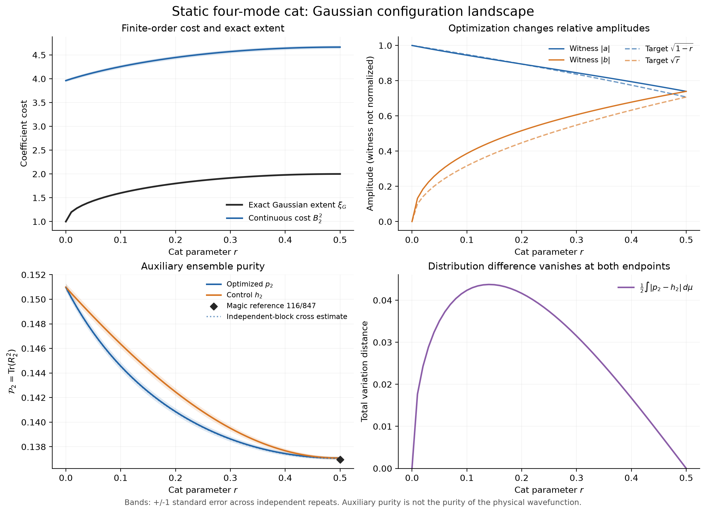

# 两个四模实验：结果与分析

两组数值实验、九个 SGD 锚点、全部图表和分析均已完成。实验代码与数据独立存放，通用库没有修改。

**静态实验完整验收通过；动力学的求解、九点中的五个 SGD 验收及所有预设不变量检查通过，但拉回占据直方图的少数 bin 未通过原定回归阈值，因此动力学整体保留 `failed_acceptance`。** 下文解释具体范围和附加诊断，不隐藏这个结果。

## 结果一览

| 项目 | 静态 asymmetric cat | 相互作用动力学 |
|---|---:|---:|
| 扫描点 | 51 | 81 |
| SGD 独立验收点 | 4/4 通过 | 5/5 通过 |
| 最大确定性求解残差 | 9.76×10⁻¹¹ | 7.91×10⁻¹¹ |
| 最大 SGD witness 误差 | 0.001064 | 0.001023 |
| 最大独立重构上界 | 0.027334 | 0.027004 |
| 正式重构样本总数 | 14,725,007 | 17,804,844 |
| 数值计算耗时 | 15.70 秒 | 28.00 秒 |
| 峰值 RSS | 99.92 MiB | 147.42 MiB |
| 预定检查 | 16/16 通过 | 48/50 通过 |

原有 40 项测试与新增 17 项实验测试全部通过。日志见 [主库测试](results/core_tests.log) 和 [实验测试](results/experiment_tests.log)。九个锚点的独立重构上界均小于 0.05，预先分配的失败概率合计为 0.05，因此这些重构界具有至少 95% 的联合覆盖保证；该统计保证依赖独立理想 Haar 采样，不覆盖浮点舍入，也不等同于整条分布曲线的置信保证。

## 静态：优化改变构型权重，但分布差异不是 magic 大小

在 r=0.1，目标态的真空/满占据系数是约 0.94868/0.31623，优化 witness 为约 0.94464/0.38634。满占据分量相对增强，两端构型的点态密度比从对照分布的 27 降到 14.6175。分布的平均构型占据数也从 h₂ 的约 1.6734 变为 p₂ 的约 1.7063。

扫描中两分布总变差距离最大约为 **0.04374**，出现在网格点 **r=0.14**。在 Gaussian 端点 r=0 和最大 magic 端点 r=0.5，两分布又都相同。因此，p₂ 与 h₂ 的差异反映优化的重新加权，不能直接用来排序 Gaussian magic。

辅助纯度从 r=0 时的 **0.150979** 降至 r=0.5 时的 **0.137081**；后者与解析值 **116/847 ≈ 0.136954** 一致。沿这条被扫描的态族，结果支持加权 Gaussian 构型平均相似度降低的描述，但没有证明它是一般态空间中的 magic 单调量，也不把小于抽样误差的局部变化解释为物理趋势。

有限阶连续成本与最小成本有显著差别：r=0 时精确 extent 是 **1**，连续成本 B₂² 约为 **3.9615**；r=0.5 时分别为 **2** 和 **4.6645**。这与 k=2 给出的较宽连续分布一致。Gaussian 目标也不对应一个点质量分布，其辅助 purity 不应预设为 1。

## 动态：直接计算复现静态归约，不变量与占据坐标需要分开

相互作用 H=U n₁n₃ 使 extent 按 **1+|sin(φ/2)|** 从 1 增长至 2，再回到 1。全空间直接求解与 Schmidt 参考的最大 witness 差为 **4.29×10⁻¹¹**。

对分布作独立 Haar 估计后，直接结果与静态预测的 purity 最大差为 **0.0001655**，TV 最大差为 **0.0002141**；谱和系数质量的预设不变量检查也全部通过。二次 Hamiltonian 对照保持 Gaussianity，辅助 ensemble 的纯度在采样误差范围内保持不变。

动态 magic 时刻 φ=π 的辅助纯度为 **0.1370385**，p₂=h₂；两分布差异的峰值出现在远离这个时刻的位置。这再次说明，分布重加权与 extent 衡量不同性质。

实验室坐标中的构型平均占据数在本次扫描中接近 2，最大偏差约 0.00172；它并不沿静态 cat 的平均占据曲线变化。图的下排把 Gaussian 构型用 U_G† 拉回静态坐标，再叠加独立静态参考。不能只比较原坐标占据图就否定 Gaussian-unitary 等价关系；也不能只看单个平均占据数就判断完整分布是否不变。

## 保留的失败检查与诊断

动力学拉回直方图有 **7/6480** 个逐 bin 比较超过原定 `max(6×合并标准误, 0.002)` 阈值：p₂ 为 4 个、h₂ 为 3 个。它们集中在四个参数点，其中三个相邻，实际差异约为 **0.263–0.288 个百分点**。其余预定检查均通过，但完整首次验收仍按规则记为未通过。

为了检查实现，重新使用原先记录的样本做了配对 Gaussian 协变检查：

- overlap 变换最大误差：**3.59×10⁻¹¹**；
- 同样本直方图恒等关系最大误差：**2.90×10⁻¹²**；
- 原直方图重放误差：不超过 **5.35×10⁻¹⁶**。

进一步使用原冻结样本计算自归一化比值的样本级 delta-method 近似标准误，七项差异约为 **1.98–2.94 个近似标准误**。四次重复在个别 bin 偶然聚得很紧，使原块间标准误偏小；加上多点比较，这些标记与有限采样波动相容。

上述解释支持坐标与权重实现正确，但属于**事后诊断**。没有换种子、追加正式样本、放宽阈值或修改原验收。完整细节与逐 bin 数值保存在 [动力学报告](results/quench/report.md) 和 [诊断 JSON](results/quench/histogram_diagnostics.json)。

## 如何使用这些结果

这两组实验验证了完整复空间求解、相干连续重构和 Gaussian-unitary 协变结构，并揭示了有限 k 分布、优化重加权和 exact extent 之间的区别。它们属于同一 Gaussian-unitary 一参数态族，不能被当作两类独立复杂多体物理验证。

如果下一步研究更复杂的相互作用，应保留当前精确小体系作回归基准。若需要对整条占据直方图给出稳定的联合统计验收，应在新实验开始前重新设计重复次数或同时误差界；本次结果不作事后追认。

## 文件入口

- [实现结构、数学约定与复现方法](README.md)
- [静态完整报告](results/static/report.md) · [逐点数据](results/static/summary.csv)
- [动力学完整报告](results/quench/report.md) · [逐点数据](results/quench/summary.csv)
- [静态总览 PDF](results/static/figures/static_overview.pdf) · [动力学总览 PDF](results/quench/figures/quench_overview.pdf)

每个实验各有 4 张图，均提供 PNG/PDF，共 16 个图文件；完整振幅、辅助矩阵、直方图和重复统计存于各结果目录的 NPZ 文件。图中的阴影为一个标准误差，不是 95% 置信区间。
