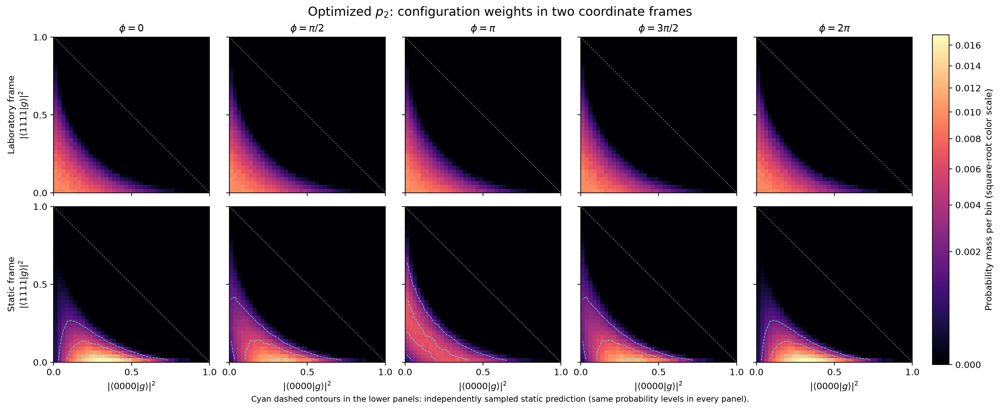
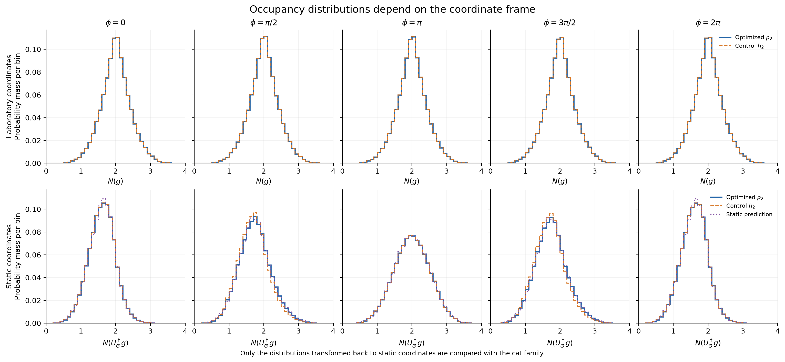
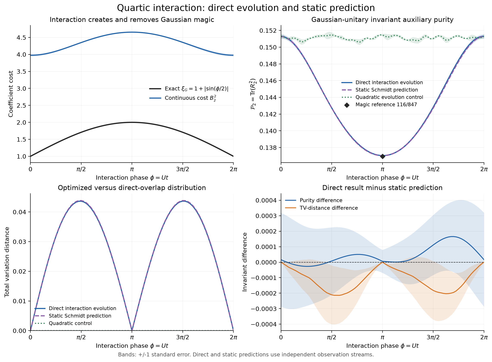
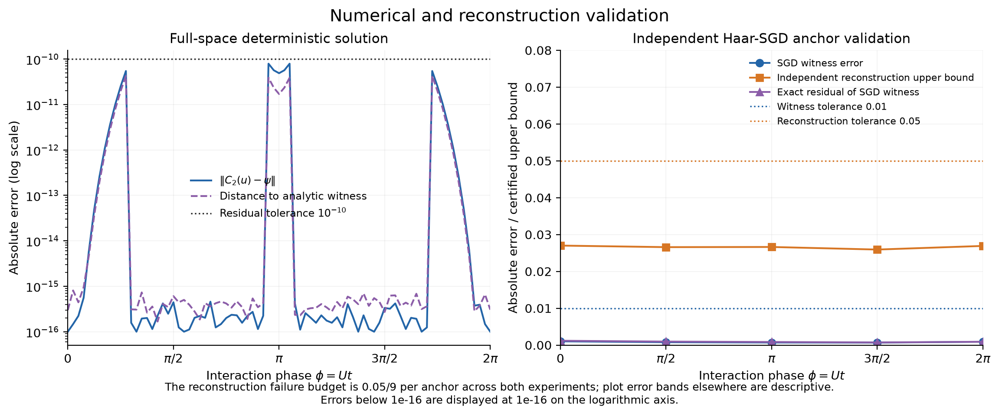

# 四模相互作用动力学实验报告

完整验收：**未通过**；状态 `failed_acceptance`。
计算耗时 28.00 秒，峰值 RSS 147.42 MiB。种子 20261022。

数值运行已结束，原定回归未全部通过。失败检查：pulled_back_number_histogram_p、pulled_back_number_histogram_h。各项状态原样保留；后续诊断不追认原验收通过。

## 方法与误差口径

密集扫描在完整 8 维复空间使用精确 q₂/C₂ 与阻尼 Newton 法求解，初值为目标态。cat 二参数方程和 Schmidt 归约仅用于独立对照。SGD 锚点复用通用库的随机优化器，未传入解析初值。
分布观测使用 4 组各 65,536 个独立 Haar 样本；每组内部各参数点与 p/h 共用样本。图中的误差条为独立重复的标准误差，不是严格置信区间。辅助 R 是各块矩阵的平均；报告的 purity 是各块 Tr(R²) 的平均，两者存在有限样本差异。谱也分别保存平均块谱与平均矩阵的谱。
九个 SGD 锚点的重构失败概率预先各分配 0.05/9。只有九个点均完成独立验证时，整组重构界才具有至少 95% 的联合覆盖保证，前提是独立理想 Haar 采样；不包含浮点区间认证。此保证不用于整条分布曲线。

## 主要数值结果

| 参数 | 等价 r | 解析 extent | 连续成本 B₂² | P₂ | P₂ 标准误 | TV(p₂,h₂) |
|---|---:|---:|---:|---:|---:|---:|
| 0.000000 | 0.000000 | 1.000000 | 3.975461 | 0.151303 | 0.000254 | 0.000000 |
| 1.570796 | 0.146447 | 1.707107 | 4.349779 | 0.142732 | 0.000153 | 0.043613 |
| 3.141593 | 0.500000 | 2.000000 | 4.655900 | 0.137038 | 0.000066 | 0.000000 |
| 4.712389 | 0.146447 | 1.707107 | 4.355361 | 0.142836 | 0.000117 | 0.043642 |
| 6.283185 | 0.000000 | 1.000000 | 3.975461 | 0.151303 | 0.000254 | 0.000000 |

magic 点的 P₂ 数值为 0.13703850，解析值为 116/847 = 0.13695396。
扫描中 TV 的最大值为 0.043642，出现在参数 4.712389。这只是当前离散扫描的最大值。
独立样本块交叉纯度与直接估计的最大差为 4.02596e-05。交叉估计用于检查自配对偏差，不能消除自归一化比值的全部有限样本偏差。

## 物理解释

相互作用只改变满占据振幅的相位，却破坏 Gaussian 配对约束。extent 在 φ=π 达到 2，在一个周期末回到 1。直接求解与独立静态预测的比较结果列在验收表中。
实验室坐标中的 N(g) 分布依赖 Gaussian 变换，不能要求与静态分布相同。将构型用 U_G† 拉回后再比较；纯度、R 的谱、质量与全流形 TV 则直接比较。
二次 Hamiltonian 对照使用 H_Q=Σ j n_j。它使初始 BCS 态发生非平凡相位演化，但保持 Gaussianity 和相应构型不变量。
本实验和静态 cat 属于同一 Gaussian-unitary 一参数态族，因此是严格的内部一致性验证，不构成两种独立复杂多体物理证据。
无论 r=0 还是 r=1/2，均有 p₂=h₂。最大 Gaussian magic 处两分布依然相同，因此 TV 不能直接当作 magic 大小。有限阶分布在 Gaussian 端点也具有宽度，P₂ 不应预设为 1。
解析 extent 是最小系数成本；这里估计的 B₂² 是有限 k=2 连续测度的系数质量平方。数值 witness 所定义测度重构 C₂(u)，其与目标的偏差另行报告，B₂² 不作为目标态 exact extent 的认证估计。
占据直方图描述 Gaussian 构型的平均粒子数；二维图坐标为构型的真空和满占据概率。它们不是目标态的测量分布，二维图的中间权重本身也不能单独证明存在 pairing。

## 占据直方图回归标记与事后诊断

原定 6480 个逐 bin 比较中有 7 个未通过（p 为 4 个，h 为 3 个）。差异发生在少数相邻参数点，原始种子、数据、阈值和整体 failed_acceptance 状态未改。
重用同一批 Haar 构型，最大 overlap 协变误差为 3.59e-11，配对直方图最大误差为 2.9e-12；保存直方图的重放误差为 5.34e-16。这些检查支持坐标与权重实现正确，但不是新的独立统计证书。

| 分布 | φ | N 区间 | 绝对差 | 原阈值 | 样本级近似 SE | 差 / 近似 SE |
|---|---:|---|---:|---:|---:|---:|
| p | 0.157080 | [1.4, 1.5) | 0.002791 | 0.002524 | 0.0014057581066876574 | 1.9852744850266673 |
| p | 3.220132 | [1.6, 1.7) | 0.002630 | 0.002442 | 0.0009571621497944827 | 2.748217863691386 |
| p | 3.298672 | [1.6, 1.7) | 0.002850 | 0.002000 | 0.0009701907385001317 | 2.9375156845458537 |
| p | 3.377212 | [1.6, 1.7) | 0.002653 | 0.002630 | 0.000984025991569098 | 2.695781726875543 |
| h | 0.157080 | [1.4, 1.5) | 0.002792 | 0.002499 | 0.001406971210268707 | 1.9842509715122818 |
| h | 3.220132 | [1.6, 1.7) | 0.002643 | 0.002464 | 0.000961272363851236 | 2.7494787150170827 |
| h | 3.298672 | [1.6, 1.7) | 0.002876 | 0.002000 | 0.0009781487347344526 | 2.9406990581549004 |

四次重复提供的块间标准误在个别 bin 偶然偏小。使用原冻结样本另算自归一化比值的 delta-method 近似标准误后，这些差异与有限采样波动相容。该分析是事后诊断，不替换原阈值，也不把未通过改成通过；若以后需要整条直方图的稳定联合验收，应另行预注册更多独立重复或合适的同时误差界。

## SGD 与独立重构

| 参数 | witness 误差 | 精确残差 | 独立重构上界 | 验证样本数 | 通过 |
|---|---:|---:|---:|---:|---|
| 0.000000 | 0.00102346 | 0.00118104 | 0.0270041 | 3145759 | True |
| 1.570796 | 0.000785022 | 0.000950749 | 0.0265802 | 3698150 | True |
| 3.141593 | 0.000704304 | 0.000842591 | 0.0266257 | 4116900 | True |
| 4.712389 | 0.000679622 | 0.000720143 | 0.0259258 | 3695975 | True |
| 6.283185 | 0.000893973 | 0.000910795 | 0.0269087 | 3148060 | True |

## 数值回归检查

| 检查 | 通过 | 最大误差 |
|---|---|---:|
| exact_stationary_residual | True | 7.91345e-11 |
| independent_witness_reference | True | 4.29081e-11 |
| Gaussianity_defect | True | 0 |
| direct_p_trace | True | 1.33227e-15 |
| direct_p_hermitian | True | 1.38778e-17 |
| direct_p_PSD_and_purity_bounds | True | 0 |
| direct_hist_n_p_normalization | True | 1.11022e-15 |
| direct_hist_xy_p_normalization | True | 1.11022e-15 |
| direct_h_trace | True | 1.55431e-15 |
| direct_h_hermitian | True | 1.38778e-17 |
| direct_h_PSD_and_purity_bounds | True | 0 |
| direct_hist_n_h_normalization | True | 1.77636e-15 |
| direct_hist_xy_h_normalization | True | 1.55431e-15 |
| magic_purity | True | 8.45421e-05 |
| p_equals_h_at_special_points | True | 3.8342e-16 |
| reference_p_trace | True | 1.11022e-15 |
| reference_p_hermitian | True | 5.96311e-19 |
| reference_p_PSD_and_purity_bounds | True | 0 |
| reference_hist_n_p_normalization | True | 8.88178e-16 |
| reference_hist_xy_p_normalization | True | 8.88178e-16 |
| reference_h_trace | True | 1.44329e-15 |
| reference_h_hermitian | True | 5.42101e-19 |
| reference_h_PSD_and_purity_bounds | True | 0 |
| reference_hist_n_h_normalization | True | 1.11022e-15 |
| reference_hist_xy_h_normalization | True | 1.11022e-15 |
| Gaussian_unitary_invariance_purity_p | True | 0.000165508 |
| Gaussian_unitary_invariance_purity_h | True | 0.000175254 |
| Gaussian_unitary_invariance_tv | True | 0.000214091 |
| Gaussian_unitary_invariance_spectrum_p | True | 0.000670011 |
| Gaussian_unitary_invariance_spectrum_h | True | 0.000660642 |
| Gaussian_unitary_invariance_mass_p | True | 0.00728392 |
| Gaussian_unitary_invariance_mass_h | True | 0.00702903 |
| pulled_back_number_histogram_p | False | 0.00375093 |
| pulled_back_number_histogram_h | False | 0.00380504 |
| quadratic_exact_residual | True | 4.81347e-16 |
| control_p_trace | True | 1.33227e-15 |
| control_p_hermitian | True | 1.38778e-17 |
| control_p_PSD_and_purity_bounds | True | 0 |
| control_hist_n_p_normalization | True | 8.88178e-16 |
| control_hist_xy_p_normalization | True | 9.99201e-16 |
| control_h_trace | True | 1.33227e-15 |
| control_h_hermitian | True | 1.38778e-17 |
| control_h_PSD_and_purity_bounds | True | 0 |
| control_hist_n_h_normalization | True | 8.88178e-16 |
| control_hist_xy_h_normalization | True | 9.99201e-16 |
| quadratic_Gaussianity | True | 1.78609e-15 |
| quadratic_p_equals_h | True | 0 |
| quadratic_constant_purity_p | True | 0.000680307 |
| quadratic_constant_spectrum_p | True | 0.00206179 |
| quadratic_constant_mass_p | True | 0.0149468 |

采样不变量的回归阈值为六倍合并标准误差与 0.002 的较大者；它是数值检查规则，不是额外的严格概率证书。

## 图与数据

`config.json` 记录环境、源码哈希及随机流；`summary.json` 记录验收与停止状态；`summary.csv` 保存逐点指标；NPZ 文件保存完整复振幅、R、直方图及重复统计；`anchors/` 保存各锚点的原始优化和验证输出。
绘图可独立重跑：`python plotting.py --input <结果目录>`，不会重新采样或训练。
