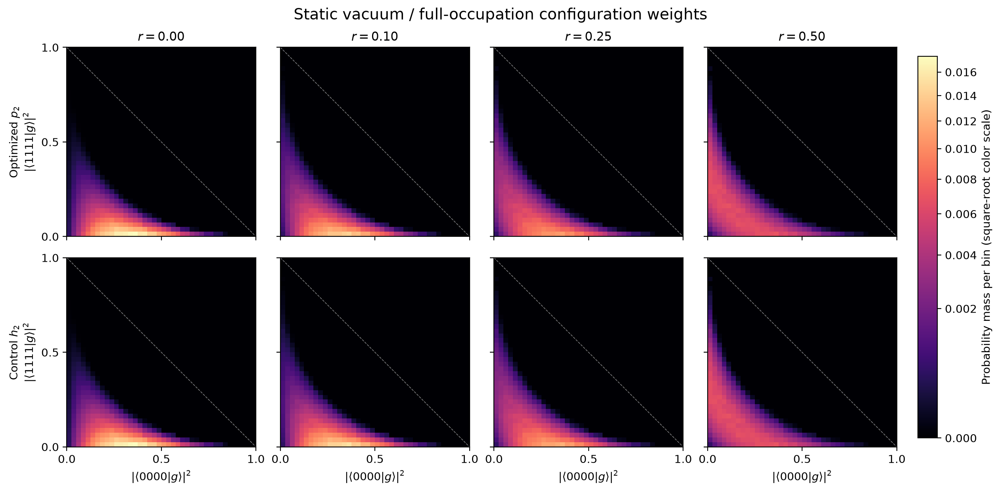
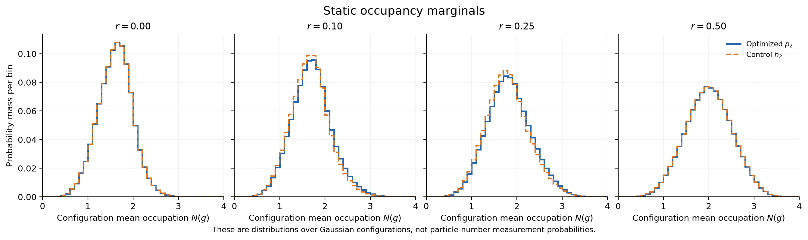
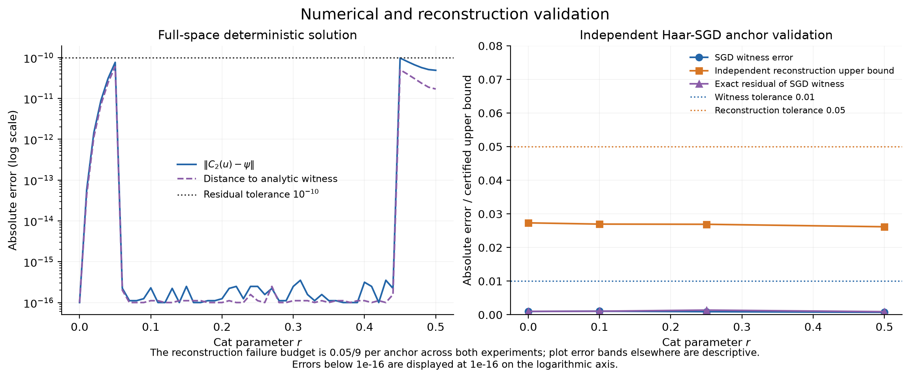

# 静态 asymmetric cat实验报告

完整验收：**通过**；状态 `completed`。
计算耗时 15.70 秒，峰值 RSS 99.92 MiB。种子 20261022。

## 方法与误差口径

密集扫描在完整 8 维复空间使用精确 q₂/C₂ 与阻尼 Newton 法求解，初值为目标态。cat 二参数方程和 Schmidt 归约仅用于独立对照。SGD 锚点复用通用库的随机优化器，未传入解析初值。
分布观测使用 4 组各 65,536 个独立 Haar 样本；每组内部各参数点与 p/h 共用样本。图中的误差条为独立重复的标准误差，不是严格置信区间。辅助 R 是各块矩阵的平均；报告的 purity 是各块 Tr(R²) 的平均，两者存在有限样本差异。谱也分别保存平均块谱与平均矩阵的谱。
九个 SGD 锚点的重构失败概率预先各分配 0.05/9。只有九个点均完成独立验证时，整组重构界才具有至少 95% 的联合覆盖保证，前提是独立理想 Haar 采样；不包含浮点区间认证。此保证不用于整条分布曲线。

## 主要数值结果

| 参数 | 等价 r | 解析 extent | 连续成本 B₂² | P₂ | P₂ 标准误 | TV(p₂,h₂) |
|---|---:|---:|---:|---:|---:|---:|
| 0.000000 | 0.000000 | 1.000000 | 3.961489 | 0.150979 | 0.000305 | 0.000000 |
| 0.100000 | 0.100000 | 1.600000 | 4.255224 | 0.144565 | 0.000322 | 0.042351 |
| 0.250000 | 0.250000 | 1.866025 | 4.515751 | 0.139596 | 0.000243 | 0.037358 |
| 0.500000 | 0.500000 | 2.000000 | 4.664476 | 0.137081 | 0.000116 | 0.000000 |

magic 点的 P₂ 数值为 0.13708066，解析值为 116/847 = 0.13695396。
扫描中 TV 的最大值为 0.043744，出现在参数 0.140000。这只是当前离散扫描的最大值。
独立样本块交叉纯度与直接估计的最大差为 3.46297e-05。交叉估计用于检查自配对偏差，不能消除自归一化比值的全部有限样本偏差。

## 物理解释

在 r=0.1，解析 witness 的真空与满占据系数分别为 0.94463648 和 0.38634338；相对于原态，满占据分量得到增强。两端构型的优化密度比为 14.6175，对照分布为 27。这里比较的是相对于 Haar 测度的点态密度，不是单个构型的概率质量。
纯度从 Gaussian 端点的 0.150979 变化到 magic 端点的 0.137081。这描述加权 Gaussian 构型的相似程度，不是目标物理纯态的纯度或纠缠熵。小于统计误差的局部变化不解释为显著的非单调行为。
无论 r=0 还是 r=1/2，均有 p₂=h₂。最大 Gaussian magic 处两分布依然相同，因此 TV 不能直接当作 magic 大小。有限阶分布在 Gaussian 端点也具有宽度，P₂ 不应预设为 1。
解析 extent 是最小系数成本；这里估计的 B₂² 是有限 k=2 连续测度的系数质量平方。数值 witness 所定义测度重构 C₂(u)，其与目标的偏差另行报告，B₂² 不作为目标态 exact extent 的认证估计。
占据直方图描述 Gaussian 构型的平均粒子数；二维图坐标为构型的真空和满占据概率。它们不是目标态的测量分布，二维图的中间权重本身也不能单独证明存在 pairing。

## SGD 与独立重构

| 参数 | witness 误差 | 精确残差 | 独立重构上界 | 验证样本数 | 通过 |
|---|---:|---:|---:|---:|---|
| 0.000000 | 0.0009734 | 0.00101303 | 0.0273342 | 3147649 | True |
| 0.100000 | 0.00106428 | 0.00105539 | 0.0269638 | 3559781 | True |
| 0.250000 | 0.000917934 | 0.00138876 | 0.0269121 | 3906604 | True |
| 0.500000 | 0.000724198 | 0.000915537 | 0.0261768 | 4110973 | True |

## 数值回归检查

| 检查 | 通过 | 最大误差 |
|---|---|---:|
| exact_stationary_residual | True | 9.75878e-11 |
| independent_witness_reference | True | 6.00795e-11 |
| Gaussianity_defect | True | 1.11022e-16 |
| direct_p_trace | True | 1.55431e-15 |
| direct_p_hermitian | True | 7.58942e-19 |
| direct_p_PSD_and_purity_bounds | True | 0 |
| direct_hist_n_p_normalization | True | 1.11022e-15 |
| direct_hist_xy_p_normalization | True | 9.99201e-16 |
| direct_h_trace | True | 1.33227e-15 |
| direct_h_hermitian | True | 7.58942e-19 |
| direct_h_PSD_and_purity_bounds | True | 0 |
| direct_hist_n_h_normalization | True | 9.99201e-16 |
| direct_hist_xy_h_normalization | True | 8.88178e-16 |
| magic_purity | True | 0.000126709 |
| p_equals_h_at_special_points | True | 4.44326e-16 |
| r_point_one_density_ratio | True | 7.10543e-15 |

采样不变量的回归阈值为六倍合并标准误差与 0.002 的较大者；它是数值检查规则，不是额外的严格概率证书。

## 图与数据

`config.json` 记录环境、源码哈希及随机流；`summary.json` 记录验收与停止状态；`summary.csv` 保存逐点指标；NPZ 文件保存完整复振幅、R、直方图及重复统计；`anchors/` 保存各锚点的原始优化和验证输出。
绘图可独立重跑：`python plotting.py --input <结果目录>`，不会重新采样或训练。
