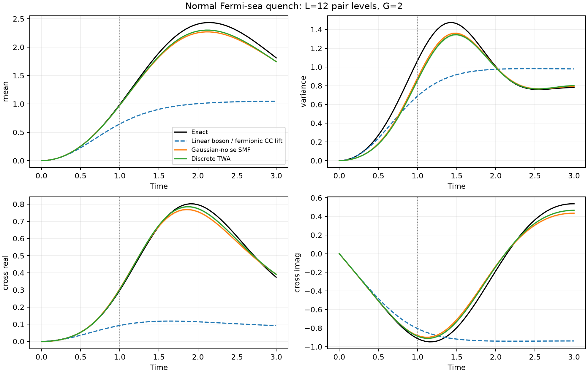
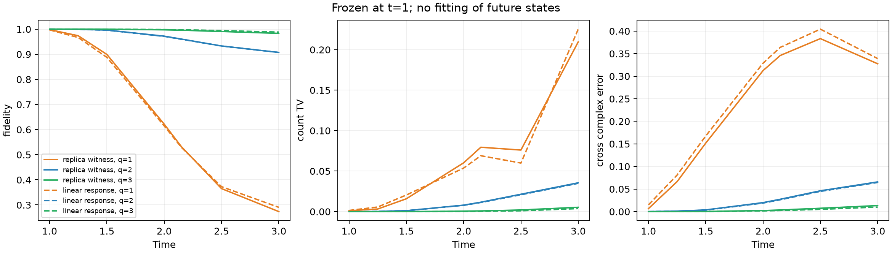

# 正常费米海中的配对形成：第一轮实验报告

后续进展见 [第二轮报告：构型、响应训练与相位控制](REPORT_COLUMNS.md)。
本文件保留第一轮结果；其中“尚未实现”的自适应搜索和实际原子外推已在第二轮补上。

**状态：研究进行中，尚未达到说明“六”要求的完整成功标准。**
已验证值得继续研究的计数窗口，完成三个关键时刻的二阶 replica 合成与多项强对照，
并进行了不读取未来态的冻结构型传播。但目前没有证据支持“canonical 分布发现了其他强方法遗漏的新物理结构”。
第一次预测比较反而说明：只读取 witness 的一次转移矩阵，并不比普通线性响应增加有效信息。
这一否定结果保留在报告和原始数据中。

所有新增工作位于 `/home/tiger/Fermionic-Gaussianity-main`，基于 `a5183ac`。
原来的 BCS、FK 工作目录没有修改。原始任务说明保存在 [RESEARCH_BRIEF.txt](RESEARCH_BRIEF.txt)。

## 1. 第一阶段：存在被放大的计数窗口

从正常费米海出发，对均匀非简并能谱进行精确固定粒子数演化。
测试 L=8、12 的 G=1、2、4，以及 L=16 的 G=2、4；L 是配对能级数，物理模式数是 2L。
包括有限体系自项的线性响应与真实 Hamiltonian 使用相同约定。

| L | G | 不稳定模增长率 | 粒子侧 N_eff | 首次脉冲前最大 Fano | 单方向径向保真度 ≥0.99 且计数超 Poisson 的窗口 |
|---:|---:|---:|---:|---:|---|
| 8 | 2 | 0.8620 | 3.014 | 1.0094 | t=0.25–0.55 |
| 12 | 2 | 0.8448 | 4.454 | 1.1122 | t=0.25–1.15 |
| 16 | 2 | 0.8337 | 5.913 | 1.2541 | t=0.25–1.25 |
| 12 | 4 | 1.7344 | 5.538 | 1.1927 | t=0.125–0.725 |
| 16 | 4 | 1.6900 | 7.376 | 1.4243 | t=0.125–0.75 |

窗口是此次时间网格上的筛选结果：额外要求均值 ≥0.05、方差减均值 >1e-4。
不是经过连续时间区间算术认证的边界，也不是热力学极限结论。

例如 L=12、G=2、t=1 时，`mean=0.987708`、`variance=1.068250`。
这排除任意单个标准 onsite PBCS 同时再现这两个数值，
但不排除经典混合，也不自动排除任意一般数目投影 Gaussian。
短时解析系数在 r=2、3、4、6 的精确演化中通过核查。

## 2. 第二阶段：额外径向自由度比单纯增加 CC 通道更关键

选取 L=12、G=2 的 t=0.5（早期）、1（线性近似已偏离）、2.15（首个脉冲附近）。
下表均为**找到的可行保真度**；局部多起点优化不能认证全局最优。

| 方法 | t=0.5 | t=1 | t=2.15 |
|---|---:|---:|---:|
| 标准 onsite PBCS，12 起点 | 0.990836 | 0.910904 | 0.772786 |
| 一般数目投影 Gaussian，8 起点 | 0.990836 | 0.910904 | 0.772786 |
| 优化后的 rank-1 pair-CC | 0.999482 | 0.976320 | 0.688063 |
| 优化后的 rank-2 pair-CC | 0.999492 | 0.976764 | 0.700037 |
| 优化后的 full-rank pair-CC | 0.999492 | 0.976764 | 0.700230 |
| 优化单配对方向 + 任意复径向系数 | 0.999988 | 0.999004 | 0.955572 |
| 上项 + 随转移数变化的轨道参数 | 0.999990 | 0.999555 | 0.968157 |

一般投影 Gaussian 使用任意 24×24 复反对称配对矩阵，
其归一化包含所有固定 12 电子的 broken-pair 配置；没有额外投影到 seniority-zero 后再归一化。
它在这些重启中回到了 onsite 最优候选，但这不是一般 projected Gaussian 的排除证书。

在首个脉冲时，每个转移数块的最佳粒子—空穴可分离态保真度上界为 0.993869，
明显高于统一单方向径向拟合的 0.955572。因此还不能把误差直接解释成大量独立通道的产生。
带内结构、不同转移数对应的轨道变化和相对相位都需要分开检验。
目前“轨道参数随转移数线性变化”的有限诊断模型只恢复一部分差距。

exponential pair-CC 与投影 BCS 的 Bessel 系数差别已有静态研究，
不能把上述对比本身当新发现。
参见 [Degroote et al., PRB 93, 125124](https://journals.aps.org/prb/abstract/10.1103/PhysRevB.93.125124)
及 [数目投影 Bogoliubov coupled cluster](https://arxiv.org/abs/1810.11245)。

## 3. 随机涨落基线已运行，不能只比较无种子平均场

使用全部 8 块 H20 同时运行 Gaussian 初始噪声的 spin SMF 和离散 TWA，
每种方法两个独立种子，每种子 65,536 条轨迹，分别用 dt=0.01、0.005。
细步结果每种方法合计 131,072 条独立轨迹；粗细步共享对应种子，以检查时间离散误差。
四个观测量在步长减半后的最大变化均小于 1.8e-9，远小于 Monte Carlo 误差。

随机基线能很好描述早期均值，并捕捉首个脉冲的大体位置，
但这里的计数方差及脉冲高度存在可分辨偏差。
计数二阶矩明确使用 `(s_i^z)^2=1/4` 的量子测量符号。
该截断方法本身已有可推导的短时计数误差；已通过穷尽小体系初始离散样本验证，
没有将这种已知截断误差包装成新量子结构。
本轮未声称击败所有高阶 TWA、BBGKY 或更一般随机 TDHFB 变体。

## 4. 完整字典 replica 合成：数值正确，但二阶分布很昂贵

实现了 paired 目标扇区中的完整 Gaussian 字典二阶 Cartan 积分。
这里限制的是因物理对称性而不失一般性的 witness 扇区，不是 Gaussian 字典。
解析矩阵元、独立完整双副本投影和独立 Haar 采样之间的核对见 [THEORY.md](THEORY.md)。

| t | `||C_2(u)-psi||` | 有限阶 extent 对偶下界的数值值 |
|---:|---:|---:|
| 0.5 | 7.54e-10 | 1.072650 |
| 1 | 2.37e-9 | 1.208704 |
| 2.15 | 1.73e-9 | 1.288752 |

上述为双精度确定性计算，不是有向舍入区间证书，也不是最优 extent。

另在 8 块 GPU 上独立采样了总计 32,768 个完整 SO(48)-Haar Gaussian，
比较 t=1 的 canonical 权重 `|<g|u>|^3`、Husimi 权重 `|<g|psi>|^2` 和 Haar。
二阶 canonical 系数质量的试算结果为 **B≈1525.8**，独立运行间标准误约 12.1。
这个标准误不是严格置信界。单个原子在目标扇区的概率仅约 1.14e-4。
合并 Monte Carlo 合成向量仍有约 0.241 的扇区误差，而确定性合成方程的误差约为 2e-9。

这说明二阶分布的主要困难是宽支持和相干抵消，不是优化器没有收敛。
甚至用目标的 Fock 展开，总质量也不超过 `sqrt(924)≈30.4`。
因此不能把低阶 canonical 原子的散点图直接解释为经济的物理构型。
已保存 canonical/Husimi/Haar 的加权候选样本；它们不是认证的稀疏分解。

## 5. 第三阶段的初次冻结预测：成功传播，未发现独特优势

只使用 t=1 的状态、replica witness 或线性响应矩阵，分别抽取 q=1、2、3 个粒子与空穴方向。
冻结这些方向，在它们生成的投影 Gaussian 线性空间中，仅用 `Q^dagger H Q` 传播。
训练文件和冻结基的 SHA256 已保存；预测文件先写出，再计算未来精确参考。
同时预先列入 G=2 的原 Hamiltonian 和 t=1 后改成 G=2.2 的扰动外推。

这里是从 witness 的一次转移矩阵提取的物理压缩，**不是从完整 canonical 测度中提取原子**。
q 是集体方向数；空间维数分别为 7、92、408，不能称为只有 7、92、408 个最优完整 Gaussian。

| 冻结构型来源 | q | 首脉冲保真度 | 计数 TV | 相干四点函数绝对误差 |
|---|---:|---:|---:|---:|
| replica witness | 1 | 0.532063 | 0.07947 | 0.34601 |
| replica witness | 2 | 0.960529 | 0.01159 | 0.02735 |
| replica witness | 3 | 0.995717 | 0.00081 | 0.00354 |
| 线性响应 | 1 | 0.529394 | 0.06902 | 0.36403 |
| 线性响应 | 2 | 0.959657 | 0.01122 | 0.02624 |
| 线性响应 | 3 | 0.997565 | 0.00036 | 0.00233 |

删掉第二、第三个方向确实破坏了预测，但这些方向也可从线性响应获得。
在 G=2.2 的外推中，线性响应三方向基同样略好。
所以这只是“少方向能承载非线性传播”的证据，**未通过分布独特物理贡献的验收**。
此外，408/924 已经是相当大的子空间，不能把这一结果宣称为可扩展的计算优势。

## 6. 验证、查新与后续任务

15 项独立/解析/数值检查通过，包括完整 fixed-N Gaussian 范数、梯度、
Haar frame、二阶 Cartan 投影、计数电流、短时系数、冻结空间完备极限及 TWA 短时局限。
全部精确筛选的最大归一化误差为 1.85e-13，最大能量漂移为 1.87e-12。
数值汇总见 [audit.json](results/assessment_01/audit.json)，原始数据和图片都保留。

文献检查已确认配对脉冲、随机涨落种子、投影 BCS/CC 系数关系、
精确配对模型淬火都有既有研究；没有完成穷尽查新。
相关背景包括 [BCS 配对 soliton](https://arxiv.org/abs/cond-mat/0312053)、
[精确可积配对淬火](https://arxiv.org/abs/0812.1928) 和
[腔 QED 中的 BCS 动力学实验](https://arxiv.org/abs/2306.00066)。

下一轮必须完成的工作保留原目标，不以本轮结果替代：

1. 完整 canonical/Husimi 原子的结构分析，以及相同计算预算下的强自适应 Gaussian 列生成；
   当前低阶 Haar 试算尚不能满足这项要求。
2. 区分幅值缺失、相位缺失、带内结构缺失，用相干核和相位消融检验，不能只看边缘分布。
3. 从实际发现的构型冻结出预测模型，预先指定新时间/参数/回波，再与强基线比较。
   从一次转移矩阵提取方向的当前路线已得到否定的独特性结果，不应重复包装。
4. 对候选物理机制做规模、能谱扰动、重复种子和文献核查；尚无可称为重要新物理发现的结果。

因此三个阶段的状态是：第一阶段物理窗口通过；第二阶段部分完成；第三阶段进行了严格的初次外推，
但核心成功条件未通过。整体目标保持进行中。
