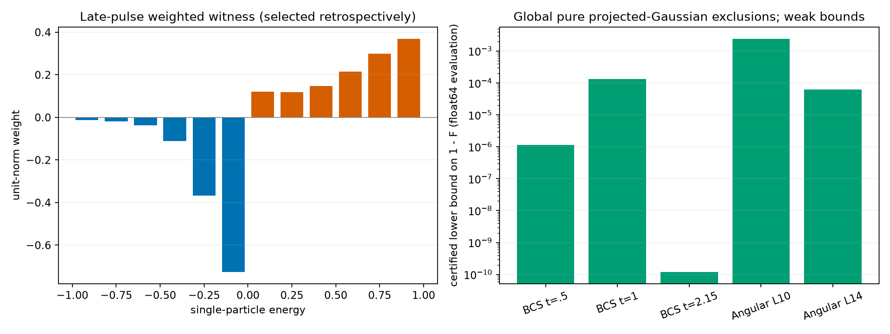
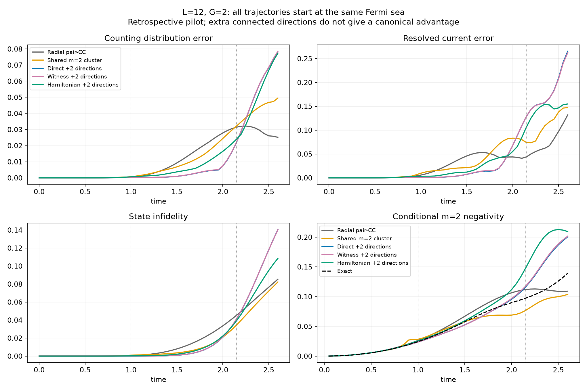

# 第九轮：连通转移反馈与首脉冲的严格弱排除

本轮补上了原模型首个配对脉冲处的一项缺口：现在有针对**全部任意轨道数目投影纯 Gaussian**
的非零排除证书，并以精确有理算术控制误差。但排除量很小，不能据此声称有重要的新物理。
新的两次转移传播对照也没有建立 canonical 特有的预测优势。
用户要求的第三阶段成功标准仍未达到，研究目标保持进行中。

## 1. 首脉冲处不再只有局部拟合失败

原 $L=12,G=2,t=2.15$ 的上方对数均值为 2.43352、方差为 0.87734，
此前的 `Var(m) > mean(m)` 判据无效。
本轮先在八块 H20 上做了 512 个复轨道投影局部搜索，正确恢复早期正对照，
但没有为所测晚时态找到旧判据的新违反。这不是全局不存在违反的证明。

随后利用已有的对称多项式凹性，推导了更强的任意 Hermitian 单体算符界。
对总粒子数 $N=2M$、$A=c^\dagger Kc$，任意纯 projected Gaussian 满足

\[
\operatorname{Var}(A)\le2\operatorname{Tr}(\gamma K^2)
-[\operatorname{Tr}(\gamma K)]^2/M.
\]

它没有对候选态额外作 seniority 投影，允许跨能级、跨自旋的 Gaussian 配对。
能量分辨的实权重将此界化为一个协方差矩阵条件。
在脉冲处，固定三位小数权重给出超额约 $2.49987635\times10^{-5}$。
使用整数 Hamiltonian 的 140 阶 Taylor 展开和严格余项界，得到

\[
\boxed{1-F_{\rm PG}>1.10249\times10^{-10}.}
\]

所有证书比较使用整数及精确分数；Taylor 态的范数余项小于 $4.587\times10^{-40}$。
这是严格非零而非常弱的全族排除，不能解释局部拟合约 0.77 的保真度障碍是否全局成立。
权重在读取脉冲态后选择，因此它是事后认证；早期 t=1 所选权重在脉冲处没有违反。
两副本回波的对应信号只有约 $10^{-9}$，也没有宣称实验上已可测。

800 个任意 Hermitian 算符的完整 Fock 作用检查、100 个独立旋转 Pfaffian 检查通过。
解析推导、适用范围和原有数学文献见 [WEIGHTED_GAUSSIAN_BOUND.md](WEIGHTED_GAUSSIAN_BOUND.md)，
精确证书见 [certificate.json](results/rational_pulse_certificate_01/certificate.json)。
本轮没有建立该不等式的发现优先权或最优性。

## 2. 两次转移方向没有同时改善计数和相干反馈

在原 $L=12,G=2$ 条件、训练 t=1，比较三种连通两次转移张量：
直接态、完整 Gaussian 字典 k=2 witness，以及普通 pair-CC 预测态上的 Hamiltonian 源。
每个模型都允许完整单次转移矩阵和每个转移次数的独立复径向系数运动。
所有初态都是同一个精确费米海；冻结后只用 Hamiltonian 传播。
这些条件以前已经查看过，所以 11 条轨迹明确归为先导诊断。

以下是首脉冲 t=2.15 的原始先导结果。q 为共享径向二次簇之外增加的方向数。

| 模型 | 保真度 | 计数 TV | 扇区电流 L1 误差 |
|---|---:|---:|---:|
| 自由径向 pair-CC | 0.954659 | 0.031478 | 0.043988 |
| 加共享二次簇 | 0.965438 | 0.032208 | 0.074171 |
| 直接态 q=1 | 0.965676 | 0.031343 | 0.094046 |
| witness q=1 | 0.965551 | 0.031247 | 0.094326 |
| 直接态 q=2 | 0.958824 | 0.022123 | 0.128748 |
| witness q=2 | 0.958598 | 0.022288 | 0.128879 |
| Hamiltonian 源 q=2 | 0.960708 | 0.024051 | 0.106484 |

q=2 的计数分布改善，没有同时带来整体态和电流的改善；增加到 q=4 未改变这一判断。
在新的脉冲加权观测量上，直接态和 witness 的 q=2 模型甚至给出错误的违反符号，
普通 Hamiltonian 源更接近精确值。这个观测量本身又是事后选择，不能拿来充当前瞻成功。

## 3. 张量中的大部分差异仍是已有形状变化

直接态与 witness 的前两个方向的子空间余弦为 0.999924、0.999818，二者非常接近。
从共享 rank-one 形状中同时投掉粒子侧和空穴侧的切向变化后，剩余平方范数占比为
直接态 0.1795%、witness 0.1910%、Hamiltonian 源 0.0542%。
因此不能把整个连通二次张量都称为新的独立带间结构。
witness 张量也不是 canonical 测度样本；本轮没有证明完整分布只能产生这些方向。
定义和公式见 [CLUSTER_FEEDBACK.md](CLUSTER_FEEDBACK.md)。

## 4. 数值可靠性和保留的失败尝试

- 所有 11 个模型初态差异精确为零；训练文件及 11 个传播文件的冻结哈希已核验。
- 原坐标误差度量在初始空扇区和规范冗余附近过慢，两组加严尝试已终止并保留日志，未计为通过。
- 改用直接切矩阵 SVD 和物理态误差控制后，五个代表模型全部完成两级复核。
  第一级相对原轨迹的最大归一化态差异为 $3.47\times10^{-6}$ 以下；
  再将积分容差收紧 100 倍、步长减半、metric 阈值从 $10^{-12}$ 降到 $10^{-13}$，
  最大差异为 $1.76\times10^{-7}$。
- 轨迹上每个计数扇区的 Ehrenfest 误差不超过 $6.10\times10^{-15}$。
  小规模完整变分空间还与精确演化独立比较。
- 73 项测试通过，包括独立 Fock 算符作用、复 QR 梯度、簇指数/Jacobian、守恒律、
  物理态误差控制，以及精确整数 Taylor 与独立分数级数的比较。

下一步仍须找到由实际 canonical 结构预先选出、在未见条件中超越强基线的显著相干效应，
并通过相同初态的删除实验验证原因。本轮的弱严格证书和负先导结果不能替代这一要求。
完整数据索引见 [audit.json](results/assessment_cluster_feedback_01/audit.json)，
代码与数据快照见 [checkpoint_manifest.json](results/assessment_cluster_feedback_01/checkpoint_manifest.json)。
