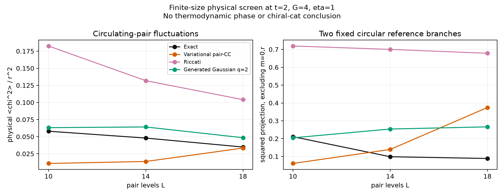
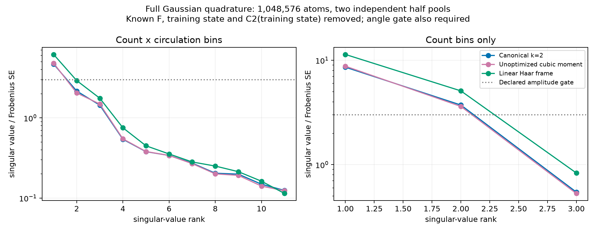
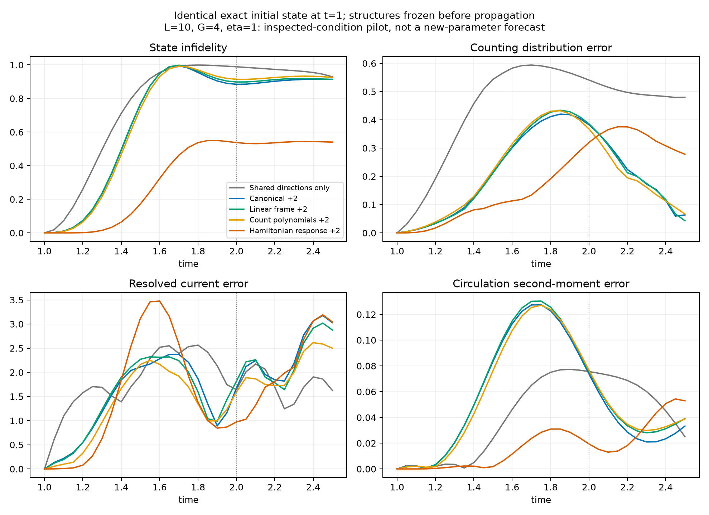

# 第十轮：实际相干分组没有越过物理预测门槛

本轮使用全部 8 块 H20 计算了 1048576 个完整 Gaussian 原子的相干积分。
两个计数方向能够跨独立样本重复，但它们与普通线性分解几乎相同，
冻结后也没有超过同维数的 Hamiltonian 响应对照。
用户要求的第三阶段成功标准仍未达到，研究目标保持进行中。

此前的严格弱排除证书和强基线结果仍然保留，本轮没有把目标改成分解精度或采样基准。

## 1. 两支简单循环构型不足以解释所测晚时态

先对已查看过的 L=10、14、18 等强双通道模型及 L=14 相对强度 0.85
计算实际循环配对算符的完整谱分布。该算符同时作用于两条电子带，
空穴表示的下带符号已与完整物理算符独立核查。

等强条件、t=2 的结果如下。最后一列是在每个非端点计数扇区内，
投影到两个固定圆周相位轨道构型所承载的总概率。

| L | 精确 $\langle\chi^2\rangle/r^2$ | 普通变分 pair-CC | 精确两支参考构型概率 |
|---|---:|---:|---:|
| 10 | 0.057944 | 0.010821 | 0.211104 |
| 14 | 0.047970 | 0.013692 | 0.098536 |
| 18 | 0.034839 | 0.033321 | 0.088754 |

L=18 时，这两支参考只承载约 9% 的权重；普通 pair-CC 又已经接近该二阶矩。
因此不能将此前的大循环涨落解释成已经发现了两支简单手性猫态，
也不能将该二阶矩单独作为 canonical 特有的物理偏差。
三个有限尺寸和一种参考支族不足以排除所有可能的手性态或热力学相。
固定阈值 $|\chi|>0.15r$ 的尾概率仅为有限尺寸诊断，完整直方图也已保存。

## 2. 本轮直接计算完整测度的相干信息

训练点为 L=10、G=4、等强通道、t=1。
独立的 4096 个 Haar 原子固定计数四分位×循环幅度三分位分组；
正式积分使用八条独立流，每条 131072 个原子。
原子保持完整 Fock 归一化，没有把无未配对电子的投影归一化后冒充原 Gaussian。

比较 canonical k=2、未优化三次矩和普通线性 frame。
三者共用相同样本、标签和对称性方差缩减。
这是对实际完整 Gaussian 积分的加权计算，不是 witness 张量的替代分析，
也不是独立同分布的 canonical 测度抽样。
具体公式、相干核和适用范围见 [COHERENT_GAUSSIAN_BINS.md](COHERENT_GAUSSIAN_BINS.md)。

canonical 未修正总积分的相对误差为 0.007016，块估计标准误差为 0.007192；
线性 frame 分别为 0.005213 和 0.005034。
已知总和控制变量使分组和精确，但这一步不是独立的重构验证。
所有新增方向都统一投掉 F、训练态及其确定性三次矩。

计数分组前两维通过独立半池筛选，子空间余弦为 0.991281、0.961968。
计数×循环的 12 个分组只解析出一维通过所定门槛，未获得额外稳定的循环方向。
不能将未解析的采样方向当作物理构型。

canonical 与线性 frame 的两个计数方向余弦为 0.999085、0.994594。
它们分别有 98.76%、94.78% 的平方范数落在普通计数及循环二阶算符
作用于训练态所生成的空间中。这里的几何相似不依赖后续精确态，
但也不构成所有 canonical 信息都等价于普通矩的定理。

## 3. 相同初态的冻结传播仍由普通响应对照占优

共冻结 17 个空间，完成 32 条先导传播：
从精确费米海出发，及从 t=1 的精确训练态重新出发。
所有相关初态一致至 $7.16\times10^{-15}$。
删除新增方向时仍保留同一个初态，避免此前的初态偏差抵消问题。

下面列出从精确训练态出发、到 t=2 的结果。
计数 TV 为总变差距离；电流误差是计数扇区相干电流的 L1 差。

| 冻结空间 | 维数 | 保真度 | 计数 TV | 电流 L1 误差 |
|---|---:|---:|---:|---:|
| 共享方向，删除所有新增结构 | 3 | 0.011181 | 0.540867 | 1.642304 |
| canonical 计数方向 | 5 | 0.115411 | 0.382598 | 1.672741 |
| 未优化三次矩计数方向 | 5 | 0.116862 | 0.380037 | 1.619201 |
| 线性 frame 计数方向 | 5 | 0.101665 | 0.386146 | 1.815900 |
| 普通计数多项式 | 5 | 0.085621 | 0.367803 | 1.592625 |
| Hamiltonian 响应 | 5 | 0.462388 | 0.319973 | 0.972698 |
| 完整对称闭合空间 | 26 | 1.000000 | 约零 | 约零 |

新增计数方向改善部分量，并没有同时修复相干电流。
Hamiltonian 响应在这几个主要量上更好，其精度本身也不足以宣称解决了动力学。
从费米海出发的完整对照也已保存，没有只保留有利初态。
这些参数曾经被查看过，所以 32 条结果不是新的独立预测。

## 4. 噪声复核与可复现性

两组独立 GPU 半池分别产生的 canonical 重启预测计数 TV 为
0.379063 和 0.381165。32 次块重采样的 5%—95% 分位为
0.374376—0.389873，仍高于 Hamiltonian 响应的 0.319973。
这些分位只是经验噪声敏感性，不是严格置信区间。
三种积分、两类初态合计保存了 204 个噪声敏感性记录，
它们不能计为 204 个独立物理条件。

77 项测试通过，包括完整算符与分块谱的独立比较、
保留全部计数概率的谱退相干、精确对称闭合以及复信号/纯噪声筛选。
冻结空间、32 个传播文件及噪声变体文件的哈希已核查。
对称闭合传播还与原独立精确演化比较。
除第九轮单独说明的有理证书外，本轮计算均为浮点或 Monte Carlo。

本轮否定的是当前简单循环支解释，以及这一训练点的计数/循环分组预测优势。
下一候选仍须提供强基线遗漏的显著物理结构，在真正未见条件中预测，
并在相同初态删除该结构后使误差重新出现。
单纯增加分组数、采样数或 replica 阶数不能替代该门槛。
完整指标见 [audit.json](results/assessment_coherent_bins_01/audit.json)，
代码数据快照见 [checkpoint_manifest.json](results/assessment_coherent_bins_01/checkpoint_manifest.json)。
