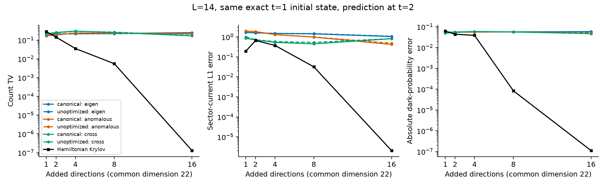
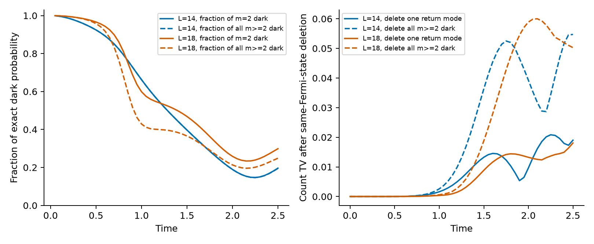
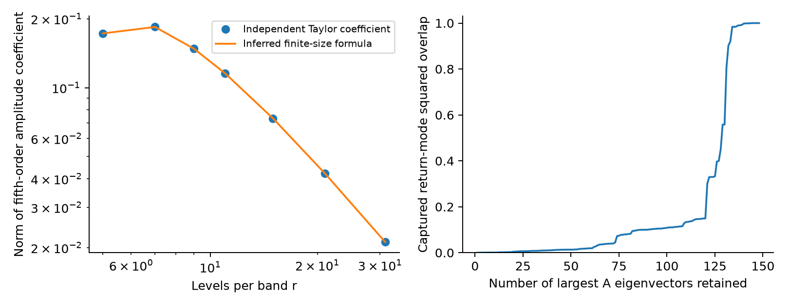

# 第十三轮：完整相干响应未过预测对照，暗成分的最早返回路径已定位

本轮排查了上一轮“两个人为暗标签可能漏掉主要方向”的问题：
计算完整 Gaussian 相干响应后，三种静态选取规则仍未同时超过普通强对照。
另一方面，暗成分的最早生成可以压缩为一个明确的暗—亮两带返回模，
但它不足以解释后期暗概率。因此，**用户要求的第三阶段仍未完成**，
也未建立分布独有、物理上重要的新发现。

完成了 42 个冻结空间、84 条同初态先导轨迹、两个单模删除实验、
七个尺寸的五阶计算及十个尺寸／参数组合的公式核查。
全部八块 H20 用于完整响应矩阵；CPU 分别以七个和两个进程处理独立检查。
本轮没有新增真正未见物理条件的预测。
定义与限定见 [COHERENT_RESPONSE_AND_RETURN.md](COHERENT_RESPONSE_AND_RETURN.md)。

## 1. 完整响应中的主要方向仍接近未优化对照

L=14、G=4、等强双通道、t=1 的训练点，在全部 170 个对称坐标上构造
完整线性相干矩 A 和共轭相干矩 B。字典仍含 28 个物理费米模式的完整 Gaussian 原子；
不依赖 Monte Carlo，也没有选取一个新的受限原子字典。

从 22 维公共空间外分别保留 A 的最大本征值方向、B 的最大奇异方向、
以及二者从公共空间向外耦合的主方向。
每种取 1、2、4、8、16 个，和未优化三次矩、Hamiltonian 块响应、普通 Krylov 比较。

canonical 和未优化结果的前四维子空间最小余弦分别为：

| 选取规则 | 最小余弦 |
|---|---:|
| A 最大本征值 | 0.994033 |
| B 最大奇异值 | 0.998140 |
| 与公共空间的交叉耦合 | 0.986686 |

这次接近性来自确定性的完整矩阵，不是上轮积分样本不够造成的。
它不证明更高阶或其他相干信息都没有价值。

## 2. 同一训练态出发，预测仍未过强基线

下表统一从精确 t=1 训练态出发，报告 t=2。
所有新增方向和传播结果先冻结并保存哈希，再读取后续参考态。
这些模型条件此前已经查看，因此只称先导。

| 方法 | 总维数 | 保真度 | 计数 TV | 电流 L1 误差 | 暗概率绝对误差 |
|---|---:|---:|---:|---:|---:|
| 共享空间，删去全部新增方向 | 22 | 0.276226 | 0.157162 | 1.868313 | 0.052235 |
| canonical A，新增 4 维 | 26 | 0.245002 | 0.219408 | 1.482142 | 0.056701 |
| canonical B，新增 4 维 | 26 | 0.278319 | 0.238055 | 1.298380 | 0.055664 |
| canonical 交叉耦合，新增 4 维 | 26 | 0.371413 | 0.301415 | 0.529169 | 0.059283 |
| 普通 Hamiltonian Krylov，新增 4 维 | 26 | 0.836263 | 0.035458 | 0.373393 | 0.038718 |
| canonical 交叉耦合，新增 16 维 | 38 | 0.505794 | 0.168409 | 0.811478 | 0.047716 |
| 普通 Hamiltonian Krylov，新增 8 维 | 30 | 0.997946 | 0.005521 | 0.031717 | 0.000083 |

全部 15 个 canonical 选取均未同时胜过同秩未优化对照及两类 Hamiltonian 对照。
Fermi 初态、其他秩和其他时间结果全部保留。
相同空间维数并不意味着已匹配全部计算成本。

一个具体诊断是，A 的最大本征值方向偏重 m=4、5 扇区：
前四维在这两扇区的总投影迹约 3.879，而在 m=2 中仅约 0.00714。
所以“大相干响应本征值”不能直接解释成“对当前配对转移最重要”。
后面返回模在这套最大本征值的前 16 维中，残余平方重叠只有 0.00240。
这一比较是结果之后的机制诊断，不是新的预注册选模规则。

## 3. 最早的暗两次转移是交换辅助的返回过程

上轮发现精确暗两次转移振幅在五阶出现，而精确一次转移的永久积到六阶才出现。
本轮将 Hamiltonian 分成独立步骤，定位到四条非零路径：

UUPUD、UUUPD、UUHUD、UUUHD。

U/D 是向上／返回转移，P/H 是粒子／空穴带内配对交换，字符串按时间顺序排列。
同一带两条路径振幅比例为 1:3，两带贡献正交。
自由能移及空穴自项的对应路径均抵消。

由 r=7、9 的系数识别出

$$
c_{5,2}^{\rm dark}
=i\frac{G^5(r-3)}{15r^5}(d b^T+b d^T),
\quad
b_{ij}=\cos\Delta_{ij},
\quad
d_{ij}=\cos3\Delta_{ij}+\frac{2}{r-2}\cos\Delta_{ij}.
$$

b 为源亮两激发模，d 被两个源同时消去。
这不是两个独立一次转移模式的乘积。
公式在额外尺寸、G=3.2、能隙 0.9 下通过检查，最大相对误差约 $3.04\times10^{-13}$。
但一般尺寸的完整系数证明尚未完成，不能把数值符合当成定理。
r=6 出现第三谐波混叠，向量公式仍符合，普通范数公式则须乘以三。

五阶计算扩展至 r=31（L=62），没有进行该尺寸的长时演化。
系数随尺寸降低不能替代后期物理信号的标度研究。

## 4. 单个返回模有作用，但不能包办后期机制

从同一个精确费米海出发，只删除上述归一化返回模，保留其余完整对称空间。
在 t=2：

| L | 返回模占 m=2 暗概率 | 占全部 m≥2 暗概率 | 删除后计数 TV | 删除后电流 L1 |
|---|---:|---:|---:|---:|
| 14 | 0.189465 | 0.189372 | 0.009638 | 0.142044 |
| 18 | 0.258575 | 0.213508 | 0.013242 | 0.056347 |

对比删除全部 m≥2 暗方向，计数 TV 分别为 0.039250 和 0.058887。
因此最早模式确有动力学影响，但晚期需要更多连通结构。
该模式来自普通 Hamiltonian 路径，不能归为 canonical 独有发现。

已有亮暗混合多激发及非弹性散射研究，例如
[Ke 等（2019）](https://arxiv.org/abs/1908.04844)。
模型不同，但“亮暗组合”或 Schmidt 秩为二本身不足以宣称新物理。
本文没有建立长寿命、亚辐射相、热力学相变或分布发现优先权。

## 5. 验证和下一道物理门槛

98 项测试通过。完整矩阵的 Hermitian／对称误差不超过 $1.74\times10^{-15}$，
canonical 自收缩的重构误差为 $2.78\times10^{-15}$。
84 条轨迹的最大初态差为 $8.02\times10^{-15}$，最大范数误差为 $2.35\times10^{-14}$。
99 个输入、冻结空间、分块矩阵或预测文件的哈希已核查。
这些均为浮点和文件一致性检查，不是物理完成证明。

不应再仅靠增加当前训练点的静态标签或最大本征方向来宣称进展。
剩余实质问题是：后期必需的连通多次转移相干结构能否由分布提取，
并在非线性连通簇、普通暗投影、自适应 Gaussian 与 Hamiltonian 响应之外提供解释与预测。
只有通过这些对照，再冻结真正未见条件及同初态删除，才满足用户第三阶段的要求。

完整指标见 [audit.json](results/assessment_coherent_response_01/audit.json)，
当前代码与数据摘要见 [checkpoint_manifest.json](results/assessment_coherent_response_01/checkpoint_manifest.json)。
