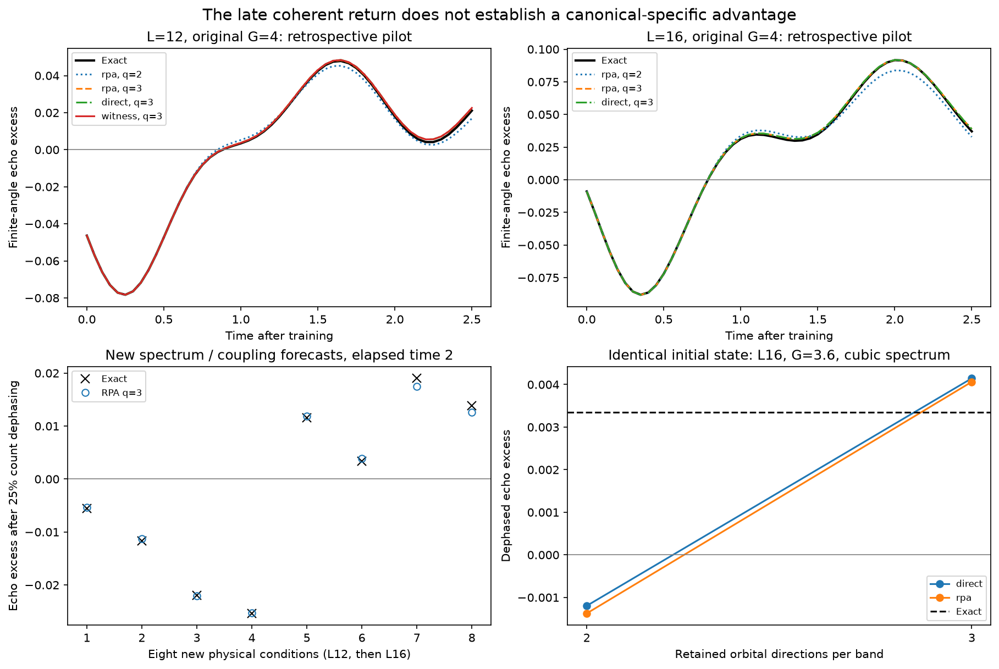
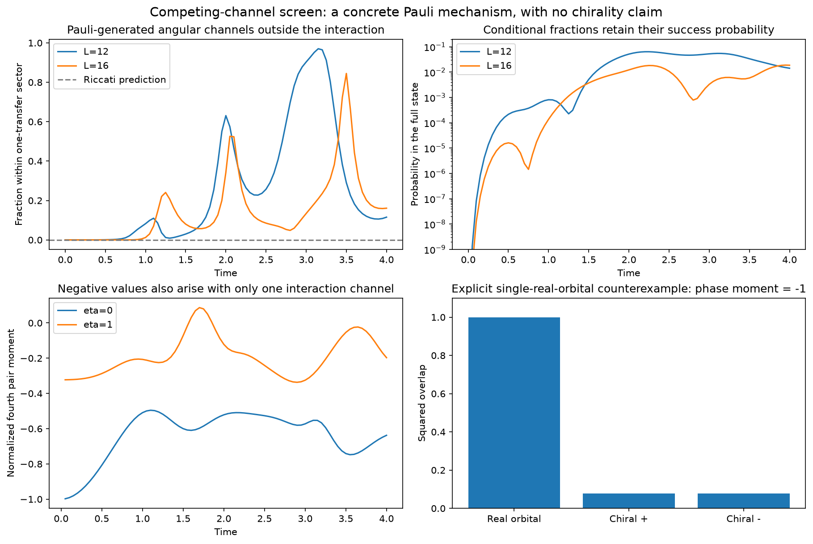

# 第七轮：晚时相干返回与 Pauli 诱导配对通道

**本轮验证了一个具体的 Pauli 诱导通道来源，但仍未建立 canonical 分布独有的重要新物理。**
原均匀 BCS 模型的晚时回波，在八个新参数条件上可由常规 RPA 生成的三通道空间预测，
因此它不能作为 canonical 优势的主要证据。
进一步的竞争通道初筛发现：硬核排斥会产生相互作用与线性响应中没有的角向谐波；
同时，一个看似“手性相位锁定”的诊断被明确的单实轨道反例否定。
新模型还存在 Hamiltonian 对称性给出的精确闭合空间，必须作为替代解释保留。

完整机器核查见 [audit.json](results/assessment_coherent_return_01/audit.json)，
新模型、三阶推导与误判控制见 [PAULI_CHANNELS.md](PAULI_CHANNELS.md)。
前六轮结论保留于各自报告，研究目标仍为 active。

## 1. 早期结构对晚时回波的真正预测

本轮从 L=12/16、G=4、t=1 的态冻结集体轨道。
比较早期直接态、有限尺寸 RPA 矩阵及 L=12 的二阶 canonical witness 提取的方向。
后续只用投影 Hamiltonian 演化；q 表示每个带的轨道方向数，
不是 Gaussian 原子数。q=2/3 在 L=12 的空间维数为 92/408，
在 L=16 为 205/1661。它们仍使用完整配对空间枚举，未实现一般多项式成本算法。
本轮 witness 方向也不是实际 canonical 概率测度抽样原子。

原 G=4 轨迹已经检查过，15 条相应预测只算机制先导实验。
随后预先写入 G=3.6/4.4、两种新能谱
ε+0.15ε³ 和 ε+0.12(ε²−平均 ε²)，在两个尺寸上形成八个新物理条件。
40 条模型轨迹整体保存后，才计算这一批精确未来参考。
主要时间固定为训练后 Δt=2，主要指标为有限角度回波超额误差和计数总变差。
角度 θ=0.2，另检查 25% 集体计数去相干后的回波。

令 W=K(0)−K(θ)−θ²平均(m)。
W>0 排除数目投影 Gaussian 纯态的经典混合，推导见
[上一轮解析界](PROJECTED_GAUSSIAN_COUNT_BOUND.md)。
新条件下的平均误差如下：

| 尺寸与来源 | q | W 绝对误差 | 计数总变差 | 全态保真度 |
|---|---:|---:|---:|---:|
| L12，直接态 | 2 | 0.00143764 | 0.05846455 | 0.87125979 |
| L12，witness | 2 | 0.00142319 | 0.05738691 | 0.87149618 |
| L12，RPA | 2 | 0.00149590 | 0.06414292 | 0.86321013 |
| L12，直接态 | 3 | 0.00139235 | 0.00968818 | 0.95953174 |
| L12，witness | 3 | 0.00138502 | 0.01026981 | 0.95837539 |
| L12，RPA | 3 | 0.00119979 | 0.01234254 | 0.95582501 |
| L16，直接态 | 3 | 0.00150518 | 0.01594031 | 0.95504049 |
| L16，RPA | 3 | 0.00149976 | 0.01639450 | 0.95639350 |

RPA 三通道对八个条件的去相干回波符号全部预测正确：
L12 的四个条件为负，L16 的四个条件为正。
这八个条件不是大量独立重复，也不据此作统计显著性主张。
W 的准确不意味着全波函数准确；表中保真度保留了实际误差。
没有 L16 的完整 canonical 合成对照。

全部 55 条先导/新条件模型轨迹另有各自初态的精确传播控制，
继续区分初态偏差与动力学误差，避免重现上一轮的归因错误。

## 2. 删除控制支持额外方向的重要性，但没有支持独特来源

另在两个新条件上做五个相同初态控制：
将 q=2 的初态原样嵌入包含它的 q=3 空间，再分别传播。
初态差不超过 \(1.80\times10^{-15}\)。
这些是检查过新条件后的因果对照，不再计作独立预测。

L16、G=3.6、三次能谱修正条件的精确去相干 W=0.00334905。
RPA 两通道预测 −0.00137528；相同初态的三通道预测 +0.00406291，
恢复正确符号。对应计数总变差从 0.06438 降至 0.02214。
直接态方向也有同样效果。L12 的控制显示计数改善，
但不能说三通道在每一个纯态回波指标上都更好。

还有一个更强的机制限制：每个带恰好只有一个集体方向的平坦能带模型，
其精确 r+1 维链也产生正的晚时 W。L=8 至 128 的探索性链计算都保留在归档中，
没有从不同时间窗口的最大值宣称热力学标度。
所以正的回波本身不要求许多独立方向。

配对淬火中的干涉、返回和偏离平均场的谱结构已有研究，
见 [Faribault、Calabrese、Caux](https://arxiv.org/abs/0812.1928)。
本轮既没有把这些现象重命名为新机制，也没有把击败 q=2 当作击败全部强基线。

## 3. 竞争通道初筛：先排除错误解释

均匀模型的多轮比较没有给出稳定的 canonical 特有信息，
因此本轮开始一个有界的扩展：两壳层、cos(2θ) 与 sin(2θ) 两个可分离配对通道，
从同样的正常费米海出发。
探索 L=8/12/16、相对耦合 η=0/0.85/1，共九个条件。
η=0 是单相互作用通道，η=0.85 打破简并，L=8 是不相交形状因子的特殊控制。
目前只完成这部分的第一阶段筛查，不能替代原三阶段验收。

发现的第一个结果是诊断限制，而非手性相：
由于复合对的双占据态不是理想玻色正交模，
负的归一化四配对算符关联甚至可在单实轨道、固定 m=2 的态中达到 −1。
该态与一个实轨道乘积完全重合，与两个手性轨道乘积的重叠各仅 0.07716。
它还给出正的手性 Binder 值。
这些指标均不能单独证明手性猫态、两分支结构或自发对称性破缺。

实际归档使用完整 Pauli 归一化的条件轨道重叠，
并保留每个条件转移数的成功概率。
不同时间和转移数的重叠偏好不一致，没有发现一个稳定、单一的手性解释。
相关超导对称性动力学已有背景，见
[Dehghani–Mitra](https://journals.aps.org/prb/abstract/10.1103/PhysRevB.96.195110)；
本模型也不是具体材料模型。

## 4. 一个可以明确追踪的 Pauli 通道来源

等强、平坦壳层模型的一次转移振幅 C(t)，在线性 Riccati 描述中只含原 k=±1 角向方向。
令 Q 投影到这两方向以外，精确硬核动力学给出

\[
Q C(t)Q=-\frac{2i}{3}t^3Q(J_{ph}\circ J_{ph}\circ J_{ph})Q+O(t^4).
\]

逐元素三次方来自两次转移再返回时，禁止重复占据同一粒子/空穴能级的修正。
它生成 k=±3 的角向 Schmidt 通道；这是角向结构，不能混称为时间三倍频信号。
L=10/12/14/16、G=3/4 的八组 H³ 检查最大误差 \(7.70\times10^{-13}\)，
短时概率幂次趋近 6。Riccati 在这些通道的范数保持约 \(10^{-15}\)。

在 G=4、η=1 的已计算轨迹上，给定一次转移后，外部通道的比例从 t=0.25 的
0.0000441 / 0.00000630，增长到 t=2 的 0.63076 / 0.34269，
分别对应 L12/L16。
后者在整个态中的概率为 0.05154 / 0.01227，不能省略这一后选择成本。
这是一个真实的非线性结构变化，且有可核查的微观来源；
目前只是探索性轨迹上的机制分析，不是 canonical 提取后的新参数预测。

还检查了 Hamiltonian 对称性的替代解释。
偶数角向网格的平坦模型可用全部奇指标构造精确闭合空间：
L12 三方向给出 141 维，L16 四方向给出 1107 维，
不变性相对残差分别约 \(9.6\times10^{-16}\)、\(1.6\times10^{-15}\)。
因此这个结构也能从 Hamiltonian 直接发现。
不能据此宣称 canonical 方法独有，也不能只比较不含它的 Riccati。

## 5. 核查与下一步

70 个冻结/预测文件哈希通过核查；完整测试 50 项通过。
新增测试包含低秩混态 QFI 与完整密度矩阵的独立对照、
平坦集体链与完整 Hamiltonian 的一致性、
一般配对核恢复原均匀模型及线性自项、
相位诊断反例和三阶 Pauli 源。
五个相同初态控制的本征分解传播与独立矩阵指数相差不超过 \(2.96\times10^{-14}\)。
新通道精确轨迹的最大范数误差约 \(7.91\times10^{-14}\)，能量漂移约 \(7.46\times10^{-13}\)。

本轮最多使用八个独立 CPU 预测进程，通道筛查使用六个进程，
闭合空间检查使用四个 BLAS 线程；没有新 GPU 任务。所有任务已结束。
本轮没有现实实验测量，没有同总计算预算优势，也没有新的全局最优拟合声明。

后续优先检查不存在上述特殊闭合的奇数 r 网格或合适谱扰动，
以能量/角向分辨的转移关联为主要物理量，
加入非线性 pair-CC、随机平均场、Hamiltonian 对称性和响应训练基线。
只有当早期 Gaussian 分布能提取并预测这些强基线遗漏的结构，
且删除它后偏差返回，才满足用户要求的第三阶段。
目前新颖性、物理上的广泛重要性和 canonical 独特预测价值仍未建立。
