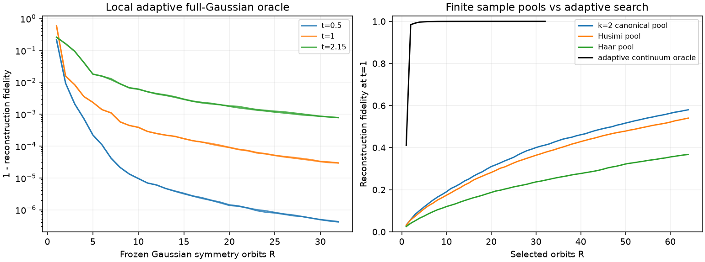
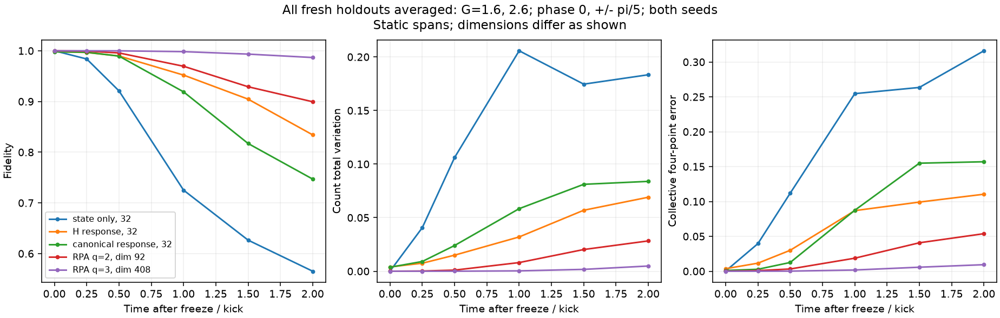
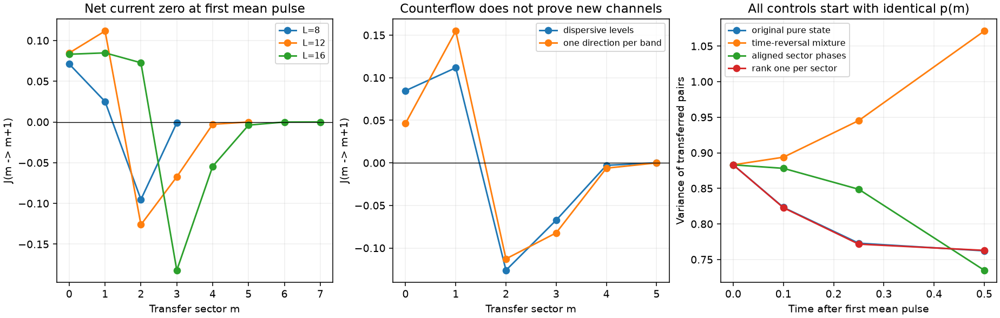

# 第二轮：实际 Gaussian 构型、响应训练与保持计数的相位控制

后续条件轨道、Hamiltonian-only 变分传播及相同初始态删除试验见 [第三轮报告](REPORT_CONDITIONAL.md)。

**研究仍在进行，尚未得到符合原任务标准的重要新物理发现。**
这一轮补上了第一轮缺少的自适应 Gaussian 构型搜索、实际候选原子的冻结外推、相干核消融，
并加入 Hamiltonian 响应训练和 24 组相位机制对照。结果支持两个实用判断：
单时刻重构精度不足以判断预测能力；仅凭计数和一个总四点函数也不足以判断后续涨落。
但这些判断尚未建立 canonical 分布相对于强方法的独特物理贡献。

第一轮模型、计数窗口和理论约定见 [REPORT.md](REPORT.md)、[THEORY.md](THEORY.md)。
本轮机器可读汇总见 [audit.json](results/assessment_columns_01/audit.json)。
所有工作均在 `/home/tiger/Fermionic-Gaussianity-main`，没有提交或推送。

## 1. 强自适应搜索明显优于当前二阶样本池

在 L=12、G=2、t=0.5、1、2.15 各运行两个种子，每次选择 32 个构型。
每一步用当前残差优化 onsite Gaussian（12 起点），再用任意复反对称准粒子配对矩阵
搜索跨能级改进（GPU 上两个起点），同时比较所有 Fock 边界原子，随后重新拟合全部复系数。
这是一种局部自适应匹配追踪；没有全局支持函数 oracle，也不是已认证的最小成本列生成。
六个任务分配到六块 H20，每个任务约 117–189 秒。

**R 计数的是 Gaussian 对称轨道，不是 R 个未经投影的纯 Gaussian。**
保存列为 `P_sector |g>`，其中 `|g>` 在完整 Fock 空间归一化，投影后不重新归一化。
数目和局域自旋差的对称平均仍是归一化 Gaussian 的相干组合，故系数绝对值和提供可行成本。
单个轨道通常需要多个原始 Gaussian 才能离散实现。

| 时刻 | R=32 可行重构保真度，两个种子范围 | 相干系数质量，未修复残差 |
|---:|---:|---:|
| 0.5 | 0.999999576–0.999999588 | 2.011–2.015 |
| 1 | 0.999970579–0.999970624 | 2.794–2.795 |
| 2.15 | 0.999217479–0.999226040 | 4.104–4.147 |

在 t=1，先前完整 Haar 采样保留的 canonical/Husimi/Haar 候选池各有 2,048 列。
从这些有限池贪心选 R=32 列，保真度分别为 0.412、0.377、0.245；
canonical 池增至 R=64 后约为 0.580。这里比较的是指定样本池和局部连续优化，
**没有匹配总运行时间或总 oracle 调用预算**，不能外推为所有 canonical 采样方案的失败。
它足以否定“当前二阶样本已提供经济而高精度的物理构型”这一说法。

在本轮重启中，跨能级优化没有提供显著改进，绝大多数选中列仍是 onsite。
这不是一般 Gaussian 字典可缩减为 onsite 的定理。
保存的 `atoms` 是带完整复相位的权威数据；若仅从 `qp_Z` 重建，必须对齐参考费米海振幅的全局相位。
Fock 边界的 `qp_Z` 用 NaN 标记，原子本身仍明确保存。

## 2. 可行成本已修复，但上下界仍不紧

对固定的 32 列解有限字典 SOCP，同时允许全部 Fock 原子修复残差：
`min ||c||_1 + ||psi-Ac||_1`。修复向量从保存系数重新计算，不把求解器的近似等式当成精确分解。
六次修复的最大重构残差为 5.8e-19。

下界来自匹配粒子—空穴四模 magic 态的张量积 witness，优化两种匹配和局域相位。
它的完整 Gaussian 支持界有解析依据；有限优化只影响找到的下界强弱。
依据是 [Reardon-Smith 的四模 FLO 乘法性结果](https://arxiv.org/abs/2407.20934)。

| t | 解析支持 witness 给出的 extent 下界数值 | 修复分解给出的最好 extent 上界数值 |
|---:|---:|---:|
| 0.5 | 2.4294 | 4.0934 |
| 1 | 3.9624 | 8.4481 |
| 2.15 | 2.7392 | 22.8604 |

这些是双精度数值，不是有向舍入的区间证书。有限字典 SOCP 的对偶没有完整字典支持认证，
不能用于宣称全局最优。Fock 修复仅用于可行成本；它没有加入冻结预测基，避免人为恢复完整精确空间。

## 3. 高重构精度没有自动带来可靠预测

第一批实际原子外推先冻结 t=1 的构型，随后测试 G=1.8、2.4 和相位踢 0、±π/3，
分别使用静态基及 Hamiltonian 决定的共同自由单体输运，共 396 个预测。
预测文件全部生成后才计算未来精确参考；冻结文件含 SHA256。

以 G=1.8、无相位踢、静态 R=32 为例：初始 F≈0.999971，但 Δt=1 时 F≈0.854，
Δt=2 时 F≈0.553。对应空间漏掉了约 37.4% 的瞬时中心化 Hamiltonian 响应向量范数。
这不是 37.4% 的状态概率。仅自由输运并没有修复这一问题。

实际 canonical/Husimi 样本基的初始重构已较差，后续外推没有显示优势。
这批实验真正使用了原始样本列，区别于第一轮仅对 witness 的 m=1 块做 SVD。

## 4. 响应训练改善外推，但直接 Hamiltonian 响应仍是更强对照

第二批构型训练仅用 t=1 的信息，比较两个三向量训练空间：

- 直接响应：`span{psi, (H-E)psi, (H-E)^2 psi}`。
- canonical 响应：`span{psi, u, v}`，其中 `C_2(u)=psi`，
  `DC_2(u)[v] = -i(H-E)psi`。这是实线性导数，必须保留对共轭方向的依赖。

第二种方法使用 witness 及其响应，并非从 canonical 概率测度直接采样。
导数经独立有限差分核查，响应方程残差约 7.7e-11。
每类两种子、每次 32 列，四块 H20 并行；每个任务约 124–134 秒。
两者把中心化 Hamiltonian 响应漏出范数降到约 4.2%，代价是初始态拟合略降至约 0.998。

使用新留出 G=1.6、2.6、相位踢 0、±π/5，以及静态/自由输运两种方式，
共 252 个预测；全部组合预先写入冻结清单。下面平均覆盖两个 G、三个踢角和两个种子，
不是只选最有利参数；RPA 的每种配置只计一次。

| 冻结空间 | 维数 | Δt=1 平均 F | 平均计数 TV | 平均总四点函数误差 | Δt=2 平均 F |
|---|---:|---:|---:|---:|---:|
| 仅重构早期态 | 32 | 0.7251 | 0.2057 | 0.2546 | 0.5652 |
| 直接 Hamiltonian 响应 | 32 | 0.9521 | 0.0320 | 0.0869 | 0.8342 |
| canonical witness 响应 | 32 | 0.9190 | 0.0584 | 0.0874 | 0.7469 |
| 线性响应两个方向生成的空间 | 92 | 0.9695 | 0.0081 | 0.0187 | 0.8994 |
| 线性响应三个方向生成的空间 | 408 | 0.9983 | 0.0003 | 0.0018 | 0.9867 |

表中使用静态传播；自由单体输运的全部结果也保留，在 32 维空间中整体更差。
RPA 空间维数更大，不构成相同成本优势证明；但直接响应与 canonical 响应同为 32 列，
本轮 canonical 没有显示稳定优势。部分单个外推点更好，不改变整体结论。
没有将响应增强的一般思路宣称为新物理；相干多构型动力学已有
[含配对的 TD-GCM 原始研究](https://arxiv.org/abs/2309.12564)。

## 5. 相位消融：先保持计数，再判断物理差别

直接删除非正交 Gaussian 列间的系数相干后，必须重新归一化。
例如 t=1 自适应 R=32，初始计数 TV 已变化约 0.111，
均值由 0.988 变为 1.179。因此这种删除不能独立证明“同样计数下，相位才是误差来源”。

本轮另实现保持每个 p(m) 不变的控制：转移数扇区退相干、相邻扇区相位对齐、
各扇区最佳 Schmidt 秩一方向，以及原态与其复共轭态的等权混合。
这些是机制诊断用的合法状态构造；复共轭并非可任意实施的量子通道，
没有把它们冒充已设计好的实验制备协议。

定义 `A=sum_{p,h} s_p^+ s_h^- / r`，`C_m=<psi_{m+1}|A|psi_m>`，有

\[
J_m=-2gr\,\mathrm{Im}\,C_m,\qquad
\dot p_m=J_{m-1}-J_m,\qquad
\dot{\mathrm{Var}}(m)=\sum_m(2m+1)J_m-2\bar m\sum_mJ_m.
\]

在首个均值极大值处，`sum J_m=0` 并不要求所有 J_m 为零。
以均匀能谱 L=12、G=2 为例，准确脉冲时间为 t=2.1418466195，
`sum |J_m|≈0.39280`，方差变化率约 -0.70851。
将原态与复共轭态等权混合后，完整初始 p(m)、能量和总复四点函数保持相同，
但所有分区电流抵消，初始方差变化率变为零。
Δt=0.1 后，原态方差为 0.82322，混合态为 0.89379；初始两者均为 0.88305。

这给出一个具体的预测限制：同一个总四点函数会隐藏不同转移数区间的相位抵消。
分区 `C_m` 包含数目投影，不能称为简单的独立四点观测量；方差导数牵涉更高关联。
这不是 canonical 分布独有的诊断，也不是此次已完成查新的新机制。

## 6. 反向分区电流不是新通道的证据

对 L=8、12、16，G=2、4，以及均匀、弯曲、粒子—空穴不对称、两条完全简并带，
共 24 组模型重复首脉冲和相位控制。所有案例都存在非零反向分区电流。
但两条简并带中，动力学严格限制于每带一个集体方向、共 r+1 维的空间，
没有新独立方向也可以产生这种电流。
其解析三对角 Hamiltonian 与完整稀疏模型已独立核对。

因此“看到分区电流反向，所以产生了新的 Gaussian 配对通道”的解释被该对照否定。
在 L=12、G=2 的非简并模型中，保持 p(m) 的逐扇区秩一替代也几乎保留后续方差，
说明这里主要需要区分径向复系数/扇区相位，而不能仅凭平均脉冲诊断通道增加。

24 组中的最大连续性方程误差为 2.3e-14，所有控制的初始计数误差低于 4.1e-15；
首脉冲处复共轭混合的总四点函数匹配误差低于 3.7e-14。

## 7. 当前验收与下一步

25 项独立/解析/数值测试通过。两批共 648 个预测的最大归一化误差为 1.35e-10，
54 个冻结基文件的 SHA256 重新核对通过。报告中的成本、投影、局部优化和原子数约定均分别列明。

第一阶段的物理窗口已建立；第二阶段原先缺少的强自适应构型对照和相位核控制已补上，
但一般投影 Gaussian 的全局有限误差排除、canonical 的可扩展有效采样仍未解决。
第三阶段完成了实际构型的留出预测和机制删除，**成功条件仍未通过**：
尚无证据表明分布额外发现了强基线遗漏、且物理上重要的结构。

下一轮应集中检验非线性阶段的带内轨道随转移数变化，是否造成直接响应及强集体模型遗漏的
可测能量分辨关联或回波偏差；任何候选结构都应先与直接 Hamiltonian 响应、
多构型传播和更高关联截断比较。此前已经否定的低阶宽支持、m=1 witness SVD、
反向分区电流，不应再次包装成分布的独特发现。原目标保持 active。
