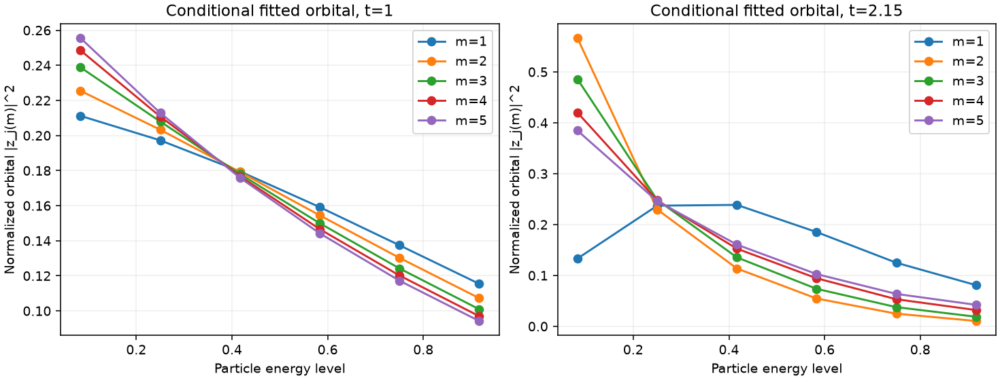
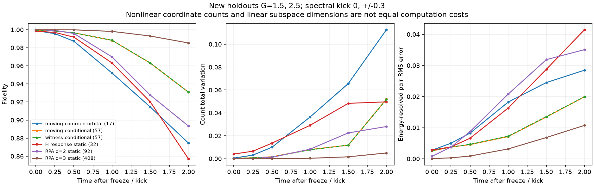
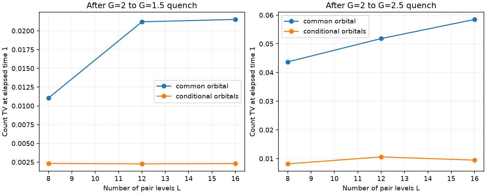

# 第三轮：转移数与配对轨道的关联

**本轮得到一个经过预测和删除控制的物理结构候选，但还不能称为 canonical 分布独有的新发现。**
非线性阶段不只需要自由径向系数：不同转移数下的配对轨道形状也明显不同。
允许这种关联随 Hamiltonian 演化，改善了留出计数和能级分辨四点函数；
从完全相同的初始态删除这项自由度，误差重新出现。
但从精确早期态直接提取的轨道，与 replica witness 提取的轨道预测几乎相同。
此外，它与既有 Jastrow/多构型方法存在直接联系，原任务的独特性与重要新物理门槛仍未通过。

前两轮见 [REPORT.md](REPORT.md) 和 [REPORT_COLUMNS.md](REPORT_COLUMNS.md)。
本轮汇总和独立测试日志见 [audit.json](results/assessment_conditional_01/audit.json)、
[tests.log](results/assessment_conditional_01/tests.log)。

## 1. 条件轨道恢复了单一径向方向遗漏的大部分结构

在每个转移数 m 中拟合

\[
\psi(P,H)=c_m\,q_m(P,H),\qquad
q_m(P,H)\propto\prod_{j\in P}p_j(m)\prod_{k\in H}h_k(m),\quad |P|=|H|=m.
\]

这是不同 Gaussian 对称轨道的相干组合；每个 q_m 还投影了上下带的占据数，
并非一个未经投影的 Gaussian。每个 m 有独立轨道，比共同轨道加任意复径向系数更灵活，
但小于任意逐扇区 Schmidt 秩一态。
两种子、多起点拟合一致到数值精度；这些仍是可行拟合而非全局最优证书。

| L=12、G=2 | t=0.5 | t=1 | t=2.15 |
|---|---:|---:|---:|
| 共同轨道 + 自由径向系数 | 0.99998765 | 0.99900351 | 0.95557217 |
| 随 m 线性变化的对数轨道 + 自由径向系数 | 0.9999900 | 0.9995546 | 0.9681567 |
| 每个 m 独立轨道 + 自由径向系数 | 0.99999004 | 0.99957320 | 0.99283974 |
| 任意逐扇区 Schmidt 秩一的上界 | — | — | 0.9938686 |

在首脉冲附近，m=1 的最优轨道权重在最低能级附近受到压低，m=2、3 则明显偏向费米面附近。
这里说的是拟合的轨道参数，而非将 Gaussian 系数分布边缘直接解释为占据概率。
物理验证另外计算了能级占据、连通占据关联和全部跨费米面的 `⟨s_p^+s_h^-⟩`。

## 2. 更强的 pair-CC 对照没有消除差距

为避免把固定 CC 径向系数的错误误判为通道数不足，新增了
`psi_m = c_m perm(T[P,H])`，每个 m 的复系数独立优化，T 分别为 rank 1、2、3 和 full rank。
每项两个种子、每种子八起点；逆向梯度有独立有限差分检查，rank-1 结果与共同轨道径向拟合一致。

| 自由径向 pair-CC | t=0.5 | t=1 | t=2.15 |
|---|---:|---:|---:|
| rank 1 | 0.99998765 | 0.99900351 | 0.95557217 |
| rank 2 | 0.99999766 | 0.99946368 | 0.95963463 |
| rank 3 | 0.99999766 | 0.99946369 | 0.95996527 |
| full rank | 0.99999766 | 0.99946369 | 0.95996725 |

本轮找到的单个共享 T，即使解除径向约束，也未达到条件轨道的约 0.993。
这支持“非线性阶段需要超出同一个 T 的系数关系”的判断；
有限局部搜索尚不足以证明所有该类态的全局误差下限。
数据在 [radial_cc_L12_G2_01](results/radial_cc_L12_G2_01)。

## 3. 静态冻结仍失败，必须检验构型如何运动

先只读 t=1 的状态或 witness，冻结共同/条件轨道及零、一、二阶密度导数空间，
维数为 7、57、236；同时保留 RPA q=2/3 和上一轮 32 列响应基。
随后在 G=1.7、2.3、-2 和能级分辨相位踢下生成 180 个静态预测。
相位踢为 `exp[-i eta (H0-H0(F)-2m)]`，eta=0、±0.4，是一个单体幺正。
G<0 表示只反转相互作用，**不是反转全部 Hamiltonian 的完整时间回波**。

条件轨道的静态 57 维空间，在正 G 留出点 Δt=1 平均 F≈0.894；
236 维约为 0.985，但 Δt=2 降至约 0.842。
witness 提取的对应空间没有改善这个结论。
所以不能把 t=2.15 重新拟合得到的 0.993 当成冻结模型的预测精度。

## 4. 固定表示类型、仅由 Hamiltonian 驱动轨道运动

进一步推导并实现上述两个非线性流形上的 Dirac–Frenkel 方程。
轨道和相干系数均参与传播，包含归一化轨道的 Berry 相位补偿；不读取未来精确态进行回拟合。
表示类型和初始坐标在 t=1 冻结。
共同轨道需要 17 个复坐标，条件轨道需要 57 个；这里包含整体振幅/相位坐标，
不能把这些数字直接等同于纯 Gaussian 原子数或计算成本。

用新留出 G=1.5、2.5、-1.8 和 eta=0、±0.3，生成 72 个预测，再访问精确参考。
下表平均覆盖两个正 G、全部三个踢角；跨能级误差是 r×r 复配对关联矩阵的逐元素 RMS。

| 方法 | 坐标数/线性维数 | Δt=1 平均 F | 计数 TV | 跨能级配对 RMS | Δt=2 平均 F |
|---|---:|---:|---:|---:|---:|
| 共同轨道运动，直接初值 | 17 | 0.95204 | 0.03643 | 0.01824 | 0.87464 |
| 条件轨道运动，直接初值 | 57 | 0.98823 | 0.00795 | 0.00715 | 0.93091 |
| 条件轨道运动，witness 初值 | 57 | 0.98829 | 0.00774 | 0.00725 | 0.93106 |
| 冻结 Hamiltonian 响应 Gaussian 轨道 | 32 | 0.96316 | 0.02915 | 0.01632 | 0.85731 |
| 冻结 RPA 两方向空间 | 92 | 0.96988 | 0.00829 | 0.02080 | 0.89350 |
| 冻结 RPA 三方向空间 | 408 | 0.99813 | 0.00031 | 0.00318 | 0.98532 |

条件轨道改善了较小强对照的若干物理误差，但并未全面胜过大空间 RPA。
在相互作用反号组，条件轨道 Δt=2 平均 F 仍只有约 0.878；本轮不是长时高精度解。
代码当前仍枚举固定配对 Hilbert 空间来计算 TDVP 核，不能宣称获得了多项式计算复杂度。

## 5. 相同初始态删除控制与规模复核

又建立两种完全相同的初始物理态：共同轨道参数复制到所有 m，系数保持一致。
随后一组允许各 m 的轨道分别运动，另一组始终约束它们相同。
初始态向量差严格为数值 0，避免把效果归因于更好的起始拟合。
在新 G=1.55、2.45、-1.9 和 eta=0、±0.25 上完成 18 个预测。

正 G 组 Δt=1，保持共同轨道时平均 F=0.95395、计数 TV=0.03566；
允许条件运动后为 F=0.98910、TV=0.01096，配对矩阵 RMS 从 0.01780 降至 0.00698。
删除条件运动后误差确实重新出现。
原始汇总见 [shared_control_summary.json](results/shared_conditional_predictions_01/shared_control_summary.json)。
这验证的是**这一有限变分模型中的结构必要性**，并不证明所有其他方法均不能预测同一效应。

另在 L=8、16 上从各自 t=1 初始态重复 G=1.5、2.5、-1.8，共 12 个预测。
下面是无踢、G=2.5、Δt=1 的计数误差；L=12 来自上面的主实验。

| L | 共同轨道 TV | 条件轨道 TV |
|---:|---:|---:|
| 8 | 0.04369 | 0.00816 |
| 12 | 0.05182 | 0.01059 |
| 16 | 0.05849 | 0.00946 |

这排除了只发生在 L=12 的偶然改进，但不是热力学极限或普适缩放定律。

## 6. 数值验证与新颖性边界

30 项测试通过，含复梯度、条件乘积态恢复、密度切空间、完整单体传播极限、
TDVP 的物理导数、范数和能量守恒，以及自由径向 CC 梯度。
L=12、16 强耦合案例将积分容差收紧 100 倍、最大步长减半、metric 截断降低 100 倍，
最大状态变化为 4.15e-8，计数变化低于 2.87e-8，远小于本轮讨论的物理差距。
所有预测都有先保存预测、后计算未来精确态的文件流程；主汇总核对了 32 个冻结文件哈希，
相同初始态控制另保存两份冻结文件。

不能把“轨道运动”或“Jastrow 修正”本身当成新方法。
投影 AGP 的时间依赖变分理论已有
[Deumens、Weiner、Öhrn 的研究](https://doi.org/10.1016/0375-9474(87)90346-0)，
Hilbert 空间 Jastrow-AGP 已用于补充对间关联
[Neuscamman 2013](https://arxiv.org/abs/1308.5297)，
复 Jastrow/backflow 的费米子实时变分传播也已有
[Nys et al. 2024](https://arxiv.org/abs/2403.07447)。

事实上，本轮条件态在非零坐标 chart 中可写成
`exp[alpha(m)+sum_j f_j(m) n_j]` 乘一个固定的投影配对态。
线性的 f_j(m) 已属于密度相关 Jastrow 修正；一般离散函数对应更高阶的集体密度关联。
这个代数联系是需要正视的强替代解释，不是本轮已排除的既有方法。

**当前更准确的结论是：**转移数与带内轨道形状的关联，是解释当前非线性计数和能量分辨关联误差的
一个有用物理坐标；通过共同初始态的删除试验验证了它的作用。
其新颖性、canonical 的独特贡献、相对于强 Jastrow/更一般多构型动力学的优势仍未建立。
下一步需检验这类替代方法是否已足够，并寻找它们真正遗漏的相干观测或认证价值，不能直接宣布完成原目标。
