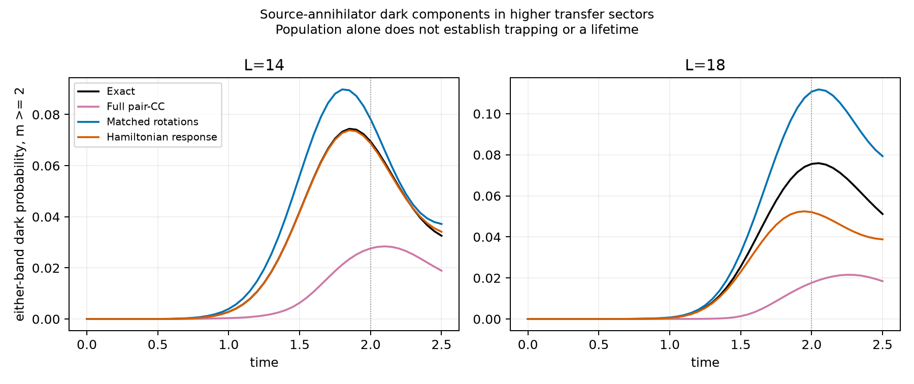
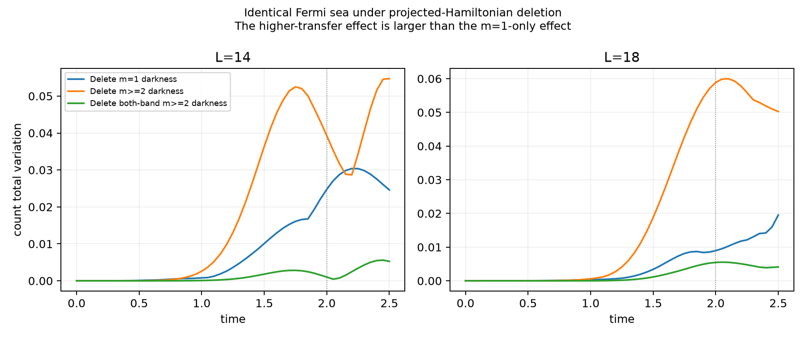
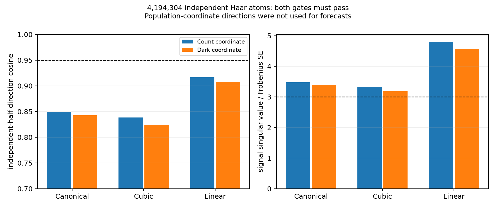
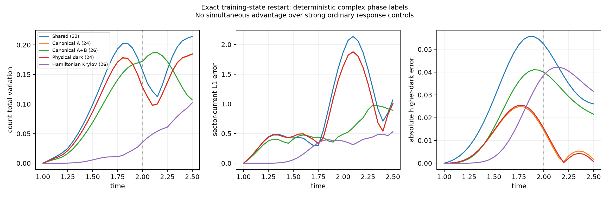

# 第十二轮：连通多次转移的暗成分有动力学作用，分布优势仍未通过

本轮把一个具体候选机制从单次转移中分离出来：**多次转移中的源暗成分，
不能由精确的一次转移振幅简单提升得到；删除它会显著改变后续计数。**
但实际 Gaussian 相干积分及保留复相位后的传播，都还没有建立相对强对照的独有预测优势。
用户要求的第三阶段仍未完成，研究目标保持进行中。

本轮完成三个已查看尺寸的物理诊断、12 个删除／完整空间传播、
四个尺寸的短时算符展开、4456448 个完整 Gaussian 原子的相干积分、
46 条相位矩先导传播及四条数值复核。全部八块 H20 用于积分。
这些记录不是相同数量的独立物理条件，也没有新增参数 holdout。
公式、字典范围及相位标签的定义见 [DARK_PAIR_COHERENCE.md](DARK_PAIR_COHERENCE.md)。

## 1. 多次转移的暗成分与一次转移不同

“暗”指在一个激发带内，同时被原 cos、sin 两个集体配对消去算符消去。
主要量是 m≥2 时至少一侧为暗的总概率，排除了空带和一次转移。
它不等于完整 Hamiltonian 的不变子空间，不能由其人口直接推断俘获或长寿命。

在等强双通道、G=4、t=2：

| L | 精确暗概率 | 普通 full pair-CC | 匹配 Gaussian 旋转 | 第十一轮同维数 Hamiltonian 响应 |
|---|---:|---:|---:|---:|
| 10 | 0.002755 | 0.010060 | — | — |
| 14 | 0.069444 | 0.027634 | 0.078206 | 0.068735 |
| 18 | 0.075574 | 0.017653 | 0.110747 | 0.052048 |

这一区分比此前单个 Fourier 指标更直接地对应源算符。
L=10 的多次转移暗概率很小，不能用它代表较大尺寸的该结构。
L=14、18 的相近数值也不足以建立热力学标度。
表中保留强对照：L=14 的普通 Hamiltonian 响应已经相当准确。

## 2. 同初态删除显示作用主要不在“双侧同时为暗”

所有投影 Hamiltonian 均从相同的精确费米海开始。
删除后在 t=2 的结果：

| L | 删除部分 | 保真度 | 计数 TV | 扇区净电流 L1 误差 |
|---|---|---:|---:|---:|
| 14 | 仅 m=1 暗成分 | 0.966421 | 0.024761 | 0.106596 |
| 14 | m≥2 任一侧为暗 | 0.862540 | 0.039250 | 0.270449 |
| 14 | m≥2 两侧同时为暗 | 0.995074 | 0.001019 | 0.027252 |
| 18 | 仅 m=1 暗成分 | 0.984129 | 0.008948 | 0.078593 |
| 18 | m≥2 任一侧为暗 | 0.861897 | 0.058887 | 0.114552 |
| 18 | m≥2 两侧同时为暗 | 0.991782 | 0.005469 | 0.014264 |

因此，不能把主要效应缩成两带共同落入一个完全暗构型。
至少一侧暗、另一侧仍可耦合的连通结构需要保留。
该对照证明所定义子空间在这些有限模型中影响动力学，
不是 canonical 的发现优先权，也不是已完成的实验干预。

## 3. 连通多次转移比一次转移永久积更早产生暗振幅

新增独立的转移分块 Hamiltonian，不构造完整 L=22 多体矩阵即可核查短时系数。
其作用先与原完整 Hamiltonian 在随机复向量上比较。
对照模型直接获得精确 $T(t)=C_1(t)/C_0(t)$，因而不受一次转移局部拟合误差影响。

| 尺寸 | 暗转移数 m | 精确振幅首次解析出的阶数 | 精确一次转移的永久积提升 |
|---|---:|---:|---:|
| L=14、18、22 | 2 | $t^5$ | $t^6$ |
| L=18、22 | 3 | $t^7$ | $t^9$ |
| L=22 | 4 | $t^9$ | 所算九阶内无非零项 |

这里报告振幅阶数，不是概率阶数。相应首次非零系数远大于浮点抵消误差；
两次转移系数范数在 L=14、18、22 分别为 0.184264、0.148065、0.115725。
较低阶的残余均处于约 $10^{-14}$ 水平。
小时间展开还比较了额外两阶，完整原始系数和变化均已保存。

最高占据附近的特殊暗扇区存在额外选择规则；
例如 L=14 的 m=3 在七阶内未解析出非零项，不能套用上述通用外观。
本轮没有证明对任意尺寸成立的 $2m+1$ 定理，也没有把极小短时信号当作重要预测成果。
这些结果只支持一个更具体的后续候选：需要连通多次转移，不能只修正一次转移轨道。
它不是对任意一般 projected Gaussian 的排除证书。

## 4. 完整 Gaussian 人口坐标仍受相干抵消与采样噪声限制

L=14、t=1 的二阶完整 Gaussian 合成初始残差为 $2.28\times10^{-10}$。
GPU 后端与独立 CPU 后端在 L=4、6、8 的随机复向量及导数上核查，
差异在约 $10^{-16}$；额外有限差分导数检查也通过。
这里有 28 个物理费米模式，采样 SO(56)，没有将字典限制成 onsite BCS。

以投影构型的平均转移数和 m≥2 暗概率为标签，保留全部三次以下二元单项式。
独立 4096 原子先固定坐标。首批积分 262144 原子后，
另用不同种子的 4194304 原子复核，两批结果分别保留。

大样本 canonical 的原始总积分相对误差为 0.008236，块标准误差为 0.008547；
线性 frame 分别为 0.006237、0.006443。
canonical 系数质量约为 7294，不能把一个小标签集合解释成低合成成本。
这些是完整相干积分的 Monte Carlo 结果，不是 canonical 测度的 iid 样本。

去除共享的两源空间、训练态及其三次矩后，没有方向同时通过独立半池余弦 ≥0.95
和末奇异值 ≥三倍整体标准误差的门槛。
即便仅保留一次暗标签，canonical 独立半池方向余弦也只有 0.84275；
线性 frame 为 0.90775。它们均未用于预测。
这说明本次坐标的方向尚未解析到所需精度，不证明所有分布信息都不存在。

## 5. 保留复相位后可去掉积分噪声，但预测仍未过强对照

另用构型的复重叠比值，而非仅用正实人口标签。
对 $v=Pu$，两个完整相干积分
$A_u(v)=d_2\int |a|^2b\,g\,d\mu$、
$B_u(v)=d_2\int a^2b^*g\,d\mu$
可由 Cartan 导数直接得到，其中 $a=\langle g,u\rangle$、$b=\langle g,v\rangle$。
这是实际完整 Gaussian 积分的恒等式，不是把 witness 张量直接当成测度样本。
标签是复数且可无界，不能称为正概率分组或选出的单 Gaussian 构型。

为排除再次发现一次转移模式，公共空间加入整个允许的 m=1 对称扇区，共 22 维。
只从训练点生成 m=2、3 的新增相干方向，再由 Hamiltonian 传播。
共冻结 23 个空间，分别从精确费米海和精确 t=1 训练态出发，完成 46 条先导轨迹。
这些条件此前都已查看。

下表为从相同训练态重新出发，到 t=2 的结果。
“暗误差”是 m≥2 任一侧暗概率的有符号误差。

| 冻结空间 | 维数 | 保真度 | 计数 TV | 电流 L1 | 暗误差 |
|---|---:|---:|---:|---:|---:|
| 共享空间，删除新增方向 | 22 | 0.276226 | 0.157162 | 1.868313 | -0.052235 |
| canonical 复相位矩 A，两方向 | 24 | 0.314636 | 0.127895 | 1.628404 | -0.014399 |
| 未优化三次矩 A，两方向 | 24 | 0.314529 | 0.127862 | 1.628896 | -0.014353 |
| 普通物理暗投影，两方向 | 24 | 0.314130 | 0.128481 | 1.630738 | -0.015282 |
| canonical 同时保留 A、B，四方向 | 26 | 0.365522 | 0.172111 | 0.487998 | -0.039927 |
| 普通 Hamiltonian Krylov，四方向 | 26 | 0.836263 | 0.035458 | 0.373393 | -0.038718 |

两方向的 canonical 结果几乎与普通暗投影和未优化矩相同。
同时加入 A、B 可以改善电流，但计数变差；同维数 Hamiltonian Krylov 在主要比较时刻更好。
所有较低秩、Hamiltonian 块响应及费米海初态结果也保留，没有只报告有利指标。
相同维数不等于已匹配全部计算成本。

## 6. 数值复核与剩余物理门槛

部分共轭相位矩很小，因此额外用 Newton／共轭梯度修复合成方程，
将残差降至 $4.50\times10^{-15}$，重新生成两个主要 canonical 空间并传播四次。
最大态变化为 $2.54\times10^{-9}$，不足以改变上表判断。
这仍是浮点数值复核，不是区间认证。

93 项测试通过，89 个冻结或输入文件哈希已核对。
删除对照的初态差为零；相位矩传播的最大初态差为 $2.58\times10^{-13}$，
最大范数误差为 $1.07\times10^{-13}$。
完整对称传播与原参考的最大态差为 $2.66\times10^{-14}$。

多激发暗态及复杂关联已有明确文献，例如
[Albrecht 等（2019）](https://arxiv.org/abs/1803.02115)和
[Zhang、Mølmer（2019）](https://arxiv.org/abs/1812.09784)。
本文封闭配对淬火与这些波导模型不同，但不能据“出现暗态”就声称新物理，
也尚未完成短时选择规则的穷尽查新。

后续需要解释这一连通多次转移效应的可压缩相干结构，
并使从实际 canonical 信息得到的结构同时越过普通暗投影、
非线性连通簇和 Hamiltonian 响应对照，再进入真正未见条件。
本轮把物理偏差定位得更具体，没有通过这一最终门槛。

完整指标见 [audit.json](results/assessment_dark_pairs_01/audit.json)，
代码与数据摘要见 [checkpoint_manifest.json](results/assessment_dark_pairs_01/checkpoint_manifest.json)。
