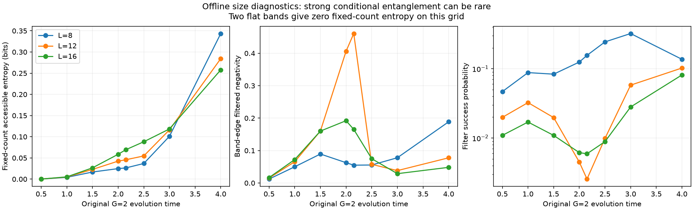
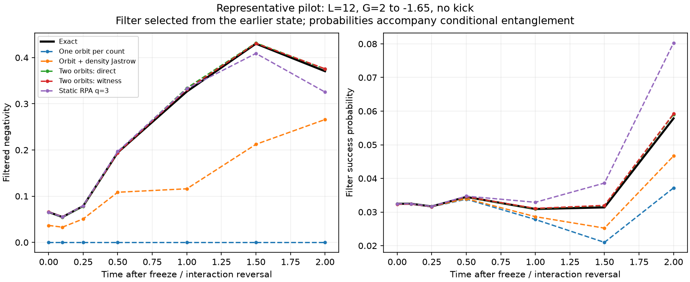
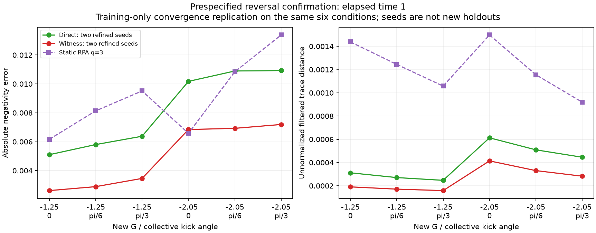

# 第五轮：固定计数内纠缠与反转预测

后续修正：[第六轮初态与动力学对照](REPORT_ORBIT_CONTROLS.md) 表明，下述较小预测误差主要来自
初态偏差抵消传播偏差，尚不能解释为更好的动力学结构。本报告保留第五轮当时的数值及判断；
当前科学结论以第六轮报告为准。

**出现了一个有限、可复核的 canonical witness 预测优势，但仍未建立用户要求的重要新物理结果。**
在两种新的相互作用反转强度、三个预选相位旋转和两个优化种子下，
由早期 canonical witness 提取的两个轨道构型，比直接从早期态提取的同型构型，
更准确地预测一个固定滤波器内的纠缠及未归一化密度矩阵。
加严训练优化后，这一排序保留。优势只涉及指定观测量和参数范围，
不能据此宣称全局波函数、计数统计或计算成本全面改善。

完整机器审计见 [audit.json](results/assessment_interband_01/audit.json)，
公式和限制见 [INTERBAND_THEORY.md](INTERBAND_THEORY.md)。
前四轮的结果与失败解释保留在各自报告中；研究目标仍为 active。

## 一、这次增加了什么物理问题

第四轮已允许任意转移数 \(m\) 对应不同的带内配对轨道。
这个族能描述计数与轨道形状之间的关联，但在每个固定 \(m\) 内，
上方粒子配置和下方空穴配置仍是乘积态。
本轮检查的是这两个配置之间的纠缠，并用两列相干的条件轨道来承载它。

原始 G=2 演化，L=12 的固定计数可用纠缠熵，在 t=1、2.15、4 分别为
0.004963、0.045638、0.28436 bits。两个完全平坦的能带在所测时间网格上给出零值。
这与有色散的能级中，散射时间和能量相位逐渐形成额外相关的图像相符。

局部筛选出一个粒子对和一个空穴对，且各自仅保留两个带边能级后，
t=2.15 的 L=12 条件 negativity 达到 0.460815，接近两比特上限 0.5，
但成功概率只有 0.00255385。相同绝对时间下，L=8/16 的 negativity 为
0.054926/0.165290，概率为 0.156207/0.00591781。
因此这个尖峰并不是已经证实的尺寸稳定宏观效应。

## 二、先提取结构，再冻结预测

全部主要预测从 G=2、t=1 的同一个精确训练态出发。
分别将目标态和二阶 canonical 合成 witness 拟合成每个 \(m\) 两个 onsite 轨道乘积；
之后都用真实训练态确定相干系数。未来轨道仅按新 Hamiltonian 的 TDVP 运动，
不读取未来精确态做拟合。

这一步用的是 **witness 向量提取的轨道**，不是从 canonical Gaussian 概率测度实际采样得到的原子。
实际原子抽样已在前几轮测试，本轮不把两者混称。
两列条件轨道也不等于两个未投影纯 Gaussian 原子。

三时刻、多起点拟合的最佳可行目标态保真度如下。局部最优不构成全局上界。

| 时刻 | 一列条件轨道，前轮 | 两列条件轨道，本轮 |
|---|---:|---:|
| 0.5 | 0.99999004 | 0.99999956 |
| 1 | 0.99957320 | 0.99996169 |
| 2.15 | 0.99283974 | 0.99883237 |

原始 12 次整体拟合共 360 次块优化，其中 299 次报告收敛；60 个选中块中 52 个收敛。
报告保留这些未收敛记录，不将其当作最优解。
用于反转比较的训练时刻 t=1 另做四组对称加严拟合，预算从每块 1000 步增至 5000 步：
120/120 次块优化、20/20 个选中块均报告收敛，仍没有全局最优证书。

加严后直接态与 witness 族的初态保真度分别为 0.99996169 和 0.99994424。
它们的初态不完全相同，witness 也没有更高的初始整体保真度。
这排除了“只是初始保真度更高”的简单解释，但尚未给出结构优势的因果定位。

滤波器在训练阶段以概率乘 negativity 选择。
目标态、归一化 witness 和预设带边选项给出同一个滤波器；没有滤波器选择优势。

## 三、预测结果及其适用范围

第一批 L=12 使用 G=1.35、2.65、−1.65，集体相位旋转为 0、π/4、π/2，
共 9 个模型族 × 9 个物理条件 = 81 条预测。
所有预测文件先保存，再计算这批精确参考。
主要评价时间预设为冻结后 Δt=1，同时保留完整时间网格至 Δt=2。

正耦合六个条件的平均误差如下，不能删去这个不支持普遍 canonical 优势的结果。

| 方法 | 保真度 | negativity 绝对误差 | 未归一化滤波迹距离 |
|---|---:|---:|---:|
| 一列条件轨道 | 0.984876 | 0.102821 | 0.005959 |
| 条件轨道 + 两体密度 Jastrow | 0.988825 | 0.065328 | 0.004489 |
| 静态 RPA q=3 | 0.999223 | 0.007320 | 0.001110 |
| 直接态两列 | 0.998695 | 0.008994 | 0.000634 |
| witness 两列 | 0.998687 | 0.009114 | 0.000627 |

反转 G=−1.65 的三个条件中，witness 两列的平均 negativity 误差为 0.005123，
直接态两列为 0.008120。对应迹距离为 0.000218 和 0.000379。
这只是先导结果，因此另外冻结新的反转测试，未把同一批结果重新称为独立验证。

确认批次预选 G=−1.25、−2.05，旋转 0、π/6、π/3。
主要终点明确固定为 Δt=1 的 negativity 绝对误差和未归一化滤波迹距离；
若两个指标系统性冲突或种子改变排序，就不认定稳定优势。
四个两列族及三个强对照，共 42 条预测，在新精确参考之前保存。

下表使用加严训练后的两个种子均值。它是同一确认网格上的数值复核，
**不是额外六个独立条件**。RPA 和 Jastrow 对照来自原确认批次。

| 方法 | 保真度 | 计数 TV | 能量分辨配对 RMS | negativity 绝对误差 | 未归一化滤波迹距离 |
|---|---:|---:|---:|---:|---:|
| 一列条件轨道 | 0.983187 | 0.007726 | 0.014966 | 0.327332 | 0.008210 |
| 条件轨道 + 两体密度 Jastrow | 0.994109 | 0.005236 | 0.005439 | 0.196276 | 0.005342 |
| 静态 RPA q=3 | 0.998099 | 0.000306 | 0.004750 | 0.009104 | 0.001219 |
| 直接态两列，加严 | 0.997543 | 0.001499 | 0.001858 | 0.008213 | 0.000400 |
| witness 两列，加严 | 0.997549 | 0.001632 | 0.001668 | 0.004989 | 0.000258 |

witness 在六个条件、两个种子上均降低两个预选误差。
相对直接态提取，均值下降约 39% 和 35%；negativity 的绝对改善只有约 0.00322。
RPA 的整体保真度和计数 TV 仍更好，并且在一个条件下 negativity 误差也略低于 witness。
种子重复衡量优化稳定性，不等于 12 个独立物理条件，未据此制造统计显著性。

## 四、规模复核与强替代解释

L=8 做直接态、witness 两列及一列对照，共 9 条预测；L=16 做直接态两列及一列对照，共 6 条。
均使用 G=1.35、2.65、−1.65，无相位旋转。
L=8 的反转 negativity 误差为直接态 0.004356、witness 0.001022；
但正 G=1.35 时排序相反。L=16 没有完整 canonical 合成后端，不能补造该尺寸的 canonical 优势。

L=16 直接态两列在 Δt=1 的保真度分别为 0.999201、0.997134、0.997641；
Δt=2 降为 0.994282、0.987563、0.959070。少数构型不是任意长时间的闭合解。

另加 45 条机制对照，分别用最低阶有限时间散射和两种有限尺寸 RPA/Riccati lift。
这些是在先导结果之后设计的对照，不是新的前瞻终点。
最简单散射公式已能给出无旋转反转后的条件纠缠增强，L=8/12/16 分别预言
negativity 约 0.2631/0.3185/0.3458，精确值为 0.2767/0.3266/0.3487。
因此不能把这种增强本身作为新非线性机制。

在六个确认条件上，最低阶散射、正常态 RPA、用早期 m=1 块匹配的 RPA，
negativity 平均误差为 0.05811、0.02293、0.01287；两列 TDVP 的量化精度更好。
最低阶对照的裸一对概率可超过 1，强耦合下仅作为机制解释，不作为受控微扰近似。
尚需增加针对 Hamiltonian 响应训练的两列模型，检验 witness 优势是否只是一般的训练重加权。

## 五、相位与删除控制说明了什么

在保持 p(m) 的条件 Schmidt 秩一替代态处，来自相邻计数扇区的两条法向源各至多秩一。
L=12 脉冲时刻，两条源有相消干涉；集体相位旋转 α=0、π/4、π/2 后，
总法向平方范数为 0.025981、0.054247、0.089398。
六个尺寸/能谱诊断中，带内局域法向残差最大 3.60e−15，超出秩二的范数最大 6.96e−16。
这是秩一替代态处的瞬时代数，不是原精确态的熵产生率，也不是 canonical 独有定理。

对脉冲精确态实施局域 Schmidt 去相干，保持两边约化态和所有计数概率，
初始计数 TV 差为 9.06e−16；筛选 negativity 从 0.460815 变为零。
它证明计数和局域约化态并未决定这个纠缠观测量。
随后 Δt=0.5 的计数 TV 差达到 0.00704，但该操作还改变部分跨 m 相干，
不能将未来差异仅归于删除块内纠缠。
操作依赖精确 Schmidt 基，属于离线诊断，未声称是现成实验协议。

## 六、从预测到线性测量见证

对第一批 81 个预测，在 Δt=1 从预测条件态选择并冻结一个 PPT 线性纠缠见证。
选择脚本不读取精确参考，但运行时第一批评价文件已经存在；
因此准确的顺序是“只使用预测选择，再生成新的合成测量”，并非“早于所有精确参考”。

每个见证模拟 100 万次制备尝试，滤波成功后做随机 Pauli 测量。
总失败概率 0.01，通过固定见证的单侧 Hoeffding 界及 81 项 union bound 控制。
直接态两列、witness 两列、RPA q=2/q=3 各在 9/9 条合成数据上认证纠缠；
Hamiltonian 响应 32 维空间为 8/9，轨道与 Jastrow 组合为 7/9，纯两体 Jastrow 为 6/9。
**这些是模型产生的合成数据，不是实验测量，也没有独占的 canonical 认证优势。**

一列条件轨道严格预测零 negativity，其部分转置零空间简并。
任意数值零空间向量给出的原始见证偶然产生 1/9 或 2/9 检测，
归档保留原数值，但不将其计为该模型预言了非零纠缠。

## 七、数值质量与资源

| 检查 | 结果 |
|---|---|
| 新的主要/规模/确认预测 | 81 + 15 + 42 = 138 条模型—条件轨迹 |
| 训练收敛复核 | 24 条，同一确认条件 |
| 事后机制对照 | 45 条 |
| 合成测量见证 | 81 个，均保留原记录 |
| 冻结文件 SHA256 | 106 个全部吻合 |
| 完整测试 | 38/38，通过时间 4.752 秒 |
| 主要及复核预测最大范数误差 | 1.41e−8 |
| 最大能量漂移 | 2.52e−7 |
| 更严积分后最大态差 | 1.15e−8 |
| 更严积分后最大 negativity 差 | 6.52e−9 |

加严积分将相对/绝对容差缩小 100 倍，SVD 截断从 1e−8 改为 1e−10，最大步长减半。
覆盖 L=12 的直接态和 witness、L=16 的直接态强耦合轨迹。
这些误差远小于所报告的反转优势，但不证明 ansatz 的系统误差已消失。

本轮使用最多 24 个独立预测 CPU 进程；小矩阵工作不需要强行迁移 GPU。
此前随机与 Haar 实验已使用全部 8 块 H20。L=16 两列轨迹在本机约 90–117 秒。
当前仍显式枚举完整配对子空间，没有多项式复杂度或相同总计算预算的优势证明。
测试日志与 PNG/PDF 图都保存在本轮审计目录。

## 八、与已有工作及原目标的关系

配对模型中粒子—空穴的能量空间纠缠、额外纠缠谱带，已有
[Rodríguez-Laguna 等的基态研究](https://arxiv.org/abs/1307.8363)。
固定粒子数内的可用纠缠、PPT 见证、多构型变分也分别有成熟先例；
相关来源与适用范围见推导笔记。没有完成穷尽查新，不主张发现优先权。

用户“六”的第一阶段物理窗口和第二阶段关键时刻比较已有实质结果；
第三阶段现在多了一次指定反转观测量上的前瞻预测、数值复核和删除诊断。
尚未通过的核心门槛仍是：**这个结构为何重要、为何不能由更强的已有方法同样提取，
以及 canonical 分布到底提供了什么独有信息或认证。**

下一步应先定位两列优势来自哪个计数扇区，再用同复杂度 Hamiltonian 响应训练作竞争对照。
若优势消失，应保留这个否定结果；若保留，再冻结新的能谱、训练耦合和尺寸测试。
在完成这些检验之前，不把约 0.003 的条件 negativity 改善升级为论文级新物理结论。
