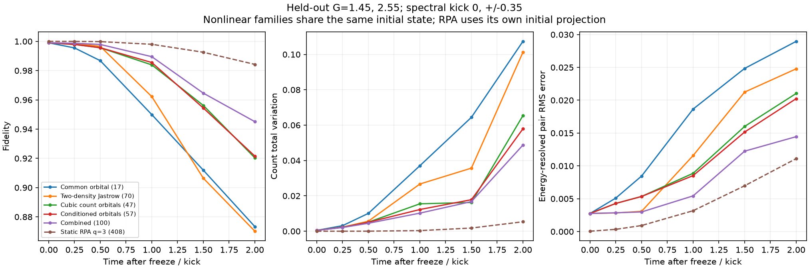
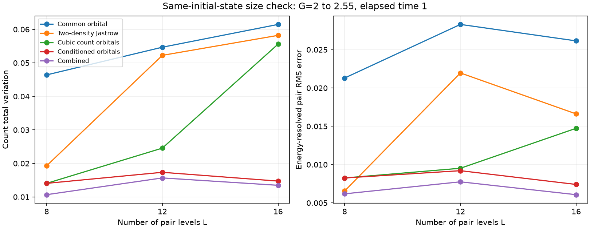
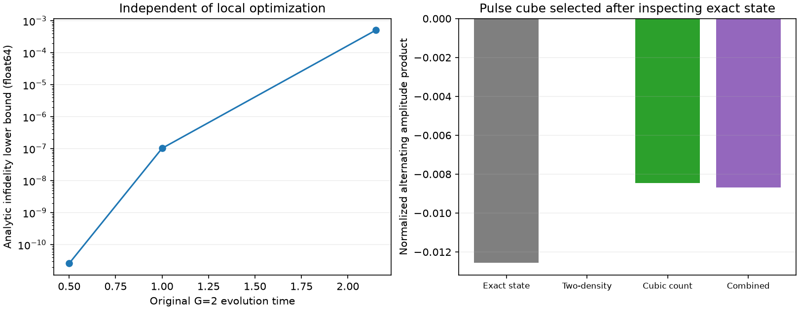

# 第四轮：密度 Jastrow 对照与条件关联排除

本轮完成 36 组多起点拟合、189 条新参数预测、L=8/12/16 的同初态对照，
并给出一个独立于局部优化的占据概率约束。结果支持：非线性配对阶段需要转移数与带内能级选择之间的高阶关联，
任意两体密度 Jastrow 加自由径向系数仍可能明显不足。
但条件轨道可以被常规高阶 Jastrow 表示，较大的三方向 RPA 仍更准，canonical 初始化也未显示独特优势。
**原定“重要、此前没有、由 Gaussian 分布带来额外发现”的目标仍未达成，研究保持 active。**

第三轮见 [REPORT_CONDITIONAL.md](REPORT_CONDITIONAL.md)，解析概率约束见 [DENSITY_CONSTRAINT.md](DENSITY_CONSTRAINT.md)。
本轮所有文件位于独立的 `_01` 新目录，未覆盖前几轮数据，未提交或推送 Git。

## 模型族与既有工作

所有模型保留任意复径向系数 `c_m`。每个 m 内的波函数是归一化指数函数。
共同轨道使用线性占据指数；多项式族使对数轨道随 `m` 作 d 次变化；两体族使用任意 `n_i n_j`；
组合族同时保留全部条件轨道和两体密度项。密度特征在每个 m 内去掉常数，并用 SVD 去除规范冗余。

| L=12 模型 | 复锥维数，含整体范数和相位 |
|---|---:|
| 共同轨道 + 自由径向系数 | 17 |
| 对数轨道线性 / 二次 / 三次依赖 m | 27 / 37 / 47 |
| 每个 m 独立条件轨道 | 57 |
| 任意两体占据 Jastrow + 自由径向系数 | 70 |
| 条件轨道 + 两体占据 Jastrow | 100 |

这些是非线性族的坐标计数，不能与线性子空间维数直接当作相等运行成本。
当前实现仍枚举完整配对数目子空间，没有建立大体系的多项式求解成本。
传播沿用含 Berry 相位补偿的 Hamiltonian-only TDVP。

Jastrow-AGP 的对间关联和时变 Jastrow 已有明确文献：
[Neuscamman 2013](https://arxiv.org/abs/1308.5297)、
[Nys 等 2024](https://arxiv.org/abs/2403.07447)。
本轮是针对本配对问题的具体对照实现，不是对这些论文所有更强参数化的复现或排除。
条件轨道等价于集体密度依赖的 Jastrow，不能把换一种参数写法当作新的变分方法。

## 快照可行拟合

每个新模型、每个时间使用两个种子、各 8 个起点，共 288 次优化。
264 次报告收敛，24 次未收敛均来自组合族；每个被采用的最佳结果均报告收敛，没有触及实部边界。
这些仍是局部可行拟合，不是全局最优证书。

| 模型 | t=0.5 | t=1 | t=2.15 |
|---|---:|---:|---:|
| 共同轨道 | 0.99998765 | 0.99900351 | 0.95557217 |
| 线性 m | 0.99999004 | 0.99955457 | 0.96815667 |
| 二次 m | 0.99999004 | 0.99957215 | 0.98069953 |
| 三次 m | 0.99999004 | 0.99957316 | 0.99249523 |
| 全部条件轨道，第三轮 | 0.99999004 | 0.99957320 | 0.99283974 |
| 两体密度 Jastrow | 0.99999915 | 0.99989661 | 0.97219054 |
| 条件轨道 + 两体密度 | 0.99999916 | 0.99991373 | 0.99465568 |

两体密度项在早期很有效，但首次脉冲附近不能替代一般的 m 条件变化。
组合族只部分改善条件轨道的剩余误差；没有获得接近精确的长时描述。

## 未拟合参数的预测

先保存各族在 `G=2,t=1` 的参数，再声明新耦合 `G=1.45,2.55,-1.7`、谱相位踢 `eta=0,+/-0.35`，
传播至 `Delta t=2`。153 条 L12 预测全部保存后，脚本才计算精确参考。
模型族的设计参考了先前 G=2 的非线性快照；不能声称结构设计从未看过该参数点的晚时信息。
真正未参与拟合的是这些新耦合和踢的后续动力学；初值参数只读取 `t=1` 文件。

下表为事先指定的正耦合、三种踢、`Delta t=1` 的六个样本均值。
TV 是完整计数分布总变差；pair RMS 是上、下能带相干四点矩阵的逐元素均方根误差。

| 独立早期拟合初始化 | 保真度 | 计数 TV | pair RMS |
|---|---:|---:|---:|
| 共同轨道 | 0.949921 | 0.037042 | 0.018653 |
| 两体密度 Jastrow | 0.961933 | 0.028028 | 0.011566 |
| 三次 m 轨道 | 0.984181 | 0.013987 | 0.008784 |
| 条件轨道 | 0.986249 | 0.009181 | 0.007963 |
| 条件轨道 + 两体密度 | 0.990325 | 0.007922 | 0.005037 |
| Hamiltonian 响应列，静态 32 维 | 0.956976 | 0.031400 | 0.017794 |
| RPA q=2，静态 92 维 | 0.969301 | 0.008527 | 0.020926 |
| RPA q=3，静态 408 维 | 0.997992 | 0.000345 | 0.003176 |

RPA q=2 的计数仍优于单独条件轨道，但相干矩阵误差较大。
RPA q=3 在上述主要指标上全部更准。不能只选保真度或一种观测量宣布全面胜出。

额外的同初态控制把所有非线性族嵌入同一个共同轨道近似态。
全轮各规模初态差异最大 `1.03e-14`，消除了初始拟合质量差异。
L12 同初态时两体 Jastrow / 条件轨道 / 组合族的 TV 分别为
`0.026693 / 0.012270 / 0.010227`，pair RMS 分别为 `0.011574 / 0.008520 / 0.005434`。

## 尺度与长时限制

L8、L16 另各做 18 条预测，仍从完全相同的近似初态出发，使用上述三个新耦合且无相位踢。
强耦合 `G=2.55, Delta t=1` 的计数 TV：

| 模型 | L8 | L12 | L16 |
|---|---:|---:|---:|
| 共同轨道 | 0.04641 | 0.05468 | 0.06148 |
| 两体密度 Jastrow | 0.01928 | 0.05225 | 0.05822 |
| 三次 m 轨道 | 0.01405 | 0.02457 | 0.05561 |
| 全部条件轨道 | 0.01405 | 0.01734 | 0.01472 |
| 条件轨道 + 两体密度 | 0.01067 | 0.01566 | 0.01346 |

三次截断在 L12 有效，但在 L16 不可靠，不能把固定低阶多项式当作已验证的可扩展机制。
L16 强耦合传播至 `Delta t=2`，两体 Jastrow、三次 m、条件轨道、组合族的保真度分别约
`0.6084、0.4388、0.8491、0.8649`。即使组合族也有明显误差，尚无可靠长时闭合。
负耦合压力测试保存在完整评价中；改变相互作用符号不是翻转整个 Hamiltonian 的 Loschmidt 回波。

## 独立于优化的概率约束

两个跨带占据交换和一个带内交换定义八个合法构型。任何两体密度 Jastrow 加任意径向系数都满足

`p000 p011 p101 p110 = p001 p010 p100 p111`。

这是一种已知无三因素相互作用约束在配对子空间的应用。
具体推导、适用范围和保真度上界见 [DENSITY_CONSTRAINT.md](DENSITY_CONSTRAINT.md)。
它检验的是固定其他占据的全构型事件，不能替换成未经证明的边缘概率关系。

L12 脉冲态违反该约束。从 108000 个候选事件选出 87 个不重叠事件，得到
`F_best(two-body Jastrow) <= 0.9994914373` 的解析界浮点代入值。
已找到的可行态给出下界 `F_best >= 0.9721905356`。
上下界相差较大，因此本轮没有证明该族的最优误差就是局部拟合误差。
该界不是一般 projected Gaussian 的界，也不排除 Jastrow 经典混合，更不能单独证明相干必要性。

事件是依据精确快照事后挑选的，故此部分属于诊断与排除，不能计入新预测。
恒等式本身已有统计学来源，当前也没有实验采样量及热力学尺度的新效应证明。

## 数值核查与下一步

33 项测试全部通过，覆盖解析拟合梯度、物理态导数、TDVP 切空间正交、范数/能量变化率、
已知子族嵌入、精确单体运动，以及独立构造的随机二次指数概率约束。
六项 L12/L16 数值加严检查将容差和 metric 截断缩小 100 倍、最大步长减半，
最大态差 `3.19e-8`、最大计数概率差 `1.99e-8`，远小于物理模型间差异。
原始全部预测最大范数误差 `1.18e-8`、能量漂移 `2.39e-7`。
29 个冻结文件哈希检查通过，详见 [audit.json](results/assessment_jastrow_01/audit.json) 和 [tests.log](results/assessment_jastrow_01/tests.log)。

本轮使用至多 32 个独立 CPU 进程。模型规模下没有假定 GPU 优势；此前随机采样阶段使用过全部 8 块 H20。
本轮全部进程已结束。

后续应检验剩余条件带间纠缠及其可操作的能量分辨响应，给新观测量事先冻结选择规则并做真正未见参数的预测。
同时需要明确 canonical 分布能否提供直接态分析和 Hamiltonian 响应无法提供的发现或认证。
不能继续靠增加变分参数、更多拟合表格或重新命名高阶 Jastrow 来满足原定新物理目标。
