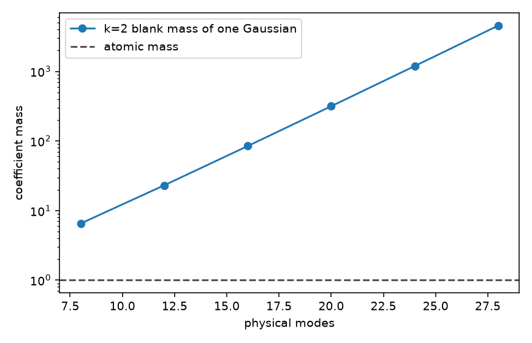
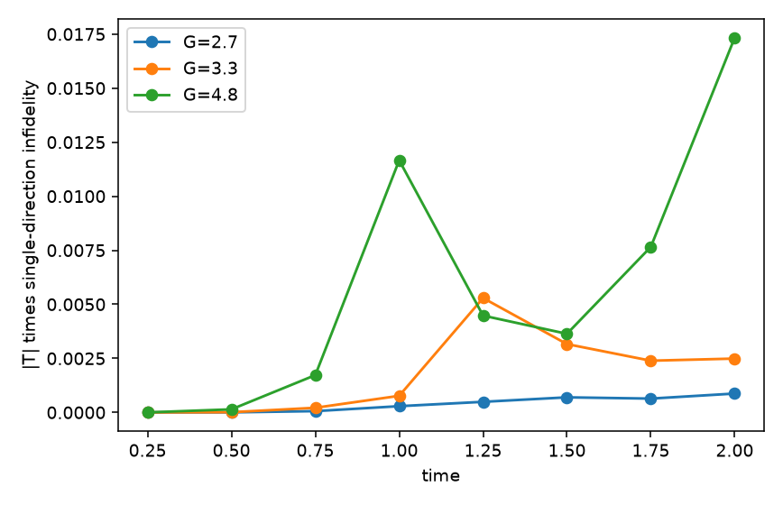
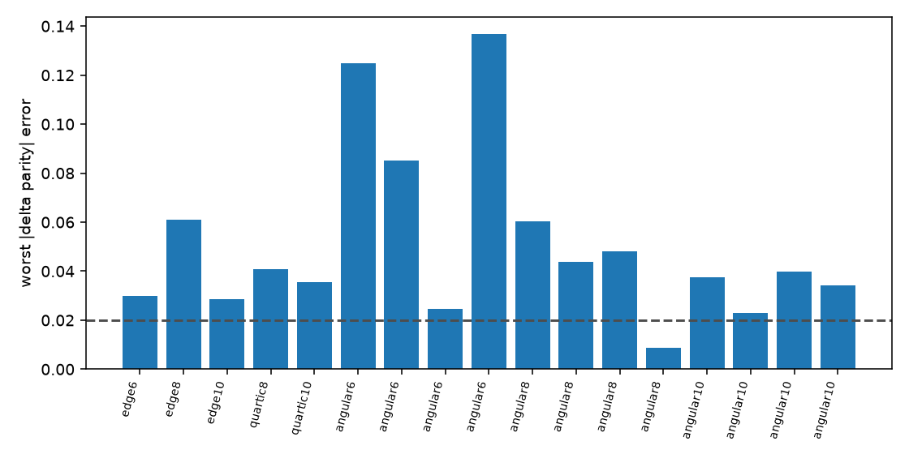

# 第十八轮：低成本 Gaussian 分解与配对关闭后的干涉读出

**三项预先规定的成功标准都没有达到。** 空白 \(k=2\) 质量的蒙特卡洛估计与精确公式相符，干涉仪计数公式的误差在 \(10^{-16}\)。训练点上能构造的 Gaussian 质量上界是 **3.111**，手头 magic witness 给出的下界是 **1.500**，比值 **2.074**，没有进入 1.2 的工程范围。交叉能级搜索没有把这个预算降到纯 onsite 列加 Fock 修复之下。冻结下来的 adaptive 列在训练读出上失败，并且差于条件轨道和两体 Jastrow。17 个保持条件中有 16 个未通过双端口门槛。onsite 排除证书没有闭合，Dicke 态也没有被误报成“必须离开 onsite”。因此这一轮没有证明低成本分解的唯一构型，也没有证明 Gaussian 列相对强对照的读出优势。

原始记录在 [results/low_cost_interferometer_02](results/low_cost_interferometer_02)。同一次选择规则的早先目录 `low_cost_interferometer_01` 把 adaptive 保持检验只记在默认端口上；下文的 16/17 使用双端口记录。训练点的选择没有因这次修正而改变。129 项测试通过，用时 13.1 秒。8 块 H20 与 164 个 CPU 进程的墙钟时间是 101 秒。

## 1. 固定下来的做法

相互作用只用来制备 seniority-zero 态。配对关闭之后，读出是四条通道上的分束器。平衡分束器 \(\alpha=\pi/4\) 的计数差和宇称差使用已经核对过的闭合式

\[
\Delta\langle e^{i\chi N_I}\rangle
=\frac{\operatorname{Re}(e^{4i\phi}\langle T\rangle)}{8}(e^{i\chi}-1)^4,
\qquad
\Delta\langle(-1)^{N_I}\rangle
=2\operatorname{Re}(e^{4i\phi}\langle T\rangle).
\]

训练只使用 \(L=6\) 的四次倾斜谱 \(x+0.45x^4+0.18x^3\)，排序后缩放到 \([-1,1]\)。耦合取 \(2.7,3.3,4.8\)，时间取 \(0.25\) 到 \(2.00\)，步长 \(0.25\)。分数是默认端口 \((0,1)\to(4,5)\) 上的 \(|T|\times(1-F_{\rm single})\)。家族按单方向、onsite PBCS、条件轨道、两体 Jastrow、一般投影 Gaussian、adaptive 列的顺序，取第一个同时满足计数总变差 \(\le 0.02\) 和宇称绝对误差 \(\le 0.02\) 的家族。相位只有 \(0\) 和 \(\pi/8\)。adaptive 的训练门槛使用 Gaussian 列本身，不使用补回目标态的 Fock 修复。若全部失败，仍然冻结 adaptive 并列明失败。

保持条件在选出 \(G^\star,t^\star\) 之后才计算：边缘成束谱 \(L=6,8,10\)，四次倾斜谱 \(L=8,10\)，以及角向相对强度 \(0.2,0.37,0.55,0.73\) 的 \(L=6,8,10\)。角向耦合使用同一个数字 \(G^\star\)，不表示物理耦合相同。保持检验同时看默认端口和交叉端口 \((0,2)\to(L-3,L-1)\)。这些条件不是把已有的 picket、warped 或 \(G=2,4\) 标题网格换一个名字。

原子是 \(\|g\|_{\rm Fock}=1\) 的扇区投影 \(P|g\rangle\)，没有在扇区内重新归一化。质量是系数的 \(\ell_1\) 范数。Fock 基本身是 Gaussian，所以 SOCP 残差修复给出可行上界；修复后的态等于目标态，它的读出误差为零不能算成功。所有局部拟合的 `global_optimum_certified` 都是 false。数值是 float64，分支定界没有定向舍入。

## 2. 空白质量校准是成立的

一个归一化 Gaussian 的真实原子质量是 1。它的 \(k=2\) 系数质量随模数迅速变大。下表与审核表一致。

| 物理模数 | 精确 \(B_2\) | \(B_2\le 1.1\) 的最小 \(k\) |
|---:|---:|---:|
| 16 | 84.44481175 | 615 |
| 20 | 315.51524585 | 979 |
| 24 | 1193.39691876 | 1426 |
| 28 | 4552.44764239 | 1957 |

\(d_{n,2}=\binom{2n}{n}/2\) 的对数恒等式在 4 到 16 个模上成立。12 个模的费米海精确 \(B_2\) 是 **23.03776021**。八块 GPU 共 \(1{,}048{,}576\) 个 Haar 样本给出 **22.96633 ± 0.05912**，比值 **0.99690**，偏差约 1.2 个标准误差。这个估计可以用来读相互作用态的 \(k=2\) 质量，但它仍然不是原子质量。

训练态的 \(k=2\) 质量是 **28.52203 ± 0.04908**。\(L=4\) 伴生态是 **7.48137 ± 0.01145**。同一训练态嵌入两个旁观能级之后，嵌入重叠是 1，replica 残差仍是 \(2.46\times 10^{-9}\)，有限阶 moment-dual extent 下界仍是 **1.18834**。空白 \(B_2\) 却从 23.038 变成 **84.44481175**，旁观系统的 \(k=2\) 蒙特卡洛质量是 **105.111 ± 0.219**。有限阶 canonical 质量依赖总模数；嵌入态的物理重叠和 moment dual 没有跟着改变。没有把同一组列重新放进扩大空间里再优化，所以不能把旁观模上的 adaptive 质量说成已经复现。

replica 在训练态、费米海、\(L=4\) 伴生态和旁观嵌入上的合成残差分别是 \(2.46\times 10^{-9}\)、\(1.11\times 10^{-16}\)、\(1.81\times 10^{-10}\) 和 \(2.46\times 10^{-9}\)。训练 witness 与态的对齐是 0.99705。moment dual 低于 magic extent，质量比使用的是后者。

## 3. 分数最高的训练点上，强对照更接近读出

24 个训练点都完成了。最大分数在 \(G=4.8,t=2\)：

\[
|T|=0.088965,\qquad F_{\rm single}=0.805164,\qquad {\rm score}=0.017334.
\]

\(\langle T\rangle=-0.088920-0.002832i\)。默认端口上 \(|\Delta{\rm parity}|\) 的信号是 **0.17784**，原始宇称最大绝对值是 **0.29784**。全部训练点的公式计数误差不超过 \(2.86\times 10^{-16}\)。

该点六个家族的默认端口结果如下。门槛是总变差和宇称绝对误差都不超过 0.02。

| 家族 | 保真度或列误差 | 计数总变差 | 宇称绝对误差 | 通过 |
|---|---:|---:|---:|:---:|
| 单方向 | 0.80516 | 0.10172 | 0.20344 | 否 |
| onsite PBCS | 0.69474 | 0.06913 | 0.13826 | 否 |
| 条件轨道 | 0.98863 | 0.01429 | 0.02859 | 否 |
| 两体 Jastrow | 0.99203 | 0.01152 | 0.02303 | 否 |
| 一般投影 Gaussian | 0.69474 | 0.06913 | 0.13826 | 否 |
| adaptive Gaussian 列 | 列误差 0.41047 | 0.02296 | 0.04593 | 否 |

条件轨道达到了同一点给出的 rank-1 上界 0.98863。它的宇称误差只比门槛高 0.0086。Jastrow 的宇称误差是 0.02303，比 0.02 高 0.00303。这两项接近失败被记录下来，没有反过来改门槛或改选择分数。一般投影 Gaussian 的粒子数扇区权重保持为 1，保真度停在 onsite 种子上；这是局部搜索，不是全局最优证书。

adaptive 的匹配追踪保真度是 0.99963，追踪质量 3.276。SOCP 修复质量是 **3.11063843**，其中 Gaussian 列系数 **2.01735**，Fock 修复 **1.09329**。未归一化列残差是 0.41047。把列态归一化后，默认端口宇称误差 0.04593，约为信号 0.17784 的四分之一。交叉端口宇称误差 0.04472，同样失败。修复态的读出误差是 0，因为它在代数上等于目标态。

八个交叉能级种子和 32 个纯 onsite 种子的修复质量都落在 \(3.1106384\) 附近，彼此差异约 \(5\times 10^{-8}\)，处于 Clarabel 容差之内。纯 onsite 最优记录的交叉能级含量是 0，Gaussian 系数 2.01735，Fock 修复 1.09329，列误差最小到 0.40931。交叉能级 oracle 没有降低可行预算。这些矩阵里可以出现很大的交叉块，最大交叉含量 0.959，但它们没有进入更便宜的修复。

因为没有家族通过训练门槛，冻结家族是 adaptive。这是失败规则的结果，不是 adaptive 赢得了比较。

## 4. 质量上界离工程门槛还远

训练态 magic witness 的 extent 下界是 **2.24990**，对应质量下界 **1.49997**。witness 范数是 \(\sqrt 8=2.82843\)。解析支持界是 \(\sup_G|\langle y|g\rangle|\le 1\)，但置换搜索并不穷尽，所以这不是可能达到的最强下界。平凡下界是 1。

\[
\frac{3.11063843}{1.49996753}=2.07380.
\]

1.2 的建议比值没有达到。更强的 witness 仍可能抬高下界，因此 2.074 不是“最优质量至少差 2.07 倍”的证明。它只说明：用手头这个 witness，当前可行预算还没有进入预设范围。Fock 修复占预算的 35%。列本身没有构成近最优分解。

按 \(|\langle u|g\rangle|^3\) 选出的 32 个 canonical 列，以及 64 个加权 reservoir 列，在最小质量修复里得到的 Gaussian 系数总质量是 \(3.6\times 10^{-9}\)。修复质量 **3.88395** 等于占据基上的 \(\ell_1\) 范数，20 个基态全部用到。\(1{,}048{,}576\) 个样本里最大的 \(|\langle u|g\rangle|\) 是 0.116。这些高权重样本没有形成比占据基更便宜的字典。这不等于那些重叠本身为零。

## 5. 证书没有排除 onsite，读出界是平凡的

\(L=4\) 伴生态使用同一组 \(G^\star,t^\star\)。128 份参数区域、每份最多 2500 个盒子，共 320000 个盒子。magic witness 的 onsite 重叠下界是 **1.00000**，上界是 **2.27365**，间隙没有闭合。下界已经贴住解析支持界，上界仍大于 1，所以类外质量比例按预定规则返回空值，而不是一个正的排除比例。伴生态本身的 onsite 重叠区间是 \([0.66228,\,1.31353]\)，上界也没有降到平凡的 1 以下。

Dicke 态是一个 onsite 投影 Gaussian，单原子质量是 \(4/\sqrt 6=1.63299\)。它的 magic witness 同样给出下界 1.00000、上界 2.17478。类外比例是空值。这个负对照没有产生假阳性，也没有给出闭合证书。

伴生态的 adaptive 修复质量是 1.99504，其中列系数 1.79889，Fock 修复 0.19615，列误差 0.12364。修复误差是 0。没有全局最优证书。

对干涉仪宇称 \(O=U^\dagger(-1)^{N_I}U\)，在 onsite 扇区原子上搜索了 48 个原子、每个设置 1176 对，覆盖默认和交叉端口以及两个门槛相位。搜索得到

\[
\alpha_{\rm lower}=0.70767.
\]

它只是 \(\alpha=\sup|\langle v|O|w\rangle|\) 的下界。取预算 \(B_0=3.11064\)，

\[
B_0^2\alpha_{\rm lower}=6.84742.
\]

同一组设置上，精确态的 \(|{\rm raw\ parity}|\) 最大是 0.37869，\(|\Delta{\rm parity}|\) 最大是 0.17784。\(B_0^2\alpha_{\rm lower}\) 已经大于这两个信号，所以“只用 onsite 类时 \(|\langle O\rangle|\le B_0^2\alpha\)” 不能排除 onsite 类。弱脉冲曲率算符 \(O_\phi\) 的 \(\alpha\) 没有另做。全部能级对的端口扫描没有做；实际比较的是默认端口、交叉端口，以及强对照上额外的 \(\pi/5\) 和 \(\alpha=\pi/6\) 调查行。

## 6. 保持条件不支持冻结列

17 个保持点使用 \(G=4.8,t=2\)。adaptive 必须同时通过两个端口。公式误差不超过 \(2.46\times 10^{-16}\)。

| 条件 | adaptive 宇称误差 | 信号 \(|\Delta{\rm parity}|\) | adaptive | Jastrow 保真度 | Jastrow |
|---|---:|---:|:---:|---:|:---:|
| 边缘 \(L=6\) | 0.02981 | 0.16404 | 否 | 0.99974 | 通过 |
| 边缘 \(L=8\) | 0.06092 | 0.09152 | 否 | 0.99092 | 通过 |
| 边缘 \(L=10\) | 0.02852 | 0.03805 | 否 | 0.96973 | 否 |
| 四次 \(L=8\) | 0.04075 | 0.07464 | 否 | 0.95897 | 否 |
| 四次 \(L=10\) | 0.03547 | 0.04008 | 否 | 0.94348 | 否 |
| 角向 \(L=6,0.2\) | 0.12492 | 0.23523 | 否 | 0.97921 | 通过 |
| 角向 \(L=6,0.37\) | 0.08530 | 0.17400 | 否 | 0.97259 | 否 |
| 角向 \(L=6,0.55\) | 0.02463 | 0.05514 | 否 | 0.99293 | 否 |
| 角向 \(L=6,0.73\) | 0.13686 | 0.13644 | 否 | 0.98889 | 通过 |
| 角向 \(L=8,0.2\) | 0.06018 | 0.08565 | 否 | 1.00000 | 通过 |
| 角向 \(L=8,0.37\) | 0.04364 | 0.08385 | 否 | 1.00000 | 通过 |
| 角向 \(L=8,0.55\) | 0.04813 | 0.09294 | 否 | 1.00000 | 通过 |
| 角向 \(L=8,0.73\) | 0.00858 | 0.02497 | 通过 | 1.00000 | 通过 |
| 角向 \(L=10,0.2\) | 0.03741 | 0.07898 | 否 | 0.76467 | 否 |
| 角向 \(L=10,0.37\) | 0.02280 | 0.04699 | 否 | 0.72304 | 否 |
| 角向 \(L=10,0.55\) | 0.03985 | 0.06025 | 否 | 0.65386 | 否 |
| 角向 \(L=10,0.73\) | 0.03420 | 0.04360 | 否 | 0.64393 | 否 |

adaptive 通过 1 个，失败 16 个。两体 Jastrow 通过 8 个。条件轨道通过 3 个，其中包括四次倾斜 \(L=10\)。唯一的 adaptive 通过点是角向 \(L=8\)、相对强度 0.73：宇称误差 0.00858，信号只有 0.02497，列误差仍有 0.468。同一点的 Jastrow 保真度数值上是 1，平衡宇称误差低于 \(10^{-8}\)。四个 \(L=8\) 角向点都是这样。这是局部拟合的数值容量，不是已证明的代数恒等式，也不是 adaptive 列发现了 Jastrow 看不到的读出。

\(L=10\) 的修复质量升到 4.63–11.37，列误差 0.38–0.68。没有出现“一份分解反复用于许多 Gaussian 读出、从而超过强方法”的情形。

## 7. 三项标准分别缺什么

近最优或显式预算内的 Gaussian 组合：可行上界 3.111，已计算下界 1.500，比值 2.074。列误差 0.410，Fock 修复占 1.093。没有近最优证书。

对所有低成本分解都必要的构型：交叉能级搜索没有降低 onsite 列加 Fock 修复的预算。onsite 排除区间没有降到 1 以下。\(B_0^2\alpha_{\rm lower}\) 已经大于干涉仪宇称信号。没有必要性结论。

强方法错过的读出或可核验计算收益：条件轨道和 Jastrow 在训练点更接近门槛。保持点上 Jastrow 通过的数目更多，并在 adaptive 唯一通过的点上数值重合精确态。一般投影 Gaussian 停在 onsite 种子。没有读出优势。

物理结果和方法结果要分开。干涉仪公式在这条新的四次倾斜演化和交叉端口上继续成立，误差不超过 \(3\times 10^{-16}\)。旁观嵌入保持态重叠和 moment dual，同时改变有限阶 \(B_2\)。这两件事是这次计算确认的。低成本 Gaussian 列的唯一性和算法优势没有被确认。
