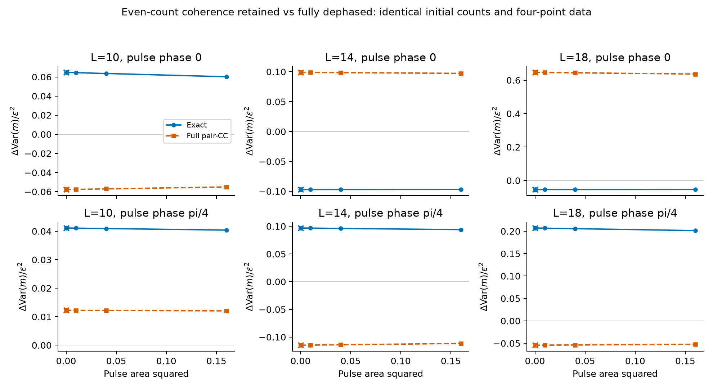
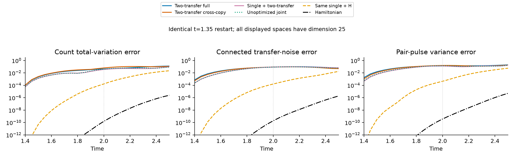
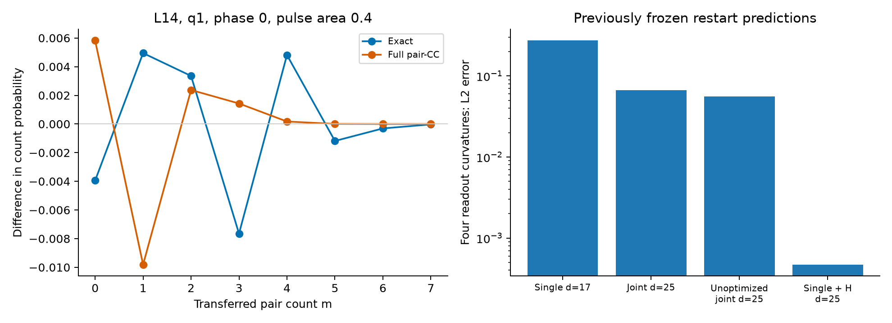
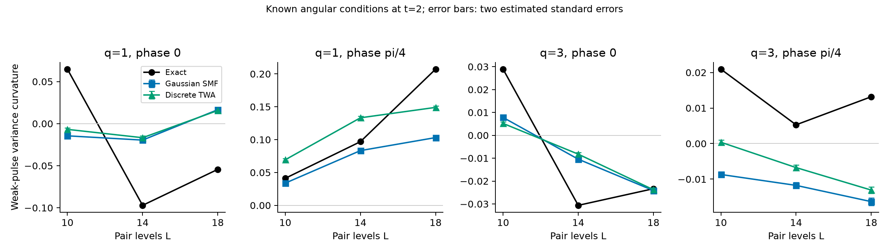
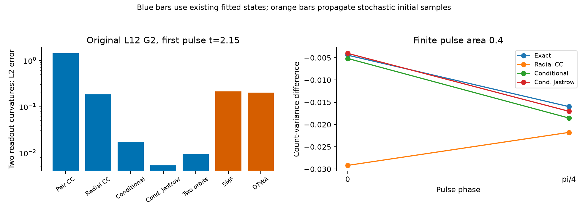

# 第十七轮：两次配对转移的相干噪声及计数读出

**本轮确定了一个可直接检验的物理偏差：某些两次转移相干可在保持全部计数统计和四费米关联不变时，被相位循环保留或删除；随后的配对脉冲把差异转成计数噪声。已有 pair-CC 在多个条件下连读出曲率的符号都预测错误。但从 canonical 分布提取的两次转移坐标仍没有超过强控制，原研究目标未完成。**

这次没有继续增加 replica 阶数，仍用 \(k=2\)。新增的是完整 Gaussian 八费米标签，及它与物理噪声、脉冲读出的联系。8 块 H20 完成 1,048,576 个独立 Haar 构型核查和 288 组确定性标签计算。新增 28 条轨迹，复用 16 条已有控制轨迹；十个优势条件全部失败。123 项测试通过。

## 1. 先确定物理偏差

令 \(X_q\) 为从下壳到上壳、具有余弦角向权重的配对转移算符，\(q=0,1,2,3\)。定义

\[
\mathcal C_{qp}=\langle X_qX_p\rangle
-\langle X_q\rangle\langle X_p\rangle.
\]

它保留两次转移之间的相位，并决定两个 Hermitian 配对脉冲方向的噪声差：

\[
\operatorname{Var}(X_q+X_q^\dagger)
-\operatorname{Var}[-i(X_q-X_q^\dagger)]
=4\operatorname{Re}\mathcal C_{qq}.
\]

在已有 \(L=14,G=4,\eta=1,t=2\) 的演化中，精确 \(\mathcal C\) 的 Frobenius 范数为 **0.081355**，而保留完整 \(T_{ph}\) 矩阵的 pair-CC 误差为 **0.129844**。对应八个脉冲方向的方差误差为 **0.608833**。这不是只比较波函数保真度，而是一个具体的高阶相干观测量偏差。

这里的“完整 pair-CC”是完整单次配对转移矩阵的指数 ansatz，不是包含全部簇阶数的精确 CC。随机平均场和离散 TWA 已补测，条件轨道等在原始均匀模型上的已有拟合也已检查，结果见下方补充；不能声称所有强方法都失败。

该筛选使用已保存的物理轨迹，属于回顾诊断。16 次有限小脉冲核查了纯态生存概率的方差展开，Richardson 外推最大误差 \(6.59\times10^{-9}\)。原始筛选见 [screen.json](results/multipair_noise_screen_01/screen.json)。

## 2. 两个低阶数据完全相同的态可以被区分

对同一个演化态 \(\rho\)，分别施加

\[
\rho_{\rm even}=\tfrac12(\rho+e^{-i\pi\hat m}\rho e^{i\pi\hat m}),
\qquad
\rho_{\rm diag}=\sum_m\Pi_m\rho\Pi_m.
\]

前者保留偶数次计数相干，后者删除不同计数扇区之间的全部相干。二者保留相同的完整占据基对角线及相同的 \(\Delta m=0\) 块，也都删除 \(\Delta m=\pm1\) 相干。因此在固定粒子数、无未配对电子的态上，它们的 **完整配对计数分布和全部四费米期望值相同**。

它们本身不是同一个混合态；差别正是人为保留或删除的更高计数相干。两种操作之前使用相同的初始费米海和相同演化，没有通过换初态制造读出差异。

随后施加理想的配对交换脉冲

\[
U_{\epsilon,\phi}=\exp[-i\epsilon(e^{-i\phi}X+e^{i\phi}X^\dagger)].
\]

两个输出的计数方差之差满足

\[
\boxed{\Delta\operatorname{Var}(m)=
-2\epsilon^2\operatorname{Re}[e^{-2i\phi}\langle X^2\rangle_\rho]
+O(\epsilon^4).}
\]

差值取保留偶数相干减去完全计数退相干。\(\phi=0,\pi/4\) 分别读出两次转移振幅的实部和虚部。推导只用双重对易子和计数选择规则，详见 [MULTIPAIR_SYMBOLS_AND_READOUT.md](MULTIPAIR_SYMBOLS_AND_READOUT.md)。相位平均可用 Gaussian 数目旋转；最后的配对交换脉冲是四费米相互作用脉冲。

这是已有多量子相干选择和相位循环思想的一个有限模型应用，相关先例包括 [Gärttner 等的实验与理论](https://arxiv.org/abs/1608.08938)。没有将其宣称为新相、已实施的实验方案或 canonical 分布独有的发现。

我们在既有 \(L=10,14,18\) 条件上，对精确态及 pair-CC 态分别检查两个离散角向标签、两个脉冲相位和五个脉冲面积，共 **120 对、240 次退相干后脉冲演化**，使用六个 CPU 进程。原始配对四点函数最大差异 \(2.78\times10^{-17}\)，占据基对角线差异为零。弱脉冲曲率的 Richardson 核查最大误差 \(1.81\times10^{-10}\)。

下表取 \(q=1,t=2\)，给出 \(\Delta\operatorname{Var}(m)/\epsilon^2\) 的弱脉冲极限。

| 能级数 | 脉冲相位 | 精确曲率 | pair-CC 曲率 |
|---:|---:|---:|---:|
| 10 | 0 | 0.064733 | −0.057801 |
| 10 | \(\pi/4\) | 0.041135 | 0.012254 |
| 14 | 0 | −0.097103 | 0.098938 |
| 14 | \(\pi/4\) | 0.096874 | −0.114739 |
| 18 | 0 | −0.054345 | 0.646628 |
| 18 | \(\pi/4\) | 0.207194 | −0.054335 |

计入 \(q=3\) 后，pair-CC 的 12 个曲率符号中有 **9 个错误**。\(L=10\) 的离散 \(q=3\) 与 \(q=2\) 混叠；这里不把不同网格的结果称为连续角动量模的尺度律。

对于相位零、面积 \(\epsilon=0.4\) 的 \(q=1\) 脉冲，两种精确退相干输出之间的计数总变差，在三个尺寸上分别为 **0.018126、0.013113、0.011250**。这是可观测量层面的相干删除效应，但选择规则本身可以由普通算符分析得到。

## 3. 从 Gaussian 分布实际计算了哪些坐标

采用四个不同能级上的

\[
f_O(g)=\langle g|s_{p_1}^+s_{p_2}^+s_{h_1}^-s_{h_2}^-|g\rangle.
\]

这是完整 Fock 空间归一化 Gaussian 的八费米 Wick/Pfaffian 标签。它包括跨能级正常相关，不能用四个 onsite 异常场的乘积代替。

对二阶 Cartan 合成，八 Majorana 插入可写为 128 个偶子集的副本分配项，分母为
\((2n)(2n-2)(2n-4)(2n-6)\)。中间态保留 \(r\pm2\) 配对数目及四个未配对电子，最终才投影回配对输出。另扣除两个端点项

\[
\frac{105}{(2n)(2n-2)(2n-4)(2n-6)}
\left[OC(u)+B_u(O^\dagger u)\right],
\]

得到在配对占据基 Slater witness 上消失的跨副本相干分量。**这个分量不是概率分箱，也不是物理连通噪声 \(\mathcal C\)**；其用途是隔离完整标签积分中超出端点算符响应的部分。

36 个双转移标签及伴随项、四个早时刻 \(0.30,0.60,0.90,1.35\)、canonical 与未优化两类源，共 288 组确定性收缩。没有增加 witness 优化或 replica 阶数。跨副本分量与完整标签向量集合的范数比约为 0.10–0.20，两类源相近；它不是该部分的概率质量。

独立核查涵盖 Clifford 对偶、完整小 Fock 中间矩阵、已有四费米公式、配对 Slater 基态零背景，以及另一套全 SO Haar/Wick 积分。Haar 核查的最大误差／估计 Frobenius 标准误为 **1.5329**，不构成严格置信证书。用于预测的向量由确定性公式得到，不带该抽样噪声。

## 4. 同初态预测和删除没有通过强控制

共享九维端点计数／Hamiltonian 切向空间沿用前轮。比较完整双转移标签、跨副本分量、普通双转移算符历史、未优化源和普通 H 方向。联合方案是在旧的 17 维单次转移对比空间上增加八个双转移跨副本方向；删除这八个方向精确恢复旧空间。另加八个普通 H 方向，修复相同的缺失。

共 22 个空间、44 条轨迹；其中 **28 条新计算，16 条已有控制直接复用并校验哈希**。两种起点分别是同一个费米海及同一个精确 \(\psi(1.35)\)。所有新空间和轨迹先保存，再生成本批完整参考；该物理条件此前已检查，所以没有新增参数留出预测。费米海轨迹的训练时间段属于回顾重建。

下表给出相同端点起始、\(t=2\) 的结果，除删除空间外均为 25 维。

| 方案 | 保真度 | 计数 TV | 连通转移噪声误差 | 脉冲方差误差 |
|---|---:|---:|---:|---:|
| canonical 完整双转移 | 0.752752 | 0.043412 | 0.085410 | 0.131487 |
| canonical 双转移跨副本 | 0.763705 | 0.063148 | 0.088599 | 0.158584 |
| canonical 单／双转移联合 | 0.777596 | 0.035730 | 0.090273 | 0.130842 |
| 未优化单／双转移联合 | 0.765383 | 0.040919 | 0.088892 | 0.142496 |
| 旧单次转移对比坐标 | 0.724298 | 0.050842 | 0.063191 | 0.102110 |
| 普通双转移算符历史 | 0.727646 | 0.063505 | 0.085641 | 0.102705 |
| 删除后单次转移空间，17 维 | 0.545112 | 0.104261 | 0.119978 | 0.219584 |
| 相同单次转移空间 + 八个 H 方向 | 0.99999739 | 0.00016669 | 0.00016056 | 0.00044596 |
| H Krylov | 约 1 | \(1.54\times10^{-10}\) | \(1.88\times10^{-10}\) | \(3.66\times10^{-10}\) |

联合坐标提高了保真度和部分计数结果，但噪声误差并未优于旧的同维单次转移对比坐标。更直接地，在相同删除空间上添加 H 方向的收益大得多。十个预定优势条件全部未通过；没有删除过强的基线来制造优势。

对新增相位循环读出再做事后诊断，canonical 联合空间正确给出 \(L=14\) 四个曲率的符号，但 L2 误差仍为 **0.067151**；未优化联合空间也全对，且误差更小，为 **0.055719**。相同单次空间加 H 的误差仅 **0.00047022**。正确符号不足以建立分布独有的机制。

## 5. 精度、证据与下一步限制

canonical 完整双转移、跨副本、联合空间在 \(t=2\) 的最大可能投影保真度分别为 **0.79453、0.81642、0.82556**。这些是保存数值线性空间的能力限制，不是完整 Gaussian 字典界，也不是区间认证。14 条代表轨迹用独立矩阵指数复算，最大态差 \(2.10\times10^{-14}\)。

最大共同初态误差 \(1.34\times10^{-14}\)，最大范数误差 \(7.78\times10^{-15}\)，嵌套删除残差 \(2.77\times10^{-15}\)。123 项测试通过，耗时 8.507 秒；231 个不同路径的证据文件与保存哈希一致。早期测试日志中的一个错误来自测试用了不含 `pair_operator` 的模型类，修正为正确模型后全套通过，原失败日志保留；数值实验结果没有因此改变。

本轮提供了一个更明确的物理读出目标，并完成了更高联合 Gaussian 坐标的检验。但已知相位循环原理、pair-CC 的局部失败、正确符号和完整积分实现，都不等于说明“六”的最终成功。尚缺少由 Gaussian 分布揭示、强方法遗漏、能在真正未知条件下预测且经同初态删除确认的重要机制。

下一步应先针对这个读出检查其余强非线性控制及原始均匀配对模型，确定偏差是否还有实质性，不能自动升级到更高算符阶数或继续改变静态 SVD 排序。若没有分布特有的候选关系，就不应开展没有依据的新参数扫描。

公式与范围：[MULTIPAIR_SYMBOLS_AND_READOUT.md](MULTIPAIR_SYMBOLS_AND_READOUT.md)。实现：[multipair_symbols.py](pairing_formation/multipair_symbols.py)、[multipair_noise.py](pairing_formation/multipair_noise.py)。协议与原始结果：[pilot protocol](results/multipair_symbol_pilot_01/protocol.json)、[readout summary](results/multipair_readout_01/summary.json)。汇总：[audit.json](results/assessment_multipair_noise_02/audit.json)。当前快照：[checkpoint_manifest.json](results/assessment_multipair_noise_02/checkpoint_manifest.json)。同目录提供独立 PDF 图；本次将代码和结果发布到独立研究分支，main 基线不变。

## 推送前补充：随机基线和原始均匀模型

角向模型新增 Gaussian 种子随机平均场和离散 TWA 控制：三个尺寸、每种方法两个独立种子、每种子 131072 条轨迹，共 **1,572,864 条独立轨迹**。步长 0.004 和 0.002 使用相同初始样本，共 24 次运行，步长重复不增加独立样本数。两次转移观测量先使用 Pauli 恒等式排除重复能级，不能直接平方经典振幅。

在 t=2 的四个读出曲率上，随机平均场的 L2 误差在 L10/14/18 分别为 0.087478、0.083040、0.129356；离散 TWA 分别为 0.083057、0.091804、0.094668。24 个分量误差中，22 个超过各自估计标准误的十倍；这是抽样误差诊断，不是严格置信证书。步长减半后的最大均值变化为 1.97e-8。这些控制未消除读出偏差，但也未建立 canonical 特有的解释。

进一步回到原始 L12、G2 均匀配对模型，检查三个既有时刻的 36 个精确或拟合态，并做 72 对有限脉冲读出。拟合态按照原有保真度选取，没有针对新观测量重拟合，**属于表达能力检查，不是新预测**。另以八块 GPU 计算 524288 条独立随机轨迹，两种步长共八次运行。因此两组随机控制总共 2097152 条独立轨迹。

首个脉冲 t=2.15 的两个精确弱脉冲曲率为 (-0.0676703, -0.0911260)，各控制的两分量 L2 误差为：

| 控制 | 读出误差 |
|---|---:|
| 完整单次转移矩阵 pair-CC 的已有拟合 | 1.424565 |
| 自由径向系数 + 完整 pair-CC 的已有拟合 | 0.183469 |
| 随机平均场传播 | 0.213781 |
| 离散 TWA 传播 | 0.202588 |
| 条件轨道的已有拟合 | 0.017311 |
| 条件轨道 + Jastrow 的已有拟合 | **0.005357** |
| 两个条件轨道构型的已有拟合 | 0.009352 |

这里没有将静态拟合与传播解释成公平计算成本的竞赛。它们回答不同的问题：随机传播遗漏了多大信号，以及已有强 ansatz 是否有能力承载该信号。后者已经给出了不依赖 canonical 合成的较准确表示。

面积 0.4、相位零的脉冲使两个精确退相干态产生 **0.102591** 的计数总变差；两个条件构型对两种相位、两种退相干输出的计数 TV 误差均小于 **0.00158**。所以该读出确有可观测的相干效应，但尚不足以支撑分布独有的新机制。均匀模型随机控制的最大步长均值差为 1.63e-10；重新演化与保存精确态的最大差为 1.35e-14。

补充原始数据与可复算脚本：[角向随机控制](results/stochastic_multipair_assessment_01/evaluation.json)、[均匀模型控制](results/uniform_multipair_controls_01/evaluation.json)、[uniform_multipair_controls.py](scripts/uniform_multipair_controls.py)。最新汇总核验 231 个证据路径，123 项测试通过。此前的 `_01` 汇总保留为补充实验之前的历史记录。

原目标保持未完成：仍需找出强控制遗漏且由 Gaussian 分布明确揭示的物理关系，再冻结其结构进行真正未知条件预测与同初态删除。不能把本轮强基线偏差、已有相位循环选择规则或新积分实现本身当作成功。
