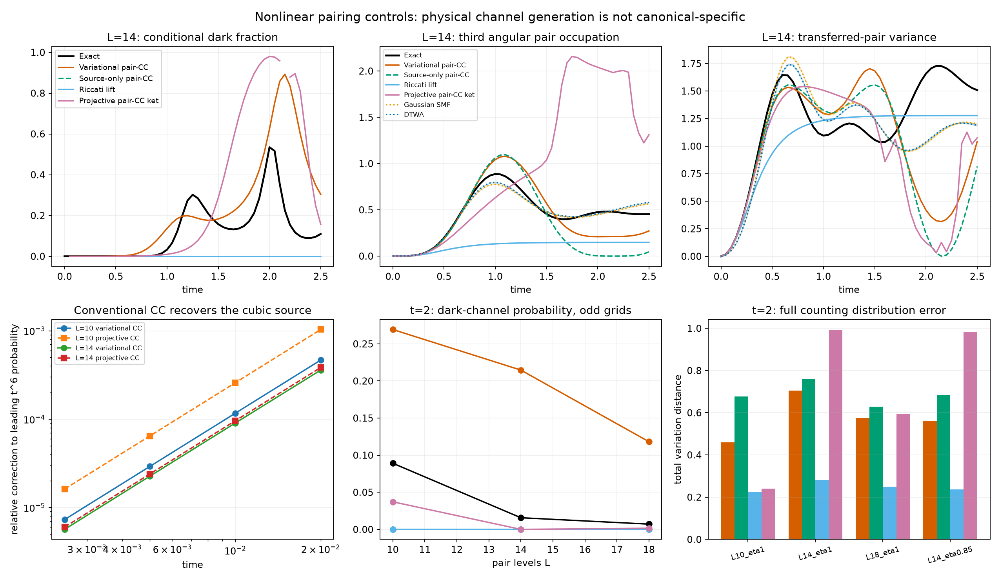
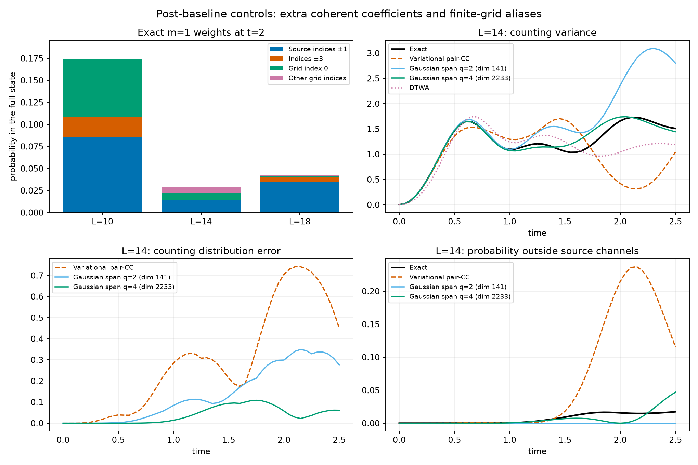

# 第八轮：Pauli 通道的非线性对照与角向混叠

**本轮确认了非线性阶段的实际误差，但没有建立 canonical 分布独有的重要物理预测。**
普通 pair-CC 方程已经包含上一轮的三阶 Pauli 通道；在本轮三个训练点，
canonical witness 与直接波函数选出的 Gaussian 通道空间相同。
晚时计数涨落仍明显超出所测随机平均场与单个 pair-CC 轨迹的精度，
但这还不足以把差异归因于 canonical 特有结构。

用户说明“六”的原目标保持不变；不能把以下控制实验改称完整目标已完成。
第七轮和此前结果均保留，见 [上一轮报告](REPORT_COHERENT_RETURN.md)。

## 实验范围与预测顺序

采用两个平坦角向壳层、G=4、正常费米海初态，计算四个条件：
L=10/14/18、η=1，以及 L=14、η=0.85。
每个壳层的角向点数 r=L/2 为奇数，去掉了上一轮偶数 r 的反号配对/自旋 1 闭合条件。
离散角向平移等其他对称性仍然存在，没有声称消除了所有有限尺寸效应。

主时间区间为 0≤t≤2.5，间隔 0.05；预定比较点为 t=2。
四种确定性模型为：全矩阵 Hermitian Dirac–Frenkel pair-CC、只允许原两通道的同类 TDVP、
有限尺寸 Riccati 提升，以及普通单转移投影 pair-CC 的归一化右态。
它们均从同一个精确费米海出发，不使用未来精确态更新参数。
后者的右态观测量不等于一般双变分 CC 的左右态期望值。

随机对照使用高斯初始涨落与离散 TWA。全部 **8 块 H20** 并行工作：
每个条件/方法两个独立种子，各 262144 条轨迹；另用同一随机种子将步长减半。
共 24 次 GPU 运行、4194304 条独立初始样本；步长复核重用了其中一半样本。
CPU 同时计算确定性模型。任务数量和矩阵大小未要求占满全部 CPU。

先保存确定性及随机预测，再冻结文件哈希，之后生成新网格的晚时精确参考。
初始 L10 pair-CC 小试验和已知短时展开已在协议中披露。
下面的 Gaussian 空间、canonical 与混叠检查是在查看主比较后提出的**机制诊断**，
不是额外的独立预测。48 个预测/预先精度复核文件的哈希已验证。
协议与数据见 [主实验目录](results/nonlinear_channels_01/protocol.json)。

## 1. 普通非线性 pair-CC 已含三阶新通道

在已核对自项的 Riccati 右端之外，普通投影 pair-CC 多出

\[
2T_{ph}\left(\sum_bJ_{pb}^{*}T_{pb}
+\sum_aJ_{ah}^{*}T_{ah}-J_{ph}^{*}T_{ph}\right).
\]

它是两次配对转移不能重复使用同一能级的直接结果。
将 T=itJ+O(t²) 代入，并投影到原两通道之外，正好给出

\[
QT(t)Q=-\frac{2i}{3}t^3Q(J\circ J\circ J)Q+O(t^4).
\]

该方程只用 Hamiltonian，右端计算为 O(r³)。
我们用随机复 Hermitian 相互作用核，独立对照完整 Fock 空间的单转移相似变换投影。
Hermitian TDVP 的短时数值也恢复同一领先概率：t=0.0025 时，相对修正不超过 7.3×10⁻⁶。
普通投影 CC 的相应修正不超过 1.62×10⁻⁵。

完整推导、方法区别和已有文献见 [NONLINEAR_PAIR_CC.md](NONLINEAR_PAIR_CC.md)。
所以“Riccati 中没有这个方向”不再是独特物理发现的候选证据。

## 2. 通道存在不等于其晚时动力学已被描述

以下均为预定 t=2 的结果。TV 是完整计数分布的总变差距离。

| 条件 | 精确 Var(m) | 高斯涨落平均场 | 离散 TWA | 全矩阵变分 pair-CC 的计数 TV |
|---|---:|---:|---:|---:|
| L10，η=1 | 1.63289 | 0.77565 | 0.77719 | 0.45948 |
| L14，η=1 | 1.65852 | 1.02491 | 1.03804 | 0.70524 |
| L18，η=1 | 1.97527 | 1.36345 | 1.36359 | 0.57539 |
| L14，η=0.85 | 1.34177 | 0.93036 | 0.94078 | 0.56165 |

随机方差的标准误在 0.0014–0.0031 量级，上述差异远超采样误差。
这不是未加入初始涨落的平均场对照。
另一方面，随机方法能较好描述部分角向平均占据：
L18 的上壳层第三角向子空间占据，精确值为 0.49294，DTWA 为 0.48631±0.00082。
因此不能把计数方差失败泛化为“随机平均场完全没有新角向成分”。

四个条件下，粒子和空穴均在原两通道之外的相干一次转移概率（‖QCQ‖²）分别为
0.089119、0.015669、0.007089、0.018882。
全矩阵变分 CC 能生成这些方向，却严重误判后续权重；其 t=2 保真度只有 0.125–0.296。
投影 CC 右态也未修复这一点，其计数 TV 为 0.240–0.992。
后者的大振幅与强非线性区间已做严格步长/容差复核，不将其失败归于未检查的积分误差。

没有给随机自旋样本分配纯态回波或相干 m=1 后选择振幅。
高斯涨落版本也不代表已经排除了所有一般 TDHFB、二阶矩闭合或更高阶随机方案。

## 3. 释放 Gaussian 组合系数有用，但没有解决全部相干结构

追加了六个同初态的 Hamiltonian 传播诊断。
q=2 使用原两通道生成的全部数目投影 onsite Gaussian 张成空间，
允许独立复系数，不再服从单个 CC 指数对各转移次数的系数约束。
q=4 再加入由上述普通 Hamiltonian 展开给出的第三角向方向。
这些是已有多构型方法的对照，不是 canonical 采样原子。

L14、η=1、t=2 时，q=2 的计数 TV 为 0.29913，q=4 降至 0.05762；
η=0.85 时由 0.22956 降至 0.08703。
但 q=4 已使用 **2233/3432** 个配对空间维度，不能称作廉价的小空间解决方案。
η=1 的保真度仍只有 0.63666；其相干 m=1 外部通道概率为 1.31×10⁻⁶，
精确值却是 0.015669。
计数分布较准，不足以证明内部角向相干结构也准。

## 4. 奇数网格的晚时权重不能统称为三阶谐波

等强通道保持离散平移对称性，可将一次转移振幅直接变换到离散 Fourier 基。
在 t=2，原通道之外的总概率与 k=±3 部分并不相等：

| L | 所有外部通道概率 | 其中 k=±3 | 离散 k=0 |
|---|---:|---:|---:|
| 10 | 0.0891190 | 0.0229983 | 0.0661207 |
| 14 | 0.0156693 | 0.0008908 | 0.0073896 |
| 18 | 0.0070887 | 0.0047249 | 0.0007682 |

直接计算去除参考整体相位后的 (H−E_F)ⁿ/n! 系数发现：
k=0 首次可分辨出现的阶数分别为 5、7、9，等于对应的 r。
其他分量的首次阶数也与相应奇角向谐波按模 r 折叠一致。
计算采用声明的浮点分辨阈值，不是区间认证的一般定理。

**这个离散 k=0 分量不能被当成已经发现连续模型中的新 s-wave 配对相。**
在这些网格上，高阶奇谐波可与低阶指标混叠；需要更充分的角向分辨率与连续极限控制。
见 [混叠核查](results/angular_aliases_01/evaluation.json)。

## 5. 三个早期 canonical 点未提供新的通道选择

针对晚时离散 k=0 权重进行了一个明确标为事后探索的有限试验：
L10、η=1、t=0.25/0.5/1，运行完整费米 Gaussian 字典的确定性 k=2 合成。
最大合成残差 1.05×10⁻⁹。

在 t=0.25 和 0.5，witness 增强弱通道权重，但未改变通道排序；
在 t=1，直接波函数和 witness 都把 k=0 排在两条主通道之后。
这个排序确实与本轮两种 CC 轨迹不同，但**直接波函数已经提供同样信息**。

保留完整简并对子，比较六种允许截断后生成的整个 Gaussian 空间，
直接态与 witness 的空间投影矩阵最大差异只有 6.68×10⁻¹⁴。
因此在这些坐标和相同初始投影下，它们给出的 Hamiltonian 传播空间相同，
没有理由再将同一空间重复传播，冒充一次有区分力的新预测。
这只排除了本次 m=1 奇异向量坐标的优势，不是对完整 canonical 分布的普遍否定。
witness 坐标也没有被称作 canonical 测度样本。
记录见 [canonical 小试验](results/angular_canonical_pilot_01/span_comparison.json)。

## 数值核查与未完成项

- 57 项测试通过，包括独立 Fock 投影、自由演化、解析 Jacobian、物理切向速度、守恒律及已知平移约化。
- 八个变分 CC 轨迹收紧容差 100 倍、步长减半等复核，最大归一化物理态差异 8.19×10⁻¹⁰。
- 四个投影 CC 轨迹的对应最大差异 4.37×10⁻¹⁰。
- 随机平均场成对样本的步长减半比较，最大观测均值差异 2.05×10⁻⁸。
- 所有主比较保留完整时间曲线、低概率后选择权重及原始样本误差；条件概率在零权重处不作物理解读。

本轮使“非线性缺失结构”的问题更具体了：多个转移次数之间的量子涨落，
以及不同角向通道的相干反馈，不能仅由线性模或其存在性判断。
但还没有一个经过连续/尺寸控制、由 canonical 独特结构预先预测、
并通过删除对照排除强替代方法的物理效应。
第三阶段的原始成功标准仍未达到。

完整审计见 [audit.json](results/assessment_nonlinear_channels_01/audit.json)，
代码与数据快照见 [checkpoint_manifest.json](results/assessment_nonlinear_channels_01/checkpoint_manifest.json)。
