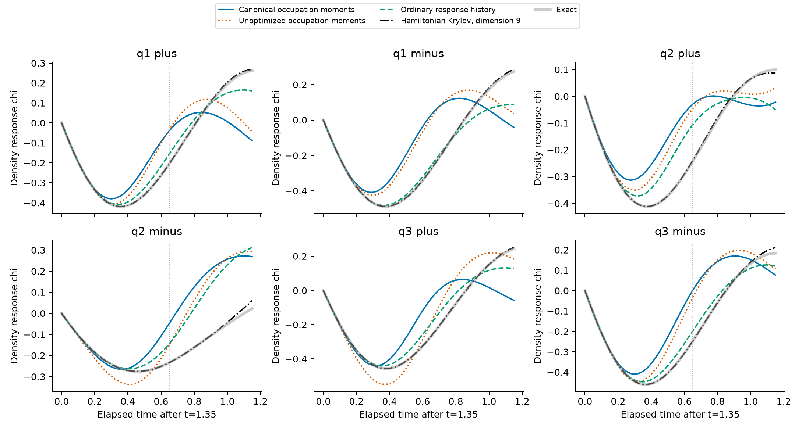
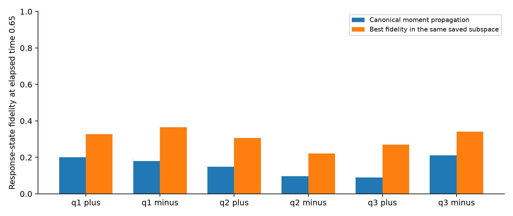

# 第十五轮：实际 Gaussian 占据坐标与角向密度响应

**本轮得到并核查了实际 Gaussian 单模式占据矩的确定性公式，但这些坐标没有解释或预测强基线遗漏的物理响应。原研究目标仍未完成。**

与前一轮的完整 witness 时间组合不同，这次直接采用每个完整 Gaussian 构型的物理坐标
\(p_i(g)=\langle g|n_i|g\rangle\)。还进入了此前完全对称态之外的六个角向响应扇区。
在完全相同的响应初态下，48 条冻结预测均已完成；12 个 canonical 筛选条件全部未通过。
没有把这些先导结果包装成新的参数外推，也没有继续开展没有候选机制支持的参数扫描。

## 1. 坐标公式及独立核查

令 \(n=2L\) 为物理复费米模式数。完整 Gaussian 的二阶 Cartan 投影满足

\[
d_2\int p_i(g)^d |g,g\rangle\langle g,g|\,d\mu
=\sum_{j=0}^2\frac{(n-1+j)_d}{(2n)_d}P_{2,j}.
\]

\(P_{2,j}\) 是两份拷贝中第 \(i\) 模总占据为 \(j\) 的 Cartan 子空间投影。
因此，收缩后的占据加权相干向量由三个固定向量张成。
**在固定二阶 replica 下，继续增加同一个模式的占据矩阶数，不能不断产生新的独立方向。**
这个限制不适用于不同模式的联合坐标、配对场相位或更高 replica 阶数。

这里的 \(p_i\) 在完整 Fock 空间归一化后计算，区别于前面实验中投影到固定粒子数、无未配对电子子空间后再取占据的坐标。
它也是构型标签，不能把其系数分布边缘直接当成目标态的物理占据。
推导、实际相干积分、线性 frame 对照和响应公式见
[OCCUPATION_SYMBOL_RESPONSE.md](OCCUPATION_SYMBOL_RESPONSE.md)。
这是 coherent-state/Berezin 量子化的具体应用，没有宣称它是新物理或确立了数学优先权。

独立核查包括：

- 对 2、3 个物理模式的完整偶宇称纯态空间，用相位平衡及 Dirichlet 积分核查 0、1、2、3、6 阶矩。
- 对随机配对振幅核查二次 Gaussian 变换的 Ward 恒等式。
- 8 块 H20 共积分 **1,048,576** 个独立 SO Haar Gaussian 构型，核查 0–4 阶相干矩及线性 frame。
  \(L=4,6,8\) 使用随机非 Gaussian witness；\(L=10,14\) 使用费米海标量收缩。
- 所有相干矩偏差与所估计 Frobenius 标准误之比最大为 **1.1664**；
  线性 frame 最大为 **1.1930**。这是数值抽样核查，不是严格置信证书。

预测所用向量由确定性 Cartan 收缩得到，不带上述 Haar 采样噪声。
8 个源、每源 14 个独立配对能级，完成 **112** 组单模式收缩、**224** 次导数调用。
最大 Ward 残差 \(6.58\times10^{-16}\)。
沿用前轮四个早时刻的 canonical witness，最大合成残差 \(2.68\times10^{-14}\)；本轮没有新做 witness 优化。

## 2. 真正对应弱相位扰动的响应

模型仍为 \(L=14,G=4,\eta=1\)，配对空间维数 3432。
训练时刻固定为 \(0.30,0.60,0.90,1.35\)。
取三个余弦角谐波 \(q=1,2,3\) 和粒子／空穴交换宇称 \(\sigma=\pm1\)：

\[
O_{q,\sigma}=\sum_j\sqrt{2/r}\cos(2\pi qj/r)
(n_{p,j}-\sigma n_{\ell,j}).
\]

这里每个 \(n\) 是一个物理自旋模式的占据，在配对态子空间内等于该能级的电子对占据。
六个响应扇区均在原 170 维完全不变子空间之外。
实际预测的是四费米关联

\[
C_O(\tau)=\langle\psi(1.35+\tau)|Oe^{-iH\tau}O|\psi(1.35)\rangle.
\]

\(2\,\mathrm{Im}\,C_O\) 是对弱相位脉冲 \(e^{-i\alpha O}\) 的线性密度响应；
\(\mathrm{Re}\,C_O\) 是对称化密度关联。
所有方案均从完全相同的
\(O\psi(1.35)/\|O\psi(1.35)\|\) 出发。
背景态由所有方案共用的 32 维普通 Hamiltonian Krylov 空间传播。
这一区分保留了响应比较的意义，但不构成计算成本优势。

每个扇区比较八种空间：

| 空间 | 维数 | 内容 |
|---|---:|---|
| 同初态删除 | 1 | 仅保留共同响应初态 |
| canonical 端点 | 3 | 共同初态及端点的一、二阶中心占据矩 |
| 未优化端点 | 3 | 对直接目标态使用相同三次相干积分 |
| Hamiltonian 端点维数对照 | 3 | 普通 Krylov |
| canonical 历史 | 9 | 共同初态及四个早时刻的占据矩 |
| 未优化历史 | 9 | 相同训练时间与坐标 |
| 普通响应历史 | 9 | 早时刻 \(O\psi\)、\(HO\psi\) 及端点二次 H 响应 |
| Hamiltonian 历史维数对照 | 9 | 普通 Krylov |

所有空间和预测均先保存，再生成完整响应参考。
原始资料见 [protocol.json](results/occupation_response_01/protocol.json) 和
[evaluation.json](results/occupation_response_01/evaluation.json)。
这是已有物理参数上的新响应观测量先导实验，**不是新的参数留出验证**。

## 3. 预测结果

主检验为 \(\tau=0.65\)，对应物理时刻 \(t=2\)。
下表给出区间 \(0\le\tau\le0.65\) 上复关联函数的相对 RMS 误差，均为九维响应空间。

| 响应扇区 | canonical 占据矩 | 未优化占据矩 | 普通响应历史 | H Krylov |
|---|---:|---:|---:|---:|
| \(q=1,+\) | 0.19620 | 0.18659 | 0.043894 | 0.00006898 |
| \(q=1,-\) | 0.30468 | 0.27433 | 0.019652 | 0.00032667 |
| \(q=2,+\) | 0.13406 | 0.10814 | 0.089023 | 0.00072417 |
| \(q=2,-\) | 0.24192 | 0.26128 | 0.056550 | 0.00015311 |
| \(q=3,+\) | 0.21627 | 0.18704 | 0.053427 | 0.00029214 |
| \(q=3,-\) | 0.21712 | 0.18335 | 0.057952 | 0.00016098 |

预先要求 canonical 同时改善响应态计数 TV、密度响应 RMS 和实部关联 RMS，并优于同类未优化方案、同维 H Krylov；历史方案还须优于普通响应历史。
**12 项检验全部未通过。**
计数 TV 属于由 \(O\) 生成并归一化的响应态，不能冒充有限脉冲之后原物理态的计数分布。

删除比较也没有建立独有必要性。例如 \(q=3\) 的两个宇称通道，删除全部新增坐标后的复关联相对误差反而小于 canonical 历史空间。
其他通道中新增坐标的部分收益，同样被普通 Hamiltonian 方向超过。

[误差比较图](results/assessment_occupation_response_01/occupation_prediction_errors.png)；
相同目录提供可独立使用的 PDF 图。

## 4. 空间限制与数值误差分开

对已保存的线性空间，投影范数平方直接给出该空间中的最佳可能保真度。
在主时刻，六个 canonical 九维空间的这一值依次为

\[
0.32733,\ 0.36570,\ 0.30663,\ 0.22059,\ 0.26890,\ 0.34090.
\]

实际传播保真度为 0.0904–0.2113。
因此传播近似造成了进一步损失，但**这些冻结的局部占据坐标本身已经严重缺少未来响应方向**。
上述投影结论针对保存的数值线性空间；不是完整 Gaussian 字典的限制，也不是区间认证。

独立控制结果：

| 检查 | 结果 |
|---|---:|
| 48 条预测的最大初态差 | \(4.81\times10^{-15}\) |
| 预测最大范数误差 | \(9.77\times10^{-15}\) |
| 共用背景与完整演化最大状态差 | \(1.93\times10^{-14}\) |
| 12 条独立矩阵指数复算最大状态差 | \(1.16\times10^{-14}\) |
| SVD 阈值从 \(10^{-11}\) 降到 \(10^{-13}\) | 全部秩不变，最大子空间残差 \(2.85\times10^{-13}\) |
| 24 条带正负号有限脉冲演化 | 中心差分误差随脉冲幅值减半约缩小四倍 |
| 脉冲差分 Richardson 外推与响应公式最大差 | \(1.93\times10^{-12}\) |
| 完整测试 | **109 项通过，5.666 秒** |
| 汇总独立复核的输入／冻结文件 | **86 个 SHA-256 一致** |

有限脉冲和事后空间容量检查属于机制及数值诊断，不计为新的独立物理预测。
详见 [diagnostics.json](results/occupation_response_diagnostics_01/diagnostics.json) 和
[audit.json](results/assessment_occupation_response_01/audit.json)。

## 5. 对下一步的实际约束

这一结果排除了“继续增加单个局部占据坐标的高阶矩，就能补足这批响应”的做法：
同一 \(k=2\) 单模式插入只有三个拷贝占据分量，角向和交换宇称固定后只留下本轮已用的两类中心矩。
值得继续研究的候选必须涉及**不同模式的联合相干信息或配对场的相位关系**，并明确解释其如何进入真实 Hamiltonian 的响应。
不能再次仅通过改时间点、提高同一坐标阶数或增加 Haar 样本量来期待产生新物理。

当前尚未确定上述联合坐标能否满足用户要求；也没有把有限 patch 的密度响应命名为新的集体模或相变。
只有候选机制先超过强非线性／普通响应基线，再通过真正未查看条件和同初态删除，才可能完成第三阶段的验收。
本轮的公式和否定证据是继续研究的约束，不替代这一目标。
