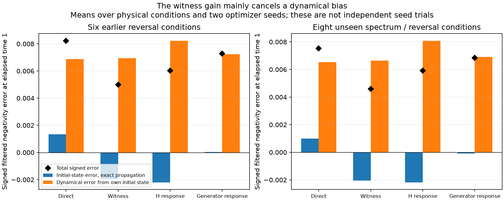
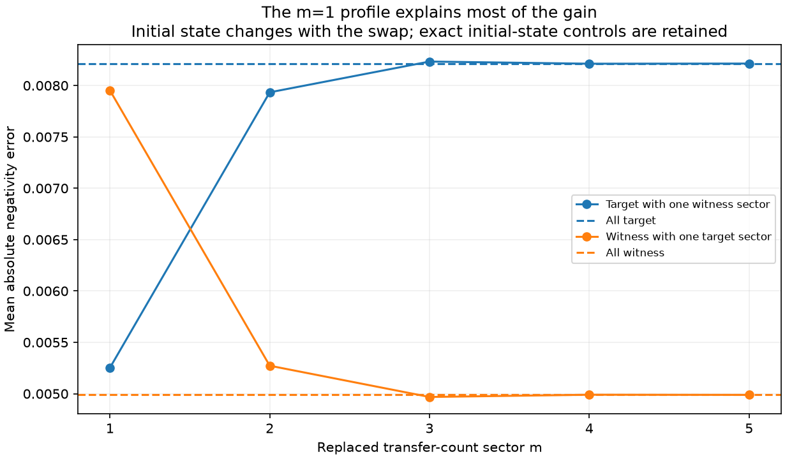
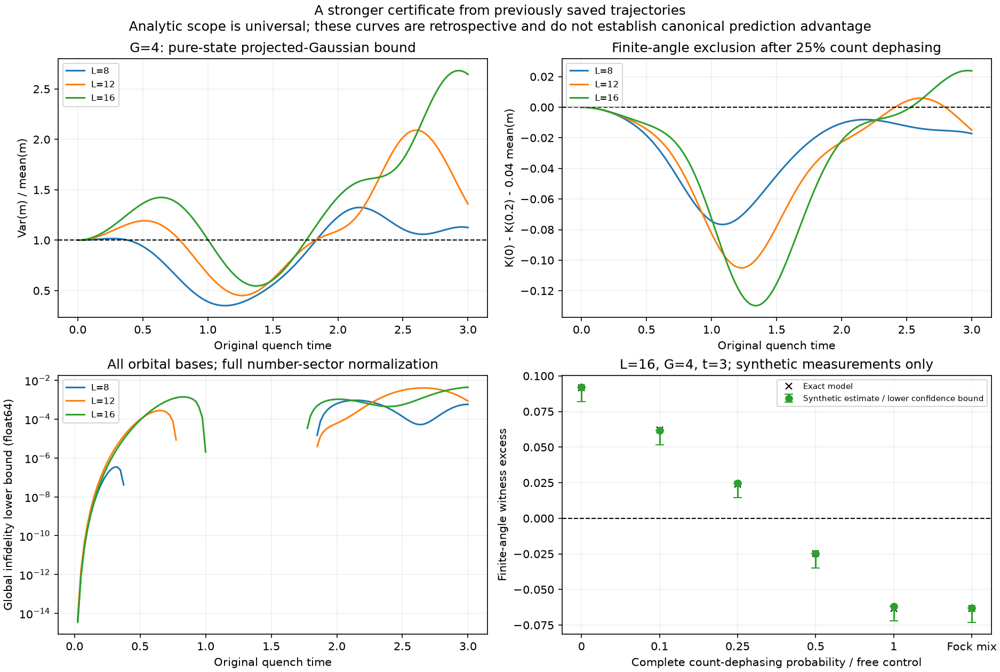

# 第六轮：初态偏差对照与一般投影 Gaussian 排除证书

**上一轮 witness 提取构型的较小预测误差，主要来自初态偏差与传播偏差的抵消；目前不能解释为发现了更好的动力学结构。**
新的八个未参与训练的物理条件仍保留这种误差排序，但同初态精确传播对照揭示了相同原因。
本轮另给出任意轨道数目投影 Gaussian 的计数界，并将它转成排除其经典混合的相干回波判据。
这个解析进展补上了原先的字典范围限制；尚未建立发现优先权或 canonical 方法独有的重要物理预测。
研究目标仍为 active，不能将三阶段流程已经运行等同于三阶段科学目标已经完成。

机器审计见 [audit.json](results/assessment_orbit_controls_01/audit.json)，
完整证明见 [PROJECTED_GAUSSIAN_COUNT_BOUND.md](PROJECTED_GAUSSIAN_COUNT_BOUND.md)。
前五轮结果保留；本报告修正 [第五轮报告](REPORT_INTERBAND.md) 中尚未定位的预测优势解释。

## 1. 用早期 Hamiltonian 响应训练同型基线

所有训练仍只使用 L=12、G=2、t=1 的态。直接态、canonical witness 和新增响应训练
都生成每个转移数 m 两个轨道乘积的同一变分族，随后仅由新 Hamiltonian 的 TDVP 推进。
这里的 witness 轨道不是实际 canonical 测度抽样原子；两列条件轨道也不是两个未投影 Gaussian 原子。

新增训练分别使用中心化的 Hψ，或单粒子能量项与配对相互作用项的响应。
后者先正交化响应空间，避免算符的任意尺度决定训练权重。
对预写协议中的八个权重、两种响应和两个种子，共评价 32 个候选；
其中四个零权重候选复用直接态拟合，28 个重新拟合。
只在初始 infidelity 不超过直接拟合两倍的候选中，选择早期法向响应残差最小者。
四组选择均为权重 0.1，未使用未来参考态或未来误差选择权重。

840 次块优化中 823 次报告收敛，最终选中的 20 个块全部报告收敛。
这是常规多目标变分训练对照，不是响应几何的全局最优算法，也没有相同总计算预算的优势声明。
直接态、witness、H 响应及双生成元响应的初始保真度分别约为
0.99996169、0.99994424、0.99995033、0.99995570。

## 2. 新预测和旧条件复核分开计数

训练开始前写入的新网格包含：

- 新耦合 G=−1.4、−2.2，集体相位旋转 0、π/5；
- 新能谱 ε+0.3ε³，以及 ε+0.25(ε²−平均 ε²)；
- 主要时间固定为训练后 Δt=1，保存网格延伸至 Δt=2；
- 沿用训练阶段选择的带边滤波器，主要指标仍为 negativity 绝对误差与未归一化滤波迹距离。

这是八个新物理条件，11 个含优化种子的模型实例产生 88 条预测。
另在前轮六个已知反转条件上做 66 条比较，在同六个条件上做 144 条分块交换对照。
**298 是模型—条件记录数，不是 298 个独立新条件；两个优化种子也不是独立物理重复。**
每批预测在计算其精确未来参考前整体保存。旧网格和交换实验是后续机制检查，不算新的前瞻确认。

新八条件在 Δt=1 的均值如下。两列族平均两个优化种子；其余基线各一组。

| 方法 | negativity 绝对误差 | 未归一化滤波迹距离 | 全态保真度 | 计数总变差 |
|---|---:|---:|---:|---:|
| 直接态两列 | 0.00752706 | 0.00054439 | 0.99641294 | 0.00216021 |
| witness 两列 | 0.00459541 | 0.00036928 | 0.99642629 | 0.00223564 |
| H 响应两列 | 0.00590730 | 0.00036200 | 0.99639655 | 0.00228622 |
| 双生成元响应两列 | 0.00683041 | 0.00048273 | 0.99639729 | 0.00214739 |
| 静态 RPA q=3 | 0.00555952 | 0.00208488 | 0.99460753 | 0.00061129 |
| 条件轨道 + 两体密度 Jastrow | 0.20382150 | 0.00621729 | 0.99206815 | 0.00661640 |
| 单列条件轨道 | 0.35217760 | 0.00965556 | 0.97720542 | 0.01070240 |

H 响应训练在第二项主要指标上略优于 witness，在第一项上较差；
RPA 的计数误差仍明显更小。没有一种 canonical 特有结构在这些指标上建立全面优势。
响应训练没有同时抹去两项指标的数值排序，但下一节的因果对照改变了其物理解读。

## 3. 初态误差与传播误差的分解

对每个模型，额外从它自身投影后的初态作精确传播，得到 298 个对应控制。
记原训练态的精确未来态为 ψ，模型自身初态的精确未来态为 χ，模型预测为 φ。
对滤波 negativity \(\mathcal N\)，逐条记录

\[
\mathcal N(\phi)-\mathcal N(\psi)
=\big[\mathcal N(\chi)-\mathcal N(\psi)\big]
+\big[\mathcal N(\phi)-\mathcal N(\chi)\big].
\]

第一项隔离初态选择在精确传播后的影响，第二项是相对于自身初态的动力学误差。
这是有符号标量的精确恒等式；不能把两个迹距离或两个绝对误差也这样相加。

| 网格与模型 | 初态引起的有符号误差 | 动力学有符号误差 | 合计 |
|---|---:|---:|---:|
| 旧六条件，直接态 | +0.00133882 | +0.00687449 | +0.00821331 |
| 旧六条件，witness | −0.00195303 | +0.00694174 | +0.00498872 |
| 新八条件，直接态 | +0.00099839 | +0.00652867 | +0.00752706 |
| 新八条件，witness | −0.00205162 | +0.00664703 | +0.00459541 |

witness 的动力学 negativity 误差在两组网格上都略大，初态造成的负偏差则抵消了正的传播偏差。
对应动力学部分的未归一化滤波迹距离也很接近：
旧网格直接态/witness 为 0.00035925/0.00035489，新网格为 0.00050864/0.00050227。
因此数值上的预测收益存在，但本轮没有证明变分切空间捕获了此前遗漏的新动力学通道。

逐个交换 m=1,…,5 的轨道后，再用相同训练目标投影确定系数。
在直接态族中只换入 witness 的 m=1 块，平均 negativity 误差就从 0.00821331 降至 0.00525250，
约重现完整两族误差差值的 92%；反向交换使 witness 的误差增至 0.00795238。
交换也改变初态，精确传播控制已保留。
结果定位到一次转移扇区，**没有支持先前待检验的“两次转移返回过程提供特殊记忆通道”解释**。

## 4. 覆盖任意轨道的投影 Gaussian 计数限制

另一个独立进展是补齐一般投影 Gaussian 的解析排除。
设 φ 是任意纯偶宇称费米 Gaussian 态，仅投影到固定总粒子数后归一化；
对任意单粒子子空间的物理粒子数 \(N_A=c^\dagger P_Ac\)，有

\[
\operatorname{Var}_\phi(N_A)\le2\langle N_A\rangle_\phi,
\qquad
\operatorname{Var}_\phi(m)\le\langle m\rangle_\phi,\quad m=N_A/2.
\]

候选态允许跨能级、跨自旋配对及任意轨道旋转，使用完整固定总粒子数范数；
不再要求它在测量基中没有破对占据。一般候选的 m 可以为半整数。
证明不允许额外施加 seniority、自旋或其他多体投影。

证明先在候选自身的规范成对基中用固定数目占据的负协方差，
再显式保留测量算符在不同规范对之间产生的破对振幅和相长干涉，
最后用 \(P_A^2=P_A\) 封闭上界。
Gaussian 规范形式是已有工具，见
[Kraus 等关于 fermionic pairing 的研究](https://arxiv.org/abs/0810.4772)；
完整逐步证明与适用边界见 [推导笔记](PROJECTED_GAUSSIAN_COUNT_BOUND.md)。

随机核查覆盖 6、8、12、16 个物理模式、多个总粒子数、子空间秩及复参数，共 3300 例；
33 例用完整固定 N 的独立 Pfaffian 实现交叉验证。
独立均值/方差误差分别约不超过 \(8\times10^{-15}\) 和 \(10^{-13}\)。
普遍结论来自解析证明，而非随机通过率。尚无外部独立数学审查，也不主张优先权。

由计数超额及有界观测量的迹距离关系，还可获得对整个纯投影 Gaussian 族的有限保真度上界；
对已知纯目标，其经典混合的保真度也满足同一界。
L=12、G=2 的原三个关键时间，界分别为：

| 时间 | 一般投影 Gaussian 保真度上界 |
|---|---:|
| 0.5 | 0.9999995288 |
| 1 | 0.9999845672 |
| 2.15 | 1，计数证书不给出非平凡限制 |

前两个是较弱但覆盖全族的障碍，不能代替先前可行拟合的误差数值。
首个脉冲 t=2.15 的 Fano 因子小于 1，**一般投影 Gaussian 在该点的非平凡全局排除仍未解决**。
具体数值均以 float64 评价，未作区间算术认证。

## 5. 相干回波可以排除经典混合

普通方差不能排除 Gaussian 经典混合。令 \(\mathcal C_{\rm PG}\) 是同一总粒子数下纯投影
Gaussian 态的凸包，使用 QFI 的凸性可得

\[
F_Q(\rho,m)\le4\langle m\rangle_\rho,\qquad \rho\in\mathcal C_{\rm PG}.
\]

QFI 与方差的关系是已知结果，见 [Sixia Yu](https://arxiv.org/abs/1302.5311)。
再用已知 Hilbert–Schmidt sub-QFI 下界和 \(1-\cos x\le x^2/2\)，得到无需零角度外推的判据：

\[
K(0)-K(\theta)\le\theta^2\langle m\rangle_\rho,\qquad
K(\theta)=\operatorname{Tr}(\rho e^{-i\theta m}\rho e^{i\theta m}).
\]

sub-QFI 和两副本计算并非本轮的新方法，参见
[Cerezo 等](https://arxiv.org/abs/2101.10144)。
混态的 \(K(0)\) 是纯度，必须实际估计，不能设为 1。
超过上述界才排除整个 \(\mathcal C_{\rm PG}\)，而非只排除某次局部拟合。

在第一轮已有的 L=16、G=4、t=3 精确轨迹上，
\(\langle m\rangle=1.58552595\)、\(\operatorname{Var}(m)=4.19544720\)、Fano=2.64609180。
一般投影 Gaussian 的保真度上界为 0.99557573。
θ=0.2 的纯态回波超额为 0.0916060。
这些都是**旧轨迹上的新证书评价，不是新生成的前瞻动力学预测**。
晚时较大的信号提供后续研究对象，但还不能称为 canonical 分布发现的新物理。

以概率 ε 完全随机化集体计数相位时，所有 p(m) 保持不变，
回波差变为原值的 \((1-\epsilon)^2\)。
上述 L=16 点在 ε=0.25 时仍有 0.0237817 的正超额；理想精确量的阈值约为 ε=0.36039。
完全计数去相干会消除此见证，但不一定消除每个固定 m 内的其他非 Gaussian 关联。
相同全 Fock 概率的经典混合则确定属于 Slater 混合，计数完全相同，回波差为零。

为检查有限采样，预先写入 L=8/12/16、G=2/4、四个时间、五个去相干概率，
并对每个物理态加入一个相同计数的自由 Fock 混合控制，共 144 例。
每个重叠和计数设置各模拟一百万次 IID 测量：
两个 SWAP 设置各用两副本，故**每例对应五百万个物理副本**。
使用总失败概率 1% 的同时单侧 Hoeffding 界。

144 例中 9 例检出违例，24 个自由混合控制中无误报。
L=16、G=4、t=3、ε=0.25 的超额下置信界为 0.0145187。
这只是已知精确态上的合成数据与理想 IID 测量验证，不是实验数据或测量成本优势。
波函数的纯态假设、噪声模型和真实硬件误差不能由这一模拟自动保证。

## 6. 核查、成本及尚未完成的目标

35 个冻结模型文件及训练选择文件的哈希通过核查；
旧预测重算与第五轮归档的最大指标差为 \(5.76\times10^{-14}\)。
298 条预测最大范数误差 \(1.33\times10^{-8}\)，能量漂移 \(1.94\times10^{-7}\)。
四种模型在一个强反转、新非对称能谱条件上加严积分容差与切空间截断，
最大态差 \(5.42\times10^{-8}\)，negativity 差 \(1.76\times10^{-9}\)。
完整测试 43 项通过，日志保存在审计目录。

本轮训练使用 24 个独立 CPU 进程，三批预测最多合计 72 个进程，解析随机核查使用 12 个进程。
每进程数值库限制一个线程。前轮随机方法与 Haar 采样已使用全部八块 H20；
本轮小矩阵与精确稀疏传播没有新增 GPU 工作。所有本轮进程均已结束。
现有实现仍枚举固定配对数空间，没有建立多项式成本，也没有 L=16 的完整 canonical 对照。

第一阶段的物理窗口保留。第二阶段新增覆盖任意轨道的解析界和相干证书，
但首个 G=2 脉冲的全族误差障碍仍缺失。
第三阶段新增八个真正未用于训练的条件和误差来源控制，
却削弱了“witness 提供特殊动力学结构”的解释。
固定计数纠缠、多构型 TDVP、pairing 计量学和 sub-QFI 本身均有已有研究背景；
不能将它们的复现或组合直接列为重要新物理成果。

后续应优先独立检查解析界的范围、紧性和文献关系，并在较强晚时信号附近，
冻结早期结构后预测未见参数的相干回波，再与 RPA、pair-CC、响应训练和多构型方法对比。
需要找到能解释并预测强基线遗漏的物理效应、且删除相应结构后效应预测失效的证据。
当前尚未满足这一验收条件。
