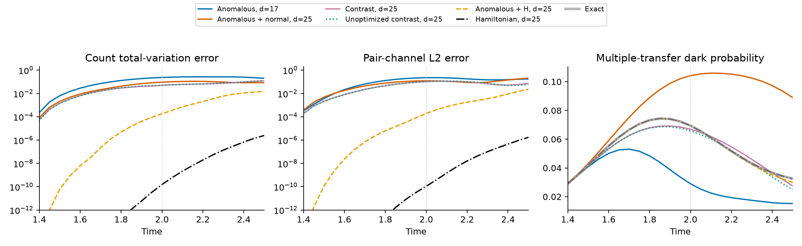
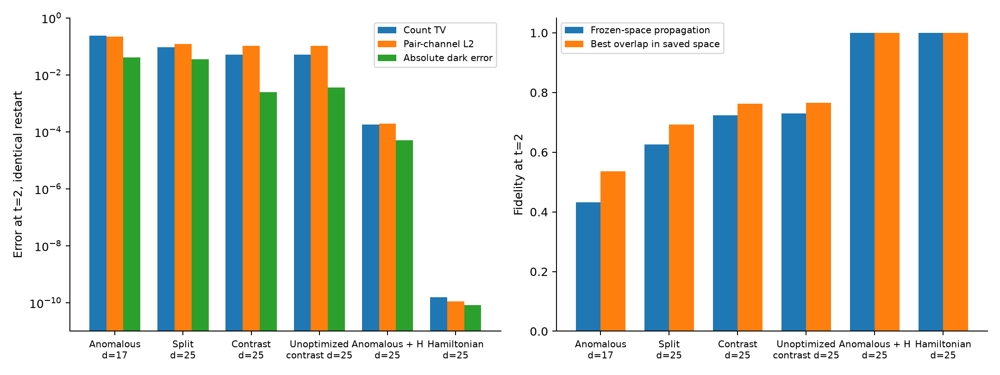

# 第十六轮：Gaussian 配对场、正常交换项及相干删除对照

**本轮把完整 Gaussian 构型的配对四点函数分成异常配对场与正常交换两部分，并完成同初态预测和删除实验。两类坐标联合使用确有改善，但未优化分布也能得到相近结果，普通 Hamiltonian 方向明显更准确。原定的重要物理发现与真正未知条件预测目标仍未完成。**

新增 36 条冻结空间轨迹，随后完成 8 条有解析依据的相干对比坐标诊断；14 个 canonical 优势条件全部未通过。这些都是已研究参数上的先导实验，没有新增物理参数留出预测。8 块 H20 完成了两批共 2,097,152 个 Haar Gaussian 构型的独立数值核查和八组确定性坐标计算。117 项测试通过。

## 1. 实际检查了什么物理坐标

每个原子均在完整偶宇称 Fock 空间归一化，物理复模式数为 \(n=2L\)。定义

\[
\rho_{ab}=\langle c_a^\dagger c_b\rangle_g,\qquad
\Delta_i=\langle s_i^-\rangle_g.
\]

Gaussian Wick 恒等式给出

\[
\underbrace{\langle s_i^+s_j^-\rangle_g}_{f_{ij}}
=\underbrace{\Delta_i^*\Delta_j}_{a_{ij}}
+\underbrace{\rho_{i\uparrow,j\uparrow}\rho_{i\downarrow,j\downarrow}
-\rho_{i\uparrow,j\downarrow}\rho_{i\downarrow,j\uparrow}}_{e_{ij}}.
\]

异常项保留配对场的相对相位；正常项含跨能级的单费米相干。对于 onsite 配对 Gaussian 乘积，非对角正常项为零，而一般 Gaussian 原子不必如此。因此该分拆有明确的构型含义，值得检验。**这并不预先证明正常项所对应的原子不可删除，也不能把分布边缘当成目标态的正常输运。**

实际使用的相干向量为

\[
M_f(u)=d_2\int f(g)|\langle g|u\rangle|^2\langle g|u\rangle\,g\,d\mu(g),
\qquad d_2=\tfrac12{2n\choose n}.
\]

三种标签分别积分，并减去各自 Haar 均值乘以未加权合成向量。最终输出位于固定粒子数配对子空间，但二次算符的中间态保留了粒子数改变和两处未配对电子。把某一个 broken-pair 中间矩阵直接称为正常物理项，会得到错误的坐标分拆。

完整公式与文献来源见 [PAIR_SYMBOL_PHASES.md](PAIR_SYMBOL_PHASES.md)。Berezin 量子化及对称空间谱是已有数学工具；这里没有将其应用或归一化核查称为新物理。合成阶数仍是 \(k=2\)。

## 2. 一个必须扣除的 Gaussian 背景

对不同能级，两个符号插入公式给出

\[
M_{a_{ij}}-\tfrac13M_{f_{ij}}
=\frac{2(Y_{ij}+2Z_{ij})}{3(2n)(2n+1)}.
\]

\(Y\) 来自粒子数改变的配对中间态，\(Z\) 来自互补未配对自旋中间态。对任意配对占据基 Slater determinant，\(P_2(u\otimes u)=u\otimes u\)，两类中间矩阵均为零。因此以上相干积分严格为零。

同一情形却有

\[
M_f=\frac{3s_i^+s_j^-u}{2n(2n-2)},\quad
M_a=\tfrac13M_f,\quad M_e=\tfrac23M_f.
\]

**正常项与异常项的 2∶1 比例，在 Gaussian 费米海上已经存在。**它不是相互作用产生新正常输运的证据。这里为零的是指定 witness 上的相干积分，标签 \(a-f/3\) 本身并非在每个 Gaussian 原子上为零；也没有证明它对任意 Gaussian witness 都为零。

原始联合坐标先导结果出来后，我们才采用这一相干对比量，在相同四个早时刻选择八或十六个方向。该追加选择明确属于事后诊断，不是独立确认性预测。

## 3. 冻结传播和同初态删除

模型为已有的双平壳、两个等强实配对通道，\(L=14,G=4,\eta=1\)。完整配对态维数为 3432，所用精确对称不变空间为 170 维。它是有限角向网格模型，没有材料、热力学新相或长寿命暗态结论。

训练仅取 \(t=0.30,0.60,0.90,1.35\) 的四个已有 canonical witness；另以直接目标态做同样积分，作为未优化对照。每个源使用 16 个壳间／壳内配对标签，共 128 组、384 个分拆向量。坐标选择不读取 \(t>1.35\) 的态。

所有方法共享九维空间，包含端点的八个配对计数扇区分量及 \(H\psi(1.35)\)。因此它们精确保留相同的费米海初态、端点初态和端点 Hamiltonian 切向。其余方向由训练向量残差的 SVD 选择，每列先归一化。

| 方案 | 总维数 | 共享空间之外的内容 |
|---|---:|---|
| 异常／正常／完整标签 | 17 | 相应八个方向 |
| 完整标签 | 25 | 完整标签的十六个方向 |
| 分拆联合 | 25 | 八个异常方向，再加八个独立正常方向 |
| 异常 + H | 25 | 相同八个异常方向，再加八个普通 H 方向 |
| 未优化对照 | 相同 | 对直接物理态做相同相干积分和选择 |
| 普通算符历史、H Krylov | 17 或 25 | 常规方向，维数匹配 |
| 精确对称空间 | 170 | 完整传播对照 |

从联合空间删除新增的八个正常方向，恰好恢复异常空间，两个初态均保持不变。加入八个 H 方向检验普通动力学是否足以修复同一缺失。嵌套关系最大残差 \(3.03\times10^{-15}\)。

18 个主方案各从费米海 \(t=0\) 和精确端点 \(t=1.35\) 出发，传播至 \(2.5\)。追加的四个对比坐标方案使用相同两种初态。费米海轨迹在训练区间内属于回顾重建；区间外属于已知物理条件上的外推。空间和预测先保存，再计算本批参考；整个参数条件此前已被检查，不能据此宣称全新留出验证。

主判据为 \(t=2\) 的配对计数总变差、四个复配对谐波的 L2 误差及多次转移暗子空间概率误差。四点量为

\[
X_q=\left\langle\sum_{ij}\frac{\cos[2\pi q(i-j)/r]}{r}
s_{p,i}^+s_{\ell,j}^-\right\rangle,\quad q=0,1,2,3.
\]

暗子空间定义沿用 [DARK_PAIR_COHERENCE.md](DARK_PAIR_COHERENCE.md)，只统计 \(m\ge2\)，不是完整 Hamiltonian 的不变子空间。

## 4. 结果没有通过强基线检验

下表均从完全相同的精确 \(\psi(1.35)\) 出发，给出 \(t=2\) 的结果。暗概率误差取绝对值。

| 方案 | 维数 | 保真度 | 计数 TV | 配对谐波 L2 | 暗概率误差 |
|---|---:|---:|---:|---:|---:|
| canonical 异常 | 17 | 0.432191 | 0.235669 | 0.225356 | 0.040434 |
| canonical 完整标签 | 25 | 0.579112 | 0.112450 | 0.174950 | 0.030562 |
| canonical 分拆联合 | 25 | 0.626588 | 0.093130 | 0.121298 | 0.034808 |
| 未优化分拆联合 | 25 | 0.626691 | 0.088594 | 0.093828 | 0.028851 |
| canonical 对比坐标 | 25 | 0.724298 | 0.050842 | 0.103324 | 0.002465 |
| 未优化对比坐标 | 25 | 0.729841 | 0.051024 | 0.104156 | 0.003612 |
| 普通算符历史 | 25 | 0.594004 | 0.102303 | 0.144672 | 0.023699 |
| 相同异常空间 + 八个 H 方向 | 25 | 0.99999656 | 0.00018053 | 0.00019376 | 0.00005116 |
| H Krylov | 17 | 0.99999587 | 0.00034463 | 0.00033150 | 0.00000892 |
| H Krylov | 25 | 约 1 | \(1.54\times10^{-10}\) | \(1.10\times10^{-10}\) | \(8.27\times10^{-11}\) |

加入正常坐标比只保留异常坐标更准确；但未优化分拆同样改善，且三个物理误差都更小。相应十六维新增空间的 canonical／未优化主角余弦全部超过 0.9684，不能将这种空间区别夸大为不同的物理机制。

扣除 Gaussian 背景后的对比坐标进一步改善暗概率与计数，但未优化结果仍非常接近。更关键的是，在相同异常空间上用普通 H 方向补充，远比用正常项补充有效。删除实验支持“新增方向有用”，不支持“canonical 特有的正常交换结构不可替代”。

从相同费米海出发的结论一致：canonical 十六方向对比坐标的计数 TV 为 0.050546，而同维 H 控制为 \(1.07\times10^{-6}\)。没有用不同初态造成的误差来充当构型必要性。

主先导十个优势条件和追加诊断四个条件均失败。条件要求同时优于未优化、同维普通算符历史及 H 控制；联合方案还必须优于完整标签、异常删除和异常加 H 修复。没有因基线过强而移除它。

## 5. 为什么不是数值传播误差

对每个保存空间直接计算目标态的投影范数平方，得到该数值线性空间内的最大可能保真度。\(t=2\) 时，canonical 异常、分拆联合、对比坐标分别为 **0.53530、0.69278、0.76219**；实际传播分别为 0.43219、0.62659、0.72430。即使重新选择该空间中的所有系数，也无法接近 H 控制的精度。

这只是保存有限空间的浮点投影界，不是完整 Gaussian 字典的保真度上界，也不是区间证书。14 条代表轨迹以另一种矩阵指数算法独立复算，最大态差 \(2.75\times10^{-14}\)，无法解释上述物理误差。

公式核查与运行完整性如下：

- 小完整偶宇称 Fock 空间检查 Cartan 投影的迹、幂等性及副本对称性，并与配对子空间的正 Beta 核比较。
- 独立构造第三 Cartan 投影，核查四 Majorana 标签插入；独立构造第四 Cartan 投影，核查两个二次标签的乘积。后者在四物理模式时秩为 294。这里的 P3/P4 只用于归一化验证，不是提高合成阶数。
- 对随机四配对能级 witness，逐项比较 16 个能级对的完整、异常及正常符号；分别核查数目改变与 broken-pair 中间矩阵。所有配对 Slater 基态的非对角对比量为零也有测试。
- 两批全 SO Haar／Wick 积分分别含 1,048,576 个构型。首批核查完整标签，第二批核查三种分拆；最大误差与估计 Frobenius 标准误之比分别为 2.5701、1.8446。这不是严格 Monte Carlo 置信证书，训练坐标采用确定性公式，不携带该采样误差。
- canonical 复用合成的最大重构残差 \(9.94\times10^{-15}\)，符号分拆残差 \(2.58\times10^{-17}\)；44 条轨迹的最大初态误差 \(1.34\times10^{-14}\)，最大范数误差 \(7.78\times10^{-15}\)。
- 117 项测试通过，耗时 6.183 秒；82 个不同路径的保存文件通过 SHA-256 复查。汇总见 [audit.json](results/assessment_pair_symbols_01/audit.json)。

## 6. 当前研究判断与文件

本轮解决了联合配对标签如何从完整 Gaussian 字典中正确计算的问题，也排除了“正常交换项显著即说明新物理”的解释。但这些是工具和负面筛选结果，没有完成说明第六节要求的独有物理认识、强基线遗漏的预测和同初态删除因果链。

后续不能继续仅改变这些单次转移标签的静态排序或增加同类早时刻。若研究真正连通的多次转移相位、非多项式联合场相位，必须先说明它对应哪个重要可测偏差，并区分于已检查的普通多体响应和 connected pair-CC。只有出现通过强控制的候选机制，才值得声明新的物理条件留出并进行确认；这里尚未证明这样的候选存在。

实现入口为 [full_cartan.py](pairing_formation/full_cartan.py)、[pair_symbols.py](pairing_formation/pair_symbols.py)、[pilot_pair_symbols.py](scripts/pilot_pair_symbols.py) 和 [pilot_pair_contrast.py](scripts/pilot_pair_contrast.py)。原始协议、轨迹及评估分别位于 [主先导](results/pair_symbol_pilot_01/protocol.json)、[追加诊断](results/pair_contrast_01/protocol.json)；复算见 [diagnostics.json](results/pair_symbol_diagnostics_01/diagnostics.json)。图目录同时提供 PDF。

当前密集实现仍随配对空间指数增长，限制为 \(L\le14\)。使用八块 GPU 并不构成与常规方法等成本的优势。所有结果保留在拉取的 main 工作目录内，未提交或推送。当前工作快照见 [checkpoint_manifest.json](results/assessment_pair_symbols_01/checkpoint_manifest.json)，以前的清单记录各自历史时点。
