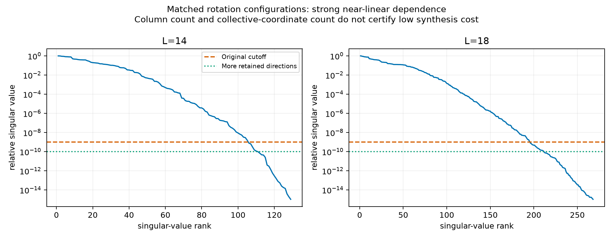
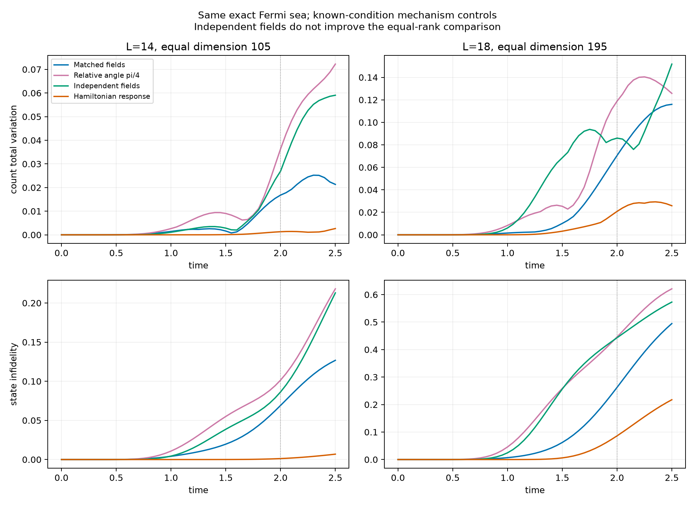
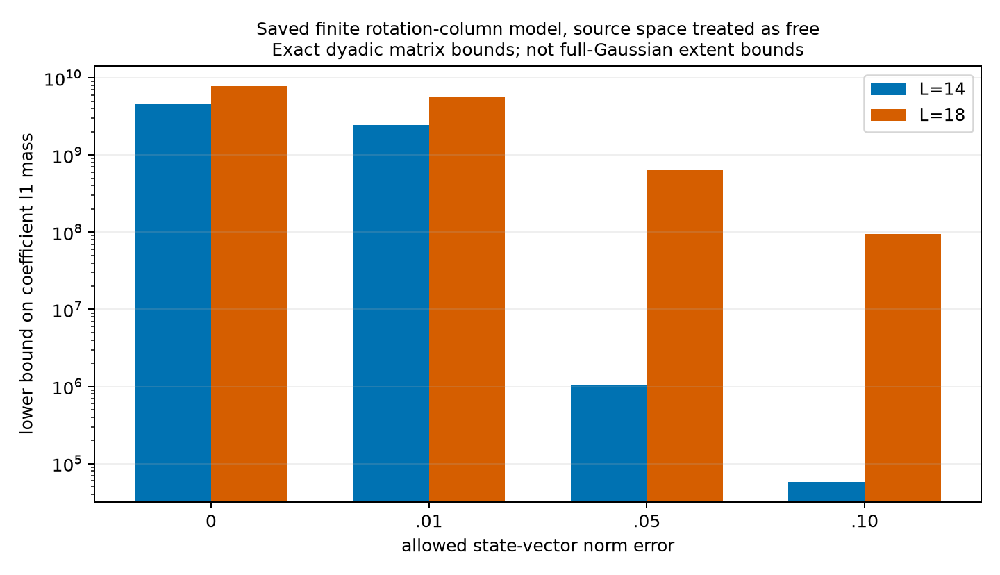

# 第十一轮：非线性场形状改善了表示，但没有形成新的预测机制

普通双源配对场的非线性 Gaussian 旋转，能改善部分晚时计数及相干电流。
然而，在相同初态、相同保留维数下，普通 Hamiltonian 响应仍更准确。
允许粒子／空穴独立形变的表面优势，也没有通过这一维数控制。
本轮没有发现 canonical 分布独有的重要物理结构，用户要求的第三阶段仍未完成。

本轮使用全部八块 H20 检查一般 Gaussian 的局部模式；CPU 完成旋转空间与机制对照。
共保存 74 个几何／精细化模型记录、7 个删除或补充对照、8 个同维数对照。
这些旋转实验只有两个已查看的物理条件，不能当作 89 次独立新预测。
公式、构型归一化及证书范围见 [ROTATION_GEOMETRY.md](ROTATION_GEOMETRY.md)。

## 1. 局部峰没有识别出源场之外的可靠新构型

五个源点包括角向 L=10、G=4、等强通道的 t=0.5、1、2，
以及原均匀 L=12、G=2 的 t=1、2.15。
每点分别对直接态和完整 k=2 witness 做 32 次 onsite 局部搜索，共 320 次。
随后八组一般复反对称配对矩阵搜索，每组四次，从相应 onsite 模式附近初始化。

直接态与归一化 witness 的射线保真度在 0.98676—0.99786；
这不是其 Gaussian 峰彼此的保真度。角向 t=0.5、1 的最强 onsite 模式
已落在原源场的圆周相位形状中，t=2 的最强找到模式接近费米海边界。
一般 Gaussian 的局部搜索相对 onsite 分数最多增加 $4.96\times10^{-10}$。

没有找到额外局部改进，不能证明不存在其他一般 Gaussian 最优构型。
局部峰、初始化吸引域频率和完整测度质量也不能互相替代；
本轮没有新增 canonical 测度抽样或完整相干积分。

## 2. 已有场的非线性形变能承载更多高谐波

自旋旋转把原双源场 $f$ 变成
$z=A f+(A^3/3)\lvert f\rvert^2f+\cdots$ 的 Thouless 形状。
因此，“出现额外 Fourier 分量”不自动意味着“增加独立配对场”。
这为前几轮高谐波结果增加了一个必须保留的常规替代解释。

在 L=14、18，G=4、等强通道，从同一精确费米海传播到 t=2：

| L | 冻结空间 | 保留维数 | 保真度 | 计数 TV | 扇区净电流 L1 误差 |
|---|---|---:|---:|---:|---:|
| 14 | 两源线性 Thouless 空间 | 17 | 0.370035 | 0.299134 | 1.710042 |
| 14 | 加入匹配旋转，16 方向 | 105 | 0.930854 | 0.016811 | 0.086482 |
| 18 | 两源线性 Thouless 空间 | 31 | 0.281642 | 0.424719 | 2.067198 |
| 18 | 加入匹配旋转，16 方向 | 195 | 0.737477 | 0.070508 | 0.291461 |

这里的相干扇区系数全部自由。16 方向乘四幅度并非 16 个 Gaussian，
也不是只有两个传播自由度；对称化、数目扇区及 SVD 会产生许多相干列。
完整对称空间维数为 170、1530。

将奇异值截断由 $10^{-9}$ 降到 $10^{-10}$，同一原始列池的秩变为 110、211。
对应 t=2 的保真度变为 0.933674、0.743655；
整个时间网格的最大态向量变化为 0.0760、0.1590。
这是改变保留空间容量，不能称为 ODE 精度检查或已证明收敛。
另用种子 862、64 方向的保真度为 0.932048、0.746232；
同样不证明整个连续旋转流形已收敛。

## 3. 同维数控制撤回了独立形变的优势解释

不限制秩时，独立粒子／空穴场在 L=14 的保真度达到 0.999278，
但保留 153 维，已接近完整的 170 维；L=18 则使用 339 维。
因此必须先控制表示容量，再判断是否发现了必要的新物理坐标。

对三个场族保留同一个两源基底，并取等范数残余列的主 SVD 方向。
普通对照从该基底反复施加 Hamiltonian，直到相同维数。
所有模型保持精确费米海初态。下表仍是 t=2：

| L／维数 | 构型或响应规则 | 保真度 | 计数 TV | 扇区净电流 L1 误差 |
|---|---|---:|---:|---:|
| 14／105 | 匹配场 | 0.930854 | 0.016805 | 0.086426 |
| 14／105 | 粒子／空穴相对旋转 π/4 | 0.898515 | 0.036356 | 0.265112 |
| 14／105 | 独立场 | 0.913624 | 0.026938 | 0.256607 |
| 14／105 | Hamiltonian 块响应 | 0.998769 | 0.001307 | 0.005192 |
| 18／195 | 匹配场 | 0.737501 | 0.070499 | 0.291415 |
| 18／195 | 粒子／空穴相对旋转 π/4 | 0.554141 | 0.118796 | 0.494034 |
| 18／195 | 独立场 | 0.556888 | 0.085969 | 0.644354 |
| 18／195 | Hamiltonian 块响应 | 0.913812 | 0.020804 | 0.128435 |

两种 SVD 构造在截断处略有不同，所以匹配场与上一表有微小差异。
同维数结果不支持“独立粒子／空穴形变已解释强对照遗漏的物理偏差”。
它也不是所有连续场族的最优比较或相同总计算预算证明。

## 4. 仅补齐一次转移的暗模式不能修复主要误差

重新利用精确对称性后，L=14 的四谐波 Gaussian 空间 q4，
从原环境空间 2233 维降到实际不变部分 116 维。
其传播与原结果的最大态差为 $7.25\times10^{-14}$。
所以不能继续以 2233 维作为该对照在本初态下的必要有效成本。

| L=14，t=2 | 维数 | 保真度 | 计数 TV |
|---|---:|---:|---:|
| q4 | 116 | 0.636663 | 0.057622 |
| q4 加一次转移的均匀模式 | 117 | 0.636496 | 0.057617 |
| q4 加全部一次转移模式 | 118 | 0.639627 | 0.057329 |

反过来，从完整对称空间只删除均匀一次转移方向，L=14、18 的保真度
仍为 0.986587、0.998692；删除全部非源一次转移方向，仍为 0.966421、0.984129。
这些删除用投影 Hamiltonian 并保留相同初态，是表示机制检查，
不是已经实现的实验干预。均匀 Fourier 指标还受有限角网格混叠限制。

这些结果削弱了“单个缺失的一次转移暗模式造成主要晚时误差”的解释。
仍需考察多次转移中的相干组织，但本轮没有识别出新的必要连通结构。

## 5. 少量场坐标不保证有限字典的低系数成本

上述匹配旋转列严重接近线性相关。
对保存的有限 binary64 矩阵，用整数与有理数重新计算了系数质量下界。
目标是该 16 方向模型自身在 t=2 的预测向量；两源空间的系数允许免费。
以下是允许态向量二范数误差 ε 时，旋转扇区列系数的 L1 质量下界摘要：

| ε | L=14 | L=18 |
|---:|---:|---:|
| 0 | $4.58429\times10^9$ | $7.88321\times10^9$ |
| 0.01 | $2.47423\times10^9$ | $5.66120\times10^9$ |
| 0.05 | $1.06589\times10^6$ | $6.33179\times10^8$ |
| 0.10 | $5.78085\times10^4$ | $9.49442\times10^7$ |

完整精确分数保存在两个证书 JSON 中，表中仅显示近似数值。
**证书只适用于保存的矩阵和目标向量，不是理想 Gaussian 原子生成的区间认证，
也不是完整 Gaussian extent、连续场流形或真实精确态的成本下界。**
换一组 Gaussian 原子可能便宜得多。该结果只说明，当前有限表示的较少场坐标
不能据此解释为低成本物理结构，更不能代替第三阶段预测。

## 6. 验证、来源与剩余门槛

84 项测试通过。新增测试覆盖自旋子归一化、独立 Gaussian 振幅、
线性／非线性源空间关系、三次 Fourier 系数、
精确复内积和具有已知解析下界的有限字典例子。
96 个冻结或输入文件哈希通过核对；八个有理证书从输入重新计算一致。
几何传播的最大初态差为 $2.51\times10^{-15}$，最大范数误差为 $5.60\times10^{-14}$；
原精确轨迹的对称性投影误差最大为 $1.83\times10^{-14}$。
这些数值检查不认证全 Gaussian 局部优化，也不把已查看参数变成新预测。

同维数脚本的首次运行因 NumPy 整数不能直接 JSON 序列化而失败；
原部分输出及终止记录保留，修复后完成的目录是 rotation_rank_controls_02。
未将失败记录计入完成数量。

配对 Gaussian 的生成坐标叠加及随时间变化的权重已有文献：
[Hizawa 等（2021）](https://arxiv.org/abs/2012.11123)、
[Li 等（2024）](https://arxiv.org/abs/2309.12564)。
本轮的旋转参数化和高谐波改善不据此声称新颖性。

下一候选必须在实际 canonical 信息中识别强常规响应遗漏的多次转移相干结构，
在未看过的物理条件下冻结并预测显著可观测偏差，
再以相同初态删除该结构，使误差重新出现。
本轮增加了这一检验必须面对的强控制，没有通过它。
原有严格但极弱的一般 PG 首脉冲排除证书仍保留在
[WEIGHTED_GAUSSIAN_BOUND.md](WEIGHTED_GAUSSIAN_BOUND.md)，两种证书的对象不可混淆。

完整指标见 [audit.json](results/assessment_rotation_geometry_01/audit.json)，
本轮代码数据快照见 [checkpoint_manifest.json](results/assessment_rotation_geometry_01/checkpoint_manifest.json)。
