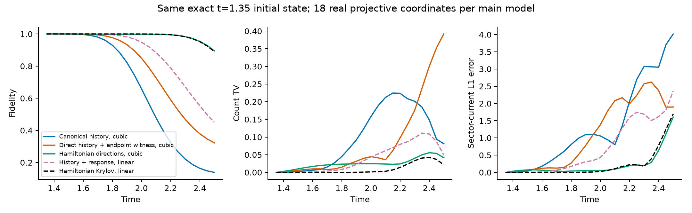
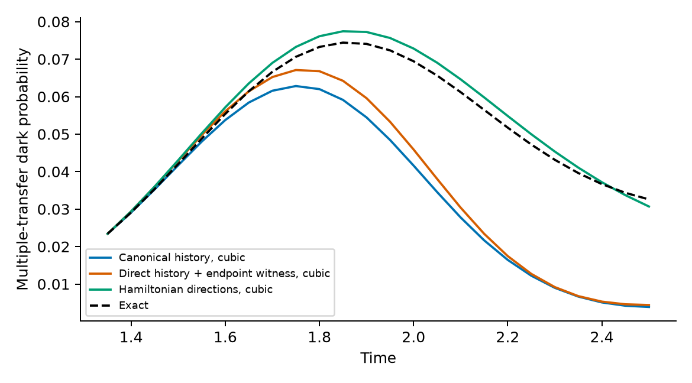
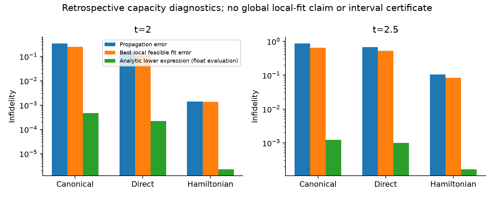

# 第十四轮：保留时间相干交叉项的非线性传播仍未通过强对照

本轮检验了“静态选模丢失分布时间信息”的替代解释。
将八个早期时刻的完整 Gaussian 合成解组织成冻结的十复维空间，
保留全部三次相干交叉项，并按 Hamiltonian 变分原理推进。
结果仍未建立 canonical 历史的独有预测优势。
**用户要求的重要新物理和第三阶段真正未见条件预测仍未完成。**

这次不是重复上一轮静态本征方向：非线性族具有 18 个实物理自由度，
其多项式系数的线性包络实际覆盖全部 170 维对称空间。
但这不意味着十个复坐标能独立控制所有多项式系数。
定义、传播方程和解析距离不等式见 [TEMPORAL_CUBIC_GEOMETRY.md](TEMPORAL_CUBIC_GEOMETRY.md)。

## 1. 训练、同初态与删除

训练时刻为 t=0.30 到 1.35 的八个点，训练计算没有读取之后的参考态。
全部八块 H20 分别处理八次合成及三类完整三次张量的分块收缩。
生成八个模型、16 条同初态轨迹，并完成八条加严数值复核。

主要三次流形分别由 canonical 历史、普通物理态历史、Hamiltonian 方向构成。
三者共同包含 F 和终点 canonical witness，以精确匹配 F 及 t=1.35 两种初态。
因此普通历史对照准确地说是“终点 canonical 加普通历史”，不是完全未优化分布。
删除模型只保留这两个共同方向，初态保持相同。
普通十维线性历史／响应和 Krylov 空间也使用相同初态。

这仍是已查看参数条件的先导，没有将训练后时间点冒充新的物理 holdout。

## 2. 从同一 t=1.35 态出发的 t=2 结果

| 方法 | 实物理自由度 | 保真度 | 计数 TV | 电流 L1 | 暗概率绝对误差 |
|---|---:|---:|---:|---:|---:|
| 删除历史，仅保留共同三次流形 | 2 | 0.086003 | 0.267974 | 3.398866 | 0.047273 |
| canonical 历史，完整三次合成 | 18 | 0.659289 | 0.158083 | 1.058129 | 0.027834 |
| 普通历史加共同 witness，三次合成 | 18 | 0.849155 | 0.044640 | 1.380915 | 0.023543 |
| Hamiltonian 方向，三次合成 | 18 | 0.998604 | 0.024565 | 0.053384 | 0.003391 |
| 普通历史加响应，线性空间 | 18 | 0.948526 | 0.043646 | 0.430685 | 0.007548 |
| 普通 Hamiltonian Krylov，线性空间 | 18 | 0.999887 | 0.001437 | 0.027281 | 0.000069 |

canonical 的电流指标优于普通历史三次模型，但计数和暗概率更差，
也没有超过两类普通线性对照。
从 F 出发时结论相同：canonical 的 t=2 保真度为 0.659244，
普通历史三次模型为 0.850647，Hamiltonian 三次模型为 0.995986。
两个预先声明的联合门槛均未通过。
局部自由度相同不等于预计算或总计算成本相同。

## 3. 训练点瞬时误差较小，不保证后期预测

在共同训练终点，canonical 变分速度相对精确 Schrödinger 速度的范数误差为 0.02152，
普通历史和 Hamiltonian 三次模型分别为 0.10289、0.12653。
然而，后两者的后续预测更好。
因此，这个训练点的更小瞬时误差不能被解释为已经找到正确的后期相干机制。

在冻结预测之后，对三个非线性族分别在 t=1.35、2、2.5 做六起点局部拟合。
这九个拟合案例、54 个起点都是事后容量诊断，绝不是预测。

| 三次流形 | t=2 已找到的可行保真度 | t=2.5 已找到的可行保真度 |
|---|---:|---:|
| canonical 历史 | 0.749744 | 0.347358 |
| 普通历史 | 0.888149 | 0.473707 |
| Hamiltonian 方向 | 0.998651 | 0.916096 |

这些是局部可行解，不是全局最优上界。它们提示冻结结构值得检查，
但不能单凭局部拟合失败证明结构必然不足。

## 4. 一个不依赖局部拟合的解析检查

针对本固定数目、无未配对电子空间，利用 Cartan 块的交换对称性和精确有理行和，
得到 L=14 的正下界

$$
\mu=\frac{1301961}{8388608}.
$$

它给出

$$
\|C_2(u)-C_2(v)\|
\ge\frac{\mu}{8}\|u\|^2\|u-v\|.
$$

因此，晚期合成解与冻结 witness 空间的距离，
可通过明确公式限制整个受限非线性族的保真度。
晚期 witnesses 是在所有预测冻结、评价之后计算，未被拿来重新训练。

在 t=2，三个族的“失保真度下界表达式”的浮点代入分别为：

| 冻结三次流形 | 解析下界表达式的数值 |
|---|---:|
| canonical 历史 | $4.7321\times10^{-4}$ |
| 普通历史 | $2.2087\times10^{-4}$ |
| Hamiltonian 方向 | $2.2715\times10^{-6}$ |

公式是解析的；输入残差与子空间距离的计算还不是区间算术，
所以这里不声称精确物理态的认证保真度界。
这些值也远不足以证明上一表中较大的局部拟合误差是必然的。
它们限定的是冻结三次族，不是完整 Gaussian 字典，也不是一般 projected Gaussian 态。

## 5. 数值可靠性与剩余任务

105 项测试通过，覆盖非全纯导数、真正非 Kähler 切空间的 Hamiltonian 方程、
完整空间 Schrödinger 演化，以及强单调性公式的独立检查。
传播原则本身已有几何理论基础，见
[Hackl 等（2020）](https://arxiv.org/abs/2004.01015)，不能据此声称新方法或新物理。

早期合成最大残差为 $2.79\times10^{-14}$；
预计算张量对随机复坐标的独立重构误差低于 $3.37\times10^{-15}$。
最大初态差为 $5.28\times10^{-13}$，能量漂移低于 $2.22\times10^{-12}$。
加严容差与步长后，最大相位对齐态变化为 $5.13\times10^{-12}$。
54 个输入、合成、张量、预测或诊断文件哈希已核查。

本轮排查了一个具体的时间信息利用方案，不能据此否定所有 Gaussian 分布路线。
但它也没有给出可解释、可迁移、强基线遗漏的连通多次转移结构。
后续仍须把实际分布的相干信息落实到物理构型坐标，
在非线性连通簇、自适应 Gaussian 和 Hamiltonian 响应之外产生重要预测，
并在真正未见条件和相同初态的删除实验中确认。
不能将这里的表示障碍或数值验证替代该目标。

完整指标见 [audit.json](results/assessment_temporal_cubic_01/audit.json)，
当前文件摘要见 [checkpoint_manifest.json](results/assessment_temporal_cubic_01/checkpoint_manifest.json)。
